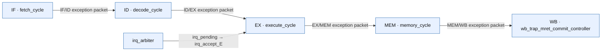

# G1 five-stage trap path

Scope: As-coded synchronous exception and interrupt packet path through the active RV32 core; no timing or verification closure claim.

Source identity: `RISCFORGE_1TOPS-main/rtl worktree; six active RTL SHA-256 hashes combined` @ `worktree-sha256:1c138abb1a5cb11b9580baa228b4aefc8b34c14fbeb0a3f8eba3e49033c41dfc`. Spec: `trap_pipeline.spec.json` (sha256 `96790837eae1`).

| Element | Status | Source | Symbol |
|---|---|---|---|
| IF | present | `ips/riscv_core/rtl/fetch_cycle.v:191` | `assign exc_valid_F` |
| ID | present | `ips/riscv_core/rtl/decode_cycle.v:418` | `assign new_exc_valid_D` |
| EX | present | `ips/riscv_core/rtl/execute_cycle.v:502` | `assign irq_accept_E` |
| MEM | present | `ips/riscv_core/rtl/memory_cycle.v:132` | `wire exc_valid_mem_local` |
| WB | present | `ips/riscv_core/rtl/wb_trap_mret_commit_controller.v:64` | `assign trap_commit` |
| IRQ | present | `ips/riscv_core/rtl/top.v:236` | `irq_arbiter u_irq_arbiter` |
| IF -> ID | present | `ips/riscv_core/rtl/fetch_cycle.v:307` | `exc_valid_reg <= exc_valid_F` |
| ID -> EX | present | `ips/riscv_core/rtl/decode_cycle.v:368` | `exc_valid_r <= next_exc_valid_D` |
| EX -> MEM | present | `ips/riscv_core/rtl/execute_cycle.v:468` | `exc_valid_r <= next_exc_valid_E` |
| MEM -> WB | present | `ips/riscv_core/rtl/memory_cycle.v:276` | `exc_valid_r      <= exc_valid_mem_final` |
| IRQ -> EX | present | `ips/riscv_core/rtl/top.v:419` | `.irq_pending_i(irq_pending)` |

Unknown / not inspected (deliberately not drawn as fact):
- Runtime ordering and precise side-effect behavior are not asserted by this static path diagram.
