# IRQ source-to-interface map

Scope: How the 13 serviced channels travel from SoC peripheral IRQ outputs through the subsystem ports, the core gateway and arbiter, to trap commit. Static wiring only: it does not show peripheral register clearing, firmware, nesting, or any executed interrupt.

```mermaid
flowchart LR
  PERIPH["Peripheral IRQ outputs: Timer 0, Timer 1, UART, SPI, I2C, GPIO"]:::present
  SOC["subsystem fast_irq_i[15:0] / timer_irq_i"]:::present
  RAW["core irq_raw[12:0] = {fast_irq_i[11:0], timer_irq_i}"]:::present
  GW["irq_gateway: edge latch for GPIO, event latch for timers/SPI, level pass-through for I2C/UART"]:::present
  ARB["irq_arbiter: class 2 fixed order, class 1 and 0 round robin, mintprio gate"]:::present
  EX["execute_cycle accepts the interrupt on a valid EX item"]:::present
  WB["WB commit: trap entry, one-hot gateway clear, round-robin advance"]:::present
  MIP["mip[11] MEIP and mip[3] MSIP bits (ext_irq_i, sw_irq_i tied to 0)"]:::present
  PLIC["PLIC (absent)"]:::absent
  CLIC["CLIC (absent)"]:::absent
  PERIPH -->|"peripheral IRQ pins"| SOC
  SOC -->|"fast_irq_i / timer_irq_i ports"| RAW
  RAW -->|"irq_raw_i"| GW
  GW -->|"pend_gateway"| ARB
  ARB -->|"irq_pending, irq_id, irq_class"| EX
  EX -->|"tagged trap packet through EX/MEM and MEM/WB"| WB
  WB -->|"clear_gateway_o, one-hot per committed cause"| GW
  WB -->|"wb_commit_irq advances the matching round-robin pointer"| ARB
  MIP -.->|"no delivery path: arbiter masks only mie[27:16], mie[7]"| ARB
  PLIC -.->|"not instantiated"| ARB
  CLIC -.->|"not instantiated"| RAW
  classDef present fill:#e8f1ff,stroke:#2b6cb0,color:#111
  classDef planned fill:#fff8e1,stroke:#b7791f,stroke-dasharray:5 3,color:#111
  classDef absent fill:#fdecea,stroke:#c53030,stroke-dasharray:2 2,color:#111
  classDef uninspected fill:#f2f2f2,stroke:#888,stroke-dasharray:2 4,color:#444
```

Source identity: `RISCFORGE_1TOPS-main/rtl worktree; subsystem, core IRQ RTL and the five peripheral IRQ sources combined` @ `worktree-sha256:1f0f44a12a3c2c4d48d2cbb734f73ecce3ac770036423694df3f8e0bde456a90`. Spec: `irq_source_map.spec.json` (sha256 `f9cd012f4102`).

| Element | Status | Source | Symbol |
|---|---|---|---|
| PERIPH | present | `ips/RTL_SOC/riscforge_soc_subsystem.sv:1068` | `.interrupt_o( i2c_interrupt_o` |
| SOC | present | `ips/RTL_SOC/riscforge_soc_subsystem.sv:1280` | `.fast_irq_i     ( { 4'b0,` |
| RAW | present | `ips/riscv_core/rtl/top.v:212` | `wire [12:0] irq_raw = {fast_irq_i[11:0], timer_irq_i};` |
| GW | present | `ips/riscv_core/rtl/top.v:220` | `irq_gateway u_irq_gateway (` |
| ARB | present | `ips/riscv_core/rtl/top.v:236` | `irq_arbiter u_irq_arbiter (` |
| EX | present | `ips/riscv_core/rtl/top.v:419` | `.irq_pending_i(irq_pending),` |
| WB | present | `ips/riscv_core/rtl/wb_trap_mret_commit_controller.v:78` | `assign wb_commit_irq_o     = trap_commit & trap_is_interrupt_o;` |
| MIP | present | `ips/RTL_SOC/riscforge_soc_subsystem.sv:1294` | `.ext_irq_i      ( 1'b0                )` |
| PLIC | absent | `Searched riscforge_soc_subsystem.sv: no PLIC instance and no plic port; MEIP is driven by the constant 1'b0 at line 1294, and irq_arbiter.v:20 masks only mie[27:16] and mie[7].` | `` |
| CLIC | absent | `ips/clic-master/ exists as standalone RTL. Searched riscforge_soc_subsystem.sv for a clic instance and csr_regfile.v for mintstatus/mtvt/mnxti; none found.` | `` |
| PERIPH -> SOC | present | `ips/RTL_SOC/riscforge_soc_subsystem.sv:1289` | `uart_int_o,` |
| SOC -> RAW | present | `ips/riscv_core/rtl/top.v:212` | `irq_raw = {fast_irq_i[11:0], timer_irq_i}` |
| RAW -> GW | present | `ips/riscv_core/rtl/top.v:223` | `.irq_raw_i   (irq_raw),` |
| GW -> ARB | present | `ips/riscv_core/rtl/top.v:239` | `.pend_i          (pend_gateway),` |
| ARB -> EX | present | `ips/riscv_core/rtl/top.v:419` | `.irq_pending_i(irq_pending),` |
| EX -> WB | present | `ips/riscv_core/rtl/top.v:551` | `.trap_cause_o(trap_commit_cause),` |
| WB -> GW | present | `ips/riscv_core/rtl/wb_trap_mret_commit_controller.v:92` | `assign clear_gateway_o = clear_gateway_r;` |
| WB -> ARB | present | `ips/riscv_core/rtl/top.v:243` | `.wb_commit_i     (wb_commit_irq),` |
| MIP -> ARB | absent | `ips/riscv_core/rtl/irq_arbiter.v:20` | `wire [12:0] active = pend_i & {mie_i[27:16], mie_i[7]} &` |
| PLIC -> ARB | absent | `-` | `` |
| CLIC -> RAW | absent | `-` | `` |

Unknown / not inspected (deliberately not drawn as fact):
- Peripheral internal clear and re-arm timing is documented from the peripheral RTL but is not drawn here.
- Firmware handlers, nesting protocol and interrupt latency are outside this map.
- G3.6 timer-to-handler integration and G6 end-to-end behavior are not established by this wiring.
