# CSR and trap corner-case verification — status and evidence

**Date:** 11 November 2026 · **Scope:** `tb_csr_corner_unit`, `tb_core_csr_trap`, their coverage model and retained XSim runs.

This page replaces nothing. It records the current state of the benches described in
[CSR_TRAP_CORNER_TESTPLAN.md](../../../Verification/doc/plans/CSR_TRAP_CORNER_TESTPLAN.md) and
[CSR_TRAP_TESTBENCH_ARCHITECTURE.html](../../../Verification/doc/architecture/CSR_TRAP_TESTBENCH_ARCHITECTURE.html), which remain the plan and architecture records.
Folder map and filing rule: [doc/README.md](../../../Verification/doc/README.md).

---

## 1. Status at a glance

| Item | State | Basis |
|---|---|---|
| Unit bench `tb_csr_corner_unit` | **Implemented, compiles, simulates** | 552 checked assertions, 0 failures, 8936 ns |
| Unit stimulus | **Implemented** — 5 directed suites, 236 cases | [`tb_csr_corner_unit.sv`](../../../Verification/infrastructure/tb/tb_csr_corner_unit.sv) |
| Unit coverage bins | **Implemented as observed-attempt bins** — 5 groups, 236 bins, 100% hit | [`csr_trap_coverage_pkg.sv`](../../../Verification/infrastructure/tb/csr_trap/csr_trap_coverage_pkg.sv) |
| Core bench `tb_core_csr_trap` | **Skeleton only** — compiles, elaborates, 30 ns reset-held | `checks=0`, `SKELETON/INCOMPLETE` |
| Core stimulus / reference model / bins | **Absent** | no program, response schedule or `c_*` sample exists |
| Running the benches | **Scripted** | [`run_csr_trap_units.ps1`](../../../Verification/run_csr_trap_units.ps1) |
| Claimed signoff credit | **None** | no gate, no waiver, no closure is claimed here |

---

## 2. Source identity

- Checkout: `RISCFORGE_1TOPS-main/rtl/ips`, local Windows worktree backed by git branch `verification_infra` at commit `cd0660d` (remote head `d1ec0de`); working tree is dirty with this session's changes. **Identity is still content-based** because the local commit does not match the remote head and the run was not tied to a commit: `sha256:9e68edc9…3903d3c`, the digest of the run's `source_sha256.txt`.
- Integrity tool re-hashed all 10 tracked files (benches, interfaces, packages, filelists, `csr_regfile.v`) against the run record: **10/10 match**. The logs therefore describe the code now on disk.
- Tool: Vivado XSim 2022.2 (`xvlog`/`xelab`/`xsim`), Windows, `-timescale 1ns/1ps`, `-debug typical`.

---

## 3. RTL under test

The unit bench drives the real [`csr_regfile.v`](../../../riscv_core/rtl/csr_regfile.v); nothing is stubbed.

**Interface.** 31 ports: clock/reset, combinational read port A, synchronous normal write port B, MRET write port C, six trap inputs, retirement and four interrupt-pending inputs, eight sideband outputs. All 31 are connected by name.

**State.** `mstatus` (WARL mask `0x0000188A`), `mie` (`0xFFFF0888`), `mtvec` (`0xFFFFFFFC`), `mscratch`, `mepc`, `mcause`, `mtval`, `mintprio[1:0]`, and 64-bit `mcycle`/`minstret`.

**Write priority (one `always` block, `csr_regfile.v:159-200`).**

1. Trap entry wins: writes `mepc`/`mcause`/`mtval`, clears MIE, saves old MIE to MPIE, sets MPP.
2. Otherwise MRET: MIE ← MPIE, MPIE ← 1, MPP ← 11.
3. Otherwise Port B commits one CSR write with its per-register mask.

**Consequences confirmed by the run.**

- A trap or MRET in the same cycle as a normal CSR write **drops that write file-wide**, for every target the event does not itself write. Observed: `mie` stays `0x12340008`, `mtvec` stays `0x12345678`.
- `mip.MSIP` is the exception: a separate process (`csr_regfile.v:208-215`) commits bit 3 even while trap suppresses Port B. Observed: `mip = 0x00000008`.
- Counters increment every clock regardless of the chain, and a Port B counter write overrides the increment (later non-blocking assignment).
- `mtvec[1:0]` is not software-writable, so vectored mode is unreachable from software.

The approved-contract analysis for these points, with line references and gaps, is
[CSR_and_Trap_Model.md §3.8](../../../documentation/signoff/CSR_and_Trap_Model.md). The RTL matches that document; **whether the file-wide suppression is the intended contract is still open** (§8).

---

## 4. Stimulus we drive

`tb_csr_corner_unit` is module-based SystemVerilog. Signals are driven on the falling edge and sampled after the rising edge, so every check sees settled state.

| Suite | Cases | Stimulus | Expected result | Checked |
|---|---|---|---|---|
| `status_cases` | 8 | trap or MRET × old MIE {0,1} × old MPIE {0,1}; `mscratch` preloaded `0x12345678` | MIE/MPIE follow trap-entry or MRET rules; unrelated state preserved | yes, 3 checks/case |
| `metadata_cases` | 168 | 21 causes × `mepc` {0, `0x80000124`} × `trap_addr_valid` {0,1} × `tval` {0, `0x87654321`} | `mepc` = trap PC; `mcause` = interrupt bit \| code; `mtval` = value only when valid | yes, 3 checks/case |
| `collision_cases` | 40 | normal write `0x89ABCDEF` × {trap, MRET, trap+MRET} × 13 CSR targets, plus trap+MRET with no write | write priority per register, preservation | **no — observation only** |
| `counter_cases` | 16 | `mcycle`/`minstret` 64-bit rollover, and low/high-half writes colliding with trap/MRET | rollover and write-vs-increment order | **no — observation only** |
| `reset_cases` | 4 | synchronous reset asserted during write / trap / MRET / write+trap | all CSR state and both counters return to 0 | yes, 6 checks/case |

The 13 collision targets are `mstatus`, `mie`, `mtvec`, `mscratch`, `mepc`, `mcause`, `mtval`, `mintprio`, `mip`, `mcycle`, `mcycleh`, `minstret`, `minstreth`.

Reset is asserted between cases, so no state leaks from one scenario into the next.

---

## 5. Coverage bins

All bins are **index bins**: one bin per planned case, sampled when the case runs. Closure credit is therefore *attempt/observation*, not value or priority coverage.

| Group | Bins | Sampled | Meaning |
|---|---|---|---|
| `u_status` | 8 | 8 | every trap/MRET × MIE × MPIE combination executed |
| `u_metadata` | 168 | 168 | every cause × PC × valid × value combination executed |
| `u_collision` | 40 | 40 | every write/event/target combination executed (no assertion) |
| `u_counter` | 16 | 16 | both counters, rollover and both write halves under all three events |
| `u_reset` | 4 | 4 | reset during each event combination |
| **Total** | **236** | **236** | reported `OBSERVED_COVERAGE|…|100.000` for each group |

Not covered by these bins: register-value distributions, mask corners (e.g. every `mstatus`/`mie` bit), cross combinations such as cause × priority, and any core-level bin (`c_exception`, `c_csr_dependency`, `c_irq_delivery`, `c_irq_order`, `c_irq_phase`, `c_m_interrupt`, `c_exception_overlap`, `c_mret`) — those groups exist in the package but are never sampled.

---

## 6. Results and evidence

Command (from `rtl/ips/Verification`; `py Verification/tools/test_unit.py` is an equivalent wrapper):

```powershell
pwsh -NoProfile -File .\run_csr_trap_units.ps1
```

| Bench | Marker | End time | Artifact |
|---|---|---|---|
| `tb_csr_corner_unit` | `UNIT_DONE\|checks=552\|failures=0\|spec_pending=56` | 8936 ns | [`artifacts/csr_trap_units_20261111_175150/csr_corner_unit/`](../../../Verification/artifacts/csr_trap_units_20261111_175150/csr_corner_unit) |
| `tb_core_csr_trap` | `SKELETON/INCOMPLETE; checks=0; failures=0` | 30 ns | [`…/core_csr_trap/`](../../../Verification/artifacts/csr_trap_units_20261111_175150/core_csr_trap) |

Each artifact directory holds `compile.log`, `elaborate.log`, `simulation.log`, `sources.f`, `run.tcl`.

**Arithmetic of 552 checks:** 8×3 (status) + 168×3 (metadata) + 4×6 (reset) = 552. `spec_pending=56` is 40 collision + 16 counter cases that print observed values without an expected result.

**Compilation quality:** unit compile/elaborate logs contain zero warnings and zero errors. The core build emits pre-existing RTL width warnings in `rv32m_mul.v` and three unconnected ports inside `top.v`; none originate in the bench.

---

## 7. Integrity re-verification

[`tools/check_csr_trap_docs.py`](../../../Verification/tools/check_csr_trap_docs.py) re-derives the documented claims from source and logs rather than trusting this page.

```
PASS  CSR unit: all csr_regfile ports connected          31/31 named
PASS  Core bench: all top ports connected                21/21 named
PASS  tb_csr_corner_unit.f: every source exists          4 listed, 0 missing
PASS  tb_core_csr_trap.f: every source exists            39 listed, 0 missing
PASS  Evidence hashes match current sources              10/10 match
PASS  Unit: UNIT_DONE marker present and zero failures
PASS  Unit: 552 checks / 56 spec-pending
PASS  Unit: finish time 8936 ns
PASS  Core: skeleton marker and 30 ns finish
PASS  Unit: every planned bin sampled once               236 of 236 bins
10/10 checks passed
```

Run it again after any bench edit; a failure means this page or the diagram is stale.

---

## 8. Explanatory evidence — what exists and what does not

**Exists.**

- RTL contract with line-level citations for every CSR, mask, priority path and open observation (O1–O15): [CSR_and_Trap_Model.md](../../../documentation/signoff/CSR_and_Trap_Model.md).
- Written plan allocating every unit and core bin: [CSR_TRAP_CORNER_TESTPLAN.md](../../../Verification/doc/plans/CSR_TRAP_CORNER_TESTPLAN.md) §4–§7.
- Architecture and ownership record: [CSR_TRAP_TESTBENCH_ARCHITECTURE.html](../../../Verification/doc/architecture/CSR_TRAP_TESTBENCH_ARCHITECTURE.html).
- Retained logs and hashes for the runs above, plus the earlier skeleton-only closure check under `artifacts/csr_trap_closure_check_20261111/`.
- This page's validated diagram (§9).

**Does not exist.**

- **No independent reference model.** Expected values are literals inside the test; they are not produced by a separately reviewed CSR/trap model. The checks are direct RTL-versus-intent comparisons, not model-versus-RTL.
- **No checked expectation for 56 of 236 cases.** Collision and counter results are recorded, not judged. The trap/MRET-versus-write priority and MSIP behaviour are therefore *observed*, not *verified*.
- **No core-level behaviour of any kind** (no program, memory effects, hazard or interrupt timing).
- **No coverage database report.** XCRG crashes locally with `0xC0000374`; only the in-simulation covergroup lines exist.
- **No RISCOF evidence** for ordinary CSR access, which the plan assigns elsewhere.

---

## 9. Diagram

Rendered from a validated spec; every solid box and arrow cites a file and symbol. The absent core path is drawn as absent, not implied.

```mermaid
flowchart LR
  PLAN["Test plan: suites and unit bin allocation"]:::present
  UNIT_TB["tb_csr_corner_unit: five directed suites"]:::present
  CSR_IF["csr_corner_if: bench-owned drive signals"]:::present
  DUT["csr_regfile (31 ports)"]:::present
  CHECK["check_word: immediate expected-value compare"]:::present
  COV["observed_corner_coverage: u_status..u_reset"]:::present
  LOG["simulation.log: UNIT_DONE and OBSERVED_COVERAGE"]:::present
  CORE["core scenarios, reference model and core bins (absent)"]:::absent
  PLAN -->|"case list and bin ranges"| UNIT_TB
  UNIT_TB -->|"drive CSR ports at negedge"| CSR_IF
  CSR_IF -->|"31 named port connections"| DUT
  DUT -->|"read_data, mstatus, mepc, mcause"| CHECK
  UNIT_TB -->|"sample_bin(group, index)"| COV
  COV -->|"OBSERVED_COVERAGE report"| LOG
  CHECK -->|"UNIT_DONE checks/failures/spec_pending"| LOG
  PLAN -.->|"core scenarios and c_* bins planned"| CORE
  classDef present fill:#e8f1ff,stroke:#2b6cb0,color:#111
  classDef planned fill:#fff8e1,stroke:#b7791f,stroke-dasharray:5 3,color:#111
  classDef absent fill:#fdecea,stroke:#c53030,stroke-dasharray:2 2,color:#111
  classDef uninspected fill:#f2f2f2,stroke:#888,stroke-dasharray:2 4,color:#444
```



Spec: [`diagrams/csr_trap_unit_verification_chain.spec.json`](../../../Verification/doc/diagrams/csr_trap_unit_verification_chain.spec.json) ·
rendered: [`diagrams/csr_trap_unit_verification_chain.md`](../../../Verification/doc/diagrams/csr_trap_unit_verification_chain.md).
Source identity `worktree-2026-11-11 sha256:9e68edc9…3903d3c`.
It does **not** show the core bench, IRQ arbitration coverage, or how a bin would be credited after an approval decision.

---

## 10. Open decisions before more bins are credited

| # | Decision | Current RTL | Why it blocks |
|---|---|---|---|
| D1 | Is file-wide trap/MRET write suppression intended, or should non-conflicting Port B writes commit? | `csr_regfile.v:159-200` | decides 39 collision expectations |
| D2 | Should an MRET-cycle Port B write to an unrelated CSR commit? | same chain | MRET only needs `mstatus`; suppression is broader |
| D3 | Is `mip.MSIP` write-through during trap intended? | separate process, `csr_regfile.v:208-215` | decides the remaining collision case |
| D4 | Counter write during trap/MRET: is increment retained or the write applied? | increment unconditional; Port B gated by chain | decides 12 counter cases |
| D5 | `mtval` for interrupts: 0, or a driven address? | the unit writes `mtval` from `trap_addr_valid_i` alone; the core gates it with `wb:76` | the metadata suite drives `trap_addr_valid` directly, so an interrupt with valid=1 stores a value here, while the core guarantees 0 |
| D6 | Should unimplemented CSR access stay silent (read 0 / drop write)? | `csr_regfile.v:198` `default: ;` | scope of any illegal-instruction test |

These are contract questions for the owner, not bench defects. Until answered, `spec_pending` is the honest state for those cases.

---

## 11. Next actions

1. Record D1–D6 decisions; convert the 56 observation cases into checks in the same suites.
2. Add a small independent CSR/trap reference model and compare it against `csr_regfile` for the same 236 cases.
3. Build core stimulus in `tb_core_csr_trap`: program load, memory response schedule, ECALL/EBREAK/illegal, CSR dependency and interrupt-arrival windows; then enable the `c_*` groups.
4. Re-run `check_csr_trap_docs.py` and regenerate §9's spec after each change.

---

### Learning checkpoint

Run `counter_cases` boundary index 2 in your head: `minstreth = 0`, `minstret = 0xFFFFFFFF` written by Port B, then one clock with `instr_retired=1`. Predict the 64-bit value and which write wins — then compare with
`UNIT_RESULT|3|2|SPEC_PENDING|0|before=00000000ffffffff|after=0000000100000000`. Explaining why `before` already shows the written value, and why the low half becomes zero instead of staying `FFFFFFFF`, is the same reasoning needed for D4.
