# IRQ unit bench structure

Scope: Four separately instantiated IRQ blocks driven and checked by tb_irq_restructure; not connected pipeline behavior and not SoC integration.

```mermaid
flowchart LR
  STIM["Directed stimulus"]:::present
  BLK["Unit instances: gateway, arbiter, CSR, commit decoder"]:::present
  EXP["Expected behavior: reference + direct checks"]:::present
  COV["Coverage sample after the related check"]:::present
  STIM -->|"TB signals drive block inputs"| BLK
  BLK -->|"irq_valid, irq_id, irq_class observed"| EXP
  EXP -->|"sample only after the check"| COV
  classDef present fill:#e8f1ff,stroke:#2b6cb0,color:#111
  classDef planned fill:#fff8e1,stroke:#b7791f,stroke-dasharray:5 3,color:#111
  classDef absent fill:#fdecea,stroke:#c53030,stroke-dasharray:2 2,color:#111
  classDef uninspected fill:#f2f2f2,stroke:#888,stroke-dasharray:2 4,color:#444
```

Source identity: `RISCFORGE_1TOPS-main/rtl; sorted path:SHA256 lines for current IRQ TB, coverage plan and four RTL files` @ `worktree-sha256:aaf5464efdce025caf69b3f535eb821c0d11f16b5febc7d7b2b8fbb781f5a8a6`. Spec: `irq_unit_bench.spec.json` (sha256 `065a72e3a997`).

| Element | Status | Source | Symbol |
|---|---|---|---|
| STIM | present | `ips/Verification/irq_unit/tb_irq_restructure.sv:242` | `initial begin` |
| BLK | present | `ips/Verification/irq_unit/tb_irq_restructure.sv:25` | `irq_gateway gw (.clk_i(clk), .rst_ni(rst_n), .irq_raw_i(raw),` |
| EXP | present | `ips/Verification/irq_unit/tb_irq_restructure.sv:326` | `found=en && glob && (expected_class+1 > t);` |
| COV | present | `ips/Verification/irq_unit/tb_irq_restructure.sv:329` | `eligibility_cov.sample(i,t,en,glob);` |
| STIM -> BLK | present | `ips/Verification/irq_unit/tb_irq_restructure.sv:25` | `.irq_raw_i(raw)` |
| BLK -> EXP | present | `ips/Verification/irq_unit/tb_irq_restructure.sv:327` | `if (irq_valid !== found || (found && (irq_id != expected_id || irq_class != expected_class)))` |
| EXP -> COV | present | `ips/Verification/irq_unit/tb_irq_restructure.sv:329` | `eligibility_cov.sample(i,t,en,glob);` |

Unknown / not inspected (deliberately not drawn as fact):
- Connected pipeline entry, peripheral source timing, firmware and nesting are not represented.
- The arbiter reference and RTL share one cause-to-vector convention; the diagram does not claim an independent mapping model.
