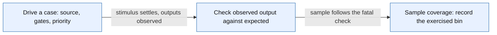

# IRQ unit coverage sampling flow

Scope: How one checked unit case becomes a functional bin in tb_irq_restructure; declared-bin measurement only, not a correctness proof.

Source identity: `RISCFORGE_1TOPS-main/rtl; sorted path:SHA256 lines for current IRQ TB, coverage plan and four RTL files` @ `worktree-sha256:aaf5464efdce025caf69b3f535eb821c0d11f16b5febc7d7b2b8fbb781f5a8a6`. Spec: `irq_unit_coverage_flow.spec.json` (sha256 `191f7155398f`).

| Element | Status | Source | Symbol |
|---|---|---|---|
| DRIVE | present | `ips/Verification/irq_unit/tb_irq_restructure.sv:242` | `initial begin` |
| CHECK | present | `ips/Verification/irq_unit/tb_irq_restructure.sv:327` | `if (irq_valid !== found || (found && (irq_id != expected_id || irq_class != expected_class)))` |
| SAMPLE | present | `ips/Verification/irq_unit/tb_irq_restructure.sv:329` | `eligibility_cov.sample(i,t,en,glob);` |
| DRIVE -> CHECK | present | `ips/Verification/irq_unit/tb_irq_restructure.sv:325` | `threshold=t; mie=en ? (32'b1 << expected_id) : 0; global_mie=glob; #1;` |
| CHECK -> SAMPLE | present | `ips/Verification/irq_unit/tb_irq_restructure.sv:329` | `eligibility_cov.sample(i,t,en,glob);` |

Unknown / not inspected (deliberately not drawn as fact):
- Bins indicate exercised cases; coverage does not establish untested behavior or independent expected results.
- Code coverage closure is not represented and remains open.
