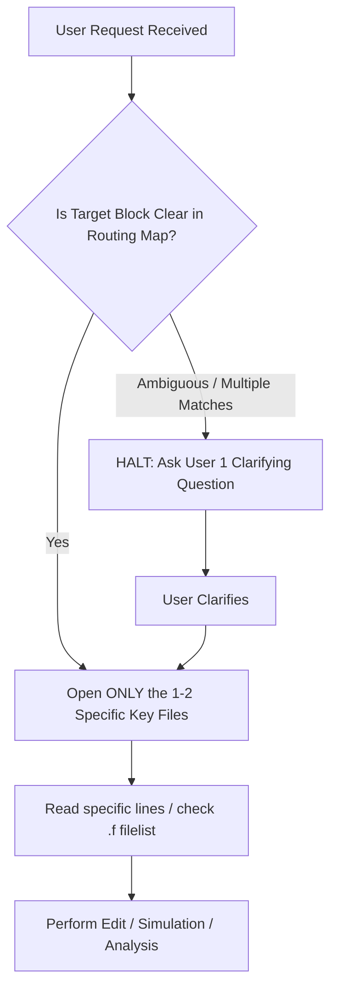

# RISCFORGE SoC & IPs — Agentic Routing & Workflow Optimization Map

> **PURPOSE**: Fast, direct indexing guide for AI models. Prevents exploratory wandering, eliminates mass-file ingestion, and provides instant file/directory lookup for all RISCFORGE components.

---

## ⚡ Core Rules for Efficient AI Agentic Flow

1. **NO MASS INGESTION (Max 1–2 Files)**:
   - NEVER read 10–20 files blindly to gather context.
   - Look up the exact file in the **Routing Directory** below. View ONLY the relevant 50–100 lines.
2. **ASK QUESTIONS INSTEAD OF WANDERING**:
   - If user request is ambiguous or could apply to multiple blocks (e.g., "fix the timer" &rarr; AON vs APB Timer?), **STOP and ask clarifying questions immediately** rather than searching multiple directories.
3. **USE FILELISTS (`.f`) FIRST**:
   - To understand module dependencies or top-level hierarchy, read the local `.f` filelist (e.g., `soc_subsystem.f`, `bootloader.f`), not all RTL files.
4. **PINPOINT SEARCHES**:
   - If searching for a signal or port, use targeted `grep` / PowerShell `Select-String` on the specific file or single directory. Never run recursive full-repo scans.

---

## 🧭 Fast Routing Map: Where to Look

| If the user mentions... | Look Directly Here | Key File(s) to Open |
|:---|:---|:---|
| **SoC Top & Integration** | `RTL_SOC/` | `riscforge_soc_subsystem.sv`<br>`sram_mux.sv`, `sram_sp.sv`<br>`soc_subsystem.f` |
| **RISC-V Core Pipeline** | `riscv_core/rtl/` | `top.v` (Core top)<br>`fetch_cycle.v`, `decode_cycle.v`<br>`execute_cycle.v`, `memory_cycle.v`<br>`writeback_cycle.v` |
| **CSRs, Traps & Exceptions** | `riscv_core/rtl/` | `csr_regfile.v`<br>`wb_trap_mret_commit_controller.v` |
| **Core Hazards & Stalls** | `riscv_core/rtl/` | `hazard_unit.v` |
| **ALU & Multiplier/Divider** | `riscv_core/rtl/` | `ALU.v`, `ALU_Decoder.v`<br>`rv32m_unit.v`, `rv32m_mul.v`, `rv32m_div.v` |
| **Core Memory Interface** | `riscv_core/rtl/` | `hybrid_mem_interface.sv`<br>`imem_controller.v`, `ls_unit.v` |
| **Bootloader & Boot ROM** | `bootloader/`<br>`RTL_SOC/` | `bootloader/bootloader.sv`<br>`bootloader/bootloader_tb_all_testcases.sv`<br>`RTL_SOC/boot_rom.sv`, `instr_fetch_demux.sv` |
| **AXI Crossbar Interconnect** | `axi_lite_xbar/` | `axi_lite_xbar.sv`<br>`tb_axi_lite_xbar.sv` |
| **AXI to APB Bridge** | `axi_lite_to_apb/` | `axi_lite_to_apb.sv`<br>`axi_pkg.sv` |
| **Bus Protocol / Timeout Monitors** | `bus_monitors/` | `axi_lite_timeout_monitor.sv`<br>`apb_timeout_monitor.sv` |
| **UART (APB)** | `apb_uart-main/rtl/` | `apb_uart.sv`, `apb_uart_wrap.sv`<br>`tb_apb_uart_thorough.sv` |
| **Timer 0 / Timer 1 (APB)** | `apb_timer-master/rtl/` | `apb_timer.sv`, `timer.sv` |
| **Always-On Timer (AON)** | `aon_timer/rtl/` | `aon_timer.sv`, `aon_timer_core.sv` |
| **I2C Master (APB)** | `apb_i2c-master/` | `apb_i2c.sv`, `i2c_master_byte_ctrl.sv` |
| **GPIO Controller (APB/AXI)** | `gpio-master/` | `gpio.sv`, `gpio_apb_wrap.sv`<br>`gpio_axi_lite_wrap.sv` |
| **SPI / QSPI Master** | `spi_master_ip/spi_master/` | `apb_spi_master.sv`<br>`spi_master_controller.sv`, `spi_master_fifo.sv` |
| **CLIC / Interrupt Controller** | `clic-master/` | `clic.sv`, `clic_apb.sv`, `clic_target.sv` |
| **External Slave VIP Models** | `i2c_slave_at24c02/`<br>`spi_slave_infinion/` | `i2c_slave_at24c02/`<br>`spi_slave_infinion/S25fs512s/` |
| **Firmware, BSP & Toolchain** | `Sw/` | `Sw/bsp/` (drivers, headers)<br>`Sw/tests/` (C / asm tests)<br>`Sw/tools/` (elf_to_hex, link.ld) |
| **SoC Memory Map & System Spec** | `Sw/`, `documentation/` | `Sw/soc_spec.md`<br>`documentation/RISCFORGE SoC Architecture.html` |
| **Interrupt Specs & Architecture** | `documentation/`<br>`Interrupt research/` | `documentation/RISCFORGE IRQ Architecture.html`<br>`documentation/RISCFORGE IRQ Arbitration Plan.html` |
| **SoC System Verification** | `RTL_SOC/` | `soc_imem_boot_tb.sv`<br>`soc_regtest_tb.sv`, `soc_montest_tb.sv`<br>`soc_timer0_boot_run_tb.sv` |
| **Subsystem Datapath Tests** | `datapath_verification/` | `UART0/`, `i2c0/`, `spi0/`, `timer0/` |
| **Interrupt Test Suite (tb1)** | `Verification/` | `Verification/tb1_interrupts.sv`<br>`Verification/run_tb1.ps1` |
| **Hex / Memory Preload Files** | `mem_files/` | `mem_files/regtest/`, `mem_files/timer/`<br>`mem_files/montest/` |
| **JasperGold (Formal / Superlint)** | `jaspergold/` | `lint.tcl`, `jg_soc.f`, `run_jaspergold.ps1` |
| **SpyGlass (Lint / CDC)** | `spyglass/` | `spyglass.prj`, `run_spyglass.tcl`, `run_spyglass.ps1` |

---

## 🗺️ SoC Address Map Reference (Instant Cheat Sheet)

```
0x0000_0000 – 0x0000_003F : BootROM (64 B)               -> RTL_SOC/boot_rom.sv
0x0001_0000 – 0x0001_7FFF : ISRAM (32 KB Instruction)     -> RTL_SOC/sram_sp.sv
0x0002_0000 – 0x0002_7FFF : DSRAM (32 KB Data)            -> RTL_SOC/sram_sp.sv
0x4000_0000 – 0x4000_0FFF : APB[0] I2C                   -> apb_i2c-master/
0x4000_1000 – 0x4000_1FFF : APB[1] Timer 0               -> apb_timer-master/
0x4000_2000 – 0x4000_2FFF : APB[2] UART                  -> apb_uart-main/
0x4000_3000 – 0x4000_3FFF : APB[3] GPIO                  -> gpio-master/
0x4000_4000 – 0x4000_4FFF : APB[4] SPI Master            -> spi_master_ip/
0x4000_5000 – 0x4000_5FFF : APB[5] Timer 1               -> apb_timer-master/
```

---

## 🚦 AI Agent Action Protocol



1. **Check the Map**: Find the exact directory and file above.
2. **Never Guess Across Modules**: If user says "the timer is failing", ask: *"Are you referring to `aon_timer` or `apb_timer` (Timer 0 / Timer 1)?"*
3. **Keep Context Clean**: Finish the action, summarize concisely, and link directly to the modified file lines.
