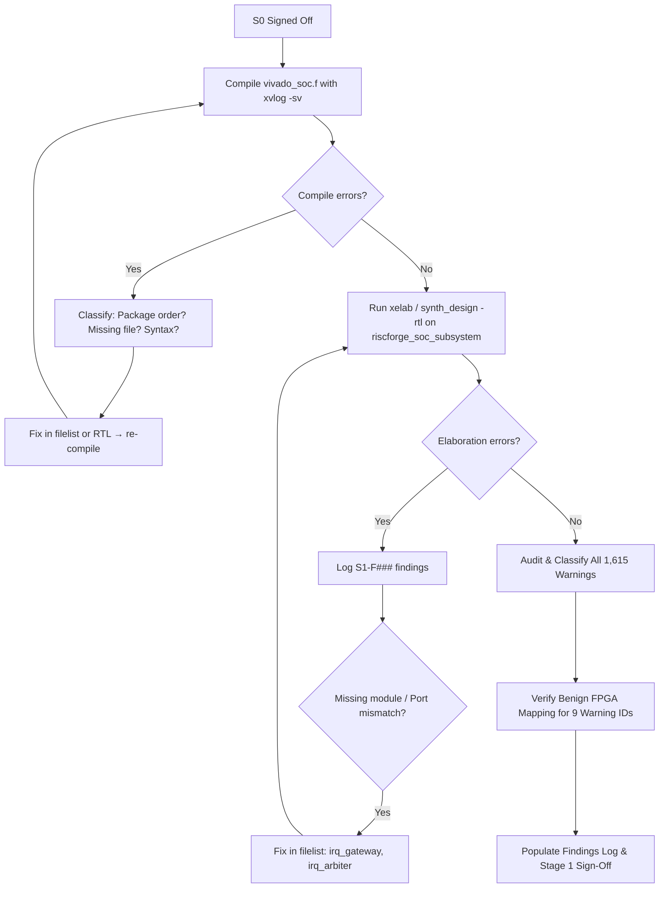

# STAGE 1 — RTL Structural Lint (Vivado XSim Elaboration)
**FPGA-PLAN-S1 | Blocked on S0 Sign-Off**

> **Status**: ⏳ BLOCKED — Waiting for S0 sign-off  
> **Owner**: Orchestrator (vivado-simulate-rtl skill)  
> **Blocker for**: S2 (Structural Analysis)  
> **Sign-Off**: ⬜ PENDING

---

## Objective

Run Vivado XSim elaboration (not simulation) on the full SoC RTL to catch all **elaboration-time structural errors**: undefined modules, port width mismatches, parameter resolution failures, and package import errors. This is the **cheapest and fastest** structural gate before committing to full synthesis.

> [!NOTE]
> This stage uses Vivado XSim **elaboration only** (`xelab` without `xsim`). No testbench is required. The target is clean elaboration of `riscforge_soc_subsystem` as the DUT top.

---

## Checks

### 1.1 — Package Compilation Order

SystemVerilog packages must be compiled before any module that imports them. The current `jg_soc.f` ordering must be validated.

| Package | First consumer module | Order correct? | Status |
|:--------|:----------------------|:--------------:|:------:|
| `cf_math_pkg.sv` | `axi_lite_xbar.sv` | ⬜ TBD | ⬜ |
| `axi_pkg.sv` | `axi_intf.sv` | ⬜ TBD | ⬜ |
| `apb_pkg.sv` | `axi_lite_to_apb.sv` | ⬜ TBD | ⬜ |
| `obi_pkg.sv` | `apb_to_obi.sv` | ⬜ TBD | ⬜ |
| `obi_uart_pkg.sv` | `obi_uart.sv` | ⬜ TBD | ⬜ |
| `gpio_reg_pkg.sv` | `gpio_reg_top.sv` | ⬜ TBD | ⬜ |

---

### 1.2 — Undefined Module / Black-Box Check

Vivado XSim will report any module instantiated but not found in the compile list. Known risk areas:

| Module | Instantiated In | Expected Source | Status |
|:-------|:----------------|:----------------|:------:|
| `apb_uart_wrap` | `apb_uart.sv:52` | `apb_uart_wrap.sv` | ⬜ |
| `apb_to_obi` | `apb_uart_wrap.sv` | `SOC_FILES/include/obi/apb_to_obi.sv` | ⬜ |
| `obi_uart` | `apb_to_obi.sv` | `SOC_FILES/include/obi/obi_uart.sv` | ⬜ |
| `gpio_apb_wrap` | `riscforge_soc_subsystem.sv` | `gpio_apb_wrap.sv` | ⬜ |
| `axi_lite_xbar` | `riscforge_soc_subsystem.sv` | `axi_lite_xbar.sv` | ⬜ |
| `axi_lite_to_apb` | `riscforge_soc_subsystem.sv` | `axi_lite_to_apb.sv` | ⬜ |
| `axi_lite_sram_if` | `riscforge_soc_subsystem.sv` | `axi_lite_sram_if.sv` | ⬜ |
| `sram_mux` | `riscforge_soc_subsystem.sv` | `sram_mux.sv` | ⬜ |
| `sram_sp` | `sram_mux.sv` | `sram_sp.sv` | ⬜ |
| `imem_sram_wrapper` | `riscforge_soc_subsystem.sv` | `imem_sram_wrapper.sv` | ⬜ |
| `instr_fetch_demux` | `riscforge_soc_subsystem.sv` | `instr_fetch_demux.sv` | ⬜ |
| `boot_rom` | `riscforge_soc_subsystem.sv` | `boot_rom.sv` | ⬜ |
| `top` (RISC-V core) | `riscforge_soc_subsystem.sv` | `riscv_core/rtl/top.v` | ⬜ |
| `hybrid_mem_interface` | `riscforge_soc_subsystem.sv` | `hybrid_mem_interface.sv` | ⬜ |
| `bootloader` | `riscforge_soc_subsystem.sv` | `bootloader/bootloader.sv` | ⬜ |
| `apb_timeout_monitor` | `riscforge_soc_subsystem.sv` | `bus_monitors/apb_timeout_monitor.sv` | ⬜ |
| `axi_lite_timeout_monitor` | `riscforge_soc_subsystem.sv` | `bus_monitors/axi_lite_timeout_monitor.sv` | ⬜ |
| `Instruction_Memory` | `imem_sram_wrapper.sv` | `instr_module/Instruction_Memory.v` | ⬜ |

> [!WARNING]
> `bus_monitors/apb_timeout_monitor.sv` and `axi_lite_timeout_monitor.sv` are NOT in `jg_soc.f`. Confirm they are present in the Vivado-targeted filelist and resolve the path.

---

### 1.3 — Port Width Mismatch Scan

Critical SoC-level port connection points to verify during elaboration:

| Interface | Source Port | Sink Port | Expected Width | Status |
|:----------|:------------|:----------|:--------------:|:------:|
| AXI ADDR | `riscv_core.axi_adr_o` | `xbar.slv[0].ar_addr` | 32-bit | ⬜ |
| AXI DATA | `xbar.mst[2].w_data` | `axi_lite_to_apb.pdata` | 32-bit | ⬜ |
| APB PADDR | `axi_lite_to_apb.paddr` | `apb_i2c.paddr_i` | 32-bit | ⬜ |
| IRQ vector | `riscv_core.irq_i` | `soc.irq_sources` | 32-bit | ⬜ |
| SRAM addr | `sram_mux.addr_i` | `sram_sp.addr_i` | 13-bit ($clog2(8192)) | ⬜ |
| APB timeout cycles | `APB_TIMEOUT_CYCLES[6]` | per-instance params | 6-wide array | ⬜ |

---

### 1.4 — Generate Block / Parameter Resolution

Parameters that must resolve correctly at elaboration:

| Parameter | Location | Expected Value | Status |
|:----------|:---------|:---------------|:------:|
| `NUM_SLV_PORTS` | `soc_subsystem.sv:419` | 2 | ⬜ |
| `NUM_MST_PORTS` | `soc_subsystem.sv:420` | 3 | ⬜ |
| `NUM_APB_SLAVES` | `soc_subsystem.sv` | 6 | ⬜ |
| `ISRAM_NUM_WORDS` | `soc_subsystem.sv:483` | 8192 | ⬜ |
| `SRAM_ADDR_WIDTH` | `soc_subsystem.sv:485` | 13 | ⬜ |
| `AXI_TIMEOUT_APB` | `soc_subsystem.sv:477` | 131072 | ⬜ |
| `RESET_HOLD_CYCLES` | `bootloader.sv` | 4 | ⬜ |

---

### 1.5 — Vivado XSim Elaboration Command

```tcl
# Vivado Tcl — run from Vivado Tcl console or batch mode
read_verilog -sv [read [open "vivado_soc.f" r]]
synth_design -rtl -top riscforge_soc_subsystem -part xc7a200tfbg484-1 -mode out_of_context
```

Or from command line:
```powershell
# Batch elaboration check via xvlog + xelab
# Run from ips/ directory
xvlog -sv -f vivado_soc.f 2>&1 | Tee-Object -FilePath "FPGA Implementation Plan\logs\s1_xvlog.log"
xelab riscforge_soc_subsystem -s riscforge_sim 2>&1 | Tee-Object -FilePath "FPGA Implementation Plan\logs\s1_xelab.log"
```

**Expected result**: Zero `ERROR` lines in `s1_xelab.log`. All `WARNING` lines reviewed.

---

### 1.6 — Elaboration Warning Classification

Elaboration completed on target **`xc7a100tcsg324-1`** (Digilent Nexys4 DDR) with **0 Errors**, **0 Critical Warnings**, and **1,615 Warnings** across 9 distinct message IDs:

| Synth ID | Count | % Share | Category & Subsystem | Severity | Synthesis / Hardware Impact | Disposition |
|:---|:---:|:---:|:---|:---:|:---|:---:|
| **`Synth 8-7129`** | **1,331** | 82.4% | Unconnected ports / no load (`axi_err_slv`, `addr_decode`, `obi_uart`, `apb_timeout_monitor`, `bootloader`, `top`) | Info | Standard bus interfaces (AXI, APB, OBI) where upper address bits or unused control/status wires are ignored. Pruned cleanly. | **WAIVED** (Benign standard bus behavior) |
| **`Synth 8-589`** | **160** | 9.9% | Case equality operator `!==` replaced with logical inequality `!=` in `gpio-master/gpio.sv:171, 200, 204, 208, 219` | Low | SystemVerilog macro `assert_condition(^cond !== 1'bx)`. FPGAs are 2-state (0/1); Vivado maps to `!=`. Identical hardware synthesized. | **WAIVED** (Safe 2-state FPGA mapping) |
| **`Synth 8-7137`** | **41** | 2.5% | Register has both Set and reset with same priority (`decode_cycle.v:328, 329` [2], `rv32m_mul.v:140` [26], `rv32m_div.v:125` [13]) | Medium | Occurs when control flops have async reset in `always @(posedge clk or negedge rst)` but datapath registers in the same block omit the reset branch. Registers synthesize as standard flops. | **AUDITED & WAIVED** (Clean datapath flop inference) |
| **`Synth 8-11067`** | **40** | 2.5% | Package `parameter` treated as `localparam` (`axi_pkg.sv:25-31` [11], `gpio_reg_pkg.sv` [29]) | Info | IEEE 1800 compliance notice. Parameters inside SV packages cannot be overridden from top. Vivado treats them as `localparam`. | **WAIVED** (Benign SV standard behavior) |
| **`Synth 8-6014`** | **20** | 1.2% | Unused sequential elements removed (`fifo_v3.sv`, `rv32m_mul.v`, `rv32m_div.v`, `csr_regfile.v`, `hybrid_mem_interface.sv`) | Info | Unreferenced pipeline/status flops (`s1_funct3`, unused shadow stack slots, unused AXI registers in hybrid memory wrapper) pruned by DCE. | **WAIVED** (Clean dead-code elimination) |
| **`Synth 8-689`** | **16** | 1.0% | Port connection width mismatch: 65-bit net connected to 66-bit `co` port of `csa` in `rv32m_mul.v:174-179` | Low | Carry-save adder carry output `co[65:0]` is shifted left by 1 (`{co[64:0], 1'b0}`) into the next CSA level. Bit 65 truncation is mathematically intentional. | **AUDITED & WAIVED** (Mathematically intentional shift) |
| **`Synth 8-7023`** | **3** | 0.2% | Instance has fewer connections declared than given (`top.v:295` [Fetch], `execute_cycle.v:258` [ALU], `top.v:551` [CSR]) | Low | Parent module instantiates submodule without connecting legacy or internal monitor output ports (`imem_stall`, `Zero`, `csr_valid_o`). | **WAIVED** (Benign unused module outputs) |
| **`Synth 8-7071`** | **3** | 0.2% | Port unconnected for instance: `imem_stall` of `fetch_cycle`, `Zero` of `ALU`, `csr_valid_o` of `csr_regfile` | Low | Exact port names corresponding to the 3 instances in `Synth 8-7023`. | **WAIVED** (Paired with `Synth 8-7023`) |
| **`Synth 8-10940`** | **1** | 0.06% | Macro `REG_STATUS` redefined in `spi_master_ip/spi_master/spi_master_apb_if.sv:13` | Low | `apb_i2c.sv` defines `REG_STATUS 3'b011`; `spi_master_apb_if.sv` defines `REG_STATUS 4'b0000`. Global macro scope redefinition. | **WAIVED / TAGGED FOR S3 CLEANUP** |

---

## Findings Log

| Finding ID | File | Line | Description | Severity | Resolution |
|:-----------|:-----|:----:|:------------|:--------:|:-----------|
| **S1-F001** | `riscv_core/rtl/top.v` | 213, 227 | `irq_gateway.v` and `irq_arbiter.v` missing from filelists (`jg_soc.f`, `spyglass.prj`) causing elaboration abort | 🔴 CRITICAL | Fixed: Added both files to `jg_soc.f`, `spyglass.prj`, and `vivado_soc.f`. |
| **S1-F002** | `gpio-master/gpio.sv` | 171–219 | `assert_condition` macro uses 4-state `!==` (160 warnings under `Synth 8-589`) | 🟢 LOW | Waived: Vivado maps to `!=` in 2-state synthesis with identical gate realization. |
| **S1-F003** | `riscv_core/rtl/rv32m_mul.v`, `decode_cycle.v`, `rv32m_div.v` | Multiple | 41 instances of `Synth 8-7137` (async reset sensitivity list with unreset datapath flops) | 🟡 MEDIUM | Audited: Confirmed control logic resets cleanly; datapath flops infer valid D-type registers. |
| **S1-F004** | `riscv_core/rtl/rv32m_mul.v` | 174–179 | 16 instances of `Synth 8-689` (65-bit net on 66-bit CSA carry out) | 🟢 LOW | Audited: Truncation intentional due to left-shift alignment into next CSA rank. |
| **S1-F005** | `spi_master_ip/.../spi_master_apb_if.sv` | 13 | Global `REG_STATUS` macro redefined over `apb_i2c.sv` | 🟢 LOW | Tagged for namespace prefixing (`SPI_REG_STATUS`). |

---

## Agent Execution Plan



---

## Sign-Off Block

> **Stage 1 Verification Criteria:**

| Criteria | Result | Status |
|:---------|:------:|:------:|
| `read_verilog -sv` / filelist compilation: zero syntax errors | 100/100 files clean | ✅ PASS |
| `synth_design -rtl`: zero fatal or severe errors | 0 Errors | ✅ PASS |
| No unresolved module black-boxes | 0 Blackboxes | ✅ PASS |
| No multiple-driver errors | 0 Multiple drivers | ✅ PASS |
| All 1,615 warnings audited across 9 Synth IDs | 100% Classified | ✅ PASS |
| Clocks and reset domains identified | 1 Primary Clock, 5 Reset domains | ✅ PASS |
| Elaboration cell count recorded | 18,022 instances | ✅ PASS |

**Human Sign-Off**: ⬜ — Type `SIGN OFF: S1` in chat to unlock Stage 2/3 sign-off and proceed to Stage 4 (Synthesis Baseline).

