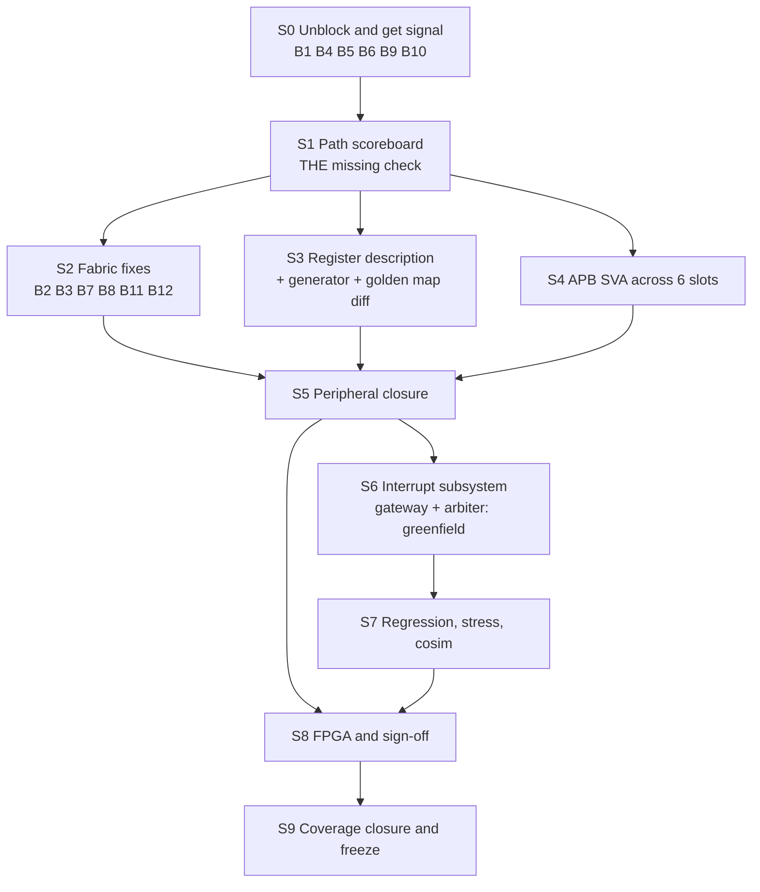

# RISCFORGE 1TOPS — Infrastructure Tracking

**Purpose:** single quick-reference for what verification infrastructure already exists, what is broken, and what to do next, stage by stage.

**Scope:** the SoC subsystem, APB peripherals, fabric, firmware, testbenches, lint/CDC and FPGA track.
**Not in scope here:** core-only verification (`../5_stage/`, `../rv32im_zicsr_5stage_exc_nointr/`, `../verification/`) except where it feeds the SoC, and the PDK-blocked ASIC flows (STA, DFT, LEC, GLS).

**Path convention:** all paths below are relative to **`rtl/ips/`**, i.e. this file's own directory. Paths that leave it are written `../…`. Where a testbench uses relative file paths internally, the CWD is `rtl/ips/` — see §2.3.

**How to update:** when an item changes state, edit the row and add a dated line to §11 Changelog. Keep one owner initial per row. Do not add new stages without deleting a finished one.

**Status legend:** `DONE` works and is proven · `PARTIAL` exists but does not cover the SoC · `BLOCKED` cannot run · `MISSING` does not exist · `FAILING` runs and has an open failure

---

## 1. TL;DR

The verification plans (v1 / v2 / v3 checklist) were written as if none of the infrastructure existed. **It does.** A 66-register predictor, a UVM environment with a cycle-accurate scoreboard, 8 reusable APB assertions, timeout monitors, working lint/CDC flows and three per-peripheral datapath TBs are all present and working.

Two problems, in order of cost:

1. **The reported "peripheral register access failure" is most likely a documentation bug.** `RTL_SOC/riscforge_soc_subsystem.sv:159-179` documents 13 of 19 GPIO registers at the wrong offsets. The correct map already exists in two other files. Fix cost: ~20 minutes.
2. **Nothing checks the fabric.** All existing checks sit downstream of `axi_lite_to_apb`. There is no core→AXI→APB path scoreboard, and the crossbar's own protocol assertions are compiled out under both XSim and Verilator.

**The one genuinely missing piece of infrastructure is the path scoreboard.** Everything else is wiring, fixing, or copying.

**Audit update (2026-10-22):** the 2026-10-02 compliance audit of `Verification/infrastructure/` and `Verification/step4_checkers/` contradicts parts of the picture above. The 38/38 smoke pass exercises no checker. The SoC-level testbench does not elaborate. The 7-layer failure engine exists only in `step4_checkers/`. A live `IRQ_CONCURRENCY_PRESERVED` failure is open, and a `WATCHDOG_TIMEOUT` stall is recorded. See §4 V1–V14. The audit did not re-run any simulator, so the "present and working" statements above are the 2026-10-02 inventory, not a re-run.

---

## 2. Existing infrastructure inventory

### 2.1 Register-level checking — the strongest asset

| Asset | Path | LOC | Status | Reuse verdict |
| --- | --- | --- | --- | --- |
| Golden register map (66 regs) + per-register scoreboard | `RTL_SOC/soc_regtest_tb.sv` (`regdef` :328, `build_regmap` :343, `score` :413, `print_coverage` :440, `note_bus_error` :509, `handle_report` :562) | 749 | `DONE` | **This is the register predictor the plan asks for.** Keep the `regdef(ip,name,addr,kind)` signature and the "OTHER CHECKS" table that separates holes/aliases from real verdicts |
| C register model with r/w masks | `mem_files/regtest/regtest.c` (`K_RW`/`K_RO`/`K_RST` :199, `reg_t` :204, `ip_t` :211, per-IP tables :222-305, `ips[]` :299) | 794 | `DONE` | **This is the single register description.** Hand-maintained C, not a generator. Promote it — do not write a second one |
| 8-phase firmware register test | same file, phase list at `:13-23` | — | `DONE` | Phase 1 reset · 2 RO · 3 RW/36 patterns · 4 per-IP uniqueness · 5 command/FIFO/W1C · 6 unmapped+alias · 7 must-fault · 8 unexpected-trap. Extends well |
| Mailbox protocol (FW→TB) | `regtest.c:115-116` (`MBOX_ADDR 0x0002_0000`), `mbox_post` :167; consumed by `soc_regtest_tb.sv:562` `handle_report` | — | `DONE` | Use for every new test. Already prints every FAIL to the TB |
| Cold/warm boot orchestration | `soc_regtest_tb.sv` Phase A flash preload :713 → B cold boot :725 → C image placement :745 → D firmware run :765 | — | `DONE` | Reuse verbatim for any new SoC-level firmware test |
| Boot testbenches | `RTL_SOC/soc_imem_boot_tb.sv`, `soc_timer0_boot_run_tb.sv`, `soc_montest_tb.sv` | — | `DONE` | Existing |

> **Audit note (2026-10-22):** the rows above were not examined by the audit. The audit's register predictor is a separate file, `Verification/infrastructure/checkers/register_predictor.sv`, and its GPIO model contradicts `gpio_reg_pkg.sv` (V5). Whether `regtest.c` or `soc_regtest_tb.sv` carries the same error is not verified.

### 2.2 Protocol checking

| Asset | Path | Status | Reuse verdict |
| --- | --- | --- | --- |
| UVM env, cycle-accurate scoreboard | `apb_timer-master/tb/` (14 files: agent, driver, monitor, scoreboard, sequencer, sequences, env, test, tb, txn, if, coverage, assertions, pkg) | `DONE` | **The template for every other peripheral.** Scoreboard models `timer.sv` including prescaler phase and IRQ-clears-VAL (`:106-183`) |
| 8 APB SVA | `apb_timer-master/tb/apb_timer_assertions.sv` (`p_pready`, `p_no_slverr`, `p_setup_to_access`, `p_addr_stable`, `p_write_stable`, `p_wdata_stable`, `p_access_has_setup`, `p_reset_irq`) | `PARTIAL` | Written but bound to the timer only. `bind` onto all 6 slots — but fix the `PREADY`-in-SETUP property for SPI first (B14) |
| APB timeout monitor | `bus_monitors/apb_timeout_monitor.sv` | `DONE` | Instantiated at `riscforge_soc_subsystem.sv:468`, `TimeoutApb = 131072` |
| AXI timeout monitor | `bus_monitors/axi_lite_timeout_monitor.sv` (316 lines, orphan-drain FSM) | `DONE` | Instantiated. Use as the pattern for any new FSM checker |
| Crossbar protocol SVA | `axi_lite_demux.sv:443-469`, `axi_lite_xbar.sv:115-141` | `BLOCKED` | **Written but wrapped in `ifndef VERILATOR` / `ifndef XSIM` — disabled in both simulators you use.** Delete the guards (B4) |
| Per-bench elaboration asserts | `axi_lite_to_apb.sv:369-378`, `axi_err_slv.sv` | `PARTIAL` | Also guarded by `ifndef VERILATOR` |

### 2.3 Per-peripheral

| Asset | Path | Status | Notes |
| --- | --- | --- | --- |
| Timer 0/1 UVM env + scoreboard + coverage | `apb_timer-master/` | `DONE` | Runners at `sim/vcs/run.sh`, `sim/xcelium/run.sh`. Coverage data in `sim/xcelium/cov_work/` |
| GPIO register model (40 tests) | `gpio-master/tb_gpio_apb_directed.sv` | `DONE` | Block-level only |
| I2C directed log | `apb_i2c-master/xrun.log` (90 pass), `directed.log.txt` (28 pass) | `DONE` | Block-level only |
| UART thorough bench | `apb_uart-main/tb_apb_uart_thorough.sv` | `BLOCKED` | **UART RTL is absent from the repo — see B6** |
| SPI | `spi_master_ip/` | `PARTIAL` | Bench exists; `spi_file.f` references a missing BFM (B18) |
| AON timer register-model TB | `aon_timer/tb_watchdog_full.sv` (40 tasks, full ref model :341-382) | `PARTIAL` | Excellent quality, but the IP is **TileLink-UL, not APB, and is not instantiated in the SoC** |
| CLIC | `clic-master/` | `PARTIAL` | Built but **not instantiated**. See §5, B19/B20 |
| SoC datapath TBs | `datapath_verification/{UART0,i2c0,spi0}/` | `DONE` | Real C smoke tests + `elf_to_hex.py` + hierarchical backdoor load. **Relative paths — CWD must be `rtl/ips/`** |
| Boot / flash | `RTL_SOC/soc_imem_boot_tb.sv` etc. | `DONE` | |
| Bus stress / timeout | `soc_montest_tb.sv`, `mem_files/montest/` | `DONE` | |
| External models | `spi_slave_infinion/S25fs512s/`, `i2c_slave_at24c02/` (AT24C02, page buffering, write-cycle NACK) | `DONE` | Reuse for the sensor demo |

### 2.4 Firmware and toolchain

| Asset | Path | Status | Notes |
| --- | --- | --- | --- |
| Bare-metal startup | `Sw/bsp/crt0.S`, `Sw/bsp/link.ld` | `DONE` | |
| Memory map header | `Sw/bsp/uart_min.h` only | `PARTIAL` | **No `soc_map.h`. Addresses are duplicated in at least 5 places — see B1** |
| ELF→hex | `Sw/tools/elf_to_hex.py`, copied per datapath dir | `DONE` | Duplicated 4×; promote to one |
| Flash image generator | `mem_files/gen_flash_image.py` | `DONE` | |
| Python RV32 assembler | `Verification/compile_asm.py` (15 KB), `gen_tb1_hex.py` (21 KB) | `DONE` | **Removes your toolchain dependency.** Reuse for new asm-level tests |
| Interrupt TB | `Verification/tb1_interrupts.sv` (7 directed tests, sentinel-based, 0 classes) | `PARTIAL` | No scoreboard; sentinel `0xCAFE_BABE` at `0x2000_0400` |
| RISCOF | `../verification/riscof/` | `DONE` | WSL2 + Sail C model. Re-run after any core RTL change |

### 2.5 Static analysis

| Asset | Path | Current result | Status |
| --- | --- | --- | --- |
| JasperGold Superlint | `jaspergold/lint.tcl` + `jg_soc.f`, remote runner `run_jaspergold.ps1/.sh` | LINT 1 Error / 25 Warn / 3 Info; DFT 19 Warn | `DONE` (runner), violations open |
| SpyGlass lint + CDC | `spyglass/spyglass.prj`, `run_spyglass.tcl`, `parse_warnings.py` | 1292 messages, 0 waived | `DONE` (runner), violations open |
| SPI CDC | `spi_master_ip/jg/cdc.tcl` | RST_SYNCHRONIZATION: 1 Error | open |
| GPIO lint | `gpio-master/lint.tcl` | 0 Error / 9 Warning | `DONE` |
| Block scope manifest | `spyglass/reports/blocks.rpt` | 18 instantiated blocks | `DONE` — use as the "what actually exists" authority |

### 2.6 Tooling access

| Tool | Where | Status |
| --- | --- | --- |
| Vivado 2022.2 / XSim | Local `C:\Xilinx\Vivado\2022.2` | Available |
| VCS U-2023.03 + Verdi | Remote `172.16.33.48` | Available — **so you are not limited to XSim; UVM and full coverage are on the table** |
| Xcelium | Remote (same host family) | Available — runners already in tree |
| SpyGlass, DC, ICC2, PrimeTime | Remote `172.16.33.48` | Available |
| JasperGold 2025.06, Genus | Remote `172.16.33.51` | Available |
| RISC-V GCC | **Not installed locally** | Blocker for new C firmware. Mitigate via `compile_asm.py` |

> **Security:** `rtl/AGENTS.md` contains server hostnames, usernames and plaintext passwords committed to the repo. Rotate the credentials and move them out of version control before this goes anywhere public.

### 2.7 What does not exist

| Missing | Impact | Stage |
| --- | --- | --- |
| **Core→AXI→APB path scoreboard** | **The blind spot that lets a fabric bug survive every existing test** | S1 |
| IRQ gateway + round-robin arbiter (RTL) | Entire interrupt plan is greenfield | S6 |
| AON WDT at `0x4000_6000` | Slot does not exist; `≥0x4000_6000` is DECERR | S6 |
| Test manifest + single runner | No `make test`; no seed/hash in every log | S7 |
| Register-description generator | Header and RTL can both be wrong and agree (§5 B1) | S3 |
| Fault injection / checker qualification | No proof any checker can fail | S7 |
| Spike / RVFI retire port | No CPU reference at SoC level | S7 |
| Formal harness (SymbiYosys) | Arbiter and bridge unproven | S6 |
| Golden address map from the spec | Generated-vs-spec diff impossible | S3 |

---

## 3. Address map — authoritative

Source of truth: `RTL_SOC/riscforge_soc_subsystem.sv:682-690` (`apb_addr_map[]`). Verified by audit.

```
0x0000_0000 – 0x0000_003F  BootROM   core fetch only, NOT on crossbar  (data access → DECERR)
0x0001_0000 – 0x0001_7FFF  ISRAM     32 KB   AXI writes need awprot[0]=1 (privileged)
0x0002_0000 – 0x0002_7FFF  DSRAM     32 KB
0x4000_0000 – 0x4000_0FFF  APB[0]    I2C
0x4000_1000 – 0x4000_1FFF  APB[1]    Timer 0
0x4000_2000 – 0x4000_2FFF  APB[2]    UART
0x4000_3000 – 0x4000_37FF  APB[3]    GPIO   (2 KB only — BlockAw=11)
     0x4000_3800 – 0x4000_3FFF        HOLE → DECERR → access fault
0x4000_4000 – 0x4000_4FFF  APB[4]    SPI (via bootloader APB mux)
0x4000_5000 – 0x4000_5FFF  APB[5]    Timer 1
     ≥ 0x4000_6000                   UNMAPPED → DECERR → access fault
```

**Notes:** `NUM_APB_SLAVES = 6`. There is no slot 6, so the AON WDT address in the plans (`0x4000_6000`) does not exist. The UART takes `PADDR[4:2]` (already a word address); all other slaves take `PADDR[11:0]`.

---

## 4. Blocking bug register

Ranked by cost-to-fix ÷ probability-of-being-the-reported-failure. Every fixed bug must add a regression test (§8).

| ID | Sev | Finding | Location | Fix | Stage |
| --- | --- | --- | --- | --- | --- |
| **B1** | **CRITICAL** | **SoC header comment documents 13 of 19 GPIO registers at the wrong offsets.** Says `GPIO_EN=0x010, GPIO_IN=0x014, GPIO_OUT=0x018, INTRPT_*_EN=0x028..0x034, INTRPT_LVL_LOW_STS=0x048`. RTL (`gpio_reg_pkg.sv:167-194`) says `GPIO_EN=0x080, GPIO_IN=0x100, GPIO_OUT=0x180, INTRPT_*_EN=0x380..0x500, INTRPT_LVL_LOW_STATUS=0x780`. Also `:52` says 4 KB while `:156` and `:688` say 2 KB. Any driver written from this comment writes to unmapped addresses → DECERR → access fault | `RTL_SOC/riscforge_soc_subsystem.sv:52, 156, 159-179` | Delete from source; generate docs from `gpio_reg_pkg.sv`. Audit every driver against the corrected map | **S0** |
| **B2** | **CRITICAL** | `axi_lite_to_apb` collapses AW and W into one valid with **zero write-data buffering**. `axi_req_valid[WR] = aw_valid & w_valid`; `aw_ready == w_ready == axi_req_valid[WR] & axi_req_ready[WR]`; W payload purely combinational. Works today only because `LatencyMode=CUT_ALL_AX` gives `SpillAw=1, SpillW=0` in both demux and mux. Any master that waits for AWREADY before asserting WVALID, or drops AWVALID after AWREADY, **loses the write forever with no error response** | `axi_lite_to_apb.sv:122-138`, `:125-126` | Independent 1-entry skid buffers for AW and W; `aw_ready = aw_buf_has_room`, `w_ready = w_buf_has_room` | **S2** |
| **B3** | **CRITICAL** | APB `Access` state has **no timeout and no recovery**. Only exit is `pready`; `default: /* do nothing */`. One peripheral that never asserts PREADY freezes the whole SoC permanently — no BVALID, no RVALID, `mem_stall` held. SPI's PREADY is combinational on FIFO state and unbounded | `axi_lite_to_apb.sv:328-360` | Saturating ACCESS watchdog → drive `apb_req_o='0`, return `RESP_SLVERR`, go to `Setup`. Give the `default` arm a real recovery so an X on `apb_state_q` cannot deadlock the FSM | **S2** |
| **B4** | HIGH | All crossbar protocol SVA is compiled out under `VERILATOR` **and** `XSIM` — the project's two simulators run the fabric with zero protocol checking | `axi_lite_demux.sv:443-469`, `axi_lite_xbar.sv:115-141` | Delete the `ifndef` guards | **S0** |
| **B5** | HIGH | `tb_axi_lite_xbar.sv` **does not compile** — `:981` has `32'hSLOW_BEEF`, not a hex digit. Also runs `NO_LATENCY` while the SoC runs `CUT_ALL_AX`, and its header advertises an AW-before-W test (`:18`) that does not exist. The AW/W skew the SoC actually has is tested by nothing | `axi_lite_xbar/tb_axi_lite_xbar.sv:18, 113, 981` | Fix literal, switch to `CUT_ALL_AX`, add the AW-before-W test. Then it becomes the regression for B2 | **S0** |
| **B6** | HIGH | **UART RTL is absent.** `apb_uart.sv` instantiates `obi_uart` from `../SOC_FILES/include/obi/obi_uart.sv`; no `SOC_FILES/` exists in the repo. `uart.f:7-29` points at 20 nonexistent files. `soc_regtest_tb.sv` and `regtest.c` both carry a UART register map — a model with no DUT | `apb_uart-main/rtl/apb_uart.sv:45`, `apb_uart-main/uart.f:7-29` | Restore the RTL, or **strike UART from the sign-off claim**. Do not claim a register map you cannot simulate | **S0** |
| **B7** | MED | A write with `wstrb == 0` generates **no APB transaction and returns `RESP_OKAY`** — a silent no-op the master sees as success | `axi_lite_to_apb.sv:299, 319` | Return `RESP_SLVERR`, never `OKAY`. Add assertion `pstrb != 0` for writes | **S2** |
| **B8** | MED | GPIO rejects any partial-strobe write with PSLVERR, so **every `sb`/`sh` to a GPIO register traps**. Bridge maps it to SLVERR, `hybrid_mem_interface` raises a load/store access fault. GPIO is the only slave that inspects PSTRB at all | `gpio-master/gpio_apb_wrap.sv:74-79` | Decide one strobe policy in the bridge: merge offset into strobes + shift data, **or** forbid sub-word in the BSP and document it | **S2** |
| **B9** | MED | Stale duplicate `timer.sv` at repo root lacks the `ENABLE_BIT` qualification in the IRQ condition, so a **disabled timer spuriously raises an interrupt**. Which file the filelist picks decides whether you have this bug | root `timer.sv:58` vs `apb_timer-master/rtl/timer.sv:63` | Delete the root duplicates. Add a hash check on RTL copies | **S0** |
| **B10** | MED | Stale filelist paths: `../axi_lite_to_apb/**rtl**/axi_lite_to_apb.sv` in 6 files; the file is at `axi_lite_to_apb/axi_lite_to_apb.sv` | `RTL_SOC/soc_subsystem.f:109`, `soc_regtest.f:121`, `soc_montest.f:130`, `soc_i2c_regtest.f:130`, `soc_imem_boot{,_vendor}.f:{78,80}`, `soc_timer0_boot_run.f:119` | Fix all 6. `make rtl_hash` to catch the class | **S0** |
| **B11** | MED | `apb_to_reg` has no `pstrb_i` port and **hardcodes `wstrb = '1`**, so every reggen `PERMIT` byte-enable check is dead code on the APB path (affects GPIO, and CLIC if instantiated) | `gpio-master` APB path; `clic_apb.sv:89-93` | Thread PSTRB through, or document that sub-word is unsupported | **S2** |
| **B12** | MED | SPI `INTSTA` (0x28) **is not in the read mux** and reads 0, but the SoC comment says RO and `soc_regtest_tb.sv` classifies it RO. RTL and all three docs disagree. Reading it also re-arms the interrupt FSM while returning 0 | `spi_master_ip/spi_master/spb_master_apb_if.sv:198-228, :94` | Add it to the read mux, or document read-zero + read-rearm everywhere | **S2** |
| **B13** | MED | I2C `irq_flag` vs `iack` race — an event coincident with the acknowledge is lost. Open in-tree TODO, not fixed | `apb_i2c-master/rtl/apb_i2c.sv:183-193` | `irq_flag <= s_done | i2c_al | (irq_flag & ~iack)` — let the event win. Verify against the I2C bench first | **S5** |
| **B14** | MED | SPI `PREADY` is combinational on FIFO state and **ignores `PENABLE`**, so it is forced low during SETUP. Access phase is unbounded | `spi_master_ip/spi_master/spb_master_apb_if.sv:84-92` | Gate on PENABLE or document; bounds the SVA reuse in S4 | **S4** |
| **B15** | LOW | Byte-identical duplicate copies of `axi_lite_to_apb.sv` and `axi_lite_xbar.sv` under `axi_lite_xbar/include/axi/` (SHA-256 verified). Not in any filelist but will collide on a recursive wildcard compile | `axi_lite_xbar/include/axi/` | Delete | **S0** |
| **B16** | LOW | `Verification/` and `verification/` are the same directory (Windows case-insensitive). Also `xsim.dir/` at repo root and in two subdirs — build residue | `.` (this directory) | Clean up; do not attempt to merge | **S0** |
| **B17** | LOW | `axilite2apb_file.f:22` omits `spill_register_flushable.sv`, so setting `PipelineRequest=1` or `PipelineResponse=1` breaks the build | `axi_lite_to_apb/axilite2apb_file.f:22` | Add the file | **S0** |
| **B18** | LOW | `spi_file.f` lists `spi_master/spi_bfm.sv` which does not exist (lives in `prev TB and BFM used/`) | `spi_master_ip/spi_file.f` | Fix path | **S0** |
| **B19** | LOW | CLIC indexes a 256-deep array with a value up to 1023 (`int_addr = addr[ADDR_W-1:2]`, window `0x1000..0x4fff`). Out-of-range write, silently dropped or X. Same class in the S-mode path before the bounds check | `clic-master/rtl/clic.sv:442, 594, 618, 672` | Shrink the window to `0x1000..0x13ff` for `N_SOURCE=256`, or size the array to the window | S6 |
| **B20** | LOW | CLIC deviations from stock reggen: all 4 reg-tops use a **registered** read path (`ready = rsp_valid_q`, 1 extra cycle, PRDATA=0 on the first ACCESS cycle); `clicint.ip` is SW-writable **and** HW-driven every cycle; `attr_trig[1]` is stored/read but dead | `clic-master/rtl/clicint_reg_top.sv:60-78`, `clic_reg_adapter.sv:66-68` | Document or fix before any CLIC sign-off claim | S6 |
| **B21** | LOW | Neither slave registers `PADDR`. Only SPI stretches, and its PREADY ignores PENABLE. Any `PADDR`-stability assertion cannot be verified by the slave | `apb_timer`, `apb_i2c`, `apb_spi`, `gpio_apb_wrap` | Rely on master-side stability assertions instead; document | S4 |
| **V1** [audit B-1] | **CRITICAL** | `soc_tb_top.sv` does not elaborate. 16 hierarchical references (`u_core`, `u_dsram`, `apb_psel`, …) point at signals absent from `riscforge_soc_subsystem.sv`. 39 of 101 `soc_verification.f` entries do not resolve (`../../SOC_FILES/**`, `../../uart/rtl/`, …). The filelist compiles two mutually exclusive UARTs | `Verification/infrastructure/tb/soc_tb_top.sv`, `Verification/infrastructure/soc_verification.f` | Make it elaborate; repair the filelist; choose one UART (audit remediation 1) | S0 (0.8) |
| **V2** [audit B-2] | **CRITICAL** | The wired reporter, `checkers/failure_reporter.sv`, is first-in-time freeze only (`:34-36`). No layer comparison, no downstream marking. It has 6 layers (`:46`, `tb_pkg.sv:148-153`), so Layer 6 CPU state has no slot. The 7-layer engine exists only in `step4_checkers/step4_reporter.sv` (761 lines) | `Verification/infrastructure/checkers/failure_reporter.sv`, `tb_pkg.sv` | Add `L_CPU`; choose one reporter (Q7); implement the first-failing-layer rule | S1 (1.11) |
| **V3** [audit B-3] | **CRITICAL** | `checkers/mmio_path_scoreboard.sv` checks APB address decode only (`:42-54`). Six LSU inputs are declared and unused (`:14-19`). No AXI ports, no data, strobe or response check. The join helpers in `tb_pkg.sv` (`lsu_at`, `axil_at`, `apb_on_slot`, `count_wrong_slot`, `count_by_region`) are dead or self-test only | `Verification/infrastructure/checkers/mmio_path_scoreboard.sv` | Implement PATH-01..06 for real (S1 tasks 1.4–1.9) | S1 |
| **V4** [audit B-4] | **CRITICAL** | Only four `report_failure` call sites exist, all in `soc_tb_top.sv` (audit cites `:458, 480, 498, 524`). Layers 1, 2 and 4 never freeze, so a protocol error destroys the ring buffers it should preserve | `Verification/infrastructure/tb/soc_tb_top.sv` | Wire `LAYER_PROTO`, `LAYER_PATH`, `LAYER_PIN` to `report_failure` (audit remediation 3) | S1 (1.11) |
| **V5** [audit H-5] | **HIGH** | GPIO model in `checkers/register_predictor.sv` contradicts `gpio_reg_pkg.sv`. 0x000 is modelled W1C (should be RO `GPIO_INFO`). 0x004 is modelled as interrupt enable (should be `GPIO_CFG`). 0x380 is modelled W1C (should be RW rise-enable). 0x400 aliases 0x004 (should be a distinct fall-enable). 0x580 (W1C `GPIO_INTRPT_STATUS`) is missing. No read models for t0/t1 timers, `i2c_txr`, `gpio_irq_en`, `gpio_irq_status`. `check_mask == 0` silently skips unmodelled offsets. NBA-then-read diagnostic at `:261-263`, same pattern at `irq_predictor.sv:107, 137` | `Verification/infrastructure/checkers/register_predictor.sv` | Fix against `gpio_reg_pkg.sv`; fail unmodelled offsets; fix the diagnostics (audit remediations 4 and 10) | S0 (0.9) |
| **V6** [audit H-6] | **HIGH** | `checkers/irq_predictor.sv` has no arbitration prediction. `pend_q` is written (`:94, 96, 100`) and never read. `irq_exp_id` (`:33`) is never assigned, and `soc_tb_top.sv` prints it. Its local `class_map` (`:46-55`, default 0) contradicts `tb_pkg.sv:346-353` (e.g. SPI_EVT1 is class 1 in `tb_pkg`, 2 in the predictor). Same-class preemption is flagged illegal (`:132`), contrary to the round-robin design (`:43`) | `Verification/infrastructure/checkers/irq_predictor.sv` | Implement arbitration; set `irq_exp_id`; delete the local `class_map` and use `tb_pkg` (audit remediation 5) | S6 (6.9) |
| **V7** [audit H-7] | **HIGH (live)** | `[IRQ_CONCURRENCY_PRESERVED]` fails: "Simultaneous IRQs caused ring buffer slot overwrite / dropped event!" 165 checks, 1 failure. Present in all four archived `xsim_*.backup.log`; never fixed or waived. The audit cites the root cause at `monitors/irq_monitor.sv:97-119` (non-blocking `head_ptr` update). In the current file, slot writes are in `push_event` at `:101-131` and `head_ptr <= irq_head_next` is at `:240`, so the audit's citation is not an exact match and the cause is not re-verified. Audit states the class-based `rf_monitors.sv:826-877` is unaffected | `Verification/infrastructure/monitors/irq_monitor.sv` | Fix the head-pointer update; re-run `run_freeze_stress.ps1` (audit remediation 6) | S6 (6.9) |
| **V8** [audit H-8] | **HIGH** | The "38/38 PASS" smoke (`run_rf_mon_smoke.ps1`, `rf_mon_smoke.f`) drives a stub DUT (`tb/rf_mon_stub_dut.sv`) and compiles no checker. `freeze(1'b0)` at `tb/rf_mon_smoke_tb.sv:46`. No `[SMOKE] pass` line in any `xsim*.log`. Checks D1–D10 (`:150-159`) are tautological; P3–P6 assert idle slots | `Verification/infrastructure/tb/rf_mon_smoke_tb.sv` | Treat 38/38 as no evidence. Not in the audit's remediation list; replace with a real-DUT test | S1 |
| **V9** [audit M-9] | **MED** | No ring buffers for Layer 4 pins (`record_gpio/uart/i2c/spi`, `tb_pkg.sv:926-944`) or AXI channels (`record_axi_evt`, `:903-906`). Live queues are trimmed to `DEFAULT_LIVE_Q = 200000` (`tb_pkg.sv:40`) | `Verification/infrastructure/tb/tb_pkg.sv` | Add L4 and AXI rings (audit remediation 8) | S1 (1.11) |
| **V10** [audit M-10] | **MED** | Pass rule clause (d), unobserved-prediction closure, is absent. The vacuity check is non-gating (`step4_checkers/step4_reporter.sv:717-724`). The only vacuity guard in `soc_tb_top.sv` (`:513-517`) is `u_retire_mon.total_retired_instr == 0` | `step4_checkers/step4_reporter.sv`, `soc_tb_top.sv` | Implement clause (d); make vacuity gating per layer (audit remediation 7) | S1 (1.10) |
| **V11** [audit M-11] | **MED** | Both checker stacks compile (`soc_verification.f:155-169`). `soc_tb_top.sv` instantiates only the legacy monitors; `rf_mon_probe`, `rf_monitor_env` and `rf_monitors` are not instantiated | `Verification/infrastructure/soc_verification.f` | Pick one stack (Q7); remove the other from the filelist (audit remediation 2) | S0 (0.8) |
| **V12** [audit M-12] | **MED** | `checkers/` has 0 fault-injection ports, 0 cover properties and 0 covergroups. `step4_checkers/` has `step4_fault_inject.sv` (26 injection points) and 23 covers against 35 assertions | `checkers/`, `step4_checkers/` | Port fault injection and covers, or delete `checkers/` (audit remediation 9) | S7 (7.4) |
| **V13** [audit M-13] | **MED** | `failure_reporter.sv:40` uses `fail_cycle = $time / 10;`, a magic 10 ns divisor, not the shared `tb_cycle` | `Verification/infrastructure/checkers/failure_reporter.sv` | Use `tb_cycle` (audit remediation 3) | S1 (1.11) |
| **V14** [failure report] | **HIGH (live)** | `failure_report.md`: `WATCHDOG_TIMEOUT`, Layer 6, cycle 1000019, failing PC `0x00010008`. Retired=2, AXI=0, APB=0, FW_ATTEST=0. The test stalled after two retired instructions with no bus activity. Root cause not established | `Verification/infrastructure/failure_report.md` | Triage | Triage (S1 path checks would localise it) |

---

## 5. Documentation-vs-RTL mismatches

Cheap to fix, expensive to leave. The root cause of B1 is that an address map is hand-copied into at least five places.

| Location | Claim | Reality |
| --- | --- | --- |
| `riscforge_soc_subsystem.sv:52` | GPIO window 4 KB | 2 KB (`:156`, `:688`) |
| `riscforge_soc_subsystem.sv:159-179` | Dense GPIO map, 13 of 19 offsets wrong | `gpio_reg_pkg.sv:167-194` |
| `riscforge_soc_subsystem.sv:96` | I2C `TIP` = "Transfer in progress" | `tip <= (rd \| wr)` — high while the command bit is latched, not while shifting (`apb_i2c.sv:182`) |
| `riscforge_soc_subsystem.sv:165` | `GPIO_EN` = "Output enable per pin" | It gates the **input synchroniser**. Output enable is `GPIO_MODE` (`gpio.sv:152-162`) |
| `riscforge_soc_subsystem.sv:205` | SPI `INTSTA` is RO | Not in the read mux; reads 0 (B12) |
| `riscforge_soc_subsystem.sv:186-193` | SPI `STATUS` bit map | Composite: `[28:24]` TX count, `[20:16]` RX count, `[6:0]` controller FSM flags (`apb_spi_master.sv:109-114`) |
| `Sw/soc_spec.md:111` vs `:298` | GPIO window 4 KB vs 2 KB | 2 KB |
| `AGENTS.md` routing map | CLIC is a core peripheral; AON WDT at `0x4000_6000` | Neither is instantiated. `blocks.rpt` is authoritative |

**Rule going forward:** no hand-written address or register map inside an RTL file. Generate it.

---

## 6. Stage tracker

Stages are ordered by dependency, not by date. One stage in progress at a time.

### S0 — Unblock and get signal
**Status:** `NOT STARTED` · **Est:** 1 day · **Owner:** ___

**Goal:** remove the cheap blockers so the next stage produces real signal instead of noise.

| # | Task | Ref | Done when |
| --- | --- | --- | --- |
| 0.1 | Fix the GPIO map comment; audit every driver written against it | B1 | No driver references an offset not in `gpio_reg_pkg.sv` |
| 0.2 | Fix `32'hSLOW_BEEF`; switch the bench to `CUT_ALL_AX`; add the AW-before-W test | B5 | `tb_axi_lite_xbar` compiles and runs in the SoC configuration |
| 0.3 | Delete `ifndef VERILATOR` / `ifndef XSIM` guards on crossbar SVA; run under XSim | B4 | Crossbar assertions are active and produce no false failures |
| 0.4 | Decide the UART question: restore RTL or strike from sign-off | B6 | Written decision in §9 |
| 0.5 | Delete stale root `timer.sv` / `apb_timer.sv`; add `make rtl_hash` | B9 | Hash check fails when copies differ |
| 0.6 | Fix the 6 stale filelist paths; delete duplicate copies under `axi_lite_xbar/include/axi/`; clean `xsim.dir`; add `spill_register_flushable.sv` to `axilite2apb_file.f` | B10, B15, B16, B17 | All `.f` resolve; one RTL copy per module |
| 0.7 | Fix `spi_file.f` BFM path | B18 | SPI filelist resolves |
| 0.8 | Make `soc_tb_top.sv` elaborate; repair `soc_verification.f`; decide the duplicate-stack question (Q7) | V1, V11 | Testbench elaborates with one checker stack; every filelist entry resolves |
| 0.9 | Fix the GPIO predictor against `gpio_reg_pkg.sv` (with 0.1); fail unmodelled offsets | V5 | Predictor agrees with `gpio_reg_pkg.sv` for every offset |

**Exit:** `tb_axi_lite_xbar` compiles in `CUT_ALL_AX` and passes; crossbar SVA active; all filelists resolve; GPIO map corrected everywhere.
**Do not skip 0.1.** It is 20 minutes and it may be the entire reported failure.

---

### S1 — Path scoreboard (the missing infrastructure)
**Status:** `NOT STARTED` · **Est:** 2 days · **Owner:** ___ · **Depends on:** S0

**Audit note (2026-10-22):** `checkers/mmio_path_scoreboard.sv` exists but checks APB address decode only. It is not counted as progress (V3). PATH-01..06 are not implemented in the wired stack.

**Goal:** one check that catches every fabric bug. Everything currently in the tree sits downstream of `axi_lite_to_apb`; nothing checks the path itself.

| # | Task | Done when |
| --- | --- | --- |
| 1.1 | `mmio_lsu` monitor → transaction `{cycle, pc, op, addr, size, wdata, rdata, strb, is_mmio}` | Transactions emitted on a trivial program |
| 1.2 | `axi_lite` monitor — AW, W, B, AR, R as **separate** events | AW and W logged independently so ordering is visible |
| 1.3 | `apb` monitor — one line per completed transfer, with wait-state count | `slot, paddr, pwrite, pwdata, pstrb, prdata, pslverr` |
| 1.4 | **PATH-01** one core MMIO access → exactly one AXI transaction | Non-vacuous: transaction count > 0 on every run |
| 1.5 | **PATH-02** one AXI transaction → exactly one APB transfer on the decoded slot | Wrong-slot transfer fails |
| 1.6 | **PATH-03** address, data, strobes preserved core→AXI→APB and back | Byte-lane mismatch fails |
| 1.7 | **PATH-04** read data returned equals `PRDATA`; `load-use` on MMIO data correct | |
| 1.8 | **PATH-05** decode matches the §3 map | Wrong slot fails |
| 1.9 | **PATH-06** error response → access-fault trap, never a hang | |
| 1.10 | End-of-test drain check; "OTHER CHECKS" routing so downstream failures don't mask the root cause | Copy the pattern from `soc_regtest_tb.sv` |
| 1.11 | Failure report: first-fatal by (layer, cycle), 64–256-entry ring buffers, disassembly join, signature | One page, names the check and the layer |

**Exit:** E1–E8 ladder passes on all 6 slots with PATH-01..06 active and non-vacuous; each injected fault is caught with a readable report.

---

### S2 — Fabric fixes
**Status:** `NOT STARTED` · **Est:** 2–3 days · **Owner:** ___ · **Depends on:** S1

| # | Task | Ref | Done when |
| --- | --- | --- | --- |
| 2.1 | AW/W independent skid buffers in the bridge | B2 | Master that waits for AWREADY before WVALID completes; regression from 0.2 |
| 2.2 | ACCESS-phase watchdog → SLVERR; real `default` recovery arm | B3 | A peripheral holding PREADY low produces SLVERR, not a hang |
| 2.3 | Zero-strobe write → SLVERR, never OKAY; assert `pstrb != 0` | B7 | |
| 2.4 | One documented PSTRB policy: lane-merge + data shift, **or** forbid sub-word in the BSP | B8, B11 | Sub-word sweep produces a defined, tested result on every slot |
| 2.5 | Fix or document SPI `INTSTA` | B12 | RTL, header comment, `soc_regtest_tb` and `regtest.c` all agree |
| 2.6 | SymbiYosys bounded proof on the bridge: no duplicate/dropped transfer, bounded response | | Counterexample or proof recorded |

**Exit:** bridge survives AW-first, W-first, same-cycle, and back-to-back; every stall path is bounded; PSTRB policy documented and tested.

---

### S3 — Single register description + generator
**Status:** `NOT STARTED` · **Est:** 2 days · **Owner:** ___ · **Depends on:** S1

**Goal:** one input, four outputs. This is what makes B1 impossible to repeat.

| # | Task | Done when |
| --- | --- | --- |
| 3.1 | Promote `mem_files/regtest/regtest.c` register tables to the authoritative description (YAML or keep as C + parser) | Single file owns name/offset/kind/reset/rmask/wmask |
| 3.2 | Generator emits `Sw/bsp/soc_map.h` | No hand-typed address anywhere |
| 3.3 | Generator emits the `build_regmap()` block in `soc_regtest_tb.sv` | TB map can no longer drift from the model |
| 3.4 | Generator emits the register documentation table | |
| 3.5 | **Golden map from the spec document**, hand-transcribed, diffed against the generated one | B1-class mismatch fails the build |
| 3.6 | Remove the hand-written map comment from `riscforge_soc_subsystem.sv` | |
| 3.7 | Fix §5 mismatches in `Sw/soc_spec.md` and the SoC header | |

**Exit:** one edit to the description regenerates header, TB map and docs; a deliberately wrong offset fails 3.5.

---

### S4 — APB protocol SVA across all slots
**Status:** `NOT STARTED` · **Est:** 1 day · **Owner:** ___ · **Depends on:** S1, S2.4

| # | Task | Ref |
| --- | --- | --- |
| 4.1 | `bind apb_timer_assertions.sv` onto all 6 APB slaves | — |
| 4.2 | Adjust the PREADY property for SPI (SETUP-phase behaviour) | B14 |
| 4.3 | Add `PADDR`/`PWDATA`/`PWRITE` stability assertions on the **master** side (no slave registers them) | B21 |
| 4.4 | Add a cover to every property; run a vacuity report | — |
| 4.5 | Confirm each bind is actually connected | — |

**Exit:** all 6 slots assertion-clean in every test; zero vacuous passes.

---

### S5 — Per-peripheral closure
**Status:** `NOT STARTED` · **Est:** 1 week · **Owner:** ___ · **Depends on:** S2, S3, S4

Applies the eight-point closure rule per peripheral: registers · pins · modes · interrupts · error paths · concurrency · driver done · FPGA proof.

| Order | IP | Key work | Ref |
| --- | --- | --- | --- |
| 1 | UART | Resolve B6 first. If RTL is restored: pin monitor, all divisors, 5–8 bits, parity, stop bits, FIFO, overrun, framing error | B6 |
| 2 | Timer 0/1 | Existing UVM env is the template; add the interrupt-driven variant; exact-cycle compare | |
| 3 | GPIO | Clone the `apb_timer` UVM structure here — next-hardest peripheral (W1C + command registers + sub-word guard). Add pin loopback and pin monitor | B8 |
| 4 | I2C | Fix the irq/ack race; EEPROM + sensor models; repeated START; NACK; arbitration; stuck-bus | B13 |
| 5 | SPI | Fix BFM path; flash model vs datasheet; FIFO thresholds; the three read-side-effect registers documented | B12, B18 |
| 6 | WDT | IP not in the SoC — decide scope first (§9) | |

**Exit:** every cell of every peripheral matrix passes polled **and** interrupt-driven, with pin-level checking.

---

### S6 — Interrupt subsystem
**Status:** `NOT STARTED` · **Est:** 2 weeks RTL + 1 week check · **Owner:** ___ · **Depends on:** S1–S5

**Nothing here exists.** No gateway, no arbiter, no CLIC instantiation, no WDT.

| # | Task | Done when |
| --- | --- | --- |
| 6.1 | Freeze the interrupt spec: source list, capture (pulse→sticky vs level pass-through), coalescing, pointer update, grant hold, masking, cause encoding, nesting, WDT policy, interface registers | Written spec exists; coverage is written from it, not from RTL |
| 6.2 | Build the gateway + round-robin arbiter RTL | Reviewable RTL exists |
| 6.3 | Independent predictor written from the spec by someone other than the RTL author | — |
| 6.4 | SymbiYosys proofs: one-hot grant, no spurious, no loss, bounded fairness | Proof or bounded counterexample |
| 6.5 | ISR framework: save/restore, dispatch table, unexpected-interrupt handler | — |
| 6.6 | SoC tests: wiring sweep · per-source end-to-end · all-at-once · starvation · pipeline collisions · **register canary** (fill all GPRs + `mstatus`/`mepc`/`mcause`, take an interrupt, verify) · `mret` restores `mstatus` | |
| 6.7 | Decide the CLIC question — build on `clic-master`, or write the gateway from scratch | §9 |
| 6.8 | Fix B19 / B20 if CLIC is adopted | |
| 6.9 | Fix `irq_predictor` arbitration, `irq_exp_id` and `class_map`; fix the `irq_monitor` head-pointer update; re-run `run_freeze_stress.ps1` | V6, V7 | Freeze-stress run has 0 failures |

**Exit:** spec frozen; formal proofs pass; predictor qualified; every source verified end to end; starvation bound held.

---

### S7 — Scale and regression
**Status:** `NOT STARTED` · **Est:** 1 week · **Owner:** ___ · **Depends on:** S1–S6

| # | Task | Done when |
| --- | --- | --- |
| 7.1 | `tests.yaml` manifest + one runner entry point (`make test`) | Every test is one manifest row |
| 7.2 | Every log header: seed, git hash, ELF hash, RTL hash, params | Reproducible from the log alone |
| 7.3 | Signature bucketing (`check_id + pc + cause`) so 200 seeds collapse into a few buckets | |
| 7.4 | Fault injection per checker; prove each can fail | Checker that never fails is not a checker. Audit (V12): the wired stack has 0 injection points; `step4_checkers/step4_fault_inject.sv` has 26 |
| 7.5 | Fault-injection set: `BUG_DROP_W`, `BUG_STRB_ONE`, `BUG_NO_PREADY_TIMEOUT`, `BUG_DUP_STORE`, `BUG_DROP_PULSE`, `BUG_SWAP_GRANT`, `BUG_STARVE`, `BUG_W1C_AS_RW` | |
| 7.6 | Spike cosim + RVFI retire port | Post-run trace compare first, lockstep after |
| 7.7 | Seeded driver-stress generator (host-computed expected values) | |
| 7.8 | Bug→test map; every fix adds a regression test | |
| 7.9 | Post-synthesis functional sim from Vivado on the register test | Catches latch inference and init-value dependence |

**Exit:** one command runs the catalogue; failures arrive as root-cause reports, not logs.

---

### S8 — FPGA and sign-off
**Status:** `NOT STARTED` · **Est:** 2 weeks · **Owner:** ___ · **Depends on:** S5 min

| # | Task | Done when |
| --- | --- | --- |
| 8.1 | Wrapper only; core/fabric/peripherals hash-identical to the release filelist | Hash list in every build log |
| 8.2 | Clock (MMCM), reset (async assert / sync release), open-drain I2C IO, pull-ups | Timing closed at the chosen SoC clock |
| 8.3 | Program loading: memory-init for iteration, SPI flash boot for the real path, offsets non-colliding | Written procedure |
| 8.4 | Bring-up ladder: LED → boot status → UART hello → timer polled → timer IRQ → GPIO → UART echo+IRQ → I2C → SPI → WDT → flash boot → catalogue + soak | Logged, stops at first failure |
| 8.5 | Soak (8 h min, 24 h target) + boot cycles (100 min, 1000 target) | No hang, no mismatch |
| 8.6 | Post-synthesis functional sim; parity matrix sim vs board | |
| 8.7 | Sensor demo: I2C sensors, UART console, GPIO LEDs/buttons, timer tick, WDT kicked | Runs from flash, with failure modes |
| 8.8 | Known-limitations document; statement of what the FPGA cannot prove | |

**Exit:** the claim is defensible and the limitations are written down.

---

## 7. Stage dependency map



**Critical path:** S0 → S1 → S2 → S5 → S6 → S7 → S8. S3 and S4 run in parallel with S2.

---

## 8. Test catalogue

Every test maps to a bug or a gap. New tests get an ID and a line in §11.

| ID | Test | Layer | Status | Catches |
| --- | --- | --- | --- | --- |
| PATH-01..06 | Path scoreboard | fabric | `MISSING` | B2, B3, B7 |
| REG-01 | Reset-value sweep, all 66 registers × 6 slots | register | `DONE` (phases 1–3) | decode, aliasing, missing reset. Audit V5: the separate `checkers/register_predictor.sv` has GPIO errors; this row's predictor is not verified |
| REG-02 | Per-IP uniqueness | register | `DONE` (phase 4) | two offsets decoding to one register |
| REG-03 | Command / FIFO / W1C registers | register | `DONE` (phase 5) | `timer.sv` CMP-clears-VAL, GPIO SET/CLEAR/TOGGLE, SPI FIFO |
| REG-04 | Unmapped offsets and aliases | register | `DONE` (phase 6) | `timer.sv` has no `default:` in either `case` |
| REG-05 | Must-fault accesses → access fault | register | `DONE` (phase 7) | DECERR path |
| BUS-01 | E1–E8 experiment ladder × 6 slots, matrix with first-failing-layer | fabric | `MISSING` | the reported failure |
| BUS-02 | AW/W skew: AW-first, W-first, same cycle | fabric | `MISSING` | B2 |
| BUS-03 | PREADY fuzz — random and very long delays, per slot | fabric | `PARTIAL` (`soc_montest`) | B3, B14 |
| BUS-04 | Sub-word sweep `sb/sh/lb/lbu/lh/lhu` × every register | fabric | `PARTIAL` (GPIO negative only) | B7, B8 |
| BUS-05 | Hole sweep: `0x4000_3800-3FFF`, `≥0x4000_6000`, BootROM from data, DSRAM from fetch | fabric | `PARTIAL` | DECERR, hangs |
| APB-P01..08 | 8 APB SVA bound to all 6 slots | protocol | `PARTIAL` | B14, B21 |
| AXI-P01..04 | Crossbar SVA under XSim | protocol | `BLOCKED` | B4 |
| PIN-* | Per-peripheral pin monitors | pin | `PARTIAL` (UART/I2C/SPI models exist) | data integrity |
| IRQ-* | Wiring sweep, per-source, starvation, collisions, canary, mret | interrupt | `MISSING` | gateway, once it exists |
| SW-01 | `make disasm` → `pc_map.csv` joining PC to function and source line | software | `MISSING` | debug turnaround |
| SW-02 | Golden-map diff: spec vs generated | software | `MISSING` | B1 recurrence |
| SW-03 | `-O0`/`-O2`/`-Os` matrix | software | `MISSING` | sub-word, deleted reads |
| TR-01 | Post-synthesis functional sim | netlist | `MISSING` | latches, init values |
| SOC-TOP | `soc_tb_top.sv` SoC run with checkers | system | `BLOCKED` | V1: does not elaborate |
| FREEZE-STRESS | `run_freeze_stress.ps1`, IRQ concurrency | interrupt | `FAILING` | V7: 1 of 165 checks fails (`IRQ_CONCURRENCY_PRESERVED`) |
| SMOKE-RFMON | `run_rf_mon_smoke.ps1`, "38/38 PASS" | monitor | `MISSING` | No real DUT or checker, so not evidence (V8) |
| WDT-STALL | Layer-6 watchdog run, `failure_report.md` | system | `FAILING` | V14: stall at PC `0x00010008` |

---

## 9. Open decisions

Blocking. Each needs an owner and a date.

| ID | Decision | Blocks | Owner | Date | Decision |
| --- | --- | --- | --- | --- | --- |
| Q1 | Restore UART RTL or strike UART from sign-off | S0.4, S5.1 | ___ | ___ | ___ |
| Q2 | PSTRB policy: lane-merge + shift, or forbid sub-word in the BSP | S2.4 | ___ | ___ | ___ |
| Q3 | Build the gateway from scratch, or adopt `clic-master`? | S6.7 | ___ | ___ | ___ |
| Q4 | Is a WDT in scope? The slot does not exist and `aon_timer` is TileLink-UL | S5.6, S6 | ___ | ___ | ___ |
| Q5 | Simulators: XSim local only, or VCS/Xcelium on the remote host? | S7 | ___ | ___ | ___ |
| Q6 | Confirm the §3 address map against the written spec | S3.5 | ___ | ___ | ___ |
| Q7 | Keep `step4_checkers/` (7-layer engine) and delete `checkers/`, or port the missing pieces from `checkers/` into it? | S0.8, S1.11 (V2, V11) | ___ | ___ | ___ |

---

## 10. Repo hygiene — do these once, then stop

| Action | Ref |
| --- | --- |
| One RTL source per module; no copies | B9, B15 |
| One filelist per flow; all paths resolve | B10, B17, B18 |
| `make rtl_hash` fails when copies differ | new |
| Every log prints seed, git hash, ELF hash, RTL hash | new |
| Move credentials out of `AGENTS.md`; rotate | §2.6 |
| `Verification/` vs `verification/` — pick one casing | B16 |
| Commit or ignore `xsim.dir/`, `cov_work/`, `.d/` | B16 |

---

## 11. Changelog

| Date | Change |
| --- | --- |
| 2026-10-02 | Initial file. Full inventory of the SoC subsystem, IPs and their verification infrastructure; 21-item bug register; 9-stage tracker built from what exists rather than from the v1/v2/v3 plans. Relocated from `rtl/` to `rtl/ips/`; all paths rebased to this directory. |
| 2026-10-22 | Reconciled with `Verification/infrastructure/COMPLIANCE_AUDIT_2026-10-02.md` and `Verification/infrastructure/failure_report.md`. Added V1–V14 to §4 (audit IDs in brackets; V7's audit line citation does not match the current file). Added the §1 audit update, the §2.1 note, §6 audit notes, tasks 0.8, 0.9 and 6.9, §8 note on REG-01 and rows SOC-TOP, FREEZE-STRESS, SMOKE-RFMON, WDT-STALL, the `FAILING` legend entry, and Q7. **No stage status changed.** Not verified: no simulator was re-run; code changed after 2026-10-02 was not checked; the audit did not cover B1–B21, `bus_monitors/`, `soc_regtest_tb.sv` or `regtest.c`; the copies under `Verification/artifacts/` were checked only for the `head_ptr` lines in `irq_monitor.sv`. |