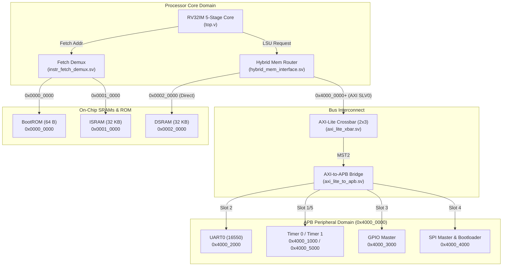
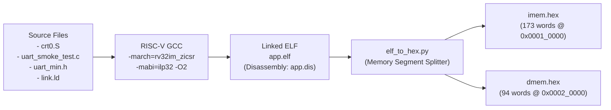
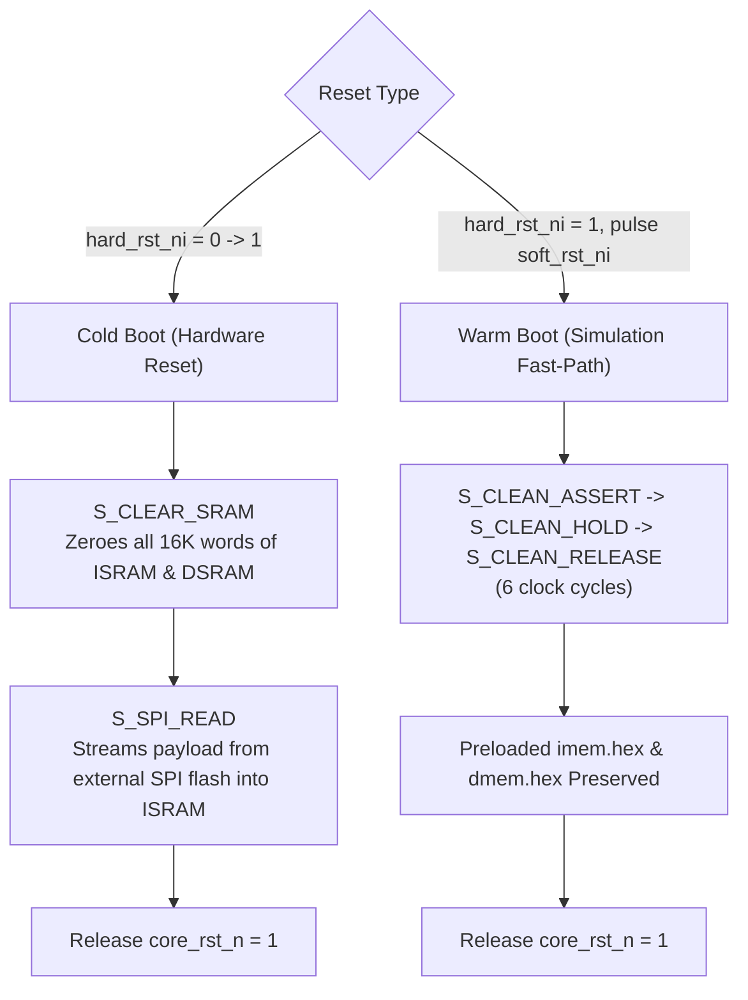

# RISCFORGE 1TOPS — SoC Architecture & UART0 Datapath Verification Report

---

## 1. System Overview & Bus Interconnect

The **RISCFORGE 1TOPS SoC Subsystem** integrates a 5-stage pipelined RV32IM processor with separate instruction and data memories, an AXI-Lite Crossbar ($2 \times 3$), and an APB Bridge subsystem driving 6 peripheral slots.



### Memory Map

| Space | Address Range | Size | Access Interface | Functionality |
|---|---|---|---|---|
| **BootROM** | `0x0000_0000 – 0x0000_003F` | 64 B | Direct Fetch Demux | Reset vector trampoline (`lui sp, 0x28000; jal x0, 0x10000`) |
| **ISRAM** | `0x0001_0000 – 0x0001_7FFF` | 32 KB | Direct Fetch / AXI Privileged | Instruction storage (`.text`, C runtime, interrupt handlers) |
| **DSRAM** | `0x0002_0000 – 0x0002_7FFF` | 32 KB | Direct Core LSU / AXI Bridge | Stack (`sp=0x28000`), `.rodata`, `.data`, `.bss` |
| **APB MMIO** | `0x4000_0000 – 0x4FFF_FFFF` | 256 MB | AXI-Lite Crossbar &rarr; APB Bridge | Memory-mapped I/O peripherals (UART0, Timers, GPIO, SPI, I2C) |

---

## 2. Software Compilation & Memory Image Generation

The software toolchain converts bare-metal C programs and startup assembly into memory initialization hex files:



### Key Toolchain Constructs:
1. **`crt0.S`**:
   - `csrci mstatus, 0x8`: Disables interrupts globally during boot.
   - Sets Global Pointer `gp = __global_pointer$` (`0x20978`) and Stack Pointer `sp = _stack_top` (`0x28000`).
   - Zeroes the `.bss` section in DSRAM and clears GP registers `x1..x31`.
   - Calls `main()` and jumps to `_exit` halt loop on return.
2. **`link.ld`**:
   - Maps `.text` and `.init` to `ISRAM` (`ORIGIN = 0x00010000, LENGTH = 32K`).
   - Maps `.rodata`, `.data`, `.sdata`, `.sbss`, `.bss`, and `STACK` to `DSRAM` (`ORIGIN = 0x00020000, LENGTH = 32K`).
3. **`elf_to_hex.py`**:
   - Parses ELF program headers, converts loadable segments to 32-bit little-endian hex words, and writes word-indexed images for `$readmemh`.

---

## 3. Reset Architecture & Boot Sequences

The hardware bootloader (`bootloader.sv`) provides two distinct reset mechanisms:



---

## 4. UART0 Driver & Datapath Verification

The test program validates full processor arithmetic, data memory storage/retrieval, bus transaction routing, and peripheral register handshake.

### Execution Flowchart

```mermaid
sequenceDiagram
    autonumber
    participant Core as RV32IM Core
    participant BootROM as BootROM (0x0000_0000)
    participant ISRAM as ISRAM (0x0001_0000)
    participant DSRAM as DSRAM (0x0002_0000)
    participant XBAR as AXI-Lite / APB Bridge
    participant UART0 as 16550 UART (0x4000_2000)
    participant TB as Testbench Monitor

    Note over Core,BootROM: 1. Reset Release
    Core->>BootROM: Fetch PC = 0x0000_0000
    BootROM-->>Core: lui sp, 0x28000; jal x0, 0x10000
    
    Note over Core,ISRAM: 2. Jump to C Runtime
    Core->>ISRAM: Fetch PC = 0x0001_0000 (_start)
    Core->>DSRAM: Zero .bss section & setup stack frame
    
    Note over Core,UART0: 3. UART Initialization
    Core->>XBAR: Write LCR = 0x83 (DLAB=1, 8N1)
    XBAR->>UART0: Set DLAB
    Core->>XBAR: Write DLL = 0x02, DLM = 0x00 (32 clocks/bit)
    XBAR->>UART0: Program Baud Divisor
    Core->>XBAR: Write LCR = 0x03 (DLAB=0, 8N1)
    XBAR->>UART0: Clear DLAB (Unlock THR & LSR)
    Core->>XBAR: Write FCR = 0x07 (Reset FIFOs)
    XBAR->>UART0: Enable FIFOs
    
    Note over Core,UART0: 4. Datapath & String Transmission
    Core->>DSRAM: Load string literal from .rodata
    Core->>XBAR: Read LSR (0x4000_2014)
    UART0-->>Core: LSR = 0x60 (THRE=1, TEMT=1)
    Core->>XBAR: Write character to THR (0x4000_2000)
    UART0->>TB: Serial frame transmitted over uart_sout_o (320 ns/bit)
    
    Note over TB: 5. Verification Result
    TB->>TB: Reconstruct bytes -> Detect ">>> TEST RESULT: [ PASSED ] <<<"
    TB-->>TB: [SIMULATION SUCCESS] Test completed cleanly
```

---

## 5. Verification Deliverables & Status Summary

| Item | Location | Status |
|---|---|---|
| **SoC Top Subsystem** | `ips/RTL_SOC/riscforge_soc_subsystem.sv` | Verified (Elaborated & Simulated) |
| **Memory Model** | `ips/RTL_SOC/sram_sp.sv` | Verified (Backdoor Preload Operational) |
| **BootROM Trampoline** | `ips/RTL_SOC/boot_rom.sv` | Verified (Hardcoded Fallback Active) |
| **UART0 Testbench** | `ips/datapath_verification/UART0/tb_uart0.sv` | Verified (Asynchronous Receiver Verified) |
| **UART Driver Header** | `ips/datapath_verification/UART0/uart_min.h` | Verified (16550 Compliant Sequence) |
| **Test Program** | `ips/datapath_verification/UART0/uart_smoke_test.c` | Verified (Banner + ALU Test Passed) |
| **HTML Report Document** | `ips/datapath_verification/UART0/soc_datapath_verification_report.html` | Generated (A4 Executive Layout) |
| **Verification Skill** | `.agents/skills/soc-verification/SKILL.md` | Documented & Operational |

