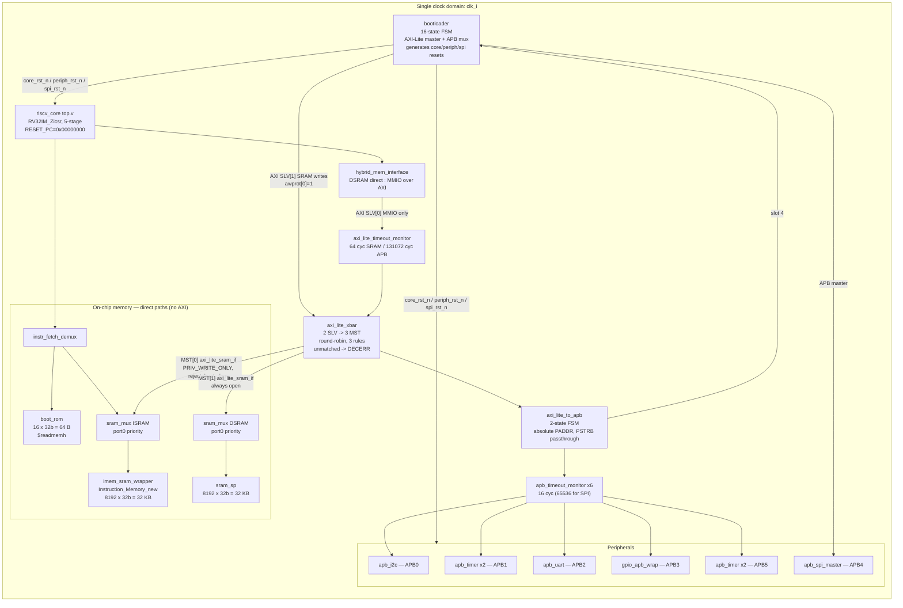
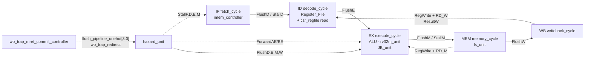
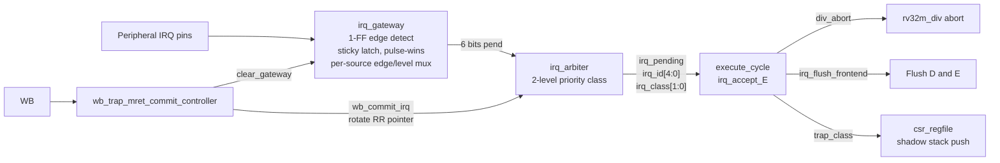
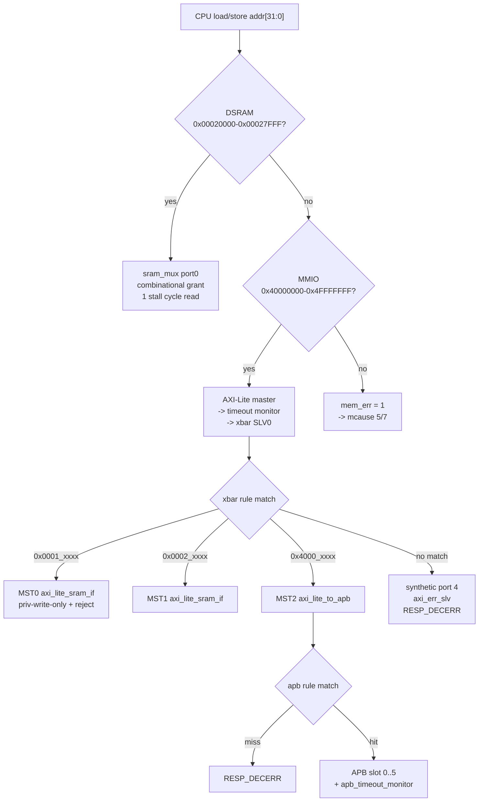
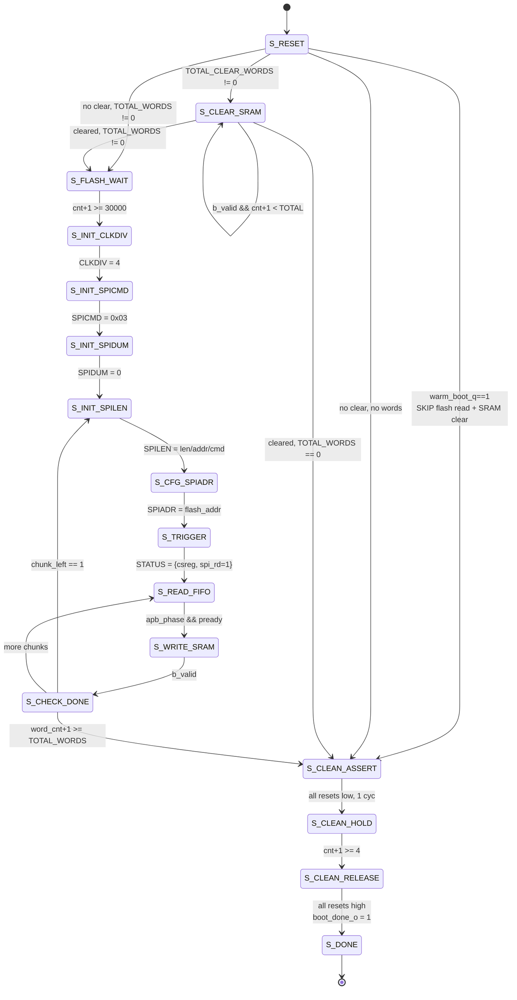
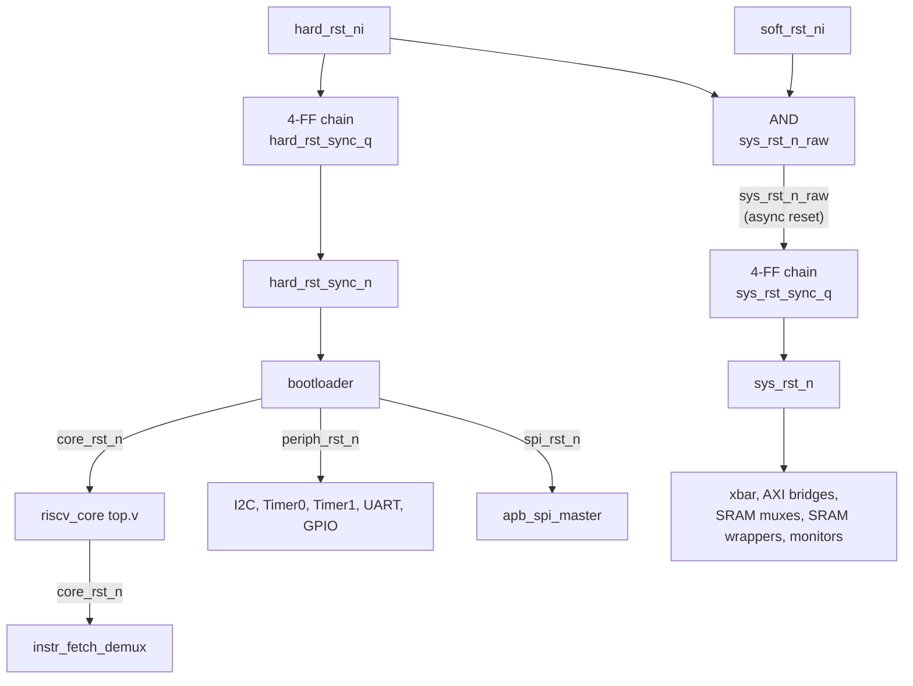
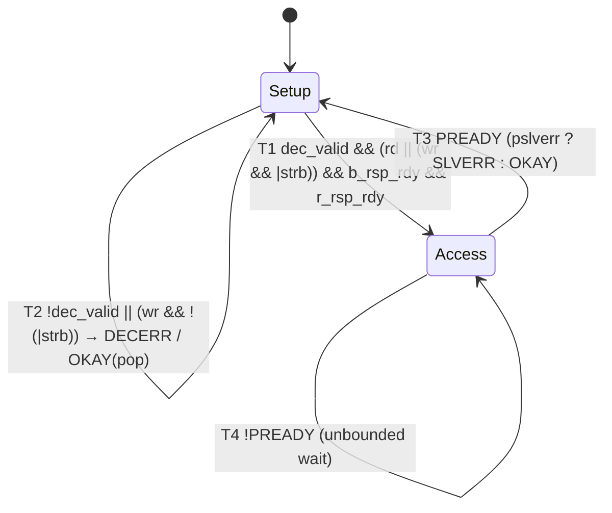
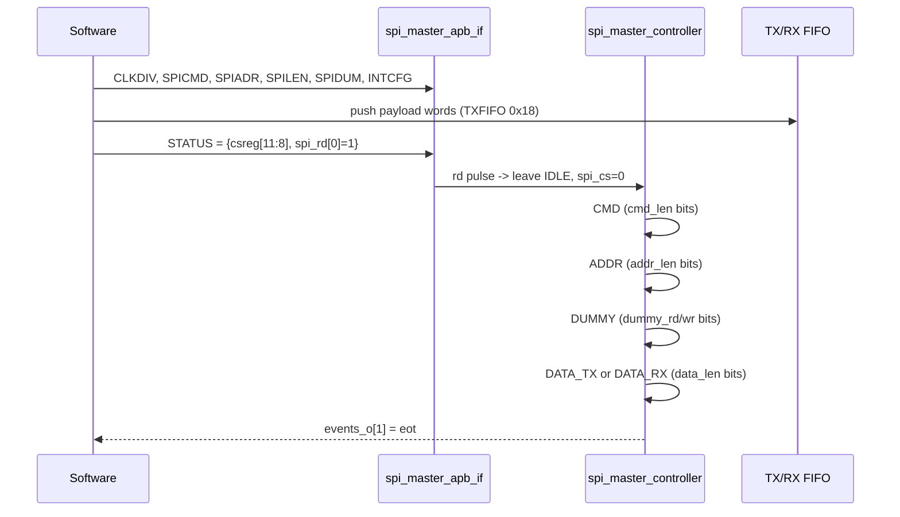
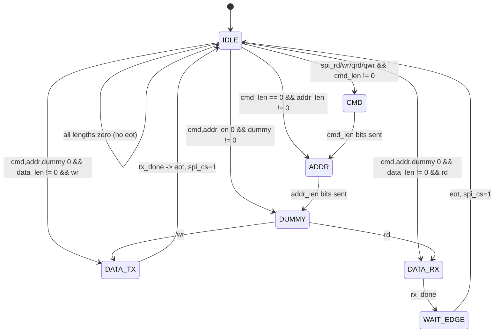

# RISCFORGE 1TOPS — Architecture Summary & Design Specification

> **Scope:** RTL design only. Every claim below is traced to `file:line` in the live tree
> (`rtl/ips/`). Where the in-tree header comments disagree with the RTL, **the RTL wins** and the
> discrepancy is called out explicitly in §11.
> **Authority:** `RTL_SOC/soc_subsystem.f` (263 lines) is the production design-only filelist.
> **Absolute source of truth for integration:** `RTL_SOC/riscforge_soc_subsystem.sv` (1374 lines).

---

## 1. Executive Summary

| Item | Value |
|:--|:--|
| Top module | `riscforge_soc_subsystem` (`:230`) |
| Core | RV32**IM_Zicsr**, 5-stage in-order, **M-mode only**, no C/F/D/A |
| Clock domains | **1** (`clk_i`) — no dividers, no gated clock domains |
| Target clock | **50 MHz** (stated in `documentation/RISCFORGE IRQ Architecture.html:519`); a 100 MHz figure also appears in `RISCFORGE Tapeout Verification Plan.html:751` — *unreconciled* |
| On-chip memory | BootROM 64 B · ISRAM 32 KB · DSRAM 32 KB |
| Interconnect | AXI4-Lite crossbar, 2 masters × 3 slaves, 3 decode rules |
| Peripheral bus | APB4 via 1 AXI-Lite→APB bridge, 6 slaves |
| Interrupts | 2-level priority-class arbiter, **6 arbitrated sources**, 4 interrupt classes (3 reachable) |
| CLIC | **RTL is real but NOT integrated** — zero filelist entries, zero port connections |
| Toolchain | `riscv64-unknown-elf-gcc`, `-march=rv32im_zicsr -mabi=ilp32` (`Sw/Makefile:12`) |
| Boot path | BootROM (2 words) → Bootloader (SPI flash → ISRAM) → release core reset |

**Clock-domain note:** exactly one internal clock domain. `spi_master_clkgen.sv:43` does generate a
divided `spi_clk`, but it clocks **no internal logic** — it leaves the SoC as the `spi_clk_o` pad
(`riscforge_soc_subsystem.sv:313,1142`).

### 1.1 What is NOT in this SoC

These are present in the repo but **absent from the build or the wiring** — the most common
source of misreading:

| Absent | Evidence |
|:--|:--|
| **CLIC** | No entry in `soc_subsystem.f`; no `clic_*` port on the SoC top (`riscforge_soc_subsystem.sv` has exactly one "clic" hit, a comment at `:1164`); core has no `mtvt`/`mintid`/`mcxtvec` |
| **AON timer** | `aon_timer/` never instantiated; no APB slot; `mip[20]` is Timer 0 ch0 **overflow**, not a watchdog |
| **MEIP / MSIP** | `ext_irq_i`, `sw_irq_i` tied `1'b0` (`:1250-1251`) |
| **11 of 16 `fast_irq_i` bits** | `top.v:207` narrows them to 6. Of the 12 peripheral-driven bits, **7 are dead**; `mip[20..26]` read 0 (`top.v:548`). `mip[27]` (SPI EOT) is live. |
| **RV32C / F / D / A** | `opcode_check.v:30-41` whitelist is 11 RV32I+M opcodes only |
| **S/U privilege, PMP, delegation** | `csr_regfile.v:97-109` implements machine-level CSRs only |
| **RVC, alternate-function GPIO mode, SPI quad mode** | Not decoded / unreachable from software |

---

## 2. Top-Level Architecture



### 2.1 Instance hierarchy (`riscforge_soc_subsystem.sv`)

Complete instance list (21 instances), verified line-exact:

| Line | Instance | Module | Role |
|--:|:--|:--|:--|
| 709 | `i_boot_rom` | `boot_rom` | 64 B ROM, reset by `core_rst_n` |
| 727 | `i_instr_fetch_demux` | `instr_fetch_demux` | fetch ROM/ISRAM select |
| 772 | `i_isram_axi_if` | `axi_lite_sram_if` | `PRIV_WRITE_ONLY=1`, `reject_i=boot_done_o` |
| 801 | `i_isram_mux` | `sram_mux` | port0 = fetch, port1 = AXI |
| 836 | `i_isram` | `imem_sram_wrapper` | `IMEM_BASE_BYTE=0x0001_0000` |
| 859 | `i_dsram_axi_if` | `axi_lite_sram_if` | `reject_i=1'b0` |
| 883 | `i_dsram_mux` | `sram_mux` | port0 = core data |
| 920 | `i_dsram` | `sram_sp` | 32 KB, **no reset port** — content is X until written |
| 944 | `i_axi_lite_xbar` | `axi_lite_xbar` | 2 SLV / 3 MST |
| 973 | `i_axi_lite_to_apb` | `axi_lite_to_apb` | 6 APB slaves |
| 1001 | `i_apb_timeout_monitor[6]` | `apb_timeout_monitor` | response-path only |
| 1018 | `i_apb_i2c` | `apb_i2c` | APB[0] |
| 1047 | `i_apb_timer0` | `apb_timer` | APB[1], `TIMER_CNT=2` |
| 1069 | `i_apb_uart` | `apb_uart` | APB[2], `PADDR[4:2]` only |
| 1107 | `i_gpio_apb_wrap` | `gpio_apb_wrap` | APB[3] |
| 1130 | `i_apb_spi_master` | `apb_spi_master` | reached via bootloader |
| 1170 | `i_apb_timer1` | `apb_timer` | APB[5], `TIMER_CNT=2` |
| 1207 | `i_riscv_core` | `top` | `RESET_PC=0x0000_0000` |
| 1269 | `i_core_data_if` | `hybrid_mem_interface` | DSRAM/MMIO split |
| 1319 | `i_axi_lite_timeout_monitor` | `axi_lite_timeout_monitor` | core master port |
| 1353 | `i_bootloader` | `bootloader` | xbar SLV[1] + APB[4] slave + APB master |

### 2.2 The core owns no AXI master

This is the single most important structural fact. `riscv_core/rtl/top.v` exposes **two raw
SRAM-style buses** and nothing else (`top.v:36-53`):

| Port | Dir | Width | Consumer |
|:--|:--|:--|:--|
| `imem_sram_en/we/wmask/addr/wdata/rdata` | out/in | 1/1/4/30/32/32 | `instr_fetch_demux` |
| `lsu_mem_req/we/addr/wdata/be/rdata/stall/err` | out/in | 1/1/32/32/4/32/1/1 | `hybrid_mem_interface` |

`hybrid_mem_interface` owns the only core-side AXI-Lite master (`riscforge_soc_subsystem.sv:1292-1293`).
**The core's two memory accesses are both direct** (`:1198`): its instruction fetch goes to ISRAM
port 0 of the mux, and its data access goes to DSRAM port 0. Only the core's MMIO accesses cross
the AXI fabric. Both SRAMs *also* have a second AXI path (mux port 1) which the bootloader uses to
write ISRAM and DSRAM during boot, and which remains open for DSRAM at runtime (`:853-863`).

---

## 3. Core Design Parameters

### 3.1 Identity

| Parameter | Value | Cite |
|:--|:--|:--|
| XLEN | 32 | `top.v:41`, `csr_regfile.v` `.XLEN(32)` (`top.v:551`) |
| Extensions | RV32I + M + Zicsr | `opcode_check.v:30-41`, `decode_cycle.v:369` |
| Privilege | **M only**; MPP hard-wired `2'b11` | `csr_regfile.v:183,207` |
| Reset | **active-low, asynchronous** | `fetch_cycle.v:230`, `memory_cycle.v:219`, `csr_regfile.v:135` (`or negedge`) |
| Reset PC | `0x8000_0000` default, SoC overrides to `0x0000_0000` | `top.v:25`; `riscforge_soc_subsystem.sv:1206` |
| Register file | 32 × 32, async dual read, x0 hardwired | `Register_File.v:29,35,37-38` |
| RF read style | **write-first bypass** | `Register_File.v:45,49` |
| RF reset | **none in synthesis** (only `initial` under `ifndef SYNTHESIS`) | `Register_File.v:34-39,52-60` |
| Stages | IF/ID/EX/MEM/WB + EX/MEM + MEM/WB pipeline regs | `top.v:293-510` |
| Branch penalty | **2 cycles taken, 0 cycles not-taken** | `hazard_unit.v:193`; `execute_cycle.v:283,290` |
| Predictor / I-cache / prefetch | **none** | NOT FOUND (no `fifo`/`predictor`/`btb` in `riscv_core/rtl/`) |
| Outstanding fetches | 1 (single fetch address port, no FIFO) | `top.v:39` |
| Debug | single output `PCSrcE1`, unconnected in SoC | `top.v:31,286`; `:1210` |

### 3.2 Pipeline & hazard unit



`hazard_unit.v` — exact logic:

| Signal | Equation | Line |
|:--|:--|:--|
| `ForwardAE/BE` | `MEM`→`2'b10`, `WB`→`2'b01`, none→`2'b00`. **`2'b11` never generated** | `:127-137` |
| `lwstall` | `ResultSrcE==01 && (Rs1_D==RdE \|\| Rs2_D==RdE) && RdE!=0` | `:148-151` |
| `csr_stall` | CSR in D reads an address written in E/M/W | `:155-158` |
| `csr_gpr_stall` | `ResultSrcE==2'b11` (CSR→GPR) with D-stage read of same rd | `:163-167` |
| `StallF/D` | `wb_redirect ? 0 : (lwstall \| csr_stall \| csr_gpr_stall \| stallMUL \| mem_stall_i)` | `:170-171` |
| `StallE` | `wb_redirect ? 0 : mem_stall_i` — **`stallMUL` deliberately excluded** | `:173` |
| `StallM` | `wb_redirect ? 0 : mem_stall_i` | `:175` |
| `FlushE` | `lwstall \| (csr_gpr_stall & ~mem_stall_i) \| PCSrcE \| csr_stall \| exc_inflight_M \| wb_redirect \| onehot[1] \| stallMUL` | `:189` |
| `FlushD` | `PCSrcE \| exc_inflight_E \| exc_inflight_M \| wb_redirect \| onehot[0]` | `:193` |
| `FlushM` | `wb_redirect \| onehot[2] \| stallMUL` | `:196` |
| `FlushW` | `wb_redirect \| onehot[3]` | `:199` |

Notes: only **two** bypass paths exist (MEM, WB) — there is no ID-stage forward, hence the
`lwstall`/`csr_gpr_stall` penalty. `flush_pipeline_onehot` is **not one-hot**: it is `4'b1111`
on redirect, `4'b0000` otherwise (`wb_trap_mret_commit_controller.v:110`), consumed as four
independent enables. `wb_redirect` unconditionally overrides **all** stalls — a pending
memory access is not held across a trap commit.

### 3.3 ALU, multiplier, divider

| Unit | Implementation | Latency | Cite |
|:--|:--|:--|:--|
| ALU | 11 ops, single-cycle, in-ALU barrel shifter (`B[4:0]`, **no RV32 shift-word/byte**) | 1 | `ALU.v:42-52,48-50` |
| **MUL** | **Booth radix-4**, 17 partial products, **Dadda CSA tree** (18→12→8→6→4→3→2, **16 `csa`**), 64-bit CPA | **3 cycles, pipelined** — but `rv32m_unit` re-asserts `stall` for 2 extra cycles, so **core throughput is 1 MUL / 3 cycles** | `booth_enc.v:8-10`, `rv32m_mul.v:59-85,174-218,247-259`; `rv32m_unit.v:66-85` |
| **DIV** | **non-restoring radix-2**, 32 iterations + signed-digit correction (`Q - ~Q`) | **~34 stall cycles** | `rv32m_div.v:80-85,94,99,168-172` |
| `rv32m_unit` | Both units instantiated (`:36,49`); `stall = mul_stall \| div_stall \| valid_in` | — | `rv32m_unit.v:85` |

* **Divider early-out** (`rv32m_div.v:127-135`): divide-by-zero → `rs1` for `REM/REMU`,
  `0xFFFF_FFFF` for `DIV/DIVU`; signed overflow `-2^31 / -1` → `0x8000_0000` for `DIV`, `0` for `REM`.
  **No magnitude-based early termination.**
* **Divider abortion**: `div_abort_internal = irq_accept_E & stallMUL` (`execute_cycle.v:297-298`)
  gives sub-4-cycle preemption — an interrupt can cut a 34-cycle divide short.
* **MUL truncation**: product kept at 64 bits (`rv32m_mul.v:247`), so bit 64 of the 33×33 product is lost.
* Branch comparison is in the ALU (`ALU.v:65-67`); resolution is in **EX** via `JB_unit`
  (`execute_cycle.v:272-278,283-290`). **JALR bit 0 IS cleared** — `ALU.v:46` `(A+B) & ~32'd1` (`ALU_Decoder.v:142`).

### 3.4 LSU & memory

| Feature | Value | Cite |
|:--|:--|:--|
| Loads | LB/LH/LW/LBU/**LHU** | `ls_unit.v:77-106` |
| Stores | SB/SH/SW | `ls_unit.v:126-145` |
| Misalign checks | LW `addr[1:0]`, LH/LHU `addr[0]`, SW `addr[1:0]`, SH `addr[0]` | `memory_cycle.v:121-130` |
| Causes | 4 load-misalign, 6 store-misalign, 5 load-access-fault, 7 store-access-fault; `mtval = ALU_ResultM` | `memory_cycle.v:134-141` |
| Byte enables | combinational in `ls_unit.v:123-159` | — |
| LSU pipelining | **effectively non-pipelined** — `mem_stall` freezes StallF/D/E/M | `hazard_unit.v:170-175` |
| Stall gate | `core_stall_gated = lsu_core_stall & ~(misaligned_load \| misaligned_store)` | `memory_cycle.v:186` |

`hybrid_mem_interface.sv` decode:

```
SRAM_BASE  = DMEM_BASE_BYTE            (:61)   SoC: 0x0002_0000
SRAM_LIMIT = DMEM_BASE_BYTE + MEM_DEPTH*4 - 1 (:62)  SoC: 0x0002_7FFF
addr_in_sram_range = (mem_addr >= SRAM_BASE) && (mem_addr <= SRAM_LIMIT)   (:70)
addr_in_mmio_range = (mem_addr >= MMIO_BASE) && (mem_addr <= MMIO_LIMIT)   (:71)
addr_fault = mem_req && !(sram || mmio)                                   (:72)
```

Defaults (`MEM_DEPTH=6048576`, `DMEM_BASE=0x8000_1000`, `MMIO=0x4000_0000..0x4000_FFFF`, `:17-20`)
are all overridden by the SoC (`:1263-1266`). Read latency: 1 wait state on SRAM reads, none on
writes (`:125-152`). **One outstanding AXI transaction** — the FSM cannot accept a new request
until IDLE (`:168-207`).

> **Consequence:** `0x0001_xxxx` (ISRAM) is **not decodable by the data path** — a load from ISRAM
> raises a load access fault. Confirmed by `mem_files/regtest/link.ld:5-7`.

### 3.5 CSR file — complete map

| Addr | Name | Reg | Reset | WARL mask | Cite |
|:--|:--|:--|:--|:--|:--|
| `0x300` | `mstatus` | `mstatus_r` | 0 | `32'h0000_188A` | `:69,137,218` |
| `0x304` | `mie` | `mie_r` | 0 | `32'hFFFF_0888` | `:70,138,219` |
| `0x305` | `mtvec` | `mtvec_r` | 0 | `32'hFFFF_FFFC` | `:71,139,220` |
| `0x340` | `mscratch` | `mscratch_r` | 0 | none | `:75,143,221` |
| `0x341` | `mepc` | `mepc_r` | 0 | none (full RW) | `:72,140,222-225` |
| `0x342` | `mcause` | `mcause_r` | 0 | none | `:73,141,226` |
| `0x343` | `mtval` | `mtval_r` | 0 | none | `:74,142,227` |
| `0x344` | `mip` | `mip_w` (comb) | — | — | `:251` |
| `0xB00/B80` | `mcycle`/`h` | `mcycle_r[63:0]` | 0 (`:144`) | none | `:78,106,108,144,159` |
| `0xB02/B82` | `minstret`/`h` | `minstret_r[63:0]` | 0 (`:145`) | none | `:79,107,109,145,160` |

`mstatus` fields: **SIE[1]**, MIE[3], MPIE[7], MPP[12:11]. `mstatus_r` declares MIE/MPIE/MPP
(`:69`); SIE[1] is a real storage bit written from the MRET port (`:209`) and enabled by mask bit 1
(`:218`). WARL `0x188A` = bits 1,3,7,11,12.
`mip` layout (`:251`): `fast_intr[15:0]→[31:16]`, `4'b0→[15:12]`, MEIP→`[11]`, `3'b0`,
MTIP→`[7]`, `3'b0`, MSIP→`[3]`, `3'b0`.

**Not implemented:** `mhartid`, `mvendorid`, `marchid`, `mimpid`, `misa`, `mcountinhibit`,
`medeleg`, `mideleg`, `mhpmcounter*`, `fcsr`, `mtinst`, `mtval2/3`. `csr_valid_o` exists
(`:266-277`) but is **not wired** (`top.v:551-586`), so reading an unimplemented CSR address is
**not** an illegal instruction — it silently returns 0.

**Trap causes raised:** 0 (instruction address misaligned — branch/jump target only,
`execute_cycle.v:481`), 2 (illegal), 3 (EBREAK), 4 (load misalign), 5 (load access fault),
6 (store misalign), 7 (store access fault), 11 (ECALL from M), interrupts (bit 5 set, ID from
arbiter). **Causes 1 (instruction access fault), 8, 9, 12–15 are NOT FOUND.**

**Vectored `mtvec` is unreachable.** `wb_trap_mret_commit_controller.v:102-105` implements
`mtvec[1:0]==2'b01` vectoring, but the WARL mask `0xFFFFFFFC` (`csr_regfile.v:220`) forbids
writing bits `[1:0]`, so MODE is permanently **direct**.

### 3.6 2-deep hardware shadow stack

Implemented in `csr_regfile.v:81-211` — **not software-visible**:

| Item | Detail | Cite |
|:--|:--|:--|
| Storage | `mepc_stack[1:0]`, `mcause_stack[1:0]`, `mpie_stack[1:0]`, `class_stack[1:0]` | `:84-87` |
| Push | on **interrupt** trap entry only (not exceptions) | `:170-177` |
| Pop | on MRET commit | `:189-211` |
| Preemption gate | `(nest_depth==0) \|\| (winner_class > cur_class)` | `irq_arbiter.v:150` |

> **Defect:** on pop, `mepc_r <= mepc_stack[0]` when `nest_depth==2` (`csr_regfile.v:192-194`)
> while `cur_class_r <= class_stack[1]` and `mstatus.MIE <= mpie_stack[1]` (`:195-196`).
> The newest frame is index 1, so **mepc/mcause restore the older frame while class/MIE restore the newer**.

### 3.7 Trap commit priority

`wb_trap_mret_commit_controller.v`:

| Item | Value | Cite |
|:--|:--|:--|
| `trap_commit` | `valid_W & exc_valid_W` | `:64` |
| `mret_commit` | `valid_W & is_mret_W & ~exc_valid_W` | `:65` |
| Precedence | **exception strictly wins over MRET** (`~exc_valid_W`) | `:65` |
| Redirect | `wb_trap_redirect_o = trap_commit \| mret_commit` | `:67` |
| Flush mask | `4'b1111` on redirect | `:110` |
| `trap_class` | `2'b00` for exceptions (`memory_cycle.v:278`; propagated via `wb_trap_mret_commit_controller.v:73`), `irq_class_i` for an accepted interrupt | — |
| Reachable classes | **0, 1, 2 only** — class 3 is never produced | — |
| MRET target | `{mepc[31:2], 2'b00}` — bit 0 architecturally cleared | `:107` |
| Retirement gate | `RegWriteW_gated = RegWriteW & valid_W & ~exc_valid_W & ~mret_commit` | `top.v:283` |

---

## 4. Interrupt Architecture



### 4.1 The 6 arbitrated sources

`top.v:207`: `irq_raw = {fast_irq_i[11], timer_irq_i, fast_irq_i[3:0]}`

| `pend_i` | Source (SoC signal) | `mcause` ID | `mie` bit | Class | Mode | Cite |
|:--|:--|:--|:--|:--|:--|:--|
| `[5]` | SPI end-of-transfer `spi_events_o[1]`<br/>*(labelled "Watchdog" inside the RTL — a stale name; no watchdog exists in this SoC)* | 27 | `mie[27]` | **2 Real-Time** | edge | `irq_arbiter.v:26,54,93,129` |
| `[4]` | Timer 0 ch0 **compare** `timer0_irq_o[1]` | 7 | `mie[7]` | **2 Real-Time** | edge | `:55,93,129` |
| `[3]` | UART `uart_int_o` | 19 | `mie[19]` | **1 Stream** | level | `:56,100-102,133` |
| `[2]` | SPI FIFO-threshold `spi_events_o[0]` | 18 | `mie[18]` | **1 Stream** | edge | `:57,100-102,133` |
| `[1]` | I2C `i2c_interrupt_o` | 17 | `mie[17]` | **0 Background** | level | `:58,112-114,137` |
| `[0]` | GPIO `gpio_global_interrupt_o` | 16 | `mie[16]` | **0 Background** | edge | `:59,112-114,137` |

`edge_mode = 6'b110101` (`top.v:208`). `irq_gateway.v:64` muxes per bit: edge-mode sources use the
sticky latch, level-mode sources pass through combinationally.

### 4.2 Arbitration policy

| Rule | Behaviour | Cite |
|:--|:--|:--|
| Qualification | `active[i] = pend_i & mie_i[cause] & mstatus_mie_i` — **global MIE gates all sources** | `:54-59` |
| Class 2 | **strict fixed priority** — SPI EOT(27) > Timer0(7), no rotation | `:92-93` |
| Class 1, 0 | **round-robin**, pointer rotates only on `wb_commit_i` | `:64-65,71-85,100,112` |
| Inter-class | 2 > 1 > 0, first-match if/else | `:126-144` |
| Preemption | `(nest_depth==0) \|\| (winner_class > cur_class)` | `:150` |

> **Two structural defects:**
> **(a)** `irq_gateway` uses a **single** sampling flop (`irq_gateway.v:31-38`) plus a combinational
> rising-edge detector (`:41`) — a **1-FF edge detector, not a 2-FF synchroniser**, despite the
> "hardened" header claim at `:5`. No metastability hardening.
> **(b)** Class 2 is fixed priority, so a sustained SPI end-of-transfer event rate causes
> **bounded priority inversion** of Timer 0 — each ID-27 commit clears `pend_q[5]`
> (`wb_trap_mret_commit_controller.v:86`), so Timer 0 does become eligible after every commit.
> True starvation would additionally require a new SPI edge to latch before Timer 0 is examined,
> which depends on the SPI EOT rate versus trap-entry + MRET latency and is not decidable from RTL.

### 4.3 Dead interrupt paths

Eleven of sixteen `fast_irq_i` bits never reach the arbiter. Of the 12 peripheral-driven bits,
**7 are dead**. `mip[27]` **is** live (`pend_gateway[5]`), but `mip[31:28]` and `mip[26:20]` read 0:

| `fast_irq_i` | SoC source | Status |
|:--|:--|:--|
| `[15:12]` | `4'b0` tied | dead (`:1236`) |
| `[10]` `t1_irq[3]` | Timer 1 ch1 compare | **dead** (`:1238`) |
| `[9]` `t1_irq[2]` | Timer 1 ch1 overflow | **dead** (`:1239`) |
| `[8]` `t1_irq[1]` | Timer 1 ch0 compare | **dead** (`:1240`) |
| `[7]` `t1_irq[0]` | Timer 1 ch0 overflow | **dead** (`:1241`) |
| `[6]` `t0_irq[3]` | Timer 0 ch1 compare | **dead** (`:1242`) |
| `[5]` `t0_irq[2]` | Timer 0 ch1 overflow | **dead** (`:1243`) |
| `[4]` `t0_irq[0]` | Timer 0 ch0 overflow | **dead** (`:1244`) |

`top.v:548` rebuilds `fast_intr_core = {4'b0, pend_gateway[5], 7'b0, pend_gateway[3:0]}`, so
`mip[31:28]` and `mip[26:20]` read 0 — **software cannot even poll them**. `ext_irq_i` (MEIP,
`mip[11]`) and `sw_irq_i` (MSIP, `mip[3]`) are visible in `mip` but have **no arbiter path**.

---

## 5. Memory Map

Derived from the RTL decode (`riscforge_soc_subsystem.sv:678-690`), not from documentation.

| Range | Size | Target | Crossbar | Access control |
|:--|:--|:--|:--|:--|
| `0x0000_0000–0x0000_003F` | 64 B | **BootROM** | **not on crossbar** | core fetch only |
| `0x0001_0000–0x0001_7FFF` | 32 KB | **ISRAM** | rule 0 → MST[0] | AXI write needs `awprot[0]=1`; **read ungated**; locked out after `boot_done_o` |
| `0x0002_0000–0x0002_7FFF` | 32 KB | **DSRAM** | rule 1 → MST[1] | ungated, always AXI-open |
| `0x4000_0000–0x4000_0FFF` | 4 KB | I2C | APB[0] | — |
| `0x4000_1000–0x4000_1FFF` | 4 KB | Timer 0 | APB[1] | — |
| `0x4000_2000–0x4000_2FFF` | 4 KB | UART | APB[2] | — |
| `0x4000_3000–0x4000_37FF` | **2 KB** | GPIO | APB[3] | 11-bit decode; 4 KB would alias (`:686-688`) |
| `0x4000_3800–0x4000_3FFF` | 2 KB | **unmapped** | — | **DECERR** |
| `0x4000_4000–0x4000_4FFF` | 4 KB | SPI | APB[4] via bootloader | — |
| `0x4000_5000–0x4000_5FFF` | 4 KB | Timer 1 | APB[5] | — |
| `0x4000_6000+` | — | **unmapped** | — | DECERR |
| anything else in `0x4000_0000–0x4FFF_FFFF` | — | **unmapped** | — | DECERR |

> **Crossbar / `hybrid_mem_interface` window bounds agree.** The crossbar rule is
> `0x4000_0000 – 0x5000_0000` (`:680`) and `MMIO_LIMIT` is `0x4FFF_FFFF` (`:1266`), but
> `addr_decode_dync` treats `end_addr` as **exclusive** (`addr_i < end_addr`, `addr_decode_dync.sv:111-112`),
> so `[0x4000_0000, 0x5000_0000)` is bit-identical to `[0x4000_0000, 0x4FFF_FFFF]` — the same
> 256 MB window. There is **no** unreachable region. Addresses `≥ 0x5000_0000` fail earlier, in
> `hybrid_mem_interface`'s own `addr_fault` (`hybrid_mem_interface.sv:72`).



---

## 6. Boot Flow



16 states, 4-bit enum, implicit encoding `S_RESET=4'h0 … S_DONE=4'hF` (`bootloader.sv:309-326`).

### 6.1 BootROM contents

`mem_files/riscforge_bootrom.hex` holds **2 words**; words 2–15 stay NOP `0x00000013`
(`boot_rom.sv:56-59` NOP-fills before `$readmemh`).

| Addr | Word | Decode |
|:--|:--|:--|
| `0x00` | `00028137` | `lui x2, 0x28` → `sp = 0x0002_8000` |
| `0x04` | `7FD0F06F` | `jal x0, +0xFFFC` → `0x0001_0000` (ISRAM base) |

Matches `Sw/bsp/link.ld:74` (`_stack_top = ORIGIN(DSRAM) + LENGTH(DSRAM) = 0x0002_8000`) and
`link.ld:23` (`.text.init` at `0x00010000`).

### 6.2 Bootloader behaviour

| Item | Value | Cite |
|:--|:--|:--|
| Flash command | `0x03` READ, 8 cmd bits + 24 addr bits, `SPI_CLK_DIV=4`, `CS_FLASH=4'b0001` | `bootloader.sv:151-174` |
| Power-up wait | `FLASH_POWERUP_CYCLES = 30_000` — plain **synthesizable** RTL with **no `ifndef` guard**; a real ~600 µs dead wait at 50 MHz on every cold boot. Only the *comment* at `:176` says "simulation only" | `:176-181,273-274,348,698-701` |
| RX byte order | `{prdata[7:0],[15:8],[23:16],[31:24]}` — **byte-swapped** | `:655-659` |
| AXI writes | `aw.prot = 3'b001` (privileged) on every write | `:548` |
| Completion | `word_cnt+1 >= TOTAL_WORDS`, a **parameter** — no length/magic read from flash | `:799` |
| **Image verification** | **NONE** — no checksum/CRC/signature anywhere | — |
| `boot_done_o` | `state_q == S_DONE`, combinational | `:830` |
| APB mux | passthrough when `state_q == S_DONE`; otherwise FSM drives | `:511-515` |
| Reset outputs | registered DFFs, async reset on `hard_rst_ni` only | `:381-383,566,589-591` |

**Cold vs warm** (`:567-570,603-606,755-756`): cold clears all of ISRAM+DSRAM and reads flash;
warm goes `S_RESET → S_CLEAN_ASSERT` directly — **no flash read, memory preserved**.
`warm_boot_q` is never cleared until the next hard reset.

> `spi_rst_ni_o` is deliberately pulsed: high during `S_CLEAR_SRAM`/`S_FLASH_WAIT`/`S_INIT_*`
> (`:721-726`), then low for 5 cycles (`S_CLEAN_ASSERT` + 4 × `S_CLEAN_HOLD`), then high (`:733-738`).

> **Reset release leads `boot_done_o` by one cycle.** The reset outputs are registered from
> **`state_d`** (`:720-740`) while `boot_done_o` is combinational off **`state_q`** (`:830`).
> At the `S_CLEAN_HOLD → S_CLEAN_RELEASE` edge the resets go high and `state_q` becomes
> `S_CLEAN_RELEASE`; `boot_done_o` only asserts on the following edge when `state_q` reaches
> `S_DONE` (`:815`). So a **one-cycle isolation window exists** in which the core is running while
> the ISRAM AXI port is still open.
> (`Sw/soc_spec.md:141` describes this as "pulses peripheral resets, **and** releases the CPU" —
> in fact all three resets are released together, and `boot_done_o` follows.)

### 6.3 Reset topology



`sys_rst_sync_q` is reset **only** by `sys_rst_n_raw = hard_rst_ni & soft_rst_ni` — `soft_rst_ni`
has no independent path into that chain (`:515,517-520`).

Both reset chains are **async assert, sync deassert** (`riscforge_soc_subsystem.sv:517-528`).
`sys_rst_n` feeds the fabric; `hard_rst_sync_n` feeds the bootloader so both leave reset on the
same edge (`:510-514`). The fetch demux shares the **core's** reset, not `sys_rst_n`, because its
only state `rom_accessed_q` selects the reset-vector fetch source (`:729-737`).

> **No CDC anywhere.** One clock, one reset domain tree. The bus monitors reset on `sys_rst_n`
> (`:1003,1321`) while the peripherals they watch reset on `periph_rst_n` — the monitors come out
> of reset *before* their slaves.

---

## 7. Interconnect

### 7.1 Crossbar configuration

`XbarCfg` (`riscforge_soc_subsystem.sv:425-439`): `NoSlvPorts=2`, `NoMstPorts=3`,
`MaxMstTrans=4`, `MaxSlvTrans=4`, `FallThrough=0`, `LatencyMode=CUT_ALL_AX`, `PipelineStages=0`,
`AxiIdWidthSlvPorts=0`, `AxiIdUsedSlvPorts=0`, `UniqueIds=0`, `AxiAddrWidth=32`,
`AxiDataWidth=32`, `NoAddrRules=3`.

The module is **fully generic** — every port width is dimensioned by `Cfg` (`axi_lite_xbar.sv:38-44`).
`PipelineStages`, `UniqueIds` and the ID fields are **never referenced** in the implementation.

### 7.2 Crossbar properties

| Property | Value | Cite |
|:--|:--|:--|
| Arbitration | **round-robin**, per transaction, via `rr_arb_tree` on AW and AR | `axi_lite_mux.sv:199-216,362-379` |
| Decode | full-width range compare, **all 32 bits**, no masking, no NAPOT | `addr_decode_dync.sv:111-112` |
| Rule priority | later rules override earlier; `$onehot0` enforced | `addr_decode_dync.sv:109-134` |
| Unmatched | routed to a **synthetic 4th master port** → `axi_err_slv` → `RESP_DECERR` | `axi_lite_xbar.sv:109-112,172-202` |
| `en_default_mst` | driven `'0` — **every miss is DECERR** | `riscforge_soc_subsystem.sv:670-671` |
| Outstanding | up to **4** per master port (select FIFOs, depth 4) | `axi_lite_mux.sv:252-312,387-403` |
| Overflow | **pure backpressure**, never drop | `fifo_v3.sv:145` |
| W before AW | **back-pressured** via a skid FF, not lost | `axi_lite_mux.sv:142-146,289-292` |
| PROT filtering | **none** in the fabric (`awprot[0]` gate lives in `axi_lite_sram_if`) | grep: no hits |
| Registered cuts | `CUT_ALL_AX` = spills on **AW and AR only**, at both demux and mux | `axi_lite_xbar.sv:153-157,224-229` |
| W/B/R payload | combinational; only the **select** is registered | `axi_lite_mux.sv:333-336,424-427` |

### 7.3 AXI-Lite → APB bridge

| Property | Value | Cite |
|:--|:--|:--|
| FSM | **2 states only** — `Setup` (merged idle+setup), `Access` | `axi_lite_to_apb.sv:93-96` |
| PADDR | **absolute pass-through, aligned down** — `start_addr` used only for PSEL select, never offset | `:305,333` |
| PSTRB | **direct WSTRB copy**, no shift; PADDR[1:0] are hard-zero | `:126,311,339` |
| Write with `strb==0` | not forwarded to APB, returns `RESP_OKAY` | `:299,319` |
| Read pipelining | `PipelineResponse=0` → **one outstanding read** | `:242-255,298` |
| Write pipelining | `PipelineRequest=0` → **one outstanding write** | `:184-197,298` |
| RD/WR arbitration | `rr_arb_tree` `NumIn=2` — **no write priority**, RAW ordering not guaranteed | `:74-75,149-167` |
| Wait states | **unbounded**, no internal counter; delegated to `apb_timeout_monitor` | `:341` |
| APB4 timing | setup `psel=1,penable=0` then access `psel=1,penable=1` | `:307-308,335-336` |
| Response map | `pslverr → RESP_SLVERR`, else `RESP_OKAY`; decode miss → `RESP_DECERR` | `:319-322,346-352` |



### 7.4 Timeout monitors

| | `apb_timeout_monitor` | `axi_lite_timeout_monitor` |
|:--|:--|:--|
| Instances | 6 (one per APB slot) | 1 (core master port) |
| Interposed on | **response path only** — request path bypasses it | full path, `slv` ↔ `mst` |
| Timeout condition | `psel & penable & ~pready` | inflight beat not handshaken |
| Counter width | `$clog2(TimeoutCycles)` | `$clog2(TimeoutApb)` = 17 |
| Thresholds | `{16,16,16,16,65536,16}` (`:463-470`) | SRAM 64, APB 131072 (`:476-477`) |
| Region select | per-instance constant | address window `0x4000_0000..0x5000_0000` |
| On timeout | `pready=1, pslverr=1, prdata=0xDEAD_BEEF` | `b/r.resp = RESP_SLVERR`, `TimeoutData=0xDEAD_DEAD` |
| Late response | n/a (request path untouched) | **swallowed**; captured beat re-driven downstream until accepted |
| While draining | **`blocked_q` latches — every later access on that slot gets an immediate `PREADY=1`/`PSLVERR=1`; the counter is never re-run** | **new requests answered with immediate SLVERR** |
| Outputs | `timeout_pulse_o` (1 cyc), `timeout_sticky_o` (to reset) | `wr/rd_timeout_pulse_o`, `wr/rd_timeout_sticky_o` |
| Mask / clear-on-write | **none** — sticky clears only on `!rst_ni`; `blocked_q` self-clears on `!psel && pready` | **none** |

The sticky bits are **observation only** — they are not wired to any interrupt. The CPU learns of
a timeout through the load/store access fault it causes: `hybrid_mem_interface.sv:249,317` maps
both AXI error responses to `mem_err`, which becomes `mcause 5/7` at `memory_cycle.v:132-141,164`.

---

## 8. Peripheral Specifications

### 8.1 UART — `apb_uart`, APB[2]

**Hierarchy:** `apb_uart` → `apb_uart_wrap` → `apb_to_obi` + `obi_uart` → `{register, modem,
baudgen, rx, tx, interrupts}` with `fifo_v3` + `counter` + `sync`
(`apb_uart.sv:52`; `apb_uart_wrap.sv:48` `apb_to_obi`, `:63` `obi_uart`).

> **`soc_subsystem.f:39-42` is factually wrong.** It claims `apb_uart.sv` is self-contained and
> that the `obi_uart*` sources are "absent from this repository". They are all present under
> `apb_uart-main/include/obi/`, and `soc_subsystem.f:161` compiles **only** `apb_uart.sv`.
> **That filelist will not elaborate** (`apb_uart_wrap` is unresolved). The correct chain is
> documented in `Verification/infrastructure/rf_filelist.txt:166-187`.

| Register | Offset | Access | Reset | Notes |
|:--|:--|:--|:--|:--|
| RHR/THR/DLL | `0x00` | RO/RW/RW | 0 / 0 / **0x01** | RHR read-to-clear |
| IER/DLM | `0x04` | RW | 0 / 0 | `[3:0]` = dtr/thr_empty/rlstat/mstat enables |
| ISR / FCR | `0x08` | RO / WO | **`0xC1`** / 0 | not R/W (see §11); ISR is combinational, not stored |
| LCR | `0x0C` | RW | 0 | see below |
| MCR | `0x10` | RW | 0 | `[0]dtr [1]rts [2]out1 [3]out2 [4]loop` |
| LSR | `0x14` | RO (read-clear) | **0x60** | 8 bits, see below |
| MSR | `0x18` | RO (read-clear) | 0 | `[7:4]` live inputs, `[3:0]` sticky deltas |
| SPR | `0x1C` | **discarded** | 0 | writes ignored, reads 0 |

Only `PADDR[4:2]` is connected (`riscforge_soc_subsystem.sv:1075`) — 3 word bits, stride 4 B,
all 8 indices decoded, nothing aliased.

**LSR bits** (`obi_uart_pkg.sv:132-141`): `[0]DR [1]overrun [2]par_err [3]frame_err
[4]break_ind [5]THRE [6]TEMT [7]fifo_err`.

**LCR**: `[1:0] word_len` (00=5,11=8), `[2] stop_bits` — **encoding is inverted**:
`stop_bits=1` → **1** stop bit (`TXSTOP1`), `stop_bits=0` → **2** stop bits (`TXSTOP2`);
a **5-bit word with `stop_bits=0`** gives **1.5** stop bits
(`obi_uart_tx.sv:217-224,227-239`, 1.5 noted at `:230`);
`[3] par_en`, `[4:5] par_mode` (00=odd, 01=even, 10=forced-1, 11=forced-0), `[6] set_break`,
`[7] dlab`.

**Baud**: 16-bit divisor `{DLM,DLL}`, `divisor = D - 1`, **16× oversample**
(`obi_uart_baudgen.sv:54,57-104`). `baud = CLK / (16 × D)`.

> Because `divisor == 0` is declared **invalid** (`:55-56`), the minimum usable `D` is 2, so
> **maximum achievable baud is `CLK/32`, not `CLK/16`**. Post-reset `DLL=1` ⇒ `divisor=0` ⇒
> **the baud tickers do not run until software programs `DLL ≥ 2`.**

**FIFOs**: TX 16×8 (`obi_uart_tx.sv:63-66`), RX 16×11 `{par,frame,break,char}`
(`obi_uart_rx.sv:182-185`), plus 1 holding register each ⇒ **17 bytes max**.
Pointer width 4.

| Behaviour | Detail | Cite |
|:--|:--|:--|
| TX full | write **held and retried**; **no APB backpressure**, no overrun status bit | `obi_uart_tx.sv:133-135,270` |
| RX full | **new byte dropped, oldest kept**; `overrun` set | `obi_uart_rx.sv:521-524` |
| THRE vs TEMT | TEMT (`tx_empty`) is a **subset** of THRE (`thr_empty`) — `tx_empty` is only set inside the FIFO-empty / `~thr_full_q` branch **and** gated on `tsr_empty`; THRE carries **no** TSR term | `obi_uart_tx.sv:260-267,285-292` |
| Interrupt | **1 wire**, level-sensitive sticky, **action-based clear** (RHR/LSR/MSR read, THR write) — **not W1C** | `obi_uart_interrupts.sv:72-89,103,130` |
| IIR priority | RLS(0x06) > RDA(0x04) ≈ timeout(0x0C) > THRE(0x02) > MS(0x00); idle = `0xC1` | `:96-123` |
| FCR | `[0]fifo_en [1]rx_rst [2]tx_rst [7:6]rx_trigger` (1/4/8/14) | `obi_uart_pkg.sv:101-109` |

> `ISR[7:6]` is **hardwired `2'b11`** regardless of `FCR.fifo_en` (`obi_uart_interrupts.sv:99`) — it
> reports 16550A capability, not the enabled state.

Modem outputs (`OUT1N/OUT2N/RTSN/DTRN`) are left open in the SoC and the four inputs are tied
`1'b1` (`:1083-1090`), so MSR reads `0x00` and the modem IRQ never fires.

### 8.2 Timer — `apb_timer`, APB[1] and APB[5]

`apb_timer` → `timer[TIMER_CNT]` (`apb_timer.sv:68-87`). `PREADY` tied 1, `PSLVERR` tied 0
(`timer.sv:44-45`) — **zero wait states, no error reporting**.

| Offset (per channel) | Name | Access | Reset | Fields |
|:--|:--|:--|:--|:--|
| `+0x00` | `TIMER_VAL` | RW | 0 | 32-bit up-counter |
| `+0x04` | `TIMER_CTRL` | RW | 0 | `[0] EN`, `[5:3] PRESCALER` |
| `+0x08` | `TIMER_CMP` | RW | 0 | compare; **write also clears TIMER_VAL** |
| `+0x0C` | — | — | — | no case: reads 0, writes dropped, **no PSLVERR** |

Stride per channel = **0x10** (index from `PADDR[4]` with `TIMER_CNT=2`, `apb_timer.sv:12,38`).
`irq_o[2N]` = overflow, `irq_o[2N+1]` = compare (`timer.sv:36,62-68`).

| Property | Value | Cite |
|:--|:--|:--|
| Counter | 32-bit **up-counter only** | `timer.sv:84,87` |
| Prescaler | **3 bits**, 0–7, `0` = bypass; tick = `HCLK/(PRE+1)` | `:16-17,72,82-91` |
| Compare | one register; match when `EN && CMP!=0 && VAL==CMP && presc==cyc` | `:67` |
| **Reload** | **from zero**, not from `TIMER_CMP` | `:79-81` |
| Overflow IRQ | `EN && VAL==0xFFFF_FFFF && presc==cyc`; also clears VAL→0 | `:63-64,80-81` |
| **Mode field** | **none** — no one-shot/periodic/free-run select | NOT FOUND |
| **Watchdog** | **none** | NOT FOUND |
| `TIMER_VAL` write while running | **yes**, and it overrides increment and clear | `:93-110` |
| Clock gating | **none** — prescale is a data-path enable, not a clock gate | `:135-147` |
| IRQ clear | **combinational self-clearing** — a pure function of register state; **no sticky status bit, no W1C** | `:63-81` |

> Effectively the counter free-runs `0 → 0xFFFF_FFFF → 0`, with both IRQs dropping for exactly
> one cycle each wrap. There is **no software-visible latched status** for either IRQ.

> `apb_timer-master/apb_timer.sv` and `apb_timer-master/timer.sv` at the repo root are **stale
> near-duplicates** (2789 B / 4780 B vs 2791 B / 5133 B). `soc_subsystem.f:152-153` compiles the
> `rtl/` versions.

### 8.3 I2C — `apb_i2c`, APB[0]

`apb_i2c` → `i2c_master_byte_ctrl` → `i2c_master_bit_ctrl` (`apb_i2c.sv:143`; `byte_ctrl.sv:141`).
OpenCores WISHBONE origin (`bit_ctrl.sv:3-11`). **Master-only**, multi-master-capable
(`bit_ctrl.sv:81`). `PREADY`/`PSLVERR` both tied (`apb_i2c.sv:214-215`).

| Offset | Name | Access | Reset | Fields |
|:--|:--|:--|:--|:--|
| `0x00` | `PRE` | RW 16-bit | 0 | `[15:0]` prescaler |
| `0x04` | `CTR` | RW | 0 | `[7] EN`, `[6] IEN`, `[5:0]` unused |
| `0x08` | `RXR` | RO | 0 | received byte |
| `0x0C` | `SR` | RO | 0 | `[7]rxack [6]busy [5]al [1]tip [0]irq_flag` |
| `0x10` | `TXR` | RW 8-bit | 0 | transmit byte **or raw address+R/W byte** |
| `0x14` | `CR` | **RW** (effectively write-strobe) | 0 | `[7]STA [6]STO [5]RD [4]WR [3]ACK [0]IACK`; readable but `[7:4]` self-clear, `[2:1]` tied 0, `[0]` self-clears |
| `0x18+` | — | — | — | reads 0, writes ignored, no error |

**SCL frequency: `f_SCL = HCLK / (4 × (PRE + 1))`** — the divisor is **4**, not 5.
One **SCL bit period** is 4 `clk_en` pulses (the `wr_a…wr_d` quad); a full *command* costs 5
(`idle`+`wr_a..wr_d`) or 6 (`idle`+`start_a..start_e`). `clk_en` period = `PRE + 1` cycles
(`bit_ctrl.sv:204-224,502-534,392-431`). `byte_ctrl.sv:82` comments `// 4x SCL`.
Max SCL = `HCLK/4` at `PRE=0`; min = `HCLK/262144` at `PRE=0xFFFF`.

```mermaid
stateDiagram-v2
    [*] --> idle
    idle --> start_a: cmd = START (0x1)
    idle --> stop_a: cmd = STOP (0x2)
    idle --> wr_a: cmd = WRITE (0x4)
    idle --> rd_a: cmd = READ (0x8)
    start_a --> start_b --> start_c --> start_d --> start_e
    start_e --> idle: cmd_ack
    stop_a --> stop_b --> stop_c --> stop_d
    stop_d --> idle: cmd_ack
    rd_a --> rd_b --> rd_c --> rd_d
    rd_d --> idle: cmd_ack
    wr_a --> wr_b --> wr_c --> wr_d
    wr_c --> wr_d: sda_chk armed (arbitration check)
    wr_d --> idle: cmd_ack
    idle --> idle: al — arbitration lost
```

Byte-controller FSM: `ST_IDLE → ST_START → {ST_READ | ST_WRITE} → ST_ACK → ST_STOP → ST_IDLE`
(`byte_ctrl.sv:189,221-330`). Note `go = (read | write | stop) & ~cmd_ack` (`:161`) — a START
alone does not assert `go`; it must accompany a read or write.

| Property | Value | Cite |
|:--|:--|:--|
| Buffering | **exactly 1 byte** — 8-bit shift register + 3-bit down-counter. **No FIFO** | `byte_ctrl.sv:128,133,179-180` |
| Open-drain | separate `_o` + `_oen` (active low); data outputs **hardwired 0** — can never drive high | `bit_ctrl.sv:157,160,541-542` |
| Interrupt | **1 wire**, `irq_flag && IEN`, sticky, W1C via `CR[0]` | `apb_i2c.sv:193,203` |
| Events | `s_done` (any transfer complete) and `i2c_al` — **one undifferentiated flag**, no separate tx/rx/NACK bits | `:193` |
| Addressing | **none in RTL** — software must place the pre-shifted address+R/W byte in `TXR` | — |
| Clock stretching | **supported** (`slave_wait` stalls `clk_en`) | `bit_ctrl.sv:194-196,215-219` |
| Repeated START | **supported** (`ST_START` re-enterable; bit controller ignores `busy`) | `byte_ctrl.sv:221-228` |
| Post-reset bus | idle, both lines released high (`oen=1`) | `bit_ctrl.sv:357-358,269-273` |

> **Four defects:**
> **(a)** `CR` writes are **silently dropped unless `CTR[7]=1`** (`apb_i2c.sv:95-97`).
> **(b)** `IACK` race: if `s_done`/`i2c_al` asserts on the same edge software writes `IACK`, the
> `& ~iack` term wins and **the event is lost** (self-documented at `:183-192`).
> **(c)** **No SCL-stuck timeout** — a slave that never releases SCL hangs the master forever.
> **(d)** **No 9-clock bus recovery** — arbitration loss abandons the bus (`bit_ctrl.sv:361-368`)
> despite the "Multimaster" claim at `:81`.

### 8.4 GPIO — `gpio_apb_wrap`, APB[3]

`gpio_apb_wrap` → `gpio_reg_top` (lowRISC reggen, 15 489 lines) → `gpio` → 32 ×
`gpio_input_stage`. Built on the PULP/OpenTitan `prim_subreg` framework.

| Parameter | Value | Cite |
|:--|:--|:--|
| `GPIOCount` | **32** | `gpio_reg_pkg.sv:10` |
| `BlockAw` | 11 → **2 KB** window | `gpio_reg_pkg.sv:13` |
| Input sync | **2-FF synchronizer per pin**, 32 instances | `gpio.sv:147-162`; `gpio_input_stage_no_clk_gates.sv:25-32` |
| `gpio_in_sync_o` | the **third** FF (`serial_q`, post-sync edge detector) | `gpio.sv:144` |
| Interrupt outputs | `global_interrupt_o` = **1 bit**; `pin_level_interrupts_o` = **32 bits** | `gpio.sv:62-63` |

> `gpio_input_stage.sv` (which uses a behavioural `tc_clk_gating`) is **not in any filelist** —
> dead code. `gpio_input_stage_no_clk_gates.sv` is compiled and defines a module with the *same
> name*, acting as a drop-in replacement.

### 8.5 SPI — `apb_spi_master`, APB[4]

`apb_spi_master` → `spi_master_apb_if` + 2 × `spi_master_fifo` + `spi_master_controller`
(→ `spi_master_clkgen`, `spi_master_tx`, `spi_master_rx`). ETH Zurich / Bologna, SHL-0.51.

| Property | Value | Cite |
|:--|:--|:--|
| Modes | **SPI mode 0 only** (CPOL=0, CPHA=0) — no CPOL/CPHA register | `spi_master_controller.sv:115,135` |
| Bit order | **LSB-first** (`sdo0 = data[31]`, shift `{data[30:0],1'b0}`) | `spi_master_tx.sv:42,85` |
| Baud | **verified** `f_SPI = f_CLK / (2 × (CLKDIV+1))`; CLKDIV 8-bit, reset 0 | `spi_master_clkgen.sv:40-53` |
| FIFO | **10 each** of TX and RX, `DATA_WIDTH=32`, 3-bit pointers | `apb_spi_master.sv:290-317` |
| Byte width | **all lengths are in bits**; serializer reloads every 32 bits | `spi_master_tx.sv:49` |
| CS | 4 lines, **active low**, `~csreg[n] \| spi_cs` | `spi_master_controller.sv:555-558` |
| CS delays | **no programmable setup/hold/SS-delay registers** | NOT FOUND |
| Clock gating | **yes** — `spi_clk` stops low in IDLE, serializer frozen | `spi_master_clkgen.sv:68-75` |
| `PSLVERR` | tied 0 | `spi_master_apb_if.sv:87` |

**Register map** (decode `PADDR[5:2]`, 4-bit word index; all offsets verified correct):

| Offset | Name | Access | Fields |
|:--|:--|:--|:--|
| `0x00` | `STATUS` | **R/W** | W: `[3:0]` start rd/wr/qrd/qwr, `[4]` FIFO flush, `[11:8]` CS mask. R: `[6:0]` FSM state, `[19:16]` RX count, `[27:24]` TX count |
| `0x04` | `CLKDIV` | R/W | `[7:0]` divider |
| `0x08` | `SPICMD` | R/W | 32-bit command shift register |
| `0x0C` | `SPIADR` | R/W | 32-bit address shift register |
| `0x10` | `SPILEN` | R/W | `[5:0] cmd_len`, `[13:8] addr_len`, `[23:16] data_len[7:0]`, `[31:24] data_len[15:8]` — **all in bits** |
| `0x14` | `SPIDUM` | R/W | `[15:0] dummy_rd`, `[31:16] dummy_wr` |
| `0x18` | `TXFIFO` | **W only** | push; reads return 0 |
| `0x1C` | — | — | **unimplemented hole** |
| `0x20` | `RXFIFO` | **R only** | pop |
| `0x24` | `INTCFG` | R/W | `[3:0] th_tx`, `[11:8] th_rx`, `[19:16] cnt_tx`, `[27:24] cnt_rx`, `[30] cnt_en`, `[31] int_en` |
| `0x28` | `INTSTA` | **R, always 0** | read is a clear/re-arm **side effect**, carries no status bits |

**Transfer trigger — there is no GO bit.** A transfer starts on a **single write to `STATUS`**:



Frame order is chosen by **length priority**; any phase with length 0 is skipped; if all lengths
are 0 the FSM returns to IDLE with **no `eot`** (`spi_master_controller.sv:219-287`).



`WAIT_EDGE` is reachable **only** from `DATA_RX`; `DATA_TX` goes straight to `IDLE`
(`spi_master_controller.sv:477-483` vs `:493-494`).

> **`MODE` state (encoding `3'b011`) is unreachable** — no `state_next = MODE` exists among the
> **29** explicit `state_next` assignments in `spi_master_controller.sv:201-511` (plus the `default`
> at `:201`), and its own branch sets no `state_next`, so it would self-loop forever.
> `spi_status[3]` is consequently always 0.

**Interrupts**: two 3-state FSMs, one per FIFO. Threshold mode (`cnt_en=0`): TX fires when
`elements_tx <= th_tx` (**low-water**), RX when `elements_rx >= th_rx` (**high-water**).
Periodic mode re-arms every `cnt_tx`/`cnt_rx` words. Clear = **read `INTSTA`**
(`spi_master_apb_if.sv:94`).
`events_o[0] = s_int_tx | s_int_rx` (1 cycle, `apb_spi_master.sv:116`);
`events_o[1] = s_eot` (combinational, `:117`).

**Flow control, no errors**: TX overflow is prevented by `PREADY=0` when the FIFO is full
(`spi_master_apb_if.sv:90-92`); RX overflow stalls the SPI clock via `WAIT_FIFO`
(`spi_master_rx.sv:94-102`); a TX FIFO that empties mid-frame **stalls** the transfer rather
than truncating it.

> **FIFO defect:** the wrap test is `pointer_in == $unsigned(BUFFER_DEPTH-1)` = 9
> (`spi_master_fifo.sv:110,123`) but the pointer is only **3 bits**. It can never equal 9, so the
> pointers wrap modulo 8 and **only entries 0–7 of the 10-deep array are reachable** while
> `elements` still counts to 10. **Effective depth is 8.**

---

## 9. Software Layer

### 9.1 Toolchain and build flow

| Item | Value | Cite |
|:--|:--|:--|
| Prefix | `riscv64-unknown-elf-` (default `D:/riscv-toolchain/xpack-riscv-none-elf-gcc-15.2.0-1/bin`) | `Sw/Makefile:5-8`; `mem_files/*/build.py:42-43,61-75` |
| Arch (BSP) | `-march=rv32im_zicsr -mabi=ilp32` | `Sw/Makefile:12` |
| Arch (SoC tests) | **`-march=rv32i_zicsr`** — I only, **no M** | `mem_files/regtest/build.py:45-52` |
| CFLAGS | `-O2 -g -Wall -ffreestanding -nostdlib -fno-builtin` | `Sw/Makefile:13` |

Flow: `gcc + crt0.S + test.c` → `.elf` → `objdump` → `elf_to_hex.py` → `*_imem.hex` / `*_dmem.hex`
(`Sw/Makefile:25-38`). The SoC-level `mem_files/*/build.py` adds an **instruction-mix gate** that
rejects any M-extension op and any sub-word load/store outside the test's allowlist, then
`objcopy -O verilog` → split hex → `*_flash.mem` (LE byte stream) → `*_params.svh`.

> `elf_to_hex.py` splits by `ISRAM_BASE <= addr < DSRAM_BASE` (`:50`), a **64 KB** window rather
> than 32 KB. Anything linked into the `0x0001_8000–0x0001_FFFF` hole is written into word indices
> ≥ 8192 and **truncated away by the SRAM**.

### 9.2 Linker script (`Sw/bsp/link.ld`)

| Item | Value | Cite |
|:--|:--|:--|
| `MEMORY ISRAM` | `ORIGIN = 0x00010000, LENGTH = 32K`, `(rx)` | `:14` |
| `MEMORY DSRAM` | `ORIGIN = 0x00020000, LENGTH = 32K`, `(rwx)` | `:15` |
| `.text.init` | **`0x0001_0000`** — **not wrapped in `KEEP()`** | `:23-27` |
| `.rodata/.data/.bss` | DSRAM `0x0002_0000`; `.data` has **no `AT()`** ⇒ VMA == LMA, no runtime copy | `:36-71` |
| `_stack_top` | **`0x0002_8000`** | `:74` |
| `__global_pointer$` | `.data + 0x800` — lands *inside* `.data`, so the gp-relative small-data window overlaps `.data` (it is **below** `_stack_top`, not above it) | `:51` |
| `.tohost` | **absent** — no host-test convention | — |

> `*(.text.init)` is **not** `KEEP()`-protected (`Sw/bsp/link.ld:26`) while `--gc-sections` is on
> (`Sw/Makefile:14`). Contrast `mem_files/regtest/link.ld:30`, which uses `KEEP(*(.text.init))`.
> In practice `_start` is retained because `ENTRY(_start)` at `link.ld:10` makes it a GC root, so
> the risk is low — but there is no belt-and-braces protection.

### 9.3 `crt0.S` sequence

| # | Action | Cite |
|--:|:--|:--|
| 1 | `.text.init`, `_start` = entry | `:8-12` |
| 2 | `csrci mstatus, 0x8` — disable MIE | `:14` |
| 3 | `la gp, __global_pointer$`; `la sp, _stack_top` = `0x0002_8000` | `:17-21` |
| 4 | Zero **x1 and x4–x31** (29 registers; x2, x3 kept) | `:24-52` |
| 5 | Zero `.bss` in DSRAM | `:55-62` |
| 6 | `csrw 0x7C0, zero` — init custom `mintprio` (CSR **not implemented** in RTL) | `:65` |
| 7 | `call main` | `:68` |
| 8 | `_exit: j _exit` — **infinite loop, not `wfi`** | `:71-72` |

**No `mtvec` is written** and **there is no trap handler in `Sw/bsp/`** — `bsp/` contains only
`crt0.S`, `link.ld`, `uart_min.h`. The SoC test firmware installs a **direct-mode** handler
(`regtest/startup.S:35-37`), records into a 5-word `g_trap` struct, and **never enables
`mstatus.MIE`** (`:85`) — the interrupt path is a safety net, not a test vector.

`Sw/bsp/uart_min.h` is the **only** driver: header-only, `static inline`, no IRQ API, no
`uart_getc()`, and baud registers declared but **never written**.

### 9.4 Software ↔ RTL cross-check

| Peripheral | RTL | Software | Verdict |
|:--|:--|:--|:--|
| I2C / Timer0 / UART / GPIO / SPI / Timer1 | `0x4000_0000 / 1000 / 2000 / 3000 / 4000 / 5000` | identical in `regtest.c:47-52`, `montest.c:56-61`, `sw_plan.md:419-424` | **9/9 base addresses MATCH** |
| ISRAM / DSRAM | `0x0001_0000 / 0x0002_0000` | identical in `link.ld:14-15`, `elf_to_hex.py:15-16` | **MATCH** |
| BootROM | `0x0000_0000` | only implicitly — `boot_rom.sv:7`; `elf_to_hex.py` reaches it via the `else` fall-through (`:56-58`). No software file names it | **implicit only** |
| `mip[7]` MTIP | Timer 0 ch0 compare | `MIE_MTIE (1<<7)` | MATCH |
| `mip[16..19]` | GPIO/SPI/I2C/UART | `sw_plan.md:471-474` | MATCH |
| `mip[20..27]` | T0/T1 overflow+compare, SPI EOT | **absent from all SW** | **8 sources UNREPRESENTED** |

No software constant contradicts the RTL. The failure is **omission**: the firmware models 5
interrupt sources (`mip[7]` plus `mip[16..19]`), while the RTL exposes only **5 peripheral bits
live in `mip`** — `mip[19:16]` and `mip[27]` (`top.v:548`). `mip[31:28]` and `mip[26:20]` are
hardwired 0. So of `mip[20..27]`, **7 are dead in RTL** and the 8th (`mip[27]`, SPI EOT) is live
but **unrepresented in software**.

---

## 10. Stated Design Targets

| Claim | Source |
|:--|:--|
| **"System clock (50 MHz)"** — `clk_i` core clock | `documentation/RISCFORGE IRQ Architecture.html:519` |
| "Setup/hold met at 50 MHz across PVT corners — Slack > 1.4 ns — Passed (PrimeTime)" | `documentation/RISCFORGE IRQ Architecture.html:1031-1033` |
| "Run the exact tapeout RTL at 25–50 MHz" | `documentation/RISCFORGE Tapeout Verification Plan.html:595` |
| "Divisors 1 (sim speed), 54 (115200 Bd at 100 MHz), 651 (9600 Bd)" | `documentation/RISCFORGE Tapeout Verification Plan.html:751` |
| DSRAM reads cost **exactly 1 stall cycle** (registered SRAM output) | `documentation/RISCFORGE SoC Architecture.html:820` |
| MMIO: "stall until response" | `documentation/RISCFORGE SoC Architecture.html:805` |
| Crossbar cuts every address channel with a spill register, **cost one cycle**, paid only by peripheral accesses | `documentation/RISCFORGE SoC Architecture.html:896` |
| Hazards: ALU→EX 0 cyc · load-use 1 cyc · CSR ≤1 cyc · CSR RAW ≤3 cyc · branch taken 2 cyc | `documentation/RISCFORGE SoC Architecture.html:850-857` |
| "On-chip memory: 32 KB ISRAM · 32 KB DSRAM · 64 B BootROM" | `documentation/RISCFORGE SoC Architecture.html:255` |

**No IPC, CPI, DMIPS, CoreMark or quantified "1 TOPS" figure is stated anywhere in the repo.**
"TOPS" appears only in document titles.

---

## 11. RTL vs In-Tree Documentation Discrepancies

Every row below was independently re-verified against the RTL by two separate audit passes.
Where the in-tree header comments disagree with the RTL, **the RTL wins**.

| # | In-tree claim | RTL reality | Cite |
|:-:|:--|:--|:--|
| 1 | `soc_subsystem.f:39-42` — "`apb_uart.sv` is self-contained … `obi_uart*` sources are absent from this repository" | **False.** `apb_uart.sv:52` instantiates `apb_uart_wrap` → `apb_to_obi` + `obi_uart`. All OBI sources exist under `apb_uart-main/include/obi/`. **`soc_subsystem.f:161` alone will not elaborate.** | `apb_uart.sv:52,63` |
| 2 | `riscforge_soc_subsystem.sv:159-179` — GPIO register offsets `0x010, 0x014, 0x018 … 0x048` | **15 of 19 offsets wrong.** The map is **sparse, 0x80 stride**: `GPIO_EN@0x080, GPIO_IN@0x100, GPIO_OUT@0x180, GPIO_SET@0x200, GPIO_CLEAR@0x280, GPIO_TOGGLE@0x300, INTRPT_RISE_EN@0x380, INTRPT_FALL_EN@0x400, INTRPT_LVL_HIGH_EN@0x480, INTRPT_LVL_LOW_EN@0x500, INTRPT_STATUS@0x580, INTRPT_RISE_STATUS@0x600, INTRPT_FALL_STATUS@0x680, INTRPT_LVL_HIGH_STATUS@0x700, INTRPT_LVL_LOW_STATUS@0x780`. Only `INFO/CFG/MODE_0/MODE_1` are right. | `gpio_reg_pkg.sv:167-185` |
| 3 | `riscforge_soc_subsystem.sv:186-205` — SPI `STATUS` is read-only with `TX_FULL/TX_EMPTY/RX_FULL/RX_EMPTY/CS` bits | **STATUS is R/W and is the START register + CS mask.** Real read layout: `[6:0]` FSM state, `[19:16]` RX count, `[27:24]` TX count. **No full/empty flag, no CS readback.** | `spi_master_apb_if.sv:136-144`; `apb_spi_master.sv:114` |
| 4 | `riscforge_soc_subsystem.sv:193` — "SPICMD … (MSB-aligned)" | Shift register is **LSB-first** | `spi_master_tx.sv:42,85` |
| 5 | `riscforge_soc_subsystem.sv:86` — I2C `SCL = PCLK/(5×(PRE+1))` | **`SCL = HCLK/(4×(PRE+1))`** | `bit_ctrl.sv:502-534`; `byte_ctrl.sv:82` |
| 6 | `riscforge_soc_subsystem.sv:140` — UART `IIR/FCR @0x08` is **R/W** | **Split RO/WO** — no FCR read path exists | `obi_uart_register.sv:231-271` |
| 7 | `riscforge_soc_subsystem.sv:153` — UART `SCR @0x1C` is **R/W** | Writes discarded, reads return 0 | `obi_uart_register.sv:177-179,264-266` |
| 8 | `riscforge_soc_subsystem.sv:144` — UART LCR parity is `[5:3]` | Parity enable is **`[3]`**; mode is **`[4:5]`** | `obi_uart_pkg.sv:111-119` |
| 9 | `riscforge_soc_subsystem.sv:114-124` — Timer "resets timer on match" | Reloads **from zero**, not from `TIMER_CMP`; and no mode field exists at all | `timer.sv:67,79-81` |
| 10 | `riscforge_soc_subsystem.sv:117` — Timer `PRESCALER` at `[5:3]` | Correct — **but only 3 bits wide (0–7)** | `timer.sv:16-17` |
| 11 | `documentation/RISCFORGE SoC Architecture.html:405` ("AON WDT / `0x4000_6000` / APB slot 6") and `:427` ("raises `mip[20]` on timeout") | **Contradicted.** No AON timer instantiated, only 6 APB slots (0–5), and `mip[20]` is Timer 0 ch0 **overflow**. | `:244,683-690,1244` |
| 12 | `documentation/RISCFORGE SoC Architecture.html:427` — "Timer 1 IRQs leave the SoC as pins, not wired to the core" | **Contradicted.** All four `timer1_irq_o[0..3]` are wired. (But see §4.3 — they are dead at the arbiter.) | `:1238-1241` |
| 13 | `documentation/RISCFORGE SoC Architecture.html:459`, `Sw/soc_spec.md:111` — GPIO window **4 KB** | **2 KB** (`end_addr = 0x4000_3800`), deliberately. `regtest.c:761-762` *expects* DECERR at `0x4000_3800` — the firmware agrees with the RTL, not the docs. | `:686-688` |
| 14 | `Sw/soc_spec.md:141` — bootloader "pulses peripheral resets, **and** releases the CPU" | **Partly wrong.** All three resets are released **together** (from `state_d`), and `boot_done_o` follows **one cycle later** (from `state_q`) — a one-cycle isolation window exists. | `bootloader.sv:720-740,815,830` |
| 15 | `rtl/AGENTS.md` — "`Instruction_Memory.v` 4 MB sim / 16 KB synth, gated by `ifndef SYNTHESIS`" | **No size gating exists.** The `ifdef` gates **only** the `initial` preload block. Module is named `Instruction_Memory_new`. | `Instruction_Memory.v:5,22,48-55` |
| 16 | `rtl/AGENTS.md` — bug: "JALR bit-0 not cleared (`execute_cycle.v:254`)" | **Already fixed.** `ALU.v:46` masks `(A+B) & ~32'd1`. | `ALU.v:46`; `ALU_Decoder.v:142` |
| 17 | `rtl/AGENTS.md` — bug: "LHU misalignment not detected (`memory_cycle.v:185`)" | **Already fixed.** `3'b101` is checked. | `memory_cycle.v:121-125` |
| 18 | `rtl/AGENTS.md` — bug: "`illegal_instr=1` fires on bubbles" | **Already fixed.** `new_exc_valid_D = valid_D && illegal_instr`. | `decode_cycle.v:415-418` |
| 19 | `rtl/AGENTS.md` — "CLIC is stubbed (`peripherals/clic.sv` — correct ports, dummy outputs)" | Stale path. No `peripherals/clic.sv` exists anywhere in the repo. **`clic-master/clic.sv` is a real, complete lowRISC CLIC** (819 lines: `clic_gateway` + `clic_target` binary max-tree + 4 reggen `*_reg_top` blocks + `clic_reg_adapter`). It is simply **not integrated** — zero filelist entries, zero SoC port connections. | `clic-master/clic.sv:57-66,353-404,411-541,695-726` |
| 20 | `irq_gateway.v:5` — header claims "2-FF synchronized, hardened" | **Single sampling flop + combinational edge detector.** A 1-FF edge detector, no metastability hardening. | `irq_gateway.v:31-41` |
| 21 | `bit_ctrl.sv:81` — "Core is now a Multimaster I2C controller" | Arbitration **detection** only. **No 9-clock bus recovery.** | `bit_ctrl.sv:318-322,361-368` |

---

## 12. Design Risk Register

| Sev | Finding | Impact |
|:-:|:--|:--|
| **CRIT** | `soc_subsystem.f` omits the entire OBI UART chain (§11 #1) | The production filelist **does not elaborate** |
| **CRIT** | GPIO register map is sparse at 0x80 stride; the in-tree comment implies 4-byte stride (§11 #2) | Any driver written from the comment faults on every access past `0x00C` |
| **CRIT** | SPI `STATUS` bit meanings in the SoC comment are entirely wrong (§11 #3) | Driver cannot start a transfer or read status |
| **CRIT** | SPI FIFO pointers are 3 bits for a 10-deep buffer ⇒ effective depth 8 (§8.5) | Overflow accounting is wrong; **silently corrupts data past 8 words** |
| **HIGH** | `irq_gateway` is a 1-FF edge detector, not a synchronized capture (§11 #20) | Metastability can latch or lose any interrupt |
| **HIGH** | 7 real timer interrupt sources are dead and invisible in `mip[20..26]` (§4.3) | Timer 1 is **completely unusable** as an interrupt source |
| **HIGH** | `csr_regfile` shadow-stack pop is asymmetric (§3.6) | Nested M-mode interrupts restore `mepc`/`mcause` from the **wrong frame** |
| **HIGH** | `mtvec` MODE is unwritable ⇒ vectored mode is unreachable (§3.5) | Cannot use vectored interrupts |
| **HIGH** | `mip[11]`/`mip[3]` are readable but have no arbiter path | Software can wait forever on MEIP/MSIP |
| **HIGH** | Reading an unimplemented CSR is **not** illegal (§3.5) | Silently returns 0; no spec-compliant trap |
| **HIGH** | `FLASH_POWERUP_CYCLES = 30_000` is synthesizable RTL, not sim-only (§6.2) | ~600 µs dead wait on **every cold boot in silicon** |
| **MED** | I2C `CR` writes dropped unless `CTR[7]=1`; `IACK` race loses events (§8.3) | Silent I2C transfer loss |
| **MED** | I2C has no SCL-stuck timeout | Master hangs forever on a stuck slave |
| **MED** | SPI `MODE` FSM state is unreachable and self-looping (§8.5) | `spi_status[3]` always 0 |
| **MED** | Timer IRQs are combinational self-clearing with no sticky status (§8.2) | Software cannot reliably observe a timer IRQ |
| **MED** | UART max baud is `CLK/32`, not `CLK/16`; baud tickers dead after reset (§8.1) | Baud-rate drivers silently fail |
| **MED** | UART `LCR[2]` stop-bit encoding is **inverted**; 1.5-stop needs `stop_bits=0` with a 5-bit word (§8.1) | Wrong framing on the wire |
| **MED** | UART LSR/MSR/RHR reads are destructive | Polled mode must snapshot all bits in one read |
| **MED** | `elf_to_hex.py` ISRAM window is 64 KB, not 32 KB (§9.1) | Anything above `0x0001_8000` is silently truncated |
| **MED** | Bootloader performs **no image verification** (§6.2) | Corrupt flash boots silently |
| **LOW** | `.text.init` not `KEEP()`-protected with `--gc-sections` on (§9.2) | Low risk in practice — `ENTRY(_start)` already roots the section |
| **LOW** | Taken-branch penalty 2 cycles, no predictor, no I-cache; MUL throughput 1/3 cycles | Low IPC |
| **LOW** | Register file has **no reset in synthesis**; `instr_module/Instruction_Memory.v` default `MEM_DEPTH=524288` | x1–x31 and SRAM power up as X unless explicitly initialised |
| **LOW** | `sram_sp` has **no reset port at all**; content is X until written | Programs must zero their own stack/data |
| **LOW** | CLIC RTL complete but unconnected on **both** ends | Dead 14-file subsystem; roadmap item |
| **LOW** | ~150 unused `axi/`+`common_cells/` library files are compiled or listed but never instantiated | Dead area in the filelist, not in the netlist |