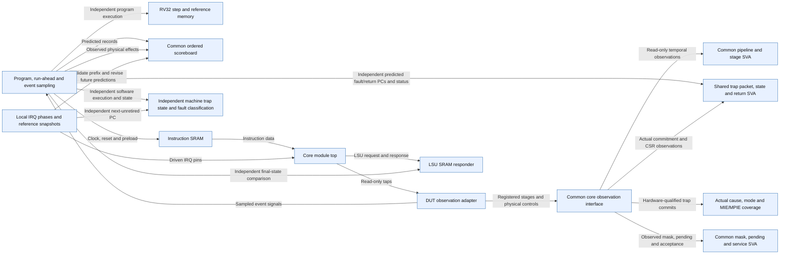

# Core trap verification architecture

F3 is implemented and executed, but not signed off. Timer, late timer, fast0 and
fast6 pass; external/software service and simultaneous requested priority fail.
The user retained MEIP > MTIP > MSIP. [F3 findings](F3_FINDINGS.md) separate that
contract from the current custom routing. F1-EXC-01 and F02-WB-01 remain open.
No RTL or GitHub issue-state change is part of this increment.

## Prediction, observation and recovery

The active DUT is module top in riscv_core/rtl/top.v. A software image and canonical
native SRAM responders drive it. Independent RV32 and scoped machine-mode semantics
predict PCs, GPR/CSR effects and reference memory. Only x0 starts known. Ordinary
retirements, physical RF writes and accepted stores have separate scoreboard cursors;
speculative decode is checked against the image, not counted as retirement.

Synchronous fault prediction excludes the faulting instruction from retirement. The
shared software handler stores mepc/mcause/mstatus/mtval, increments mepc by four and
returns through MRET. F2 checks illegal, EBREAK and misaligned LW/SW; no faulting
misaligned packet may issue a memory request. Aligned load execution is unsupported.

F3 cannot predict the interrupt arrival cycle as a fixed program trace. Instead,
local f3_scenario.svh saves pre-instruction reference snapshots during independent
execution. Every observed ordinary retirement must first match its expected PC.
The next expected retirement PC is the interrupt frontier and expected mepc, without
using DUT PCE, trap PC or CSR mepc as an oracle. A later timer stimulus exercises a
different frontier (0x80000060 versus early 0x80000050).

Observed trap commitment only aligns reference replanning. Before revising the tail,
`core_scoreboard.revise_unconsumed` checks observed retirement/GPR/store prefix counts
against independently saved counts. It preserves all observed effects, restores
reference state at the frontier and predicts handler plus resumed application.
IRQ handlers preserve mepc, replaying the interrupted instruction. Final dependent
application signatures 24/25 expose skipped or duplicated execution. One IRQ before
application stores is supported; post-store replanning fails explicitly instead of
inventing memory rollback. The common machine model accepts an independently supplied
interrupt PC/cause and applies mie and MIE checks and entry/return state rules.

## Reuse boundaries and temporal checks

Common library: typed effects, scoreboard, semantic steps, pipeline interface,
SRAM models, stage/pipeline SVA, shared trap SVA and functional monitor. Local fixture:
programs, handler construction, snapshot storage, source timing, scenario phases,
completion and the DUT-specific read-only hierarchy adapter. SVH files are included
manifest inputs; only SV/V compilation units appear as simulator sources.

core_sync_trap_sva.sv is generalized for both trap types, despite its historical
name. It checks independent cause/tval/PC/status, commitment redirects and MRET
restoration. core_irq_mask_sva.sv checks no acceptance/trap while globally masked,
required mip visibility, enabled acceptance and service within six sampled cycles
of fixture request readiness. Shared stage/protocol properties check reset/flush/
hold and request/commit relationships. Activation witnesses prevent vacuous passes.
No responder sees a flush mask, and physical effects are never deduplicated.

Pins change 2 ns after a falling edge. Timer/fast sources receive a one-clock pulse;
external/software level sources remain asserted. Early cases require eight masked
samples; timer-late arrives after enable. These are deterministic logical arrival
tests, not CDC/metastability verification or a universal same-edge service claim.

## Coverage and retained evidence

trap_functional_cov.sv samples actual hardware trap events: synchronous and IRQ
causes, mtvec mode and crossing, plus MIE/MPIE entry/return transitions. Per-run
counters corroborate actual witnesses. The timer report has 7/72 bins hit (9.72%);
31.46% is its point/cross average, not bin closure. Direct mode is hit; vectored is
unhit because the current mtvec WARL mask clears mode bits. Unsupported or failing
bins remain visible; no merged percentage or whole-core closure is claimed.

[F3_CONTRACT.md](F3_CONTRACT.md) defines timing/support; [F3_MATRIX.json](F3_MATRIX.json)
records 13 same-input runs, source/header hashes and archives; [RESULTS.md](RESULTS.md)
retains historical evidence. Five F1/F2 regressions pass on the F3 input set. Only
negative-mepc is the intentional checker-negative; external/software/priority are
real requested failures. Selected Final runs retain waveforms and detailed IMC
reports. Default iteration uses compressed SSH and compact retrieval.

No nested ISR preemption, full source sweep, ordered multi-source drain, fairness/
threshold closure, trap/wait or multicycle overlap, bus faults, vectored execution
or SoC ISR event loop is established. Current route omissions explain service and
priority failures; source repair needs separately authorized RTL work. Directed
passing fixtures do not waive the adjacent-store or repeated-write findings.

# Core trap and interrupt verification through F3

Scope: Directed synchronous recovery and four passing IRQ cases; independent PC/effect prediction, shared SVA and coverage. Requested external/software service and priority fail; general squash and IRQ closure remain open.

Source identity: `RISCFORGE_1TOPS-main/rtl/ips; modified HDL/header SHA256 set in F3_MATRIX.json; runs in RESULTS.md` @ `cd0660db866654e5a8bc687d2b8b9280e10b9ad2`. Spec: `core_trap_architecture.spec.json` (sha256 `3de4f85c7f8c`).

| Element | Status | Source | Symbol |
|---|---|---|---|
| TB | present | `Verification/tb_core_trap_lean/tb_core_trap_lean.sv` | `module tb_core_trap_lean` |
| DUT | present | `riscv_core/rtl/top.v` | `module top #(` |
| OBS | present | `Verification/tb_core_trap_lean/core_trap_observe.sv` | `module core_trap_observe` |
| MODEL | present | `Verification/lib/core/rv32/rv32_reference_pkg.sv` | `task automatic execute(` |
| SB | present | `Verification/lib/core/core_scoreboard_pkg.sv` | `class core_scoreboard` |
| IMEM | present | `Verification/lib/memory/sync_imem_sram.sv` | `module sync_imem_sram` |
| DMEM | present | `Verification/lib/memory/lsu_dmem_responder.sv` | `module lsu_dmem_responder` |
| PIPE | present | `Verification/lib/core/core_pipeline_if.sv` | `interface core_pipeline_if` |
| SVA | present | `Verification/lib/core/sva/core_pipeline_sva.sv` | `module core_pipeline_sva` |
| MACHINE | present | `Verification/lib/core/rv32/rv32_machine_reference_pkg.sv` | `task automatic step_machine` |
| TRAP_SVA | present | `Verification/lib/core/sva/core_sync_trap_sva.sv` | `module core_sync_trap_sva` |
| COV | present | `Verification/lib/core/trap_functional_cov.sv` | `module trap_functional_cov` |
| IRQ_FIX | present | `Verification/tb_core_trap_lean/f3_scenario.svh` | `task automatic update_f3_frontier()` |
| IRQ_SVA | present | `Verification/lib/core/sva/core_irq_mask_sva.sv` | `module core_irq_mask_sva` |
| TB -> MODEL | present | `Verification/tb_core_trap_lean/tb_core_trap_lean.sv` | `execute(image_pc` |
| TB -> SB | present | `Verification/tb_core_trap_lean/tb_core_trap_lean.sv` | `scoreboard.expect_instruction` |
| DUT -> OBS | present | `Verification/tb_core_trap_lean/core_trap_observe.sv` | `assign retired_w = tb_core_trap_lean.dut.instr_retired_W;` |
| OBS -> TB | present | `Verification/tb_core_trap_lean/tb_core_trap_lean.sv` | `core_trap_observe observe_core` |
| TB -> SB | present | `Verification/tb_core_trap_lean/tb_core_trap_lean.sv` | `scoreboard.observe_store` |
| TB -> IMEM | present | `Verification/tb_core_trap_lean/tb_core_trap_lean.sv` | `sync_imem_sram #` |
| IMEM -> DUT | present | `Verification/tb_core_trap_lean/tb_core_trap_lean.sv` | `.imem_sram_rdata(imem_rdata)` |
| DUT -> DMEM | present | `Verification/tb_core_trap_lean/tb_core_trap_lean.sv` | `.lsu_mem_req(mem_req)` |
| TB -> DMEM | present | `Verification/tb_core_trap_lean/tb_core_trap_lean.sv` | `dmem.mem[word_index] !== reference_memory.read_word` |
| OBS -> PIPE | present | `Verification/tb_core_trap_lean/core_trap_observe.sv` | `assign pipeline.hold_stage` |
| PIPE -> SVA | present | `Verification/tb_core_trap_lean/tb_core_trap_lean.sv` | `.pipe(pipeline)` |
| TB -> MACHINE | present | `Verification/tb_core_trap_lean/tb_core_trap_lean.sv` | `step_machine(image_pc` |
| TB -> TRAP_SVA | present | `Verification/tb_core_trap_lean/tb_core_trap_lean.sv` | `.expected_fault_pc(checked_trap_pc)` |
| PIPE -> TRAP_SVA | present | `Verification/lib/core/sva/core_sync_trap_sva.sv` | `core_pipeline_if.monitor pipe` |
| PIPE -> COV | present | `Verification/lib/core/trap_functional_cov.sv` | `covergroup cg_traps @(posedge pipe.clk)` |
| IRQ_FIX -> DUT | present | `Verification/tb_core_trap_lean/f3_scenario.svh` | `timer_irq = f3_pending_mask[7];` |
| IRQ_FIX -> MACHINE | present | `Verification/tb_core_trap_lean/f3_scenario.svh` | `enter_interrupt(expected_fault_pc, expected_cause, machine_state);` |
| IRQ_FIX -> SB | present | `Verification/tb_core_trap_lean/f3_scenario.svh` | `scoreboard.revise_unconsumed(` |
| PIPE -> IRQ_SVA | present | `Verification/lib/core/sva/core_irq_mask_sva.sv` | `core_pipeline_if.monitor pipe` |

Unknown / not inspected (deliberately not drawn as fact):
- F1-EXC-01 and F02-WB-01 remain open; directed smoke passes do not waive them
- F3-IRQ-01 and F3-ARB-01 are real requested-policy failures
- Vectored mode unhit; nested ISR, multi-source drain, wait overlap, full fast sweep and SoC loop not closed
