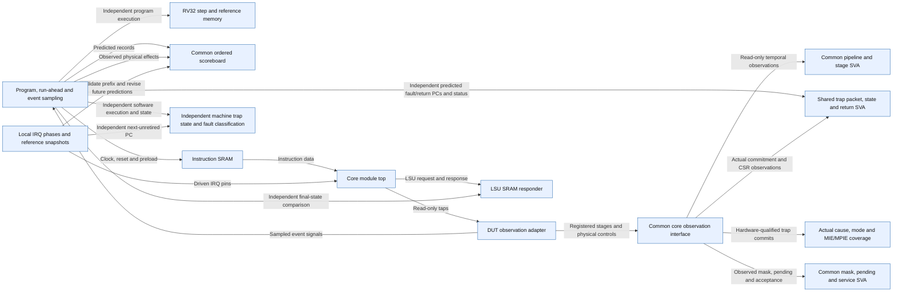

# Core trap and interrupt verification through F3

Scope: Directed synchronous recovery and four passing IRQ cases; independent PC/effect prediction, shared SVA and coverage. Requested external/software service and priority fail; general squash and IRQ closure remain open.

Source identity: `RISCFORGE_1TOPS-main/rtl/ips; modified HDL/header SHA256 set in F3_MATRIX.json; runs in RESULTS.md` @ `cd0660db866654e5a8bc687d2b8b9280e10b9ad2`. Spec: `core_trap_architecture.spec.json` (sha256 `3de4f85c7f8c`).

| Element | Status | Source | Symbol |
|---|---|---|---|
| TB | present | `Verification/tb_core_trap_lean/tb_core_trap_lean.sv` | `module tb_core_trap_lean` |
| DUT | present | `riscv_core/rtl/top.v` | `module top #(` |
| OBS | present | `Verification/tb_core_trap_lean/core_trap_observe.sv` | `module core_trap_observe` |
| MODEL | present | `Verification/lib/core/rv32/rv32_reference_pkg.sv` | `task automatic execute(` |
| SB | present | `Verification/lib/core/core_scoreboard_pkg.sv` | `class core_scoreboard` |
| IMEM | present | `Verification/lib/memory/sync_imem_sram.sv` | `module sync_imem_sram` |
| DMEM | present | `Verification/lib/memory/lsu_dmem_responder.sv` | `module lsu_dmem_responder` |
| PIPE | present | `Verification/lib/core/core_pipeline_if.sv` | `interface core_pipeline_if` |
| SVA | present | `Verification/lib/core/sva/core_pipeline_sva.sv` | `module core_pipeline_sva` |
| MACHINE | present | `Verification/lib/core/rv32/rv32_machine_reference_pkg.sv` | `task automatic step_machine` |
| TRAP_SVA | present | `Verification/lib/core/sva/core_sync_trap_sva.sv` | `module core_sync_trap_sva` |
| COV | present | `Verification/lib/core/trap_functional_cov.sv` | `module trap_functional_cov` |
| IRQ_FIX | present | `Verification/tb_core_trap_lean/f3_scenario.svh` | `task automatic update_f3_frontier()` |
| IRQ_SVA | present | `Verification/lib/core/sva/core_irq_mask_sva.sv` | `module core_irq_mask_sva` |
| TB -> MODEL | present | `Verification/tb_core_trap_lean/tb_core_trap_lean.sv` | `execute(image_pc` |
| TB -> SB | present | `Verification/tb_core_trap_lean/tb_core_trap_lean.sv` | `scoreboard.expect_instruction` |
| DUT -> OBS | present | `Verification/tb_core_trap_lean/core_trap_observe.sv` | `assign retired_w = tb_core_trap_lean.dut.instr_retired_W;` |
| OBS -> TB | present | `Verification/tb_core_trap_lean/tb_core_trap_lean.sv` | `core_trap_observe observe_core` |
| TB -> SB | present | `Verification/tb_core_trap_lean/tb_core_trap_lean.sv` | `scoreboard.observe_store` |
| TB -> IMEM | present | `Verification/tb_core_trap_lean/tb_core_trap_lean.sv` | `sync_imem_sram #` |
| IMEM -> DUT | present | `Verification/tb_core_trap_lean/tb_core_trap_lean.sv` | `.imem_sram_rdata(imem_rdata)` |
| DUT -> DMEM | present | `Verification/tb_core_trap_lean/tb_core_trap_lean.sv` | `.lsu_mem_req(mem_req)` |
| TB -> DMEM | present | `Verification/tb_core_trap_lean/tb_core_trap_lean.sv` | `dmem.mem[word_index] !== reference_memory.read_word` |
| OBS -> PIPE | present | `Verification/tb_core_trap_lean/core_trap_observe.sv` | `assign pipeline.hold_stage` |
| PIPE -> SVA | present | `Verification/tb_core_trap_lean/tb_core_trap_lean.sv` | `.pipe(pipeline)` |
| TB -> MACHINE | present | `Verification/tb_core_trap_lean/tb_core_trap_lean.sv` | `step_machine(image_pc` |
| TB -> TRAP_SVA | present | `Verification/tb_core_trap_lean/tb_core_trap_lean.sv` | `.expected_fault_pc(checked_trap_pc)` |
| PIPE -> TRAP_SVA | present | `Verification/lib/core/sva/core_sync_trap_sva.sv` | `core_pipeline_if.monitor pipe` |
| PIPE -> COV | present | `Verification/lib/core/trap_functional_cov.sv` | `covergroup cg_traps @(posedge pipe.clk)` |
| IRQ_FIX -> DUT | present | `Verification/tb_core_trap_lean/f3_scenario.svh` | `timer_irq = f3_pending_mask[7];` |
| IRQ_FIX -> MACHINE | present | `Verification/tb_core_trap_lean/f3_scenario.svh` | `enter_interrupt(expected_fault_pc, expected_cause, machine_state);` |
| IRQ_FIX -> SB | present | `Verification/tb_core_trap_lean/f3_scenario.svh` | `scoreboard.revise_unconsumed(` |
| PIPE -> IRQ_SVA | present | `Verification/lib/core/sva/core_irq_mask_sva.sv` | `core_pipeline_if.monitor pipe` |

Unknown / not inspected (deliberately not drawn as fact):
- F1-EXC-01 and F02-WB-01 remain open; directed smoke passes do not waive them
- F3-IRQ-01 and F3-ARB-01 are real requested-policy failures
- Vectored mode unhit; nested ISR, multi-source drain, wait overlap, full fast sweep and SoC loop not closed
