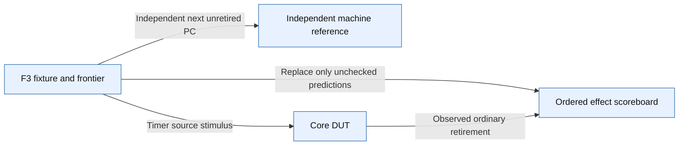

# F3 interrupt verification handoff

Scope: Independent expected PC and ordered effects; simplified verification path, not full RTL routing or coverage closure.

Source identity: `RISCFORGE_1TOPS-main/rtl/ips; modified input SHA256 set in Verification/tb_core_trap_lean/F3_MATRIX.json` @ `cd0660db866654e5a8bc687d2b8b9280e10b9ad2`. Spec: `f3_handoff.spec.json` (sha256 `078abd16f410`).

| Element | Status | Source | Symbol |
|---|---|---|---|
| F | present | `Verification/tb_core_trap_lean/f3_scenario.svh` | `initial begin : f3_drive_sources` |
| M | present | `Verification/lib/core/rv32/rv32_machine_reference_pkg.sv` | `task automatic enter_interrupt` |
| S | present | `Verification/lib/core/core_scoreboard_pkg.sv` | `class core_scoreboard` |
| D | present | `riscv_core/rtl/top.v` | `module top #(` |
| F -> D | present | `Verification/tb_core_trap_lean/f3_scenario.svh` | `timer_irq = f3_pending_mask[7];` |
| F -> M | present | `Verification/tb_core_trap_lean/f3_scenario.svh` | `enter_interrupt(expected_fault_pc, expected_cause, machine_state);` |
| F -> S | present | `Verification/tb_core_trap_lean/f3_scenario.svh` | `scoreboard.revise_unconsumed(slot, f3_snapshot_gpr_count[slot], f3_snapshot_store_count[slot]);` |
| D -> S | present | `Verification/tb_core_trap_lean/tb_core_trap_lean.sv` | `scoreboard.observe_retirement(obs_pc_w);` |

Unknown / not inspected (deliberately not drawn as fact):
- Full nested ISR and SoC interrupt routing are outside this milestone.
