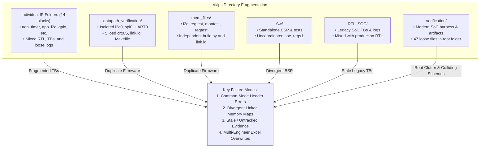
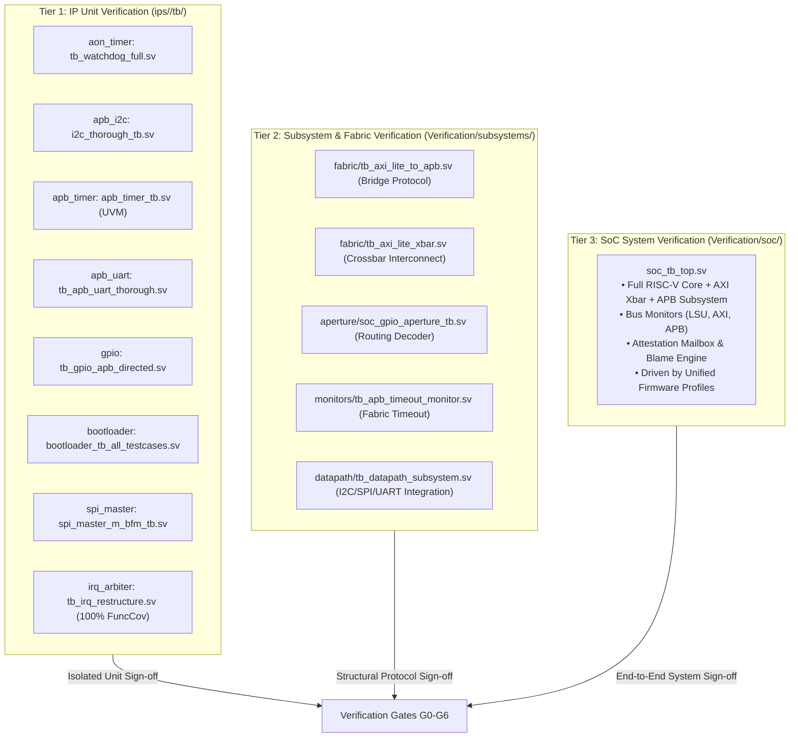
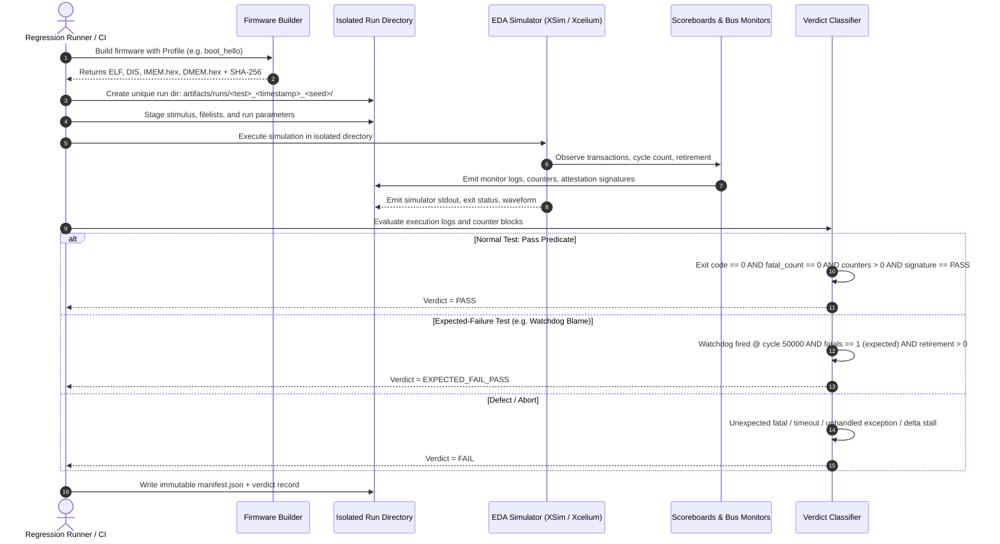
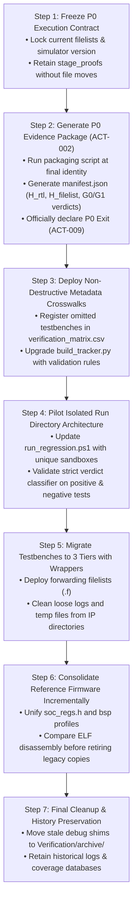

# RISCFORGE Verification Infrastructure, Firmware & Coordination Framework Architecture

> **Document ID:** RF-ARCH-VERIF-ORG-2026-B  
> **Target System:** RISCFORGE 1TOPS SoC Subsystem (`rtl/ips`)  
> **Baseline:** Verification Plan Rev B (`RISCFORGE_Verification_Plan_RevB.docx`)  
> **Status:** Architectural Proposal & Staged Implementation Plan  
> **Peer Review:** Reviewed with T3 Orchestration Engine (Codex `gpt-6.1-sol`, low effort)

---

## Executive Summary

A comprehensive repository audit of `rtl/ips` revealed significant organizational fragmentation across testbenches, firmware implementations, and verification infrastructure. While substantial engineering progress has been achieved (including DEF-001 hazard resolution, DEF-002 UART delta loop isolation, and 100% functional coverage on the interrupt arbiter unit), testbenches and firmware remain split across multiple unaligned silos (`Sw/`, `Verification/tests/`, `mem_files/`, `datapath_verification/`, `RTL_SOC/`, and individual IP folders). Furthermore, six conflicting numbering schemes cause coordination friction.

This document establishes an **industry-grade Verification Organization and Coordination Framework**. It details:
1. **Repository Pathology & Inventory Analysis**: A complete diagnostic of all existing testbenches, firmware folders, and documentation across `rtl/ips`.
2. **Independent Peer Review Findings**: Architectural critique and validation conducted via T3 Code orchestration (Codex `gpt-6.1-sol`).
3. **Three-Tier Boundary-Driven Testbench Hierarchy**: Clean separation of Unit (Tier 1), Subsystem/Fabric (Tier 2), and SoC Integration (Tier 3), utilizing non-destructive forwarding filelists to maintain continuous operational integrity.
4. **Profile-Driven Reference Firmware Architecture**: A unified BSP with execution profiles (Cold Boot, Preload, Trap, Nested IRQ, Compliance), centralized register definitions, shared peripheral drivers, and semantic test suite IDs.
5. **Unified Single-Source-of-Truth Coordination Framework**: Transition from manual Excel editing to version-controlled structured ledgers (JSON/YAML/CSV) that deterministically generate `RISCFORGE_Verification_Tracker.xlsx`, `PHASE_STATUS.md`, and CI manifests.
6. **Execution Isolation & Robust Verdict Classifier**: Preventing race conditions in parallel regressions, logging full artifact provenance (SHA-256 manifests), and eliminating false-positive verdict assertions.
7. **P0-Protected Staged Rollout Roadmap**: A 7-step sequence ensuring current Phase 0 (Bring-up) closeout is strictly safeguarded before structural migrations commence.

---

## 1. Repository Audit & Diagnostic Findings

Across the 32 directories in `rtl/ips`, four primary pathologies were identified:



### 1.1 Testbench Fragmentation
* **Unit Testbenches in IP Folders**: Structure is wildly inconsistent. `apb_timer-master` maintains a full UVM/SV environment in `tb/`, whereas `aon_timer`, `gpio-master`, and `bootloader` dump testbenches and raw simulator log files (`xrun_*.log`, `xvlog.log`) directly into their root directories. `apb_uart-main` places testbenches inside `rtl/`. `clic-master` contains zero testbenches.
* **Subsystem Datapath Testbenches (`datapath_verification/`)**: Contains complete, self-contained verification environments for `i2c0`, `spi0`, and `UART0`. Each has its own `run_tb.ps1`, `Makefile`, and firmware, completely isolated from the top-level regression environment.
* **Legacy SoC Testbenches (`RTL_SOC/`)**: Six historical testbenches (`soc_i2c_regtest_tb.sv`, `soc_imem_boot_tb.sv`, `soc_montest_tb.sv`, `soc_regtest_tb.sv`, `soc_timer0_boot_run_tb.sv`) remain co-located with production RTL files (`riscforge_soc_subsystem.sv`).
* **Modern SoC Verification (`Verification/infrastructure/tb/`)**: Houses the active, production-grade testbench `soc_tb_top.sv` with bus monitors and attestation mailboxes.
* **Root Clutter**: The `Verification/` root directory contains 47 loose files, including duplicate testbenches (`tb_axi_lite_to_apb.sv`, `soc_gpio_aperture_tb.sv`, `sram_sp_component_tb.sv`), ad-hoc debug testbenches (`tb_uart_trace_force.sv`, `tb_uart_nodut.sv`), and intermediate log files.

### 1.2 Firmware & Memory Map Divergence
Firmware is split across four mutually incompatible silos:
1. `Sw/bsp`: Contains `crt0.S`, `link.ld`, `soc_regs.h`, and `uart_min.h`.
2. `Verification/tests/bsp`: Contains `crt0.s`, `link.ld`, `isr_dispatch.c/h`, `proof_activity.c/h`, `mailbox.h`, and `soc_regs.h`.
3. `mem_files/`: Houses independent C and assembly sources for `i2c_regtest`, `montest`, `regtest`, and `timer`, each with custom `startup.S`, `link.ld`, and `build.py`.
4. `datapath_verification/`: Houses independent C programs for `i2c0`, `spi0`, `UART0` with custom `*_min.h` headers.

**Critical Vulnerability**: The four silos define different memory layouts (e.g. 32KB vs 64KB SRAM, divergent `.text` and `.data` base addresses) and duplicated register offsets (`soc_regs.h` vs `*_min.h`). This creates a significant common-mode failure risk where firmware passes in one silo but silently corrupts stack or memory in another.

### 1.3 Coordination Framework Gaps
* **Coverage in `verification_matrix.csv`**: Contains only 17 evidence rows. It currently omits:
  - `bootloader` standalone test suite.
  - `apb_timer-master` UVM verification suite.
  - `datapath_verification` testbenches.
  - Standalone crossbar testbench (`tb_axi_lite_xbar.sv`, currently recorded as `NO_RETAINED_RUN`).
  - Recent Oct 30 interrupt arbiter restructure unit run (`tb_irq_restructure.sv`, 100% functional coverage).
  - External memory slave models (`i2c_slave_at24c02`, `spi_slave_infinion`).
* **Colliding Numbering Schemes**: Six independent numbering systems exist across the codebase:
  1. Rev B Master Plan Phases: `P0`, `P1a`, `P1b`, `P2`, `P3.1`..`P3.4`, `P4.1`..`P4.5`, `P5`, `P6`, `F`.
  2. Stage Briefs: `Stage 1` (P0) through `Stage 8` (P6).
  3. Firmware Suites: `stage1_hello` through `stage7_nested_irq` (where `stage2_watchdog` is a watchdog fault-injection test, NOT Phase 1a Core Trust!).
  4. Infrastructure Stages: `S0` through `S8` in `handoff.md`.
  5. Roadmap Packages: `R0` through `R7` in `verification_roadmap.md`.
  6. Local Gate Labels: `P0-G1.1` through `P0-X3`.
* **Multi-Engineer Excel Divergence**: `build_tracker.py` regenerates `RISCFORGE_Verification_Tracker.xlsx`, but the script allows manual in-cell editing of yellow columns. Regenerating the tracker overwrites manual edits or resets component closure columns (`NO`, `NOT MAPPED`), leading to data loss in collaborative team environments.

---

## 2. Independent Peer Review Summary (Codex `gpt-6.1-sol`)

The proposed restructuring plan was formally submitted to an automated architectural review via T3 Code orchestration, utilizing Codex (`gpt-6.1-sol`) with low reasoning effort. The peer review validated the directional goals and supplied critical architectural mandates:

| Review Area | Codex `gpt-6.1-sol` Finding & Recommendation | Architecture Resolution Incorporated |
|---|---|---|
| **Organizational vs. Verification Validity** | Moving files does not equal verification closure. Qualifications (staged fixes, synthetic responders, model-only checker proofs) must be preserved as structured metadata fields rather than lost in folder moves. | Preserved all qualification tags in `verification_matrix.csv` and manifest schemas. |
| **Completeness Criterion** | Arbitrary targets (e.g. "reach 30+ rows") are unscientific. Completeness must be measured against the approved inventory of Rev B requirements, configurations, and verification obligations. | Mapped all matrix rows directly to Rev B clause numbers and functional obligation IDs. |
| **Common-Mode Register Risk** | Generating firmware headers directly from RTL (or vice versa) can cause common-mode failure where both agree on an erroneous specification. | Maintain independent architectural specification models and pin-level protocol assertions that check behavior externally. |
| **Testbench Boundary vs. Execution Medium** | Classify testbenches strictly by their physical DUT boundary (Unit, Subsystem, SoC), NOT by whether they execute firmware or run BFMs. | Formalized 3-tier boundary definitions. A test executing firmware on a subsystem model is a Tier 2 test, not Tier 3. |
| **Migration Safety & Symlinks** | Symlinks break across Windows PowerShell and Linux EDA environments. File moves break relative `$readmemh`, include paths, hierarchical binds, and coverage scopes. | Adopted **non-destructive forwarding filelists (`.f`) and wrapper scripts** instead of moving active files during active phases. |
| **Firmware Execution Contracts** | One universal `crt0.S` / `link.ld` is too rigid; preload boot, cold boot, trap tests, and compliance tests intentionally require different startup flows. | Introduced **Execution Profiles** (`profile_bootrom`, `profile_sram_preload`, `profile_trap_debug`, `profile_compliance`). |
| **Semantic Test Naming** | Do not name tests after phases (e.g. `p0_hello`, `p1b_watchdog`), as planning phases shift. Use permanent semantic IDs (`boot_hello`, `watchdog_blame`, `nested_irq`) and map them to phases via metadata. | Renamed test suite naming convention to purely semantic test IDs. |
| **Tracker Source of Truth** | Allowing Excel edits and porting back is unsafe. Authoritative records must live in version-controlled JSON/YAML ledgers; Excel and Markdown must be strictly **generated views**. | Structured ledger format established with one-way deterministic generation. |
| **Regression Runner Concurrency** | `run_regression.ps1` copies firmware into shared static filenames (`imem.hex`), causing collisions if jobs run concurrently. | Mandated unique, timestamped, isolated execution working directories for each regression run. |

---

## 3. Three-Tier Boundary-Driven Testbench Hierarchy

Testbenches are strictly classified by their **Design Under Test (DUT) boundary**, establishing clear verification intent and scoping:



### 3.1 Tier Definitions & Directory Structure
1. **Tier 1: IP Unit Verification (`ips/<ip>/tb/`)**
   - **Boundary**: Standalone IP block.
   - **Stimulus**: Dedicated Bus Functional Models (BFMs) or direct pin driving; no CPU core instantiated.
   - **Hygiene Rule**: All testbenches, filelists, and test vectors reside exclusively in `<ip>/tb/`. Simulation artifacts, waveforms, and logs are output to a `.gitignore`'d `<ip>/build/` or captured in `Verification/artifacts/`.
2. **Tier 2: Subsystem & Fabric Verification (`Verification/subsystems/`)**
   - **Boundary**: Multi-block structural fabric partitions (e.g. AXI-Lite Crossbar + APB Bridge + Aperture Decoders + Bus Monitors).
   - **Stimulus**: AXI master BFMs injecting concurrent transactions, error conditions, protocol stress, and synthetic responses.
   - **Role**: Validates arbitration, address decoding, wait-state propagation, timeout recovery, and PSLVERR generation prior to full SoC integration.
3. **Tier 3: Full SoC Integration Verification (`Verification/soc/`)**
   - **Boundary**: Full SoC Subsystem (`riscforge_soc_subsystem.sv` with `riscv_core`).
   - **Stimulus**: Real firmware executed by the RISC-V core from BootROM or SRAM, coupled with external slave models (`i2c_slave_at24c02`, `spi_slave_infinion`, UART terminals).
   - **Role**: System-level bring-up, end-to-end memory operations, interrupt preemption, software-driven fault injection, and Soak/Phase 5 convergence.

### 3.2 Non-Destructive Forwarding Filelists
To prevent breaking existing automated scripts or CI references, no active files are moved immediately. Instead, **forwarding filelists** and wrapper scripts provide clean reference access:

```text
# Example Forwarding Filelist: Verification/filelists/tb_axi_bridge.f
# Authoritative implementation location:
+incdir+../../axi_lite_to_apb
../../axi_lite_to_apb/axi_pkg.sv
../../axi_lite_to_apb/axi_lite_to_apb.sv
../../axi_lite_to_apb/tb_axi_lite_to_apb.sv
```

---

## 4. Profile-Driven Reference Firmware Architecture

To resolve the divergence across `Sw/`, `Verification/tests/`, `mem_files/`, and `datapath_verification/`, a centralized, modular firmware architecture is established under `Verification/firmware/`:

```mermaid
flowchart LR
    subgraph BSP["Reference BSP (Verification/firmware/bsp/)"]
        REG["soc_regs.h<br/>(Master Memory Map & Register Offsets)"]
        TRAP["trap_handler.S<br/>(Context Save/Restore & Vectored Dispatch)"]
        MAIL["mailbox.h<br/>(Attestation & Signature Interface)"]
    end

    subgraph Profiles["Execution Profiles (Verification/firmware/profiles/)"]
        P_BOOT["profile_bootrom.ld<br/>• Reset Vector @ 0x0001_0000<br/>• Code in BootROM<br/>• Data in SRAM"]
        P_PRE["profile_sram_preload.ld<br/>• Reset Vector @ 0x0000_0000<br/>• Preloaded IMEM/DMEM<br/>• High-Speed Sim Execution"]
        P_TRAP["profile_trap_debug.ld<br/>• Fault Injection Alignment<br/>• Dedicated Exception Stacks"]
    end

    subgraph Drivers["Peripheral Drivers (Verification/firmware/drivers/)"]
        D_UART["uart_driver.c/h"]
        D_SPI["spi_driver.c/h"]
        D_I2C["i2c_driver.c/h"]
        D_GPIO["gpio_driver.c/h"]
        D_TMR["timer_driver.c/h"]
    end

    subgraph Suites["Semantic Test Suites (Verification/firmware/suites/)"]
        T1["boot_hello"]
        T2["watchdog_blame"]
        T3["monitor_counts"]
        T4["fault_inject"]
        T5["reg_sweep"]
        T6["polled_periph"]
        T7["nested_irq"]
        T8["compliance_rv32i"]
    end

    BSP --> Drivers
    Profiles --> Suites
    Drivers --> Suites
    BSP --> Suites
```



### 4.1 Standard Register Map (`soc_regs.h`)
All ad-hoc headers (`uart_min.h`, `spi_min.h`, `i2c_min.h`) are deprecated. `soc_regs.h` serves as the authoritative C header:
* Base addresses locked to Rev B Table 14.1:
  - `BOOTROM_BASE` = `0x0001_0000`
  - `SRAM_BASE` = `0x0000_0000` (Size: 32KB/64KB configurable)
  - `APB_BASE` = `0x1000_0000`
  - `I2C_BASE` = `0x1000_0000` (Slot 0)
  - `TIMER0_BASE` = `0x1000_1000` (Slot 1)
  - `UART_BASE` = `0x1000_2000` (Slot 2)
  - `GPIO_BASE` = `0x1000_3000` (Slot 3)
  - `SPI_BASE` = `0x1000_4000` (Slot 4)
  - `TIMER1_BASE` = `0x1000_5000` (Slot 5)
  - `MAILBOX_BASE` = `0x2000_0000` (Attestation & Signature)

### 4.2 Standardized Build Tool (`build_firmware.py`)
A unified Python builder standardizes GCC toolchain invocations across all platforms:
* Inputs: Suite directory + Profile name.
* Compiler Flags: `-march=rv32i -mabi=ilp32 -O2 -nostartfiles -Wall -Wextra`.
* Provenance Stamping: Automatically embeds GCC version, git SHA/content SHA, and compile timestamp into the ELF metadata.
* Generated Artifacts:
  - `<test>.elf` (linked executable)
  - `<test>.dis` (complete disassembly with source line interleaving)
  - `<test>_imem.hex` (32-bit word-formatted instruction memory image)
  - `<test>_dmem.hex` (32-bit word-formatted data memory image)
  - `<test>_manifest.json` (content SHA-256 hashes of all sources and binaries)

---

## 5. Single-Source-of-Truth Coordination Framework

To eliminate spreadsheet desynchronization and multi-engineer collisions, the coordination framework is restructured into an automated, version-controlled architecture:

```mermaid
flowchart LR
    subgraph Ledgers["Version-Controlled Data Layer (.csv / .json)"]
        REQ["requirements_register.csv<br/>(Rev B Obligations & Clauses)"]
        MAT["verification_matrix.csv<br/>(Evidence Rows & Qualifications)"]
        DEF["defects.csv<br/>(DEF-001..DEF-012 Ledgers)"]
        ACT["actions.csv<br/>(ACT-001..ACT-011 Ledgers)"]
        DEC["decisions.csv<br/>(DEC-A..DEC-E Architectural Logs)"]
    end

    subgraph Engine["build_tracker.py (Validation & Generator Engine)"]
        VAL["1. Schema & Foreign-Key Validation<br/>2. Crosswalk Integrity Check<br/>3. Metric & Score Computation<br/>4. OpenPyXL Formatting Engine"]
    end

    subgraph Views["Strictly Generated Views (Do Not Hand-Edit)"]
        XLSX["RISCFORGE_Verification_Tracker.xlsx<br/>• Dynamic Formulas<br/>• Conditional Formatting<br/>• Visual Dashboard"]
        MD["PHASE_STATUS.md<br/>• Text Snapshot for GitHub / CI"]
        HTML["Dashboard HTML View<br/>(Optional Web Presentation)"]
    end

    Ledgers --> Engine
    Engine --> Views
```



### 5.1 Restructured Workbook Schema
The master workbook `RISCFORGE_Verification_Tracker.xlsx` is generated with 13 inter-linked sheets:

| Sheet Name | Purpose | Primary Key | Key Columns / Calculations |
|---|---|---|---|
| `Dashboard` | Executive verification summary | N/A | Formula-driven counts of MET/PARTIAL/NOT MET, Gate status, Defect severity distributions. |
| `Phase_Tracker` | Phase lifecycle status | `Phase_ID` | Rev B reference, Entry/Exit criteria, Gate status, Effort estimate, Blocker links. |
| `P0_Checklist` | P0 Bring-up gate tracking | `P0_ID` | Acceptance predicate, Evidence artifact path, Status (`MET`/`PARTIAL`/`NOT MET`), Gap, Action. |
| `Gate_Register` | Rev B Gate sign-off | `Gate_ID` | G0 through G6 pass predicates, Evidence artifact, Role owner, Verdict (`PASS`/`FAIL`/`UNTESTED`). |
| `Stage_Crosswalk` | 6-scheme reconciliation | `RevB_Phase` | Master Plan phase ↔ Stage brief ↔ Test suite ID ↔ Roadmap package ↔ Infra stage. |
| `Run_Register` | Attributable run ledger | `Run_ID` | Date, Tool, RTL SHA, Filelist SHA, Seed, Command, Completeness formula (`%`). |
| `Component_Evidence` | Detailed component status | `Evidence_ID` | Component, Scope, Top/Bench, Reported result, Artifact path, Boundary closed (`YES`/`NO`). |
| `Peripheral_Closure` | 6 APB peripherals closure | `Device_Name` | Unit bench, Firmware path, IRQ path, Timeout path, Overall closure formula. |
| `Infra_Maturity` | Capability checklist | `Capability` | Industry standard practice, Repo status (`EXISTS`/`PARTIAL`/`MISSING`), Target phase. |
| `Defects` | Bug register | `Defect_ID` | DEF-001..012, Class (C-DUT, C-TB, etc.), Severity (S1..S5), Status, Fix path, Regression test. |
| `Decisions` | Architectural choices | `Decision_ID` | DEC-A (Simulator of record), DEC-B..DEC-E, Scope, Approver, Timestamp. |
| `Actions` | Active engineering tasks | `Action_ID` | ACT-001..011, Description, Acceptance criteria, Owner, Status, Phase gate link. |
| `Doc_Inventory` | Documentation index | `Doc_ID` | Path, Title, Scope, Authority level, Revision date. |

### 5.2 Six-Scheme Crosswalk Reconciliation
The master crosswalk table is formally embedded into the tracker to resolve terminology collisions:

| Rev B Phase | Reference Stage Brief | Test Suite Semantic ID | Legacy Suite Folder | Roadmap Pkg | Infra Stage | Local Gate | Notes |
|---|---|---|---|---|---|---|---|
| **P0** | Stage 1 (Bring-up) | `boot_hello` | `stage1_hello` | R6 | S0 | P0-G1..P0-X3 | Bring-up & proof package. |
| **P1a** | Stage 2 (Core Trust) | `compliance_rv32i` | N/A (RISCOF) | R1 | S1 | G0, G1 | Core compliance, Sail lockstep, DEF-001. |
| **P1b** | Stage 3 (SoC Structural) | `monitor_counts` | `stage3_monitor_count` | R2, R5 | S1, S2, S4 | G0, G1, G3 | Bus counts, LSU-to-AXI-to-APB match. |
| **P1b (Supp)**| Stage 3 (Blame Engine) | `watchdog_blame` | `stage2_watchdog` | R2 | S1 | G3 | Watchdog fired during retirement (expected fail). |
| **P2** | Stage 4 (Device Models) | `reg_sweep`, `polled_periph` | `stage5_reg_sweep`, `stage6_*` | R3, R4 | S3, S5 | G3 | Register interface & peripheral models. |
| **P3.1** | Stage 5 (Reset & Clock) | `reset_stress` | N/A | R4 | S6 | G3 | Warm/cold reset with traffic. |
| **P3.2** | Stage 5 (Interrupts) | `nested_irq`, `irq_unit` | `stage7_nested_irq`, `tb_irq_*`| R4 | S6 | G3 | Vectored/direct IRQ, preemption, RR arbiter. |
| **P3.3** | Stage 5 (Fabric & Error) | `fault_inject` | `stage4_fault_inject` | R5 | S2 | G3 | Aperture errors, timeout propagation. |
| **P4.1-4.5** | Stage 6 (Regression & Cov)| `full_regression` | `run_regression.ps1` | R7 | S7 | G2, G4, G6 | Coverage closure & candidate regression. |
| **F** | Formal Track | `jg_superlint`, `formal_sva` | `jaspergold/` | F1 | N/A | Input to G5 | Parallel formal properties track. |
| **P5** | Stage 7 (Soak & Stress) | `soak_test` | N/A | R7 | S7 | G3 | Cold cycling & timeout soak. |
| **P6** | Stage 8 (Release) | `release_signoff` | N/A | R7 | S8 | G5 | Final freeze & release stamping. |

---

## 6. Execution Isolation & Verdict Classifier

### 6.1 Parallel Execution Isolation
To eliminate race conditions during regression runs, each test invocation executes in an isolated sandbox:



### 6.2 Standardized Attributable Manifest (`manifest.json`)
Every regression run generates an immutable `manifest.json` satisfying Rev B Tables 5.2 and 21.10:

```json
{
  "run_id": "20261031_boot_hello_run01",
  "timestamp": "2026-10-31T03:55:00Z",
  "tool": {
    "simulator": "Xilinx XSim",
    "version": "2022.2",
    "exact_command": "xsim work.soc_tb_top -tclbatch xsim_run.tcl -testplusarg TIMEOUT=100000"
  },
  "provenance": {
    "H_rtl": "e3b0c44298fc1c149afbf4c8996fb92427ae41e4649b934ca495991b7852b855",
    "H_filelist": "98234abcf9281e09183471029348120349812304918230491823049182304918",
    "ID_1_duplicate_divergent": 0,
    "ID_2_unresolved_entries": 0,
    "ID_3_absolute_paths": 0
  },
  "execution": {
    "test_name": "boot_hello",
    "profile": "profile_bootrom",
    "seed": "none",
    "plusargs": ["TIMEOUT=100000", "BOOT_MODE=ROM"],
    "elf_sha256": "4a28f...b912",
    "imem_sha256": "194ad...c011",
    "dmem_sha256": "0291f...e829"
  },
  "metrics": {
    "instructions_retired": 5551,
    "axi_reads": 14,
    "axi_writes": 4,
    "apb_transfers": 18,
    "pslverr_count": 0,
    "attestation_signature": "0x0004000e",
    "simulation_cycles": 12840,
    "wall_clock_seconds": 3.8
  },
  "verdict": {
    "status": "PASS",
    "predicate_g0_harness": "MET",
    "predicate_g1_stimulus": "MET",
    "notes": "Stage 3 boot scenario cleanly executed."
  }
}
```

---

## 7. Prioritized Implementation Roadmap (Protecting P0)

To safeguard current Phase 0 (Bring-up) closeout activities, changes are rolled out in a strict 7-phase sequence:



### Action Items Cross-Reference:
* **P0 Milestone Sign-off**:
  - `ACT-001`: Apply `apb_to_obi.sv` fix to golden copies.
  - `ACT-002`: Run the unified P0 packaging script.
  - `ACT-003` / `ACT-004`: Compute `unresolved_modules` and run `ID-1/2/3` check.
  - `ACT-005`: Converge duplicate `timer.sv` files.
  - `ACT-009`: Officially sign off Phase 0 exit.
* **Infrastructure Restructuring Milestone**:
  - Implement forwarding filelists for Tier 1 and Tier 2 testbenches.
  - Unify firmware build into `build_firmware.py`.
  - Regenerate master tracker with 100% synchronized data.

---

## Conclusion & Next Steps

This architecture provides a scalable, industrial-grade foundation for the RISCFORGE 1TOPS SoC. By strictly decoupling testbench classification from execution medium, centralizing firmware around execution profiles, enforcing single-source-of-truth coordination ledgers, and protecting Phase 0 closeout with forwarding wrappers, the team can achieve rapid, reliable sign-off across all verification gates.
