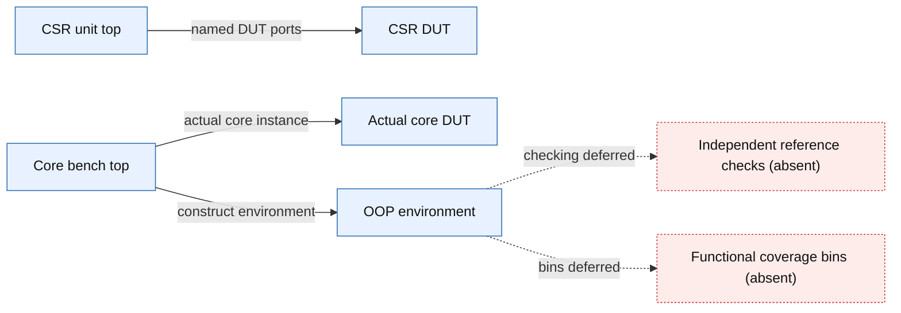

# CSR/trap coverage and closure check — 2026-11-11

**Verdict: OPEN / NOT CLOSED.** Both current benches compile, elaborate and execute locally. They execute only the reset-held skeleton and perform no functional checking; no functional coverage bins are implemented.

## Executed evidence

Tool: local Vivado XSim 2022.2, seed 1. Sources copied unchanged from the local workspace; source/filelist SHA-256 hashes and execution copies are retained in [manifest.json](manifest.json) and `source_snapshot/`. Git commit/dirty state is unavailable. All inspected workspace inputs still match their recorded hashes.

| Bench | SV compile | Coverage-enabled elaboration | Simulation | Functional verdict |
| --- | --- | --- | --- | --- |
| tb_csr_corner_unit | exit 0 | exit 0 | exit 0; finishes at 25 ns | SKELETON/INCOMPLETE; no checks |
| tb_core_csr_trap | exit 0 | exit 0 | exit 0; finishes at 30 ns | SKELETON/INCOMPLETE; checks=0 |

Both runs retain active-low reset asserted and IRQs low. XSim explicitly reports: `The Functional Coverage Database has not been updated during simulation.` A zero process exit is not a functional PASS.

## Coverage and checking

- Reference model/checker bodies: unimplemented USER_REF_MODEL hooks.
- Functional covergroups/bins: unimplemented USER_COVERAGE hooks. A closure percentage is undefined; there is no implemented functional-bin denominator.
- Directed hazard/exception/IRQ programs and schedules: unimplemented USER_STIMULUS hooks.
- Assertion module: extension stub; no checking properties implemented.
- Memory shells: placeholder NOP and zero/no-error/no-stall responses; no functional latency/error/effect model.
- Code instrumentation: requested statement, branch, condition and toggle (`-cc_type sbct`). Both runs wrote an `xsim.CCInfo` database. Reset-only activity does not establish feature coverage.
- Code report generation: XCRG restores both databases, then exits with Windows status `3221226356` (`0xC0000374`) while generating HTML. A retry with XILINX_VIVADO configured and relative report paths fails identically. Partial HTML is retained but is not accepted as a completed report or closure evidence.

## Warnings and preserved negative evidence

The core elaboration retains multiplier port-width mismatches (`co` and `shift`) and unconnected `imem_stall`, `csr_valid_o` and ALU `Zero` warnings. These are findings for engineer review, not diagnosed functional defects or waived warnings. No RTL or bench source was changed by this run.

The first two attempts (`../run_170245/` and `../run_170343/`) failed during generated-C compilation with XSIM 43-3409/43-3915. The generated file contains an unescaped Windows coverage directory. Forward-slash command paths resolve that failure in this run. Shortening paths alone did not resolve it.

The coverage-disabled diagnostic attempt in `../run_170343/` elaborated but its Tcl script path was misinterpreted; despite process exit 0, the requested script did not execute. It is not counted as a simulation pass. Its logs are preserved.

Remote VCS and Cadence attempts returned `Network error: Connection timed out`; direct SSH and campus-proxy TCP probes also timed out. No remote tool or licensed VCS run occurred. Local XSim results are engineering diagnostics and do not replace the checklist's VCS evidence requirement.

## Source-backed scope diagram

Source identity: source archive; Git commit unavailable. Manifest SHA-256: `68e2e9281fee441b5281fd51575d747d79c9df37fc3373ed218eea1d6b66f2aa`.
Diagram [spec](diagrams/closure_scope.spec.json), [validated rendering and source citations](diagrams/closure_scope.md), [validation log](diagrams/validation.log). This static diagram shows connections and absent checking/coverage; it does not depict an exercised trap path.

## Evidence files

- [Machine-readable stage commands/results](result.json)
- [CSR simulation log](tb_csr_corner_unit/simulation.log)
- [Core simulation log](tb_core_csr_trap/simulation.log)
- [Core elaboration warnings](tb_core_csr_trap/elaborate.log)
- [CSR report-generator failure](tb_csr_corner_unit/coverage_report.stdout.log)
- [Core report-generator failure](tb_core_csr_trap/coverage_report.stdout.log)
- Waveforms: each bench directory retains the generated `.wdb` and code-coverage database.

## What remains before closure

1. Engineer reviews/signs off the reference behavior and coverage-bin contract, including unresolved interrupt/CSR ordering policies.
2. Implement checks and bins, then directed stimulus and functional memory behavior as agreed. The engineer retains the previously assigned ownership.
3. Execute checked exception/IRQ/hazard scenarios, demonstrate checker-negative controls, inspect unhit bins/code and dispose warnings/defects with evidence.
4. Retain accepted-tool reports for the exact candidate and satisfy the agreed closure criteria. No gate approval or waiver is assigned here.

## Manual-based external activity collection — follow-up

External collection succeeded using the existing compiled snapshots and the documented XSim VCD commands. No RTL, testbench behavior, reference model or functional-bin definitions were changed.

- [AMD UG900 2022.2: Using the Value Change Dump Feature](https://docs.amd.com/r/2022.2-English/ug900-vivado-logic-simulation/Using-the-Value-Change-Dump-Feature) documents `open_vcd`, `log_vcd`, `close_vcd` and script-driven simulation.
- [AMD UG900: Functional Coverage Report Generator](https://docs.amd.com/r/2022.1-English/ug900-vivado-logic-simulation/Functional-Coverage-Report-Generator) distinguishes functional database reporting (`-report_format text/html`) from the code-coverage HTML report (`-cc_report`). A functional report still requires actual covergroups and sampled bins.
- [Accellera UCIS example](https://www.accellerasystemsinitiative.org/images/downloads/standards/ucis/UCIS_Version_1.0_Final_June-2012.pdf) shows `$display($get_coverage())` after defining and sampling a covergroup. Printing is a reporting operation; it does not create the coverage model or exercise scenarios.

Collector: [collect_external_activity.py](collect_external_activity.py). Its selected signal paths are validated with simulator `get_objects`; a missing signal or incomplete capture is an error. The script exports VCD and parses all changes at each timestamp before sampling clocked levels. Unknown values are counted separately. Counts are nonzero clock samples, not a claim of uniquely retired transactions or checked functional bins.

Successful output: [activity.json](external_activity_171406/activity.json), [activity.csv](external_activity_171406/activity.csv), [unit VCD](external_activity_171406/tb_csr_corner_unit/activity.vcd), [core VCD](external_activity_171406/tb_core_csr_trap/activity.vcd). Each bench directory retains the actual Tcl script, command metadata and simulator log.

| Observed metric | CSR unit | Core bench |
| --- | ---: | ---: |
| Duration | 25 ns | 30 ns |
| Rising clock samples | 3 | 3 |
| Samples while reset asserted | 3 | 3 |
| Active clock samples | 0 | 0 |
| Trap input/commit nonzero samples | 0 | 0 |
| MRET input/commit nonzero samples | 0 | 0 |
| Normal CSR write nonzero samples | 0 | 0 |
| IRQ input nonzero samples | 0 | 0 |
| Memory request nonzero samples | Not at this boundary | 0 |
| Unknown samples on monitored controls | 0 | 0 |

The collector reports raw observed activity without a coverage percentage: the required functional-bin model is not implemented. It can provide data for a later reviewed mapping to the engineer's bins and checker outcomes. The observed reset-only runs leave functional coverage closure OPEN.

The initial external-capture attempt in `external_activity_171321/` failed because the XSim launcher misparsed a space-containing coverage directory. The successful capture uses an isolated path without spaces and archives its results back into the project. This was runner/environment handling only.
