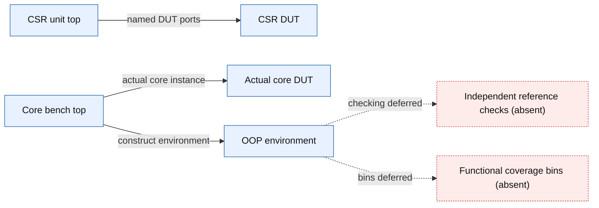

# CSR trap closure-check scope

Scope: Static DUT and environment connections for the executed source snapshot. Reset remains asserted; these edges do not claim functional activity or checking.

Source identity: `RISCFORGE_1TOPS-main/rtl source archive` @ `unavailable; executed source manifest SHA256 68e2e9281fee441b5281fd51575d747d79c9df37fc3373ed218eea1d6b66f2aa`. Spec: `closure_scope.spec.json` (sha256 `6d74a01af670`).

| Element | Status | Source | Symbol |
|---|---|---|---|
| U | present | `ips/Verification/infrastructure/tb/tb_csr_corner_unit.sv:1` | `module tb_csr_corner_unit` |
| R | present | `ips/riscv_core/rtl/csr_regfile.v:3` | `module csr_regfile` |
| C | present | `ips/Verification/infrastructure/tb/tb_core_csr_trap.sv:1` | `module tb_core_csr_trap` |
| D | present | `ips/riscv_core/rtl/top.v:23` | `module top #(` |
| E | present | `ips/Verification/infrastructure/tb/csr_trap/csr_trap_env_pkg.sv:107` | `class corner_env` |
| M | absent | `Inspected trap_scoreboard.consume/model_and_check and unit extend_reference_model: empty USER_REF_MODEL hooks.` | `` |
| F | absent | `Inspected both bench tops, coverage class, interfaces and assertion stub: no covergroup definitions or bins.` | `` |
| U -> R | present | `ips/Verification/infrastructure/tb/tb_csr_corner_unit.sv:16` | `.clk_i(clk)` |
| C -> D | present | `ips/Verification/infrastructure/tb/tb_core_csr_trap.sv:18` | `top #(.RESET_PC(RESET_PC)) core` |
| C -> E | present | `ips/Verification/infrastructure/tb/tb_core_csr_trap.sv:118` | `environment = new(core_if)` |
| E -> M | absent | `-` | `` |
| E -> F | absent | `-` | `` |

Unknown / not inspected (deliberately not drawn as fact):
- Git commit/branch/dirty state not established; exact source hashes and snapshots retained.
- VCS and Cadence hosts unreachable during this check.
- Full architecture behavior and any coverage closure remain unverified.
