# IRQ standards review — 12 November 2026

The custom direct IRQ structure is not inherently forbidden. Platform causes 16–27, fixed/round-robin priority, software-managed nesting and direct-only mtvec are not the defects reported here. PLIC and CLIC are not required simply to deliver machine interrupts.

## Findings recorded on GitHub

- [#33](https://github.com/raghul7cj/RISCFORGE_1TOPS/issues/33): standard MSIP/MEIP appear pending and enabled but cannot reach arbitration; MSIP is also writable through mip contrary to its standard access semantics. Optional MSI can be absent, but then it must be represented consistently.
- [#34](https://github.com/raghul7cj/RISCFORGE_1TOPS/issues/34): mintprio=3 suppresses standard MTIP while MIE/MTIE remain set. Custom-source filtering must be distinguished from standard machine-timer compatibility.
- [#35](https://github.com/raghul7cj/RISCFORGE_1TOPS/issues/35): source inspection shows a 32-bit periodic APB equality event mapped to cause 7 and cleared at trap acknowledgement, rather than a standard mtime/mtimecmp facility. This does not make the APB peripheral timer itself invalid.
- [#20 addendum](https://github.com/raghul7cj/RISCFORGE_1TOPS/issues/20#issuecomment-6817612467): M-only CSR accepts MPP=00 and SIE=1. Added evidence to the existing WARL issue rather than creating a duplicate.

## Evidence and limits

- [Reproducer](tb_irq_compliance.sv), [runner](run.ps1), [compile log](compile.log), [simulation log](simulation.log), [machine result](result.json), [source identities](source_identity.json).
- Icarus Verilog 12.0 in WSL: compilation succeeds; simulation intentionally exits 1 after seven failing standard-contract checks and one passing timer control. Seven checks are not seven independent root causes.
- The real CSR/gateway/arbiter blocks use the same relevant interconnections as top.v. This is not a full-core instruction execution proof. The reproduced mismatches are interface/CSR observations; SoC timer semantics are static findings.
- All seven inspected production sources match GitHub verification_infra after line-ending normalization. Git blob and SHA-256 values are saved; no claim of a clean local Git checkout is made.
- No production RTL, existing TB expectation, coverage exclusion or workbook status was changed. Existing 471-bin unit evidence retains its original scope and does not prove these standard contracts.
- CSR/IRQ instruction ordering remains an open integrated obligation in #21. No new pipeline-race failure is asserted here.

## Basis and next action

Reference: [RISC-V Privileged ISA 1.13](https://docs.riscv.org/reference/isa/v20260120/priv/machine.html), machine interrupt registers, privilege/interrupt-enable stack, and machine timer sections. These findings concern standard M-mode compatibility, not Linux/SBI or a claim to implement optional AIA/CLIC extensions.

Resolve the intended standard/custom boundary first; then independently test the approved correction. Preserve these negative results and add integrated instruction-to-trap tests. Do not change expectations solely to make the current RTL pass.

Run from rtl/: `./ips/Verification/artifacts/irq_compliance_review_20261112/run.ps1`. A failing return is the current expected negative evidence, not closure.

## Reproducer diagram

# Focused IRQ compliance review

Scope: Real block-level reproduction of pending/eligibility and CSR contract mismatches; not full pipeline or SoC execution.

```mermaid
flowchart LR
  S["Directed CSR writes and IRQ inputs"]:::present
  D["Real gateway + CSR + arbiter; top-equivalent wiring"]:::present
  C["Independent standard-contract checks"]:::present
  R["Retained failing verdict"]:::present
  S -->|"CSR state qualifies pending requests"| D
  D -->|"observe pending, offer and CSR fields"| C
  C -->|"failed contracts accumulate"| R
  classDef present fill:#e8f1ff,stroke:#2b6cb0,color:#111
  classDef planned fill:#fff8e1,stroke:#b7791f,stroke-dasharray:5 3,color:#111
  classDef absent fill:#fdecea,stroke:#c53030,stroke-dasharray:2 2,color:#111
  classDef uninspected fill:#f2f2f2,stroke:#888,stroke-dasharray:2 4,color:#444
```

Source identity: `RISCFORGE_1TOPS-main/rtl; SHA256(source_identity.json bytes + reproducer bytes)` @ `worktree-sha256:e97db949e44b442def13f7fba5435f9b401b2177ffe376cd3efc97282d978515`. Spec: `compliance_review.spec.json` (sha256 `da45c7a02be4`).

| Element | Status | Source | Symbol |
|---|---|---|---|
| S | present | `ips/Verification/artifacts/irq_compliance_review_20261112/tb_irq_compliance.sv:41` | `write_csr(12'h304,32'h888);` |
| D | present | `ips/Verification/artifacts/irq_compliance_review_20261112/tb_irq_compliance.sv:27` | `irq_arbiter arb(` |
| C | present | `ips/Verification/artifacts/irq_compliance_review_20261112/tb_irq_compliance.sv:34` | `task check(` |
| R | present | `ips/Verification/artifacts/irq_compliance_review_20261112/tb_irq_compliance.sv:63` | `if(failures) $fatal` |
| S -> D | present | `ips/Verification/artifacts/irq_compliance_review_20261112/tb_irq_compliance.sv:28` | `.mstatus_mie_i(status[3])` |
| D -> C | present | `ips/Verification/artifacts/irq_compliance_review_20261112/tb_irq_compliance.sv:52` | `check(mip[11]` |
| C -> R | present | `ips/Verification/artifacts/irq_compliance_review_20261112/tb_irq_compliance.sv:36` | `failures=failures+1;` |

Unknown / not inspected (deliberately not drawn as fact):
- Instruction-pipeline CSR ordering remains under GitHub #21.
- APB timer mismatch #35 is static inspection, not exercised by this reproducer.
