# Focused IRQ compliance review

Scope: Real block-level reproduction of pending/eligibility and CSR contract mismatches; not full pipeline or SoC execution.

```mermaid
flowchart LR
  S["Directed CSR writes and IRQ inputs"]:::present
  D["Real gateway + CSR + arbiter; top-equivalent wiring"]:::present
  C["Independent standard-contract checks"]:::present
  R["Retained failing verdict"]:::present
  S -->|"CSR state qualifies pending requests"| D
  D -->|"observe pending, offer and CSR fields"| C
  C -->|"failed contracts accumulate"| R
  classDef present fill:#e8f1ff,stroke:#2b6cb0,color:#111
  classDef planned fill:#fff8e1,stroke:#b7791f,stroke-dasharray:5 3,color:#111
  classDef absent fill:#fdecea,stroke:#c53030,stroke-dasharray:2 2,color:#111
  classDef uninspected fill:#f2f2f2,stroke:#888,stroke-dasharray:2 4,color:#444
```

Source identity: `RISCFORGE_1TOPS-main/rtl; SHA256(source_identity.json bytes + reproducer bytes)` @ `worktree-sha256:e97db949e44b442def13f7fba5435f9b401b2177ffe376cd3efc97282d978515`. Spec: `compliance_review.spec.json` (sha256 `da45c7a02be4`).

| Element | Status | Source | Symbol |
|---|---|---|---|
| S | present | `ips/Verification/artifacts/irq_compliance_review_20261112/tb_irq_compliance.sv:41` | `write_csr(12'h304,32'h888);` |
| D | present | `ips/Verification/artifacts/irq_compliance_review_20261112/tb_irq_compliance.sv:27` | `irq_arbiter arb(` |
| C | present | `ips/Verification/artifacts/irq_compliance_review_20261112/tb_irq_compliance.sv:34` | `task check(` |
| R | present | `ips/Verification/artifacts/irq_compliance_review_20261112/tb_irq_compliance.sv:63` | `if(failures) $fatal` |
| S -> D | present | `ips/Verification/artifacts/irq_compliance_review_20261112/tb_irq_compliance.sv:28` | `.mstatus_mie_i(status[3])` |
| D -> C | present | `ips/Verification/artifacts/irq_compliance_review_20261112/tb_irq_compliance.sv:52` | `check(mip[11]` |
| C -> R | present | `ips/Verification/artifacts/irq_compliance_review_20261112/tb_irq_compliance.sv:36` | `failures=failures+1;` |

Unknown / not inspected (deliberately not drawn as fact):
- Instruction-pipeline CSR ordering remains under GitHub #21.
- APB timer mismatch #35 is static inspection, not exercised by this reproducer.
