# CSR unit bench verification chain

Scope: How one directed case in tb_csr_corner_unit reaches a checked verdict and an observed-bin hit. Does not show the core bench (no stimulus), IRQ arbitration coverage, or signoff closure.

```mermaid
flowchart LR
  PLAN["Test plan: suites and unit bin allocation"]:::present
  UNIT_TB["tb_csr_corner_unit: five directed suites"]:::present
  CSR_IF["csr_corner_if: bench-owned drive signals"]:::present
  DUT["csr_regfile (31 ports)"]:::present
  CHECK["check_word: immediate expected-value compare"]:::present
  COV["observed_corner_coverage: u_status..u_reset"]:::present
  LOG["simulation.log: UNIT_DONE and OBSERVED_COVERAGE"]:::present
  CORE["core scenarios, reference model and core bins (absent)"]:::absent
  PLAN -->|"case list and bin ranges"| UNIT_TB
  UNIT_TB -->|"drive CSR ports at negedge"| CSR_IF
  CSR_IF -->|"31 named port connections"| DUT
  DUT -->|"read_data, mstatus, mepc, mcause"| CHECK
  UNIT_TB -->|"sample_bin(group, index)"| COV
  COV -->|"OBSERVED_COVERAGE report"| LOG
  CHECK -->|"UNIT_DONE checks/failures/spec_pending"| LOG
  PLAN -.->|"core scenarios and c_* bins planned"| CORE
  classDef present fill:#e8f1ff,stroke:#2b6cb0,color:#111
  classDef planned fill:#fff8e1,stroke:#b7791f,stroke-dasharray:5 3,color:#111
  classDef absent fill:#fdecea,stroke:#c53030,stroke-dasharray:2 2,color:#111
  classDef uninspected fill:#f2f2f2,stroke:#888,stroke-dasharray:2 4,color:#444
```

Source identity: `RISCFORGE_1TOPS-main rtl/ips (no git metadata in this checkout)` @ `worktree-2026-11-11 sha256:9e68edc994f77c9fe1772ab78e835dd1e4e224d6ba75731fe9e632bee3903d3c`. Spec: `csr_trap_unit_verification_chain.spec.json` (sha256 `42404eccfdfc`).

| Element | Status | Source | Symbol |
|---|---|---|---|
| PLAN | present | `ips/Verification/doc/plans/CSR_TRAP_CORNER_TESTPLAN.md:83` | `Unit-owned bins` |
| UNIT_TB | present | `ips/Verification/infrastructure/tb/tb_csr_corner_unit.sv:283` | `initial begin` |
| CSR_IF | present | `ips/Verification/infrastructure/tb/csr_trap/csr_corner_if.sv:31` | `clocking drive_cb` |
| DUT | present | `ips/riscv_core/rtl/csr_regfile.v:3` | `module csr_regfile` |
| CHECK | present | `ips/Verification/infrastructure/tb/tb_csr_corner_unit.sv:105` | `task automatic check_word` |
| COV | present | `ips/Verification/infrastructure/tb/csr_trap/csr_trap_coverage_pkg.sv:4` | `covergroup u_status` |
| LOG | present | `ips/Verification/artifacts/csr_trap_units_20261111_175150/csr_corner_unit/simulation.log:495` | `UNIT_DONE` |
| CORE | absent | `Searched tb_core_csr_trap.sv, csr_trap_env_pkg.sv and csr_trap_coverage_pkg.sv: arena/scoreboard hooks exist but no program, response schedule, expected-value model or c_* bin is implemented; the run ends at 30 ns reset-held.` | `` |
| PLAN -> UNIT_TB | present | `ips/Verification/doc/plans/CSR_TRAP_CORNER_TESTPLAN.md:83` | `Unit-owned bins` |
| UNIT_TB -> CSR_IF | present | `ips/Verification/infrastructure/tb/tb_csr_corner_unit.sv:96` | `csr_if.write_address` |
| CSR_IF -> DUT | present | `ips/Verification/infrastructure/tb/tb_csr_corner_unit.sv:17` | `csr_regfile #(.XLEN(32)) dut` |
| DUT -> CHECK | present | `ips/Verification/infrastructure/tb/tb_csr_corner_unit.sv:132` | `check_word("status.MIE"` |
| UNIT_TB -> COV | present | `ips/Verification/infrastructure/tb/tb_csr_corner_unit.sv:131` | `coverage_collector.sample_bin(0, index)` |
| COV -> LOG | present | `ips/Verification/infrastructure/tb/csr_trap/csr_trap_coverage_pkg.sv:109` | `OBSERVED_COVERAGE|u_status` |
| CHECK -> LOG | present | `ips/Verification/infrastructure/tb/tb_csr_corner_unit.sv:293` | `UNIT_DONE|checks=` |
| PLAN -> CORE | planned | `ips/Verification/doc/plans/CSR_TRAP_CORNER_TESTPLAN.md:95` | `Core-owned bins` |

Unknown / not inspected (deliberately not drawn as fact):
- Whether the trap/MRET-versus-Port-B write priority in csr_regfile is the approved contract; the plan lists it as spec-pending.
- Core-level behaviour: no program, memory response schedule or reference model has been executed.
- Whether RISCOF Zicsr normal-access closure exists; no qualifying run was located.
- XCRG coverage database reporting crashes locally, so only in-simulation covergroup output is available.
