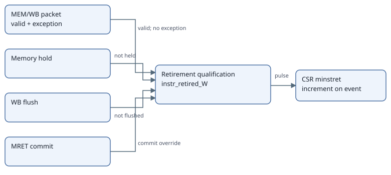

> **11 November final-source update:** see the [current retirement report](../../documentation/core/MINSTRET_RETIREMENT_20261111.md) and [29-bin checklist](checklist/README.md). The XSim declaration blocker described below is historical; declaration ordering now permits execution. Smoke/probe/Dhrystone pass; CoreMark CRCs match but its duration rule fails.

# WB retirement counter correction



[Saved ground-truth spec](docs/diagrams/retirement.spec.json) · [source citations and identity](docs/diagrams/retirement.md).

To reproduce the final saved before/after comparison in the GitHub layout:

```sh
python3 ips_reorganized/Verification/minstret_retirement/run.py --baseline-top ips_reorganized/Verification/minstret_retirement/evidence/final_20261111/top_before.v
```

Use `ips/` instead in the flat local workspace. The baseline snapshot is preserved
as evidence; it is not an active production source.

The core's `valid_W` indicates an occupied MEM/WB packet. It is not a one-cycle
retirement event: memory waits hold the packet and its validity high. The CSR
previously incremented `minstret` every clock while that packet remained valid.

`ips/riscv_core/rtl/top.v` now supplies this event to `instr_retired_i`:

```verilog
assign instr_retired_W = valid_W & ~exc_valid_W &
                         (mret_commit | (~mem_stall_out & ~FlushW));
```

For ordinary instructions this is valid, non-excepting, not held and not
flushed. A committing MRET is the explicit exception to the hold/flush mask:
the existing commit controller consumes it by redirecting and clearing the WB
packet, even when the younger memory stage is waiting. The MRET must count once.
The change affects only the CSR retirement input, not register/CSR write enables
or trap-controller behavior.

NOPs are instructions and count. Invalid pipeline bubbles do not. Excluding
NOPs would make `minstret` a different metric. The RISC-V ISA explicitly includes
applicable performance-counter increments in NOP behavior:
https://docs.riscv.org/reference/isa/v20260120/unpriv/rv32.html#_nop_instruction

## Directed verification

Run from repository root under WSL/Linux with Python 3, Icarus Verilog and
`riscv64-unknown-elf-gcc`/binutils:

```powershell
wsl.exe -e python3 ips/Verification/minstret_retirement/run.py
```

The assembly executes a statically known path of **29 retiring instructions**:
real NOPs, stores, variable-latency loads, a jump over two wrong-path
instructions, a three-iteration loop, and an ECALL handler ending in MRET.
The faulting ECALL does not retire. The instruction list is built from ELF
symbols and explicit program flow, not from DUT retirement-pulse totals.

The harness checks the final real CSR value against that architectural count,
checks the executed WB PC order, and checks that an ordinary held packet leaves
the counter unchanged. It requires exactly one exception and one MRET, and
observed held WB edges for each nonzero wait case. No pipeline signals are forced.

On 2026-11-11 the patched core passed waits **0, 1, 4, 9**, reporting 29 for
each. There were respectively 0, 2, 8, 18 observed held WB edges. The captured
pre-patch `top.v` passes wait 0 and fails waits 1, 4, 9 by incrementing a held WB
packet. Local before/after reproduction:

```powershell
wsl.exe -e python3 ips/Verification/minstret_retirement/run.py --baseline-top ips/Verification/minstret_retirement/build/top_before.v
```

That optional baseline file was saved before the change and is a local build
artifact. The evidence directory retains the comparison results, source hashes
and logs. Generated ELF, disassembly, expected instruction list and simulator
executables remain under the ignored `build/` directory.

The existing `core_port_20261109/run_tests.py` regression also passed all 13
cases with this patch. It covers MDU, load/MDU overlap, redirect waits, illegal
instructions, fetch faults, trap/MDU interaction and MEPC behavior.

## Full-SoC limitation

An attempted full-SoC XSim counter-probe run failed compilation before target
execution: `execute_cycle.v:308` uses `start_M` before its declaration, which
XSim reports as `VRFC 10-3380`. This existing MDU declaration issue was not
changed as part of the counter fix. The log is preserved in `evidence/` and the
full run directory is
`ips/benchmarks/runs/minstret_fix/counter_probe_20261111T083131Z_de84f679`.

These are directed development checks, not full retirement qualification,
benchmark validation or signoff. Counter overflow/writes and MRET concurrent
with a younger memory wait are not explicitly exercised by this test. Existing
Icarus multiplier-width warnings are retained in the compile logs.
