# minstret checklist closure

The user's instruction/event checklist is closed for the directed core configuration
below: **29/29 declared functional bins, 12/12 simulations passing**, on 2026-11-11.
No design RTL was changed during this checklist campaign. The preceding retirement
pulse patch in `ips/riscv_core/rtl/top.v` is the DUT implementation under test.

Final source campaign: [20261111T090729Z/coverage.json](campaigns/20261111T090729Z/coverage.json), rerun after the behavior-preserving MDU declaration reorder. The prior 20261111T084023Z campaign remains historical.
The first campaign (`20261111T083907Z`) is retained; the final one additionally
requires an actually observed flushed decode poison instruction and verifies final
data-memory values. It supersedes the first campaign's closure claim.

## Contract and measured bins

An ordinary valid, non-excepting WB packet increments once when consumed, not
while held or killed. A committing MRET increments once despite its own redirect
flush. A real NOP is an instruction and increments; an invalid pipeline bubble
does not. No tested program writes minstret, so the expected per-cycle counter
change is exactly 0 or 1 and the final count is independently predictable.

| Requested condition | Functional bins | Passing evidence |
| --- | --- | --- |
| ADD, SUB, MUL, DIV increment | ADD, SUB, MUL, DIV | Each instruction retires with delta 1 in operations.S. |
| Completed LW/SW increment | LW, SW | Final memory matches the software reference; each WB consumption adds 1. Both reads and writes receive 0/1/4/9 external wait cycles. |
| BEQ/BNE/JAL/JALR increment | BEQ_taken, BEQ_not_taken, BNE_taken, BNE_not_taken, JAL, JALR | Exact reference PC path and delta 1 for all six bins. |
| Legal completed CSR instructions increment | CSRRW, CSRRS, CSRRC, CSRRWI, CSRRSI, CSRRCI | All six forms use mscratch; read-only CSRRS also reads minstret. Each adds 1. |
| MRET increments | MRET | Five synchronous handler returns plus one interrupt return per set of wait configurations; each adds 1 despite its flush. |
| ECALL/EBREAK do not increment | ECALL, EBREAK | Actual trap causes 11/3 at the reference faulting PCs; each trap edge adds 0. |
| Illegal instruction does not increment | illegal | Executed 0xffffffff traps with cause 2; delta 0. |
| Misaligned load/store exceptions do not increment | misaligned_load, misaligned_store | Actual causes 4/6 at the intended LW/SW; delta 0 and exact handler path. |
| Flushed wrong-path instruction does not increment | wrong_path | Poison instructions are observed in valid decode slots with FlushD asserted; they never appear in the retired path or cause unexpected traps. |
| Pipeline bubble does not increment | bubble | Every invalid WB cycle checked for delta 0. |
| Stall produces no new increment | stall | Every valid held ordinary WB packet checked for delta 0; observed in nonzero wait cases. |
| Interrupt itself does not increment | interrupt | Timer input pin is pulsed, cause 7 commits at a precise boundary with delta 0; handler retires and interrupted NOP is replayed once. |
| Real NOP increments | NOP | Explicit executable 0x00000013 instructions count once, including the interrupted/resumed NOP. |

Bins are explicit counters derived from passing cycle traces and observed flush
logs. They are not a commercial simulator covergroup database or code coverage.
Failures cannot contribute passing bin hits. Closure requires every run to pass,
all bins to have checked hits, and no open bin.

## Testbench and oracle

`tb_checklist.sv` instantiates the real `top` core. It supplies synchronous
instruction memory, byte-enabled data RAM, variable wait responses for both
loads and stores, and a timer interrupt pulse. No hierarchical force is used.
Hierarchical accesses observe WB, CSR state and trap/flush events.

`run_checklist.py` assembles the three readable `.S` programs, then executes the
actual binary instructions in a deliberately small software reference. The
reference independently evaluates operands, arithmetic, memory, branches,
jumps, CSR state, synchronous trap entry and MRET. It emits an ordered list of
retired PCs, expected synchronous traps and final data memory. It stops at the
named `done` instruction; this avoids counting the terminating spin loop.

The TB checks the expected WB PC order, every counter delta and final count.
Its **per-cycle consume qualification mirrors the intended RTL contract**, so
that check alone would be insufficient. The independent software path length
and trap sequence, final counter total and final data memory provide additional
checks that are not computed from the DUT's retirement pulse.

The interrupt is asynchronous external stimulus. The main reference path has
unique PCs in a NOP window. At the actual interrupt commit, the TB requires the
reported interrupted PC to match the next expected PC, inserts the statically
assembled handler into the expected path, then requires the interrupted
instruction to execute after MRET. The Python collector requires exactly one
timer interrupt. This validates the reported precise boundary; it is not an
independent prediction of the arbiter's exact interrupt-acceptance cycle.

## Observed results

All three programs passed each wait setting **0, 1, 4, 9**:

- `operations.S`: reference/actual total 31, covering arithmetic, memory,
  branches, direct/indirect jumps, CSR forms, NOP and wrong-path squashing.
- `exceptions.S`: reference/actual total 33, including five MRET instructions
  and excluding all five faulting instructions.
- `interrupt.S`: reference/actual total 44, including the two-instruction
  handler and excluding the interrupt event itself.

Across the final campaign there were 180 checked NOP retirements, 70 checked
held-packet cycles with zero increment, 568 checked bubble cycles with zero
increment, and four timer interrupt entries with zero increment. Raw counts
are diagnostic hit totals, not performance measurements.

## Reproduce and inspect binary artifacts

From the GitHub repository root:

```powershell
wsl.exe -e python3 ips_reorganized/Verification/minstret_retirement/checklist/run_checklist.py
```

Each run creates a new `campaigns/<UTC timestamp>/` directory. It returns nonzero
if any simulation fails, an assertion/postcheck fails, or a required bin is open.
In the flat local workspace, replace `ips_reorganized/` with `ips/`; the runner
derives its RTL root from its own location and supports both layouts.
No simulator or EDA server credentials are needed. Tested tools: Icarus Verilog
and VVP 12.0, GCC 13.2.0, Python 3.12.3 under WSL.

Each program directory contains:

- `program.elf`, **`program.bin`**, `program.hex` and `program.dis`.
- `reference.json`, `reference.hex`, symbol table and compiler logs.
- `wait0/1/4/9.csv` cycle traces and corresponding simulator logs.

The raw binaries contain `.text` linked at `0x80000000` for this directed core
testbench. They are not directly interchangeable with the full-SoC benchmark
images linked into ISRAM at `0x00010000`.

`coverage.json` records per-run pass/failure, bin hits, all 36 source hashes and
artifact hashes. The sources were rehashed after execution with no changes.
The campaign compile log preserves existing multiplier port-width warnings.

## Limits and disposition

**Closed:** the 29 named functional bins for these programs, memory model and
machine-mode core configuration.

**Not claimed:** RTL statement/toggle/FSM coverage, universal instruction or
CSR legality, exhaustive operands, counter overflow or explicit counter writes,
nested/multiple interrupt sources, every MRET/backpressure interaction, formal
proof, full-SoC benchmark validation, or silicon signoff. The earlier full-SoC XSim declaration blocker is resolved by reordering declarations without changing logic. Smoke, probe and Dhrystone now pass. CoreMark completes with matching CRCs but retains its short-duration failure; no valid score is claimed. See [current integrated evidence](../../../documentation/core/MINSTRET_RETIREMENT_20261111.md).

The checklist is closed without waivers, expected-result changes, or additional
RTL fixes. Remaining qualification items above stay open outside this scope.

## Validated testbench diagram

```mermaid
flowchart LR
  assembly["Three assembly programs"]:::present
  build["ELF + SRAM image build"]:::present
  driver["TB memory + timer drivers"]:::present
  oracle["Software path reference"]:::present
  dut["Real top core"]:::present
  checker["PC + counter + memory / checks at clock edges"]:::present
  report["Passing-bin collection / coverage.json"]:::present
  assembly -->|"assemble"| build
  build -->|"ELF / SRAM images"| driver
  build -->|"assembled words"| oracle
  driver -->|"memory / waits / timer"| dut
  dut -->|"WB/CSR"| checker
  oracle -->|"expected PCs"| checker
  checker -->|"verdict"| report
  classDef present fill:#e8f1ff,stroke:#2b6cb0,color:#111
  classDef planned fill:#fff8e1,stroke:#b7791f,stroke-dasharray:5 3,color:#111
  classDef absent fill:#fdecea,stroke:#c53030,stroke-dasharray:2 2,color:#111
  classDef uninspected fill:#f2f2f2,stroke:#888,stroke-dasharray:2 4,color:#444
```



[Saved source-backed spec and identity](../docs/diagrams/testbench.spec.json) · [node/edge citations](../docs/diagrams/testbench.md).
