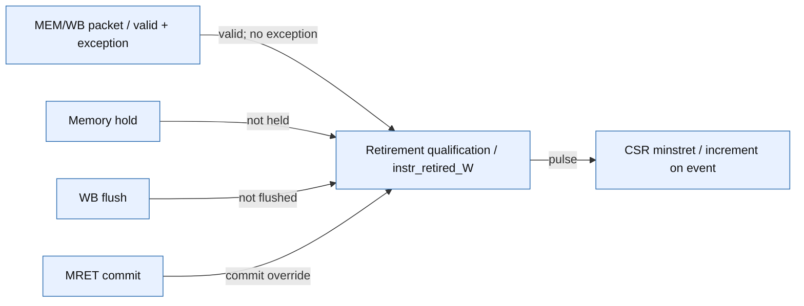

# WB occupancy to exactly-once minstret event

Scope: Current retirement-counter input path only; not a claim about every architectural side effect. Baseline plus the saved hashed source overlay.

Source identity: `raghul7cj/RISCFORGE_1TOPS verification_infra + source-overlay 8647af8b6fe7` @ `25d7b8ebf4ae8ab4da39f144df097676145e3dae`. Spec: `retirement.spec.json` (sha256 `d6cba31a4a58`).

| Element | Status | Source | Symbol |
|---|---|---|---|
| wb | present | `ips_reorganized/riscv_core/rtl/memory_cycle.v:206` | `reg valid_W_r;` |
| wait | present | `ips_reorganized/riscv_core/rtl/memory_cycle.v:193` | `assign mem_stall_out = core_stall_gated;` |
| flush | present | `ips_reorganized/riscv_core/rtl/top.v:165` | `wire FlushW;` |
| mret | present | `ips_reorganized/riscv_core/rtl/wb_trap_mret_commit_controller.v:65` | `assign mret_commit =` |
| pulse | present | `ips_reorganized/riscv_core/rtl/top.v:299` | `assign instr_retired_W =` |
| counter | present | `ips_reorganized/riscv_core/rtl/csr_regfile.v:154` | `if (instr_retired_i)` |
| wb -> pulse | present | `ips_reorganized/riscv_core/rtl/top.v:299` | `assign instr_retired_W =` |
| wait -> pulse | present | `ips_reorganized/riscv_core/rtl/top.v:300` | `(mret_commit | (~mem_stall_out & ~FlushW));` |
| flush -> pulse | present | `ips_reorganized/riscv_core/rtl/top.v:300` | `(mret_commit | (~mem_stall_out & ~FlushW));` |
| mret -> pulse | present | `ips_reorganized/riscv_core/rtl/top.v:300` | `(mret_commit | (~mem_stall_out & ~FlushW));` |
| pulse -> counter | present | `ips_reorganized/riscv_core/rtl/top.v:590` | `.instr_retired_i(instr_retired_W),` |

Unknown / not inspected (deliberately not drawn as fact):
- No statement/toggle/FSM coverage or counter-write/overflow qualification is represented.
