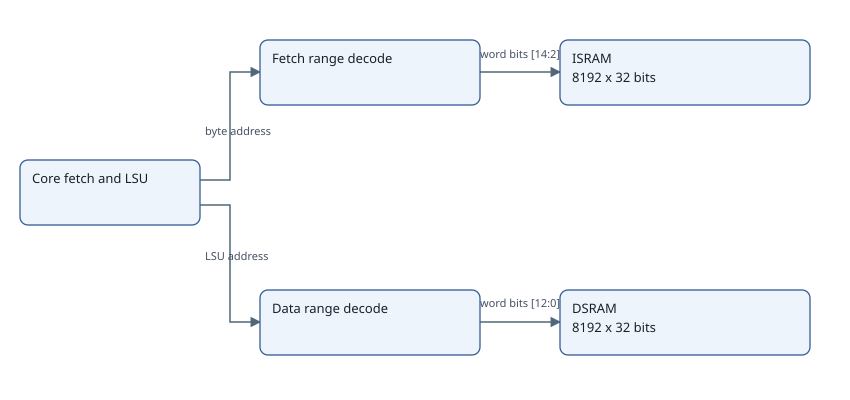

# Gate progress evidence as of 12 November 2026

This packet records the 11 November SRAM/simulator investigation for the signoff checklist update. No simulation was rerun on 12 November. It is scoped engineering evidence, not coach approval or accepted-tool gate signoff. Production RTL, TB, firmware, checks and SRAM sizes were unchanged by this investigation.

## Current progress and remaining criteria

| Checklist item | Evidence and progress | Remaining work |
| --- | --- | --- |
| G1.6 memory organization and G3.10 SRAM integration | 32,768 bytes each I/D SRAM. Current ELF uses 11,792 B text and 4,352 B static DSRAM. Passive probe observes 416 B stack depth and 28,000 B gap above static data. No enabled data-byte sample outside DSRAM. | One workload is not general memory safety. Architecture freeze, macro acceptance and official ROM-size departure remain unresolved. |
| G2.8 hazard and G2.9 CSR/trap implementation | Held-WB retirement duplication corrected. Directed architectural path oracle reports 29/29 declared bins and 12/12 runs. NOPs retire. Held, killed and faulting packets do not. | Counter writes/wrap, collisions, exact benchmark instruction windows and broader CSR/trap obligations remain. Do not equate the scoped fix with entire G2.9 closure. |
| G4.10/G4.11 core sanity | Dedicated full-SoC software TB is executable. Smoke and Dhrystone final-state checks pass in retained XSim runs. This is supporting evidence. | Not a replacement for class-complete approved-tool core sanity/regression. |
| G5.7 benchmarks | Dhrystone 10-iteration correctness PASS. CoreMark 2K validation workload has matching CRCs e3c1/0747/8d84 and no trap. Complete XSim and WSL Verilator result JSON is equal. | CoreMark terminal FAIL 0x3001: 534,940 timed cycles at 100 MHz = 0.0053494 s, below 10 s. No qualified score. Longer/performance-seed campaign and timing/counter qualification remain. |
| G5.8/G5.10 core coverage/bugs | Named retirement bins pass. Reporting-hook 6K-versus-2K classification corrected and upstream clone identity checked. | These bins do not close ISA/hazard/delay/code coverage or the entire defect list. IRQ/CSR negative evidence remains separately recorded. |
| G6 full-SoC execution | Real SoC booted through warm-reset SRAM preload, ran the benchmark and reported mailbox/trap state. | Does not prove cold ROM/SPI boot, remap, per-IP cases, all address boundaries or full regression. |

## Raw cross-simulator and SRAM evidence

- [Exact comparison and limits](comparison.json), [XSim raw result](xsim_result.json), [Verilator raw result](verilator_result.json).
- [Passive memory observations](sram_probe.json), [decoded ELF capacity](capacity_evidence.json).
- [Run log](verilator_run.log), [compile log](verilator_compile.log), [literal commands](commands.json).
- [Image hashes](image_hashes.json), [actual compile-input identity](actual_compile_inputs.json), [original source hashes](source_hashes.json), [source identity](source_identity.json).
- [Temporary TB diff](tb_overlay.patch) and [executed diagnostic TB](soc_benchmark_tb.sv). Only boot-ROM path-selection syntax and passive observation differ. Existing checks remain enabled. Generated C++ built under WSL /tmp because the workspace contains spaces.
- [Diagnostic script](portable_verilator_probe.py) preserves the original local ips/ layout and evidence paths. In the Git layout, map ips/ to ips_reorganized/ and stage referenced retained inputs before replay. This packet is evidence, not a newly integrated portable runner.

Verilator exit -6 follows the TB fatal for expected duration FAIL. JSON was written first. Both simulators used XSIM compatibility guards; Verilator additionally has two-state and assertion-selection differences. Equality here supports reproduction of this scenario, not general equivalence. Icarus did not execute: its original compile stopped at obi_pkg.sv:37.

SP briefly reaches 0x28004 during startup auipc/addi address construction, then returns to 0x28000. This register intermediate did not cause an out-of-range memory-byte sample. Request samples are observations, not a unique architectural transaction ledger.

## Validated routing diagram

[Saved source-backed spec](sram_routing.spec.json), [validation record](diagram_validation.json): five boxes and four arrows. This describes RTL selection/indexing, not runtime safety or latency.

## Previously published detailed evidence

- [Retirement correction, path oracle and full-SoC runs](https://github.com/raghul7cj/RISCFORGE_1TOPS/blob/94891823742fa80c77ebfb9d6427de281f85305a/ips_reorganized/documentation/core/MINSTRET_RETIREMENT_20261111.md).
- [Retained software-run summary](https://github.com/raghul7cj/RISCFORGE_1TOPS/blob/94891823742fa80c77ebfb9d6427de281f85305a/ips_reorganized/Verification/minstret_retirement/evidence/soc_20261111/summary.json).
- [CoreMark source verification and reporting-fix summary](https://github.com/raghul7cj/RISCFORGE_1TOPS/blob/94891823742fa80c77ebfb9d6427de281f85305a/ips_reorganized/benchmarks/docs/evidence/coremark_report_fix/summary.json).
- [Current IRQ/CSR negative evidence and gate boundaries](https://github.com/raghul7cj/RISCFORGE_1TOPS/blob/94891823742fa80c77ebfb9d6427de281f85305a/ips_reorganized/Verification/artifacts/irq_compliance_review_20261112/RESULTS.md).

## Next experiment

Use a small multi-iteration pilot before a long run. At 100 MHz a qualifying duration needs at least one billion timed cycles, beyond the current 2M watchdog. The first-order 2,500-iteration estimate is 13.37 target seconds and about 1.72 host hours in Verilator; it has not been executed. Preserve upstream duration/CRC checks. More iterations reuse buffers; no SRAM enlargement is indicated for this configuration. Performance seeds and remaining counter/timing qualification are also required.

## Dhrystone direct results

The 11 November XSim run passes all port final-state checks for 10 iterations: zero validation errors, no trap, 10,163 timed cycles (1,016.3 cycles/iteration). Instruction count and CPI remain unqualified; no published compliant score is asserted.

- [Analyzed Dhrystone PASS and qualification limits](https://github.com/raghul7cj/RISCFORGE_1TOPS/blob/bae6e79e01f479afc624fd3afb0011f29d0b8306/ips_reorganized/Verification/minstret_retirement/evidence/soc_20261111/dhrystone_20261111T090713Z_0e367f6e/analysis.json).
- [Raw Dhrystone mailbox and testbench result](https://github.com/raghul7cj/RISCFORGE_1TOPS/blob/bae6e79e01f479afc624fd3afb0011f29d0b8306/ips_reorganized/Verification/minstret_retirement/evidence/soc_20261111/dhrystone_20261111T090713Z_0e367f6e/result.json).
- [Dhrystone simulation log](https://github.com/raghul7cj/RISCFORGE_1TOPS/blob/bae6e79e01f479afc624fd3afb0011f29d0b8306/ips_reorganized/Verification/minstret_retirement/evidence/soc_20261111/dhrystone_20261111T090713Z_0e367f6e/simulation.log).
- [Run identity and metadata](https://github.com/raghul7cj/RISCFORGE_1TOPS/blob/bae6e79e01f479afc624fd3afb0011f29d0b8306/ips_reorganized/Verification/minstret_retirement/evidence/soc_20261111/dhrystone_20261111T090713Z_0e367f6e/run_metadata.json).
- [Build flags, source pins and image hashes](https://github.com/raghul7cj/RISCFORGE_1TOPS/blob/bae6e79e01f479afc624fd3afb0011f29d0b8306/ips_reorganized/Verification/minstret_retirement/evidence/soc_20261111/dhrystone_20261111T090713Z_0e367f6e/build.json).
