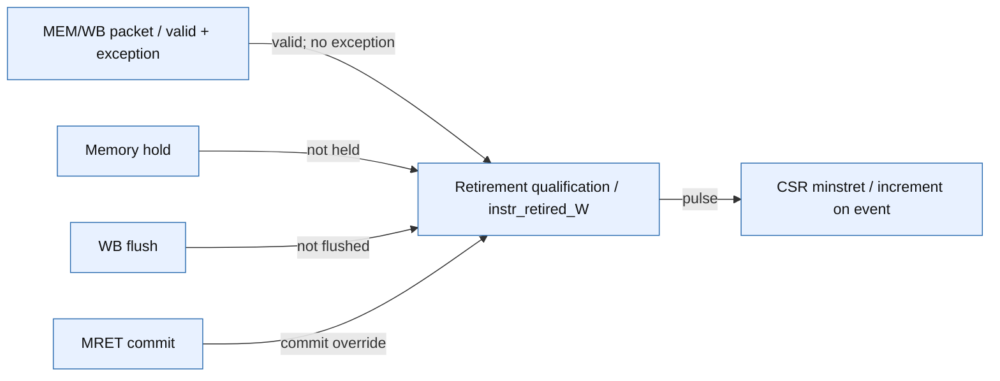

# minstret retirement: correction and current evidence

The held-WB duplicate increment is corrected in `riscv_core/rtl/top.v` and checked
with a directed architectural path oracle. **29/29 declared functional bins and
12/12 core runs pass**. The original before/after reproducer and 13 existing core
regression configurations also pass on the final source.

This is **implementation plus scoped verification**, not complete counter or
benchmark qualification. [Issue #16](https://github.com/raghul7cj/RISCFORGE_1TOPS/issues/16)
remains open because its counter-write and benchmark-requalification obligations
extend beyond these passing bins. [Issue #23](https://github.com/raghul7cj/RISCFORGE_1TOPS/issues/23)
remains open for complete workload/performance qualification.

## What changed and why

`valid_W` is a level describing an occupied MEM/WB packet. Memory waits preserve
that level. It cannot be used alone as an exactly-once retirement pulse.

```verilog
assign instr_retired_W = valid_W & ~exc_valid_W &
                         (mret_commit | (~mem_stall_out & ~FlushW));
```

An ordinary packet counts when it can advance, not while held or flushed. MRET
is counted once through its commit event, because it causes its own redirect
and WB flush. Exceptions do not retire. A real NOP counts; a bubble does not.
This changes only the CSR counter's retirement input, not the other architectural
write-enable paths.

The only accompanying MDU edit is declaration ordering in `execute_cycle.v`:
`m_hold`, `start_M` and `m_complete` are declared before procedural references.
Their expressions and update priorities are unchanged. This resolves XSim
`VRFC 10-3380`; it is not another functional MDU correction.

## Source-backed retirement diagram



Source: `25d7b8ebf4ae8ab4da39f144df097676145e3dae` plus source-overlay `8647af8b6fe70072995d0f06155605642ee559d96a0dd911b1161571a3c76f0d`. [Saved validated spec](../../Verification/minstret_retirement/docs/diagrams/retirement.spec.json) · [all source citations](../../Verification/minstret_retirement/docs/diagrams/retirement.md).

This diagram distinguishes stage occupancy, consume qualification and counter
update. It does not claim that every register/CSR/memory side effect has an
independently qualified exactly-once commit interface.

## Testbench and reference boundary


Source: `25d7b8ebf4ae8ab4da39f144df097676145e3dae` plus source-overlay `8647af8b6fe70072995d0f06155605642ee559d96a0dd911b1161571a3c76f0d`. [Saved validated spec](../../Verification/minstret_retirement/docs/diagrams/testbench.spec.json) · [all source citations](../../Verification/minstret_retirement/docs/diagrams/testbench.md).

The active top is `tb_checklist`, instantiating `top` at reset PC `0x80000000`.
The source set is the core's `.v` files plus the SV harness, compiled with Icarus
`-g2012`. It uses synchronous instruction memory, byte-enabled data memory with
0/1/4/9 wait responses, active-low reset, and an actual timer input pulse.
These are core-level injected memory/interrupt stimuli, not peripheral-to-core
SoC routing coverage. Software is RV32IM_Zicsr, ILP32, no compressed instructions.

The small software executor runs the actual assembled words to derive the
retired PC path, synchronous traps and final memory. The per-cycle consume
predicate mirrors the intended RTL contract; it is not an independent oracle
by itself. Independence comes from the dynamic path length, expected trap list,
final counter total and memory checks. The interrupt checker aligns the handler
at the DUT-reported precise interrupted PC; it does not independently predict
the arbiter's exact acceptance cycle or prove all source priorities.

## Final directed campaign and functional bins

See the [checklist and test sources](../../Verification/minstret_retirement/checklist/README.md),
[coverage JSON](../../Verification/minstret_retirement/checklist/campaigns/20261111T090729Z/coverage.json),
and [interactive coverage/architecture view](../../Verification/minstret_retirement/checklist/coverage.html).

The final campaign is `20261111T090729Z`, rerun after declaration reordering.
It supersedes `20261111T084023Z` for the final source identity; older passing and
negative results are preserved with their own hashes. The required bin set is
the user's instruction/event table, expanded into branch outcomes and six legal
CSR instruction forms. All 29 bins have checked hits and all 12 configurations
pass, with no waivers or expected-result changes.

Expected/observed retiring totals are 31 for arithmetic/control/memory/CSR, 33
for five synchronous exceptions and their handlers, and 44 for timer entry and
return. NOPs count. Faulting ECALL/EBREAK/illegal/misaligned operations, the
interrupt itself, bubbles, held packets and flushed poison do not count.
The three selected poison instructions are observed in valid decode slots
with `FlushD`, then absent from the retired path. Raw cycle traces retain
counter values before and after the checked events.

The original reproducer independently expects 29 dynamic instructions and shows
the pre-patch RTL failing held-WB tests at wait 1/4/9 while the corrected core
passes at wait 0/1/4/9. The baseline file matches the remote parent `top.v`.

## Full-SoC rerun before publication

Actual XSim 2022.2 execution on the same final core source, using the existing
full-SoC harness and unchanged staged firmware images:

| Workload | Current run | Observed result |
| --- | --- | --- |
| Smoke, 1 iteration | `smoke_20261111T090645Z_bd4ac7b8` | PASS; zero arithmetic/validation errors; no trap. |
| Counter probe | `counter_probe_20261111T090713Z_5d44cf56` | Diagnostic PASS; no trap. The window includes read overhead and is not an exact instruction oracle. |
| Dhrystone, 10 iterations | `dhrystone_20261111T090713Z_0e367f6e` | PASS; final-state checks complete; no trap. |
| CoreMark, 1 iteration | `coremark_20261111T090713Z_853ac45a` | Workload completes, CRCs match; terminal FAIL solely for insufficient duration. |

CoreMark reports list `0xe3c1`, matrix `0x0747`, state `0x8d84`, matching the
upstream 2K validation arrays. The timed work consumes 534,940 target cycles;
at the modeled 100 MHz that is about 5.35 ms, below the required 10 seconds.
The unchanged duration rule produces one error (`0x3002`). This is correctness
evidence with a preserved qualification failure, **not a valid CoreMark score**.

See [retained SoC run evidence](../../Verification/minstret_retirement/evidence/soc_20261111/summary.json).
The [source binding audit](../../Verification/minstret_retirement/evidence/soc_20261111/source_binding.json)
finds 109 matching parent Git blobs after the prefix mapping, the two intended
core overlays, and one UART source differing only by a trailing blank line.
That remote UART file is preserved. The benchmark TB and its two manifests
were not on the remote branch and are retained as immutable input snapshots
under `evidence/soc_20261111/inputs`; this commit does not claim to publish the
entire benchmark build flow. Generated config/ROM inputs are retained per run.
The passing smoke and Dhrystone results supersede the old arithmetic/trap
outcomes for this final source only; they do not erase the November 4 failures.
The analyzer conservatively continues to mark instruction/CPI accounting
unqualified. No published score is asserted.

## Issue acceptance and remaining work

| Obligation in #16 | Disposition |
| --- | --- |
| Current-candidate held-WB reproducer | Done with before/after evidence. |
| Independent unique-retirement ledger | Done for the declared paths; dynamic PC oracle, not repeated-PC suppression. |
| Normal/stall/exception/MRET/read/write interactions | Normal/stall/exception/MRET and legal reads checked; explicit counter writes/overflow and wider collision tests remain open. |
| Benchmark windows/counts requalified | Workloads rerun; exact measurement-window instruction accounting and standard duration/performance qualification remain open. |

Neither issue closure nor general G2/G5/G6 signoff follows from 29 directed bins.
Unmeasured statement/toggle/FSM coverage, exhaustive operands/legality, counter
write priority/wrap, nested interrupts, all MRET/backpressure collisions, full
ISA regressions and standard benchmark duration remain separate obligations.

## Reproduce

From the remote repository root (local flat workspace uses `ips/` in place of
`ips_reorganized/`):

```sh
python3 ips_reorganized/Verification/minstret_retirement/checklist/run_checklist.py
python3 ips_reorganized/Verification/minstret_retirement/run.py
python3 ips_reorganized/Verification/core_port_20261109/run_tests.py
```

Each checklist run creates a new timestamped campaign; any failed assertion,
missing bin, unexpected trap or bad final result makes it fail. Raw binary text
is linked at `0x80000000` for the unit harness; full-SoC firmware is separately
linked at `0x10000` by its existing builder. The upload preserves that boundary.

The publish-layout replay `20261111T092202Z` also passes all 12 cases under an
actual `ips_reorganized/` directory layout. Its 36 source hashes equal the primary
campaign after only the path-prefix mapping. [Replay proof and logs](../../Verification/minstret_retirement/evidence/final_20261111/remote_layout_replay/proof.json).

Diagram specs, source references, validator output, overlay identities and run
hashes are committed with the documents. The baseline is the named remote
parent plus the explicitly hashed overlay; it is not falsely described as a
clean checkout of that parent. Learn the key distinction through a held NOP:
`valid_W` may stay 1 for several clocks, but its ordinary retirement event is
only asserted when that packet advances.
