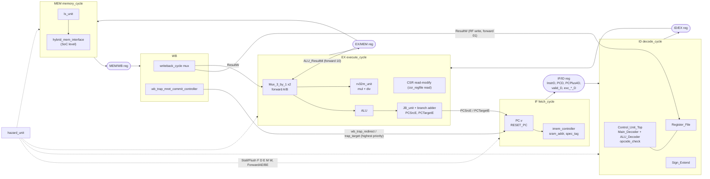

# RISCFORGE RV32 Core: Microarchitecture (as implemented)

Scope: sign-off documentation for the 1-TOPS tape-out checklist (items 1.1, 1.2, 1.13, and the "coded" evidence for 2.1 to 2.8 and 2.11). The exact checklist-item-to-section mapping is not given in the request; see Ambiguity A1.

Rules used in this document:
- It documents the RTL AS IMPLEMENTED. No RTL or testbench file was edited, and no bug is diagnosed or fixed here.
- Source root: `ips/riscv_core/rtl/` (active core, instantiated by `ips/RTL_SOC/riscforge_soc_subsystem.sv`). The legacy tree `rv32im_zicsr_5stage_exc_nointr_old/` was not used.
- Every claim cites `file:line`. File names without a path are in `ips/riscv_core/rtl/`.
- Evidence level: static reading of the RTL only. No simulation was run by the author of this document. Cycle counts that were derived by tracing the RTL (not observed in a waveform) are marked **UNVERIFIED**.
- CSR file, CSR address map, interrupt arbitration and trap CSR updates are documented elsewhere: see [CSR_and_Trap_Model.md](CSR_and_Trap_Model.md) (same folder; this file did not exist when this document was written).

---

## 1. Frozen choices

| Item | Frozen choice as implemented | Evidence |
|:--|:--|:--|
| Base ISA | RV32I, 32-bit, little-endian byte lanes in `ls_unit` | `opcode_check.v:30-41`, `ls_unit.v:74-159` |
| M extension | Implemented: MUL, MULH, MULHSU, MULHU, DIV, DIVU, REM, REMU (R-type opcode, `funct7 == 0000001`) | `decode_cycle.v:369`, `rv32m_unit.v:22-62` |
| Zicsr | Implemented: CSRRW/CSRRS/CSRRC and the three immediate forms, handled in EX, committed at WB | `Control_Unit_Top.v:154-163`, `execute_cycle.v:333-341` |
| Privileged instructions | `ECALL`, `EBREAK` (exact 32-bit encodings), `MRET` decoded; no other SYSTEM encodings decoded | `decode_cycle.v:151-152`, `Control_Unit_Top.v:165-166` |
| C extension (compressed) | NOT implemented. No 16-bit decode exists; PC is forced 4-byte aligned (any `PC_next[1:0] != 0` raises cause 0) | `fetch_cycle.v:183-186`, `execute_cycle.v:280-290` |
| A extension (atomics) | NOT implemented. Opcode `0101111` is not in the valid-opcode list, so an AMO/LR/SC fetch is an illegal instruction (cause 2) | `opcode_check.v:30-43`, `decode_cycle.v:415-418` |
| `misa` CSR | No reference to `misa` / CSR 0x301 in `riscv_core/rtl/` (grep for `misa`, `12'h301` found only the word "misaligned") | UNVERIFIED that no other file defines it; csr_regfile.v was not read in full |
| FENCE / FENCE.I | Opcode `0001111` is accepted as valid (no illegal exception). Decoder asserts no register write, no memory write, no jump or branch for it, so it behaves as a NOP. `funct3` is not inspected, so FENCE.I is also a NOP | `opcode_check.v:40`, `Main_Decoder.v:96-110, 156-162, 188-207` |
| Privilege | Machine mode only (see CSR document) | not examined here |
| Pipeline depth | 5 stages | `top.v:10-15` |
| Stage names | IF (`fetch_cycle`), ID (`decode_cycle`), EX (`execute_cycle`), MEM (`memory_cycle`), WB (`writeback_cycle`) | `top.v:295, 324, 377, 448, 505` |
| Pipeline registers | IF/ID inside `fetch_cycle`; ID/EX inside `decode_cycle`; EX/MEM inside `execute_cycle`; MEM/WB inside `memory_cycle`. `writeback_cycle` is purely combinational | `fetch_cycle.v:221-304`, `decode_cycle.v:220-372`, `execute_cycle.v:210-432`, `memory_cycle.v:199-287`, `writeback_cycle.v:34-36` |
| Branch resolution stage | EX | `execute_cycle.v:283, 290` |
| Trap/MRET commit stage | WB (precise, retirement-boundary commit) | `wb_trap_mret_commit_controller.v:64-67` |
| Hazard policy | Forwarding plus stall, not stall-only. Two forwarding paths into EX (from EX/MEM and from MEM/WB), a write-first register-file bypass in ID, and stalls for load-use, CSR hazards, M-unit busy and LSU wait states. No branch prediction, no speculation beyond sequential fetch, flush on taken branch/jump/trap | `hazard_unit.v:127-137, 148-175`; full list in section 3.8 |
| Reset | Asynchronous assert, active-low `rst` (named `rst` / `rst_n`) on every pipeline register | `fetch_cycle.v:230`, `decode_cycle.v:241`, `execute_cycle.v:346`, `memory_cycle.v:219`, `PC.v:36` |
| Reset PC parameter | `RESET_PC`, 32-bit parameter, default `32'h8000_0000` in `top`, `fetch_cycle` and `PC`. Reset loads `PC <= RESET_PC` | `top.v:25`, `fetch_cycle.v:51`, `PC.v:29, 38-39` |
| Reset PC in the SoC | The SoC overrides it to `32'h0000_0000` (BootROM base) | `riscforge_soc_subsystem.sv:1244-1245` |
| Register file reset | None in synthesis; registers are zeroed only in simulation (`initial` under `ifndef SYNTHESIS`). Read ports return 0 while `rst == 0` | `Register_File.v:44, 48, 52-60` |

---

## 2. Datapath description

### 2.1 Pipeline diagram



ASCII view of the same structure, with the redirect and forward paths:

```
        +--------+   +-------+   +--------+   +-------+   +--------+   +-----+
 PC --> |   IF   |-->| IF/ID |-->|   ID   |-->| ID/EX |-->|   EX   |-->|EX/MEM|--> MEM --> MEM/WB --> WB
        +--------+   +-------+   +--------+   +-------+   +--------+   +-----+                       |
           ^  ^                                              |  ^  ^         |                        |
           |  +--- PCSrcE/PCTargetE (branch/jump, from EX) --+  |  +- fwd 10 +  (ALU_ResultM)      |
           +------- wb_trap_redirect/trap_target (from WB) ---------------------------------------+
                                                                |  +---------- fwd 01 (ResultW) ---+
```

### 2.2 Stage block table

| Stage | Module(s) | Key inputs | Key outputs | Key control signals |
|:--|:--|:--|:--|:--|
| IF | `fetch_cycle` (`PC`, `PC_Adder`, `imem_controller`) | `PCSrcE`, `PCTargetE`, `wb_trap_redirect`, `trap_target`, `StallF`, `StallD`, `FlushD`, `imem_sram_rdata` | `InstrD`, `PCD`, `PCPlus4D`, `valid_D`, `exc_valid_D/cause/tval/pc`, `imem_sram_en/addr` (plus tied-off `we`, `wmask`, `wdata`) | `PC_next` mux `fetch_cycle.v:119-121`; PC hold `:135`; IF/ID priority reset > FlushD > stall > advance `:230-303` |
| ID | `decode_cycle` (`Control_Unit_Top`, `Main_Decoder`, `ALU_Decoder`, `opcode_check`, `Register_File`, `Sign_Extend`) | IF/ID outputs, `RegWriteW_gated`, `RDW`, `ResultW`, `FlushE`, `StallE` | ID/EX bundle: `RegWriteE`, `ALUSrcE`, `MemWriteE`, `ResultSrcE`, `BranchE`, `JumpE`, `ALUControlE`, `lsunitE`, `RD1_E/RD2_E`, `Imm_Ext_E`, `RD_E`, `RS1_E/RS2_E`, `PCE`, `PCPlus4E`, CSR control, `is_mret_E`, `is_M_instruction_E`, `op_E`, `valid_E`, `exc_*_E`; combinational `RS1_D/RS2_D`, `illegal_instr` | ID/EX priority reset > FlushE > StallE > advance `decode_cycle.v:241-371` |
| EX | `execute_cycle` (`Mux_3_by_1` x2, `Mux2`, `ALU`, `PC_Adder` as branch adder, `JB_unit`, `rv32m_unit`) | ID/EX bundle, `ForwardA_E/B_E`, `ResultW`, `ALU_ResultM`, `csr_rdata_i`, `irq_pending_i` | `PCSrcE`, `PCTargetE`, EX/MEM bundle (`ALU_ResultM`, `WriteDataM`, `RD_M`, `ResultSrcM`, `lsunitM`, CSR old/new values, `valid_M`, `exc_*_M`), `stallMUL`, `div_abort_o`, `irq_flush_frontend_o` | `PCSrcE` `execute_cycle.v:290`; EX/MEM priority reset > FlushM > StallM > advance `:346-431` |
| MEM | `memory_cycle` (`ls_unit`); `hybrid_mem_interface` sits outside the core in the SoC | EX/MEM bundle, `lsu_mem_rdata`, `lsu_mem_stall`, `lsu_mem_err` | `lsu_mem_req/we/addr/wdata/be`, `mem_stall_out`, MEM/WB bundle (`ReadDataW`, `ALU_ResultW`, `PCPlus4W`, `exc_*_W`, CSR old/new, `valid_W`) | MEM/WB priority reset > FlushW > hold on `core_stall_gated` > advance `memory_cycle.v:219-286` |
| WB | `writeback_cycle`, `wb_trap_mret_commit_controller`, `csr_regfile` | MEM/WB bundle | `ResultW`, RF write (gated at `top.v:285`), `wb_trap_redirect`, `trap_target`, `flush_pipeline_onehot` | `ResultSrcW` select `writeback_cycle.v:34-36`; trap/mret commit `wb_trap_mret_commit_controller.v:64-67` |

Result select at WB: `ResultSrcW` 00 = `ALU_ResultW`, 01 = `ReadDataW` (load), 10 = `PCPlus4W` (JAL/JALR link), 11 = `old_csr_W` (CSR read) (`writeback_cycle.v:34-36`, encodings from `Main_Decoder.v:171-182`).

Register-file write is gated at WB by `valid_W & ~exc_valid_W & ~mret_commit` (`top.v:285`). CSR write is gated the same way (`top.v:286`).

---

## 3. Per-unit sections

### 3.1 PC generation (checklist 2.1)

Files: `PC.v`, `PC_Adder.v`, `fetch_cycle.v`, `imem_controller.v`.

- PC register: reset to `RESET_PC` (asynchronous, active-low); otherwise `PC <= PC_Next` when `StallF == 0`, else hold (`PC.v:36-44`).
- Sequential PC: `PCPlus4F = PCF + 4` (`PC_Adder.v:28`, instance `fetch_cycle.v:141-145`).
- Next-PC priority, highest to lowest (`fetch_cycle.v:119-121`):
  1. `wb_trap_redirect ? trap_target` (trap, interrupt, or MRET committed at WB)
  2. `PCSrcE ? PCTargetE` (taken branch or jump resolved in EX)
  3. `PCPlus4F`
- **Is "trap > branch/jump" implemented as such? Yes**, as a single priority mux in `fetch_cycle.v:119-121`. The same condition is applied to the PC hold: `StallF` reaching the PC is `(StallF | imem_stall_raw) && !PCSrcE && !wb_trap_redirect` (`fetch_cycle.v:135`), so neither a branch nor a trap redirect can be held off by a stall. `PCSrcE` itself is not masked by `wb_trap_redirect` in `execute_cycle.v:290`; the mux order alone gives the trap priority.
- Trap target: `trap_commit ? {mtvec base, plus 4*cause if vectored interrupt} : {mepc[31:2],2'b00}` (`wb_trap_mret_commit_controller.v:98-103`). Trap beats MRET in that mux (`:103`); an MRET commit requires `~exc_valid_W` (`:65`). CSR semantics are in the CSR document.
- Branch/jump target: `PCTargetE = JALR ? alu_r : (PCE + Imm_Ext_E)` (`execute_cycle.v:266-270, 284, 287`). JALR clears bit 0 only (`ALU.v:46`).
- Misaligned target: if a taken branch or jump computes a target with `[1:0] != 0`, `PCSrcE` is suppressed and an instruction-address-misaligned exception (cause 0, `tval = PCTargetE`) is raised instead (`execute_cycle.v:283-290, 480-483`).
- Fetch-side misalignment check uses `PC_next[1:0] != 0` (`fetch_cycle.v:183-186`).
- Instruction fetch address: `sram_addr = (stall_in && !instruction_is_branch) ? PC[31:2] : PC_next[31:2]` (`imem_controller.v:105`). Details of the extra cycle on a redirect are in section 7.

### 3.2 Decoder (checklist 2.2)

Files: `Control_Unit_Top.v`, `Main_Decoder.v`, `ALU_Decoder.v`, `opcode_check.v`, `Sign_Extend.v`, `decode_cycle.v`.

Decoded opcodes (`opcode_check.v:30-41`; control outputs in `Main_Decoder.v`):

| Opcode | Mnemonic class | RegWrite | ALUSrc | MemWrite | ResultSrc | ImmSrc / imm | Notes |
|:--|:--|:--|:--|:--|:--|:--|:--|
| `0110111` | LUI | 1 | 1 | 0 | 00 | U (`Sign_Extend.v:69-70`) | EX returns `Imm_Ext_E` (`execute_cycle.v:292`) |
| `0010111` | AUIPC | 1 | 1 | 0 | 00 | U | EX returns `PCE + Imm_Ext_E` (`execute_cycle.v:292`) |
| `1101111` | JAL | 1 | 1 | 0 | 10 | J (`ImmSrc=11`) | Jump bus `Jump[1]=1`, `Jump[0]=Op[3]=1` (`Control_Unit_Top.v:136-137`) |
| `1100111` | JALR | 1 | 1 | 0 | 10 | I | `Jump[0]=Op[3]=0` selects JALR; `ALUOp=11`, ALU op `0110` (`ALU_Decoder.v:142`) |
| `1100011` | BRANCH | 0 | 0 | 0 | 00 | B (`ImmSrc=10`) | `Branch[3]=1`, `Branch[2:0]=funct3` (`Control_Unit_Top.v:127-128`) |
| `0000011` | LOAD | 1 | 1 | 0 | 01 | I | `lsunit[4]=1`, `lsunit[3]=Op[5]=0` |
| `0100011` | STORE | 0 | 1 | 1 | 00 | S (`ImmSrc=01`) | `lsunit[3]=Op[5]=1` |
| `0010011` | OP-IMM | 1 | 1 | 0 | 00 | I, or shamt for SLLI/SRLI/SRAI | `Sign_Extend.v:76-78` |
| `0110011` | OP (includes M) | 1 | 0 | 0 | 00 | n/a | M-extension if `funct7 == 0000001` (`decode_cycle.v:369`) |
| `0001111` | FENCE / FENCE.I | 0 | 0 | 0 | 00 | n/a | accepted, NOP behaviour (see section 1) |
| `1110011` | SYSTEM | 1 | 0 | 0 | 11 | I | CSR ops, ECALL, EBREAK, MRET |

Control-bus packing: `lsunit = {lse, Op[5], funct3}` (`Control_Unit_Top.v:117-119`); `Branch = {Branche, funct3}` (`:127-128`); `Jump = {Jumpe, Op[3]}` (`:136-137`).

Immediates (`Sign_Extend.v:42-83`, priority order as coded):

| Type | Selector | Formula |
|:--|:--|:--|
| J | `ImmSrc == 11` | `{{12{In[31]}}, In[19:12], In[20], In[30:21], 1'b0}` |
| B | `ImmSrc == 10` | `{{20{In[31]}}, In[7], In[30:25], In[11:8], 1'b0}` |
| S | `ImmSrc == 01` | `{{20{In[31]}}, In[31:25], In[11:7]}` |
| U | `LUI == 1` (LUI or AUIPC) | `{In[31:12], 12'b0}` |
| I-shift | opcode `0010011` and `funct3` is `001` or `101` | `{27'b0, In[24:20]}` |
| I (default) | otherwise | `{{20{In[31]}}, In[31:20]}` |

ALU control mapping (`ALU_Decoder.v:63-142`): ALUOp 00 = ADD; ALUOp 01 = SUB for BEQ/BNE, SLT-signed for BLT/BGE, SLTU for BLTU/BGEU; ALUOp 10 = by `funct3` (SUB only when `{op[5], instr[30]} == 11`; SRA when `instr[30]`); otherwise default `0110` (JALR).

CSR decode: `csr_valid = (Op == SYSTEM)`; `csr_imm_mode = funct3[2]`, `csr_op = funct3[1:0]` only when `csr_valid` (`Control_Unit_Top.v:154-163`). `is_mret` matches the full 32-bit pattern `0011000_00010_00000_000_00000_1110011` (`:165-166`). ECALL matches `InstrD == 32'h00000073`, EBREAK `32'h00100073` (`decode_cycle.v:151-152`).

Decode-stage exceptions (`decode_cycle.v:415-426`): illegal instruction (cause 2, `tval = InstrD`), ECALL (cause 11), EBREAK (cause 3, `tval = PCD`), all gated by `valid_D`. A fetch-stage exception already in the IF/ID register takes priority (`:423-426`).

Illegal-instruction detection is opcode-only (`opcode_check.v:30-43`); `funct3` and `funct7` are not validated (see Observation O10).

### 3.3 Register file (checklist 2.3)

File: `Register_File.v`.

- 32 x 32-bit array, two combinational (asynchronous) read ports, one clocked write port (`Register_File.v:29, 34-39, 44-50`).
- x0: writes with `A3 == 0` are ignored, and the `else` branch re-writes `Register[0] <= 0` every cycle (`:35-38`). Read of x0 returns whatever `Register[0]` holds, which is 0 in simulation (initial block `:52-60`); no explicit read-side mask for address 0 other than the write-side enforcement (`:44-50`). Hardwiring is therefore by write enforcement.
- Same-cycle read/write: **write-first bypass**. If `WE3 && A1 == A3 && A3 != 0`, `RD1 = WD3` (`:45`); same for `RD2` (`:49`). `WE3` here is `RegWriteW_gated` (`top.v:331`, `:285`), so a squashed WB write does not bypass.
- Read ports return 0 while `rst == 0` (`:44, 48`).
- No reset of the array in synthesis (`:52-60` is simulation-only).

### 3.4 ALU (checklist 2.4)

File: `ALU.v` (combinational, one cycle).

| ALUControl | Op | Expression | Line |
|:--|:--|:--|:--|
| 0000 | ADD | `A + B` | `ALU.v:42` |
| 0001 | SUB | `A - B` | `:43` |
| 0100 | AND | `A & B` | `:44` |
| 0101 | OR | `A \| B` | `:45` |
| 0110 | JALR | `(A + B) & ~32'd1` | `:46` |
| 0111 | XOR | `A ^ B` | `:47` |
| 1000 | SLL | `A << B[4:0]` | `:48` |
| 1001 | SRL | `A >> B[4:0]` | `:49` |
| 1010 | SRA | `A_signed >>> B[4:0]` (`sra_result`, `:34`) | `:50` |
| 1100 | SLTU | `{31'b0, A < B}` (unsigned) | `:51` |
| 1111 | SLT | `{31'b0, A_signed < B_signed}` | `:52` |
| other | default | `0` | `:53` |

- Add/sub wrap: plain 32-bit Verilog `+` and `-` into a 32-bit result, so overflow wraps modulo 2^32 with no flag (`:42-43`).
- Shift masking: only `B[4:0]` is used as the shift amount for SLL, SRL and SRA (`:34, 48-50`). For immediate shifts `Sign_Extend` supplies `{27'b0, In[24:20]}`.
- Comparison flags for branches are computed from the raw operands and are independent of `ALUControl`: `flags[2] = (A == B)`, `flags[1] = (A_signed < B_signed)`, `flags[0] = (A < B)` (`:65-67`). The `Zero` output (`:60`) is not used by `execute_cycle` (not connected at `execute_cycle.v:258-264`).
- ALU operands come after forwarding: `Src_A` from `Mux_3_by_1`, `Src_B` from `Mux2(Src_B_interim, Imm_Ext_E, ALUSrcE)` (`execute_cycle.v:233-254`).

### 3.5 Branch / jump unit (checklist 2.5)

Files: `JB_unit.v`, `execute_cycle.v`.

`JB_unit` input `B = {Branch, funct3}`, `J = {Jumpe, Op[3]}`, `flags` from the ALU (`JB_unit.v:9-22`):

| Instruction | funct3 | Condition | Line |
|:--|:--|:--|:--|
| BEQ | 000 | `flags[2]` | `JB_unit.v:13` |
| BNE | 001 | `!flags[2]` | `:14` |
| BLT | 100 | `flags[1]` | `:15` |
| BGE | 101 | `!flags[1]` | `:16` |
| BLTU | 110 | `flags[0]` | `:17` |
| BGEU | 111 | `!flags[0]` | `:18` |

- `yes = branch_taken | J[1]`; `JALR = J[1] & ~J[0]` (`:21-22`). JAL and JALR are always taken.
- Branch encodings `funct3 = 010` and `011` match none of the six terms, so they are never taken and are not flagged illegal (`:13-18`; see O10).
- `branch_taken_raw = yesE & valid_E & ~exc_valid_E` (`execute_cycle.v:283`); `PCSrcE = branch_taken_raw & ~target_misaligned_E` (`:290`). The comment at `:289` states that `PCSrcE` is deliberately not gated by `StallM`.
- Targets: branch/JAL `PCE + Imm_Ext_E` (`:266-270`), JALR `alu_r` (`:284`). Link value for JAL/JALR is `PCPlus4` via `ResultSrc = 10` (`Main_Decoder.v:175-176`).
- Branches are resolved in EX with forwarded operands; there is no branch predictor.

### 3.6 Multiply / divide unit (checklist 2.6)

Files: `rv32m_unit.v`, `rv32m_mul.v`, `rv32m_div.v`, `execute_cycle.v`, `hazard_unit.v`.

**Issue and handshake (as coded).**
- `is_M_instruction_E` is registered in ID/EX when `opcode == 0110011 && funct7 == 0000001`; `op_E = funct3` (`decode_cycle.v:369-370`).
- `start_M = is_M_instruction_E && !m_started`, a combinational single-cycle start (`execute_cycle.v:310`). `m_started` sets on issue and clears on `m_valid_out` or `div_abort_internal` (`:301-309`).
- Interface to the unit: `valid_in = start_M`, operands `Src_A`/`Src_B_interim` (forwarded), `funct3`, `rd_in = RD_E` (`execute_cycle.v:312-325`). Returns `result`, `rd_out`, `valid_out` (one-cycle pulse), and `stall` (`rv32m_unit.v:7-20, 85-88`).
- `stall = mul_stall | div_stall | valid_in` (`rv32m_unit.v:85`). `valid_in` is part of the stall term, so the stall is asserted combinationally in the issue cycle.
- There is no ready/back-pressure on `valid_out`: when `m_valid_out` is high, EX substitutes the result (`ResultE = result_M`), `RD_E1 = rd_me`, `RegWriteE1 = 1` (`execute_cycle.v:293, 329-331`) and loads it into EX/MEM (`:411-419`). While an M instruction is in EX but not finished, `RegWriteE1 = 0` (`:330`).
- Operation dispatch: `funct3[2] == 0` goes to the multiplier, `funct3[2] == 1` to the divider (`rv32m_unit.v:22-23, 43, 56`).

**What stalls the pipeline.** `stallMUL = stall` of `rv32m_unit` (`execute_cycle.v:327`). In `hazard_unit` it contributes to:
- `StallF`, `StallD` (`hazard_unit.v:170-171`): fetch and IF/ID freeze.
- `FlushE` (`:192`) and `FlushM` (`:199`): ID/EX and EX/MEM are loaded with bubbles each stalled cycle.
- It is NOT part of `StallE` or `StallM` (`:173, 175`). So the M instruction does not stay in EX: the cycle after issue, EX holds a bubble (`decode_cycle.v:273-304` flush branch) and the M-unit carries the operation internally, re-injecting the result into EX/MEM when `valid_out` pulses. This follows from the code; it is **UNVERIFIED** by simulation.

**Latency (derived by tracing the RTL; UNVERIFIED by simulation).** Cycle 0 is the issue cycle (M instruction in EX, `valid_in = 1`).

| Case | Stalled cycles | `valid_out` cycle | Evidence |
|:--|:--|:--|:--|
| MUL, MULH, MULHSU, MULHU | 3 (cycles 0, 1, 2) | 3 | 3 pipeline registers `s1`, `s2`, output (`rv32m_mul.v:134-146, 228-239, 251-259`); stall counter set to 2 on issue and counts down (`rv32m_unit.v:69-83`) |
| DIV, DIVU, REM, REMU (regular operands) | 35 (cycles 0 to 34) | 35 | IDLE (cycle 0) then 32 COMPUTE iterations (cycles 1 to 32, `rv32m_div.v:167-173`), CORRECT (cycle 33, `:200-203`), DONE (cycle 34, `:208-214`); `valid_out` visible in cycle 35 |
| DIV/DIVU/REM/REMU with divisor 0, or signed overflow | 2 (cycles 0, 1) | 2 | IDLE goes directly to DONE (`rv32m_div.v:127-135`) |

Latency is fixed per class (bounded, no data-dependent variation other than the two early-out cases). `ARCHITECTURE_SUMMARY.md:215` says "~34"; the trace above gives 35 stalled cycles. This difference is listed under Ambiguity A5.

**Multiplier details (`rv32m_mul.v`).** Radix-4 Booth, 17 partial products on 33-bit sign/zero-extended operands (`:45-59, 65-85`), correction word (`:103-122`), 18-input Dadda tree to a sum/carry pair (`:158-218`), 64-bit carry-propagate add, and the product is truncated to 64 bits (`:247-248`). Operand signedness: MUL, MULH both signed; MULHSU rs1 signed, rs2 unsigned; MULHU both unsigned (`:45-46`). Result select: low 32 bits for MUL (`funct3 == 000`), high 32 bits otherwise (`:52, 257`).

**Divider details (`rv32m_div.v`).**
- Non-restoring radix-2, `P` starts at 0, dividend held in `quotient` and shifted in (`:94-99, 145-146, 167-173`); signed-digit to binary conversion `q_final_sd = quotient - ~quotient` and remainder/quotient restore (`:69-74`); sign fix-up for DIV and REM (`:73-74`).
- Operation flags are snapshotted in IDLE (`:122-125`).
- Divide by zero (`:49, 127-130`): DIV/DIVU return `32'hFFFF_FFFF`; REM/REMU return `rs1`.
- Signed overflow `0x8000_0000 / 0xFFFF_FFFF` (`:50-52, 132-135`): DIV returns `32'h8000_0000`; REM returns `0`. The overflow term applies only to signed ops (`:47, 50-52`), so DIVU/REMU with those operands run the normal path. Divide by zero is tested first (`:127` before `:132`).

**Abort (interrupt pre-emption).** `div_abort_internal = irq_accept_E & stallMUL` (`execute_cycle.v:297`); `irq_accept_E` requires `valid_E` (`:459`). `abort_i` resets the divide FSM to IDLE and clears its stall (`rv32m_div.v:106-109`) and clears the MUL stall counter (`rv32m_unit.v:73-75`). `rv32m_mul` has no abort input and its pipeline registers are not cleared by it (`rv32m_mul.v:23-38`). See O5 and O6.

### 3.7 Memory interface, load/store (checklist 2.7)

Files: `memory_cycle.v`, `ls_unit.v`, `hybrid_mem_interface.sv`.

**Byte enables and store alignment (`ls_unit.v:123-159`).**

| Store | funct3 | Byte offset | `mem_be` | `mem_wdata` |
|:--|:--|:--|:--|:--|
| SB | 000 | 0 / 1 / 2 / 3 | `0001` / `0010` / `0100` / `1000` | `wdata`, `<<8`, `<<16`, `<<24` |
| SH | 001 | `addr[1]=0` / `1` | `0011` / `1100` | `wdata` / `wdata << 16` |
| SW | 010 | n/a | `1111` | `wdata` |
| other funct3 | n/a | n/a | `0000` | `0` |
| non-store | n/a | n/a | `0000` | passes `core_wdata` through |

SH with `addr[0] = 1` still maps to the halfword lane selected by `addr[1]` in `ls_unit` (`:136-142`), but the request is blocked before reaching the bus (see misalignment below).

**Load formatting (`ls_unit.v:74-118`).** LB / LBU select the byte by `addr[1:0]` and sign / zero extend; LH / LHU select the half by `addr[1]` and sign / zero extend; LW passes the word; any other load funct3 returns 0 (`:113`). Non-load instructions return 0 (`:116`). Formatting happens in the MEM stage and the formatted value is latched into `ReadDataM_r` (`memory_cycle.v:274`).

**Alignment checks (`memory_cycle.v:115-130`).** Misaligned LW (`addr[1:0] != 0`), LH/LHU (`addr[0] != 0`), SW, SH raise load (cause 4) or store (cause 6) address-misaligned (`:134-136`). `tval` is the effective address (`:141`). On misalignment the bus request is suppressed: `lsu_mem_req/we = raw & valid_M & ~(exc_valid_M | misaligned_load | misaligned_store)` (`:179-180`). LB/LBU/SB have no alignment requirement.

**Outstanding transactions.** One. The LSU is a blocking, single-issue port: a request is driven from the EX/MEM register for as long as the instruction sits in MEM, and the pipeline is stalled until the bridge releases (`ls_unit.v:45-51`, `hazard_unit.v:170-175`). There is no request queue, no write buffer in the core, and no second request until the first completes. On the fetch side there is also one address per cycle and no handshake (section 4.1).

**Wait-state handling.** `core_stall = mem_req & mem_stall` (`ls_unit.v:50`). `memory_cycle` gates it with `~(misaligned_load | misaligned_store)` (`memory_cycle.v:186, 193`) and exports it as `mem_stall_out`. Effects:
- `StallF`, `StallD`, `StallE`, `StallM` all assert (`hazard_unit.v:170-175`), freezing PC, IF/ID, ID/EX and EX/MEM so the address, write data and control stay stable for the whole access.
- MEM/WB holds its contents (`memory_cycle.v:260-265`) so WB does not capture stale read data.
- `FlushE` data-hazard terms and `FlushW` exclude `mem_stall_i` (`hazard_unit.v:192, 201-202`); `FlushM` excludes it (comment at `:198`), except the `stallMUL` term (see O2).
- `wb_redirect` overrides all four stalls (`hazard_unit.v:170-175`), so a trap commit does not wait for an outstanding access.

**Data memory behaviour behind the bus (`hybrid_mem_interface.sv`).**
- Address decode: `SRAM_BASE..SRAM_LIMIT` goes to the native DSRAM; `MMIO_BASE..MMIO_LIMIT` goes to an AXI4-Lite master; anything else with `mem_req` is `addr_fault` (`:61-62, 70-75`).
- SRAM path: address, write data and byte mask are driven combinationally from the LSU bus (`:97-103`). Loads take exactly one stall cycle (`:106-152`): cycle T `IDLE` with request, `mem_stall = 1`; cycle T+1 `WAIT`, `mem_stall = 0`, `sram_rdata` valid, MEM/WB latches. Stores are not stalled (`:119, 152`).
- MMIO path: AXI4-Lite master with write FSM (`:157-260`) and read FSM (`:265-325`). The LSU-facing handshake is combinational: `mem_stall = sram_stall_needed | axi_wr_busy | axi_rd_busy`, where busy means request active and transaction not yet completed (`:375-382`). Minimum cost with an always-ready slave: 1 stall cycle for a write (cycle 0 stalled, `b_valid` in cycle 1 releases) and 1 for a read (**UNVERIFIED**, derived from `:166-208, 272-286`).
- Read data: `mem_rdata = sram_rdata` if the address is in the SRAM range, else the AXI data on the completing cycle, else the registered `axi_rdata_reg` (`:391-396`).
- AXI address, data and strobes are driven combinationally from the LSU bus, valid for the whole stall (`:344-356`).

### 3.8 Hazard unit and forwarding (checklist 2.8)

File: `hazard_unit.v`.

**Forwarding paths (complete list).**

| # | Path | Producer | Consumer | Select | Line |
|:--|:--|:--|:--|:--|:--|
| F1 | EX/MEM to EX, operand A | `ALU_ResultM` (= EX/MEM `ResultE_r`; includes M-unit results injected at `execute_cycle.v:293`) | `Src_A` | `ForwardAE = 10` when `RegWriteM && Rs1_E != 0 && RD_M == Rs1_E` | `hazard_unit.v:129`; mux `execute_cycle.v:233-239` |
| F2 | EX/MEM to EX, operand B | same | `Src_B_interim` | `ForwardBE = 10` | `hazard_unit.v:135`; `execute_cycle.v:241-247` |
| F3 | MEM/WB to EX, operand A | `ResultW` (post-WB mux: ALU, load data, PC+4, CSR old value) | `Src_A` | `ForwardAE = 01` when `RegWriteW && Rs1_E != 0 && RD_W == Rs1_E` and F1 does not match | `hazard_unit.v:130`; mux `execute_cycle.v:233-239` |
| F4 | MEM/WB to EX, operand B | same | `Src_B_interim` | `ForwardBE = 01` | `hazard_unit.v:136`; `execute_cycle.v:241-247` |
| F5 | WB to ID (register-file bypass) | `WD3 = ResultW` | `RD1`, `RD2` in ID | `WE3 && A == A3 && A3 != 0` | `Register_File.v:45, 49` |

- Priority: F1/F2 (MEM) over F3/F4 (WB) (`hazard_unit.v:127-137`). `2'b11` is never generated. `Mux_3_by_1` selects `b` (ResultW) if `s[0]`, else `c` (ALU_ResultM) if `s[1]`, else `a` (`Mux_3_by_1.v:30-31`).
- `Rs != 0` guards F1 to F4. `ForwardAE/BE` are forced to `00` while `rst == 0` (`hazard_unit.v:128, 134`).
- Forwarded operand `Src_B_interim` is also the store data (`RD2_E_r <= Src_B_interim`, `execute_cycle.v:418`) and the M-unit `rs2` (`:316`); `Src_A` also feeds the CSR operand (`:333`), the M-unit `rs1` (`:315`) and the JALR base.
- `RegWriteW` into the hazard unit is the gated version (`top.v:592`, signal at `:285`).
- Not forwarded: load data from the MEM stage (handled by stall F-L1), CSR old value from the EX or MEM stage into EX (handled by stall F-S3).

**Stall and flush conditions (every term).**

| ID | Condition | Effect | Line |
|:--|:--|:--|:--|
| S1 | `lwstall`: `ResultSrcE == 01` (load in EX) and `Rs1_D == RdE` or `Rs2_D == RdE`, `RdE != 0` | `StallF`, `StallD`; `FlushE` unless `mem_stall_i` | def `hazard_unit.v:148-151`; use `:170-171, 192` |
| S2 | `csr_stall`: CSR instruction in ID reads a CSR address being written by a CSR instruction in EX, MEM or WB (`csr_write_en_E/M/W`) | `StallF`, `StallD`; `FlushE` unless `mem_stall_i` | `:155-158`; `:170-171, 192` |
| S3 | `csr_gpr_stall`: `ResultSrcE == 11` (CSR read in EX) and ID reads that `rd` | `StallF`, `StallD`; `FlushE` unless `mem_stall_i` | `:163-167`; `:170-171, 192` |
| S4 | `stallMUL` (M-unit busy, including issue cycle) | `StallF`, `StallD`, `FlushE`, `FlushM` (no `mem_stall_i` qualifier on the flush terms) | `:170-171, 192, 199` |
| S5 | `mem_stall_i` (LSU wait state) | `StallF`, `StallD`, `StallE`, `StallM`; MEM/WB self-holds | `:170-175`; `memory_cycle.v:260` |
| S6 | `imem_stall_raw` (`spec_tag`, one drain cycle after a redirect) | freezes PC and holds IF/ID (not routed through the hazard unit) | `fetch_cycle.v:135, 260`; `imem_controller.v:133` |
| S7 | `wb_redirect` | forces `StallF/D/E/M = 0` | `hazard_unit.v:170-175` |
| FL1 | `PCSrcE` (taken branch/jump) | `FlushD`, `FlushE` | `:192, 196` |
| FL2 | `exc_inflight_E` (`valid_E & exc_valid_E`) | `FlushD` | `:184, 196` |
| FL3 | `exc_inflight_M` (`valid_M & exc_valid_M`) | `FlushD`, `FlushE` | `:185, 192, 196` |
| FL4 | `wb_redirect` (trap or MRET at WB) | `FlushD`, `FlushE`, `FlushM`, `FlushW` | `:192, 196, 199, 202` |
| FL5 | `flush_pipeline_onehot[0..3]` (all four bits set together on redirect, from the commit controller) | `FlushD`, `FlushE`, `FlushM`, `FlushW` respectively | `wb_trap_mret_commit_controller.v:106`; `hazard_unit.v:192, 196, 199, 202` |
| FL6 | `irq_flush_frontend` (interrupt accepted in EX) | flushes IF/ID and ID/EX via the `FlushD` / `FlushE` inputs OR'd at the stage ports | `top.v:309, 327`; `execute_cycle.v:460` |
| FL7 | `stallMUL` | `FlushE`, `FlushM` | `hazard_unit.v:192, 199` |

Register-level priorities: IF/ID: reset > `FlushD` > (`StallD | imem_stall_raw`) > advance (`fetch_cycle.v:230-303`). ID/EX: reset > `FlushE` > `StallE` > advance (`decode_cycle.v:241-371`). EX/MEM: reset > `FlushM` > `StallM` > advance (`execute_cycle.v:346-431`). MEM/WB: reset > `FlushW` > `core_stall_gated` hold > advance (`memory_cycle.v:219-286`).

Load-use cost with a zero-wait-state memory: 1 bubble (S1 asserts for one cycle, then the load is in MEM and the consumer reads it through F3/F4 once the load reaches WB). This is derived from `hazard_unit.v:148-151, 192` (**UNVERIFIED** by simulation).

---

## 4. Memory interface protocol

### 4.1 Instruction fetch port (core to SoC)

Core ports (`top.v:36-41`): `imem_sram_en`, `imem_sram_we`, `imem_sram_wmask[3:0]`, `imem_sram_addr[29:0]`, `imem_sram_wdata[31:0]` (outputs); `imem_sram_rdata[31:0]` (input).

| Signal | Driver and value | Line |
|:--|:--|:--|
| `imem_sram_en` | `= rst_n` (disabled only in reset) | `imem_controller.v:87` |
| `imem_sram_we`, `imem_sram_wmask`, `imem_sram_wdata` | tied to 0 (read-only port) | `imem_controller.v:88-90` |
| `imem_sram_addr` | word address `[31:2]` of `PC` (when stalled) or `PC_next` (otherwise) | `imem_controller.v:105` |
| `imem_sram_rdata` | memory output; used as the instruction `sram_rdata`, NOP-gated while `!rst_n` or `spec_tag` | `imem_controller.v:146` |

- Timing: address presented in cycle T; data returned in cycle T+1 (1-cycle synchronous read, no handshake). Contract comment: `imem_controller.v:6-8`.
- There is no `ready`, `valid`, `gnt` or error input on the fetch port. The core therefore cannot be stalled by the fetch memory except through its own `spec_tag` drain cycle, and cannot receive an instruction access fault. Fetch exceptions generated in the core are limited to misaligned PC (cause 0) (`fetch_cycle.v:183-186`).
- Startup: out of reset the memory presents word 0 combinationally (`raddr_q` held at 0), which is the first instruction when `RESET_PC` maps to word 0 (`imem_controller.v:25-30`; `instr_fetch_demux.sv:97-119`).

SoC side (`riscforge_soc_subsystem.sv:1230-1232, 1251-1257, 1293-1296`): the core's word address is widened to a byte address (`{addr,2'b00}`) and sent to `instr_fetch_demux`, which routes to the BootROM (`0x0000_0000`, 16 words by default) or to the ISRAM (`0x0001_0000`) through `sram_mux` port 0, and returns data selected by a registered `rom_accessed_q` (`instr_fetch_demux.sv:23-27, 73-74, 82-90, 114-127`). A fetch address outside both ranges deasserts the demux grant and produces no valid response (`instr_fetch_demux.sv:15, 89-90`); the core does not observe this (no `gnt` input), so it receives whatever the read-data mux selects. This is a documented SoC-level behavior and is not an exception in the core.

### 4.2 Data port (LSU bus)

Core ports (`top.v:46-53`): outputs `lsu_mem_req`, `lsu_mem_we`, `lsu_mem_addr[31:0]`, `lsu_mem_wdata[31:0]`, `lsu_mem_be[3:0]`; inputs `lsu_mem_rdata[31:0]`, `lsu_mem_stall`, `lsu_mem_err`.

| Signal | Meaning | Line |
|:--|:--|:--|
| `lsu_mem_req` | `is_ls_valid & valid_M & ~(exc_valid_M \| misaligned)` | `ls_unit.v:45`; `memory_cycle.v:179` |
| `lsu_mem_we` | store and the same qualifiers | `ls_unit.v:46`; `memory_cycle.v:180` |
| `lsu_mem_addr` | full byte address `ALU_ResultM` | `ls_unit.v:47`; `memory_cycle.v:159` |
| `lsu_mem_wdata`, `lsu_mem_be` | aligned store data and byte strobes (section 3.7) | `ls_unit.v:66-67` |
| `lsu_mem_rdata` | raw 32-bit word; formatted by `ls_unit` | `ls_unit.v:57, 74-118` |
| `lsu_mem_stall` | bridge asks the core to wait; qualified by `mem_req` | `ls_unit.v:50` |
| `lsu_mem_err` | bridge reports an access fault; consumed on the cycle the access completes | `ls_unit.v:51` |

Handshake rules as coded:
- The request is level-based and held for the whole time the instruction is in MEM. The core does not issue a separate "accept"; completion is the first cycle with `lsu_mem_stall == 0` while the request is active.
- On a completing cycle (`stall == 0`) the core latches formatted `rdata` into MEM/WB and advances (`memory_cycle.v:266-286`).
- Stall behaviour: section 3.7 (wait-state handling) and section 3.8 (S5).
- A store to the SRAM does not stall (`hybrid_mem_interface.sv:119, 152`); a store to MMIO stalls until the AXI write response (`:375-378`).

**Access fault reporting (load/store).**
1. `hybrid_mem_interface` asserts `mem_err` combinationally in the completing cycle when (a) `mem_req` and the address is in neither the SRAM nor the MMIO range, (b) an AXI write response is not OKAY, or (c) an AXI read response is not OKAY (`hybrid_mem_interface.sv:70-72, 387-389`).
2. `ls_unit` passes `mem_err` to `core_err` unconditionally (`ls_unit.v:51`).
3. `memory_cycle` raises a MEM-local exception when `(misaligned_load | misaligned_store | lsu_core_err) & valid_M` (`memory_cycle.v:132`). Cause select: misaligned load 4, misaligned store 6, access fault on load 5, access fault on store 7 (`:134-139`). Misalignment takes priority over access fault. `tval` is the effective address (`:141`); the exception PC is `PC_M` (`:147`).
4. A previously propagated exception from IF, ID or EX wins over a MEM-local one (`:143-147`).
5. The exception travels in the MEM/WB register to WB, where the commit controller redirects to `mtvec` (`memory_cycle.v:276-280`; `wb_trap_mret_commit_controller.v:64-67`). Register write of the faulting load is suppressed at WB by `~exc_valid_W` (`top.v:285`).
6. SoC note: the AXI timeout monitor answers the core with SLVERR on a timeout (`riscforge_soc_subsystem.sv:1337-1346`), which would appear as a non-OKAY response in item 1 (UNVERIFIED: the monitor is outside the files read for this document).
7. Instruction access faults (cause 1) are not generated by the core (section 4.1).

SoC instance parameters for the data bridge (`riscforge_soc_subsystem.sv:1301-1308`): `DMEM_BASE_BYTE = 0x0002_0000`, `MMIO_BASE = 0x4000_0000`, `MMIO_LIMIT = 0x4FFF_FFFF`, `MEM_DEPTH = DSRAM_NUM_WORDS` (value not read; **UNVERIFIED**). Defaults inside the module differ (`hybrid_mem_interface.sv:16-20`). Loads and stores to the BootROM or ISRAM address ranges (below `0x0002_0000` with these parameters) are address faults at the data port.

---

## 5. Checklist evidence map (coded evidence)

| Checklist topic | Where documented | Primary RTL files |
|:--|:--|:--|
| 1.1 / 1.2 frozen choices | section 1 | `top.v`, `PC.v`, `opcode_check.v`, `hazard_unit.v` |
| 2.1 PC generation | section 3.1 | `PC.v`, `fetch_cycle.v`, `imem_controller.v` |
| 2.2 Decoder | section 3.2 | `Control_Unit_Top.v`, `Main_Decoder.v`, `ALU_Decoder.v`, `Sign_Extend.v` |
| 2.3 Register file | section 3.3 | `Register_File.v` |
| 2.4 ALU | section 3.4 | `ALU.v` |
| 2.5 Branch/jump | section 3.5 | `JB_unit.v`, `execute_cycle.v` |
| 2.6 MDU | section 3.6 | `rv32m_unit.v`, `rv32m_mul.v`, `rv32m_div.v` |
| 2.7 Memory interface | sections 3.7, 4 | `memory_cycle.v`, `ls_unit.v`, `hybrid_mem_interface.sv` |
| 2.8 Hazard/forwarding | section 3.8 | `hazard_unit.v` |
| 2.11 | not defined in the request (Ambiguity A1) | n/a |
| 1.13 | not defined in the request; section 7 records the owner-stated fetch limitation (Ambiguity A1) | n/a |

---

## 6. Redirect priority at the commit boundary (for reference)

Taken from `wb_trap_mret_commit_controller.v` only for redirect priority; CSR content is in [CSR_and_Trap_Model.md](CSR_and_Trap_Model.md).

- `trap_commit = valid_W & exc_valid_W` (this includes accepted interrupts, which travel as `exc_cause_W[5] = 1`); `mret_commit = valid_W & is_mret_W & ~exc_valid_W`; `wb_trap_redirect = trap_commit | mret_commit` (`:64-67`).
- `trap_target = trap_commit ? trap_target_addr : {mepc[31:2], 2'b00}` (`:103`).
- On redirect all four pipeline flush enables are driven (`:106`), the stage registers are flushed (`hazard_unit.v:192, 196, 199, 202`), and all stalls are overridden (`:170-175`).
- Exception priority inside the pipeline (older stages win; for the same instruction in EX): misaligned branch target, then propagated IF/ID exception, then accepted IRQ (`execute_cycle.v:462-475`); in MEM: propagated exception, then misaligned (load 4 / store 6), then access fault (5 / 7) (`memory_cycle.v:134-147`).

---

## 7. KNOWN LIMITATION: instruction-fetch redirect cost (performance note)

Owner statement (recorded, not investigated further): the instruction-fetch architecture is not optimal but proven working; a taken branch or jump costs one cycle more than the optimal design would. This section is a performance note. It is not a defect report and not a fix proposal.

**Where the extra cycle arises (from the RTL).** On a redirect the fetch path uses a one-cycle "drain" window driven by `spec_tag`:
- `spec_tag <= instruction_is_branch` where `instruction_is_branch = PCSrcE | wb_trap_redirect` (`imem_controller.v:117-124`; `fetch_cycle.v:166`). `stall = spec_tag` (`imem_controller.v:133`).
- In cycle T (redirect cycle) `PC_next` is the target, so the target address is presented to the instruction memory immediately (`imem_controller.v:105`, `instruction_is_branch` bypasses the stall mux), `FlushD` clears IF/ID and the PC is loaded with the target (`fetch_cycle.v:119-121, 135, 244`).
- In cycle T+1 `spec_tag = 1`: the memory output is already the instruction at the target, but `imem_controller` forces it to NOP (`imem_controller.v:146`), PC is held (`fetch_cycle.v:135`), IF/ID is held (`fetch_cycle.v:260`), and the same address is presented again (`imem_controller.v:105`).
- In cycle T+2 `spec_tag = 0`: the same instruction is passed through and latched into IF/ID at the end of T+2; the next address presented is `target + 4`.
- The T+1 cycle, in which valid target data is available but discarded and re-fetched, is the place where the extra cycle arises. The RTL's own header describes this sequence (`fetch_cycle.v:30-47`; `imem_controller.v:32-51`).

**Resulting branch penalty (derived by tracing; UNVERIFIED by simulation).** "Penalty" below = number of cycles in which the stage after the redirect source holds a bubble compared with fall-through flow.

| Redirect | Source stage and cycle T | Target instruction in ID | Target instruction in EX | Bubble cycles seen by EX (taken branch/jump) or WB (trap) |
|:--|:--|:--|:--|:--|
| Taken branch (not predicted, resolved in EX) | EX at T | T+3 | T+4 | 3 (EX bubbles at T+1, T+2, T+3) |
| JAL / JALR | EX at T (same path, `PCSrcE`) | T+3 | T+4 | 3 |
| Trap, interrupt, MRET (commit at WB) | WB at T | T+3 | T+4 | handler's first instruction reaches WB at T+6, so 5 bubble cycles at WB (T+1 to T+5) |
| Not-taken branch | n/a | n/a | n/a | 0 |

For comparison, a design that could use the memory data returned in T+1 would place the target in ID at T+2 and EX at T+3, giving 2 bubble cycles for a branch and 4 at WB for a trap, which is one less in each row. This matches the owner's "1 extra cycle" statement.

**Documentation discrepancy to note (A2).** The RTL comments and `ARCHITECTURE_SUMMARY.md:165, 1057` state the branch penalty as "2 cycles" (`fetch_cycle.v:47`, `imem_controller.v:51`). That figure counts the two wrong-path instructions flushed (the instruction in ID and the one being latched into IF/ID, `hazard_unit.v:192, 196`), or equivalently the T+1 and T+2 fetch cycles, and is not the same measure as the EX-bubble count in the table above. Which measure the sign-off should quote is for the owner to decide.

Interrupt acceptance flushes the front end through `irq_flush_frontend` (`top.v:309, 327`) before the trap commits at WB; the committed trap then uses the same fetch redirect path as above.

---

## 8. Observations (facts only)

No diagnosis is attached to any item. "Derived" means obtained by tracing the RTL, not observed in simulation.

- O1. `fetch_cycle` declares an `imem_stall` output (`fetch_cycle.v:83, 191`) that the `top` instance does not connect (`top.v:295-321`). The hazard unit receives no fetch-drain stall; the drain is handled inside `fetch_cycle` (`fetch_cycle.v:135, 260`).
- O2. `stallMUL` is included in `FlushE` and `FlushM` without the `~mem_stall_i` qualifier that the load-use, CSR-GPR and CSR terms carry (`hazard_unit.v:188-192, 199`). In `execute_cycle`, `FlushM` is tested before `StallM` (`execute_cycle.v:368, 389`). `start_M` is combinational on `is_M_instruction_E` (`execute_cycle.v:310`), so `stallMUL` can be high while ID/EX is held by `StallE`.
- O3. `valid_M_r` loads from `valid_E` only (`execute_cycle.v:424`). When `m_valid_out` is high the EX stage holds the bubble inserted by `FlushE = stallMUL` (derived from `hazard_unit.v:192`, `decode_cycle.v:273-297`), whose `valid_E` is 0, while the M-unit result is injected into EX/MEM (`execute_cycle.v:293, 329-331`). The RF write at WB is gated by `valid_W` (`top.v:285`).
- O4. Forwarding from EX/MEM (`ALU_ResultM`) has no `ResultSrcM` select; `ALU_ResultM` is the EX result register (`execute_cycle.v:419, 441`). Producers whose architectural result differs from it (load: MEM data; JAL/JALR: PC+4; CSR: old value) rely on the load-use and CSR stalls (`hazard_unit.v:148-167`) or on the flush after a taken jump.
- O5. `div_abort_internal = irq_accept_E & stallMUL` (`execute_cycle.v:297`) and `irq_accept_E` requires `valid_E` (`:459`). Derived: after the issue cycle EX holds a bubble (`valid_E = 0`), so the abort condition can be true only in the issue cycle.
- O6. `rv32m_mul` has no abort input (`rv32m_mul.v:23-38`); `abort_i` only clears the MUL stall counter (`rv32m_unit.v:73-75`). `rv32m_mul` registers only reset `s1_valid`, `s2_valid`, `valid_out` (`rv32m_mul.v:135-136, 229-231, 252-253`).
- O7. The comment on `csr_gpr_stall` says "CSR instruction in EX or MEM" (`hazard_unit.v:160`) while the equation tests only `ResultSrcE == 2'b11` (EX) (`:163-167`).
- O8. `exc_valid_F` and `exc_pc_F` / `exc_tval_F` are computed from `PC_next` (`fetch_cycle.v:183-186`) and registered together with `PCF` and `InstrF` (`:295-302`).
- O9. `memory_cycle` declares parameters `MEM_DEPTH` and `DMEM_BASE_BYTE` (`memory_cycle.v:37-38`); no use of them was found in the file. The SoC bridge uses its own parameter set (`riscforge_soc_subsystem.sv:1301-1308`).
- O10. Illegal-instruction detection is opcode-only (`opcode_check.v:30-43`). Branch `funct3` 010/011 are never taken and not flagged (`JB_unit.v:13-18`). SYSTEM instructions other than ECALL, EBREAK, MRET with `funct3 = 000` decode as `csr_valid = 1` with `csr_op = 00` (no CSR write, `execute_cycle.v:338-341`, `RegWrite = 1`, `ResultSrc = 11`). SLLI/SRLI/SRAI `funct7` upper bits are not checked (`Sign_Extend.v:76-78`).
- O11. `hybrid_mem_interface.sv:49` labels `sram_rdata` "2-cycle latency", while the controller implements one stall cycle with data valid in the following cycle (`:106-119`).
- O12. Register-file array has no reset in synthesis (`Register_File.v:52-60`).
- O13. `ARCHITECTURE_SUMMARY.md:189-201` quotes hazard-unit line numbers and an ungated `csr_stall` in `FlushE` that differ from the current file (`hazard_unit.v:192`).
- O14. Derived fixed latencies: MUL 3 stalled cycles, regular DIV/REM 35, early-out DIV/REM 2; `ARCHITECTURE_SUMMARY.md:215` quotes "~34" for DIV.
- O15. The default `RESET_PC` (`0x8000_0000`, `top.v:25`) is not decodable by `instr_fetch_demux` ranges used in the SoC (`instr_fetch_demux.sv:24-27`); the SoC overrides it (`riscforge_soc_subsystem.sv:1245`). `PC.v:26-28` comments that the SoC fetch ranges are BootROM `0x0` or ISRAM `0x10000`.
- O16. The ALU `Zero` output is not connected in `execute_cycle` (`execute_cycle.v:258-264`); branch decisions use `flags` (`ALU.v:65-67`).

---

## 9. Ambiguities for the owner

- A1. The request names checklist items 1.1, 1.2, 1.13 and 2.11 without their text. Section 5 gives a best-effort mapping (marked UNVERIFIED). Please confirm what 1.13 and 2.11 require so the sections can be re-labelled.
- A2. Branch penalty quoting: RTL comments and `ARCHITECTURE_SUMMARY.md` say 2 cycles; the trace in section 7 gives 3 EX-bubble cycles (2 for an ideal fetch). Which number should the sign-off record, and is a simulation trace (branch-heavy test) to be attached as evidence?
- A3. M-unit results and `valid_W` (O3): confirm which M-extension regression run shows MUL/DIV results retiring to the register file, since the static read of `valid_M_r <= valid_E` does not show where `valid` is set for the injected result.
- A4. `stallMUL` and `mem_stall_i` overlap (O2): is an M instruction directly behind a waiting load/store a case covered by the regressions?
- A5. DIV latency: "~34" in the summary versus 35 stalled cycles derived here. Needs a waveform measurement.
- A6. Divider abort (O5, O6): what is the intended pre-emption window for an interrupt during a divide, and is a multiply expected to be abortable?
- A7. FENCE, FENCE.I and WFI are accepted as NOP-like by decode. Is the core meant to claim Zifencei, and is WFI expected to do anything beyond retiring?
- A8. Instruction access faults (cause 1) are not generated and the fetch port has no error/ready input (section 4.1). Confirm this is the intended frozen behavior for fetches outside BootROM/ISRAM.
- A9. `misa` is not implemented or was not found. Confirm whether a read-only `misa` is expected by the compliance flow.
- A10. `DSRAM_NUM_WORDS` and the resulting SRAM address window were not read for this document; the data-port address map in section 4.2 is therefore incomplete.
- A11. `CSR_and_Trap_Model.md` was not present in the folder when this document was written; the link will resolve only after the other writer delivers it.
