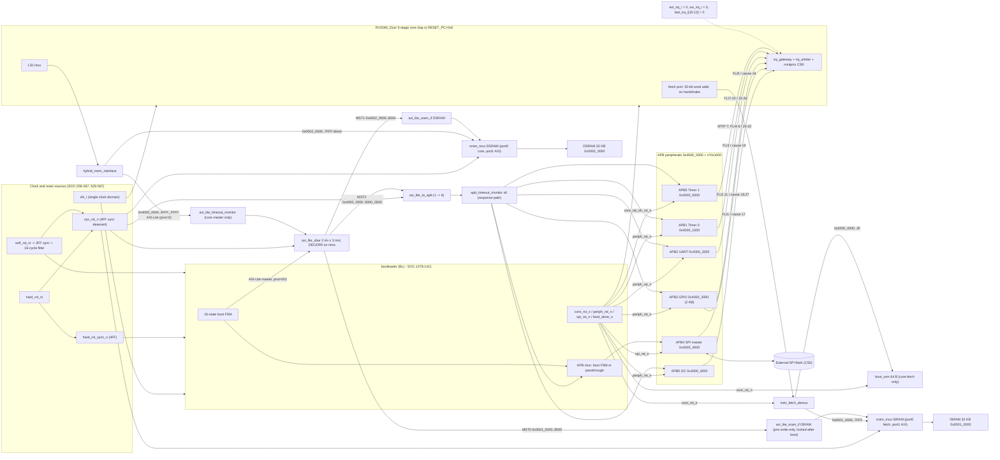

# RISCFORGE 1TOPS - SoC Architecture Map and Boot Plan (as implemented)

Scope: sign-off documentation for checklist items 1.6, 1.7, 1.8, 1.9, 1.12 and the as-built status of
G3 items 3.1-3.13 (`Verification/signoff/1TOPS_PROJECT_CHECKLIST.md:28-34,61-73`).

Rules used in this document:
- It records the design AS IMPLEMENTED in `rtl/ips/`. No RTL or testbench file was edited and no bug was fixed.
  Where the checklist wording asks for something the RTL does not contain, the gap is stated, not relabelled.
- Every claim carries a `file:line` citation, relative to `rtl/ips/` unless the path starts with another directory.
  A claim I could not confirm from source is marked **UNVERIFIED**.
- Short names: `SOC` = `RTL_SOC/riscforge_soc_subsystem.sv` (1413 lines at the time of reading).
  `CORE` = `riscv_core/rtl/`. `BL` = `bootloader/bootloader.sv`.
- Status words follow the tutor convention: "implemented" (RTL exists and is wired), "tested/verified" is NOT claimed
  anywhere in this document. Simulation evidence is only referenced by path, not re-run.
- No credentials or server details appear here.

---

## 0. Source-of-truth ranking and staleness of the existing notes

The RTL wins over every document. `documentation/ARCHITECTURE_SUMMARY.md` and `INFRA_TRACKING.md` were checked
against the current RTL; they are partly stale (details in section 8, O-20 to O-24). Summary of what to trust:

| Document | Trust for | Do not trust for |
|---|---|---|
| `SOC` Section 8 (`SOC:717-729`) | Decoder bases/limits | - |
| `SOC` header comment (`SOC:1-230`) | Memory/APB ranges, topology | GPIO register offsets (`SOC:159-179`), GPIO window in `SOC:52,194` |
| `documentation/ARCHITECTURE_SUMMARY.md` | Memory map table (`:402-415`), bus behaviour | Interrupt sections (`:22,40-41`): describe an older `top.v` |
| `INFRA_TRACKING.md` section 3 | Address map shape | Line numbers (`:126` cites `682-690`, now `717-729`); "UART RTL absent" (`:157`); "no gateway/arbiter" (`:113,331`) |
| `Sw/soc_spec.md` | Overall shape, memory table minus GPIO | GPIO 4 KB (`:111`); `clic-master/` listed as if used (`:79`) |
| `Sw/bsp/soc_regs.h` | Peripheral bases, GPIO offsets | `MAILBOX_ADDR` (`:38`) |

---

## 1. Memory organisation (checklist 1.6)

| Item | As implemented | Evidence |
|---|---|---|
| BootROM size | **64 bytes = 16 x 32-bit words** (checklist expects 4 KB; **not met**) | `SOC:240` (`BOOTROM_NUM_WORDS = 16`), `boot_rom.sv:32`, `SOC:745-747` |
| BootROM type | Behavioural array filled by `$readmemh` at elaboration; unfilled words are NOP (`0x00000013`) | `RTL_SOC/boot_rom.sv:50-61` |
| BootROM access | Core instruction fetch only. Not on the AXI-Lite crossbar. Not reachable by core loads/stores | `boot_rom.sv:10-12`, `SOC:35`, `CORE/hybrid_mem_interface.sv:70-72` |
| BootROM read timing | Registered address, combinational array read: data for `mem[0]` is present out of reset, 1-cycle latency afterwards | `boot_rom.sv:63-74` |
| ISRAM size | **32 KB = 8192 x 32-bit words**, base `0x0001_0000` | `SOC:489`, `SOC:717` |
| ISRAM implementation | `Instruction_Memory_new` (behavioural `reg` array) behind `imem_sram_wrapper`. Read data is `mem_array[raddr_q]` (combinational from a registered address) and is forced to 0 while `rst_n` is low | `instr_module/Instruction_Memory.v:22,32-49`, `RTL_SOC/imem_sram_wrapper.sv:58-70`, `SOC:871-884` |
| DSRAM size | **32 KB = 8192 x 32-bit words**, base `0x0002_0000` | `SOC:490`, `SOC:718` |
| DSRAM implementation | `sram_sp`: behavioural, registered-output, read-first. Source says "Replace with TSMC / foundry hard macro for tapeout" | `RTL_SOC/sram_sp.sv:3-9,41-53`, `SOC:956-967` |
| Prefetch buffer | **None** found. Fetch is `core -> instr_fetch_demux -> {boot_rom, ISRAM}` with no queue (grep for cache/prefetch/buffer in `imem_controller.v`, `fetch_cycle.v`, `top.v` returned nothing) | `RTL_SOC/instr_fetch_demux.sv:82-90` |
| Instruction cache | **None** | same grep; `SOC:10` (fetch goes straight to ISRAM mux port 0) |
| Data cache | **None** | `CORE/hybrid_mem_interface.sv:97-103` (DSRAM access is a direct combinational route) |
| SRAM macros | **No foundry macro instantiated.** Both SRAMs are behavioural models | `sram_sp.sv:3-9`; `Instruction_Memory.v:22` |
| SRAM ports | Each SRAM is single-port behind a 2:1 fixed-priority mux (port 0 = core, port 1 = AXI bridge) | `RTL_SOC/sram_mux.sv:76-103`, `SOC:837-868,919-953` |
| DSRAM read latency seen by LSU | one stall cycle on reads, none on writes | `hybrid_mem_interface.sv:125-152` |
| Atomics / LR-SC | none (RV32IM_Zicsr only) | `documentation/ARCHITECTURE_SUMMARY.md:1-24` (second-hand, **UNVERIFIED** here) |

Port-sharing facts:
- ISRAM mux ports are never active together by construction: the core is held in reset while the bootloader writes
  (port 0 idle), and after boot the ISRAM AXI bridge rejects all traffic (`reject_i = boot_done_o`)
  (`SOC:831-836`, `SOC:818`, `axi_lite_sram_if.sv:14-25`).
- DSRAM port 1 (AXI) is only ever driven by the bootloader at runtime, because the core's data path reaches DSRAM
  directly and never through the crossbar (`SOC:12-14`, `SOC:902` `reject_i = 1'b0`). The DSRAM AXI slave stays open at
  runtime; no privilege gate (`SOC:892-897`, no `PRIV_WRITE_ONLY`).

---

## 2. Address map (checklist 1.8)

### 2.1 Table

Decode rule notes: the crossbar/bridge use PULP `addr_decode`, where `end_addr` is **exclusive**
(`axi_lite_xbar/include/common_cells/addr_decode.sv:54`). The core-side splitters use inclusive limits
(`hybrid_mem_interface.sv:61-62,70-71`, `instr_fetch_demux.sv:73-74`). Ranges below are written inclusive.

| # | Slave | Base | Last byte | Size | Decode rule (file:line) | Reachable by | Access constraints |
|---|---|---|---|---|---|---|---|
| 1 | BootROM | `0x0000_0000` | `0x0000_003F` | 64 B | Fetch demux range compare (`instr_fetch_demux.sv:68,73`) | Core instruction fetch only | Read-only; data load/store to it faults (see 2.3) |
| 2 | ISRAM | `0x0001_0000` | `0x0001_7FFF` | 32 KB | Fetch: `instr_fetch_demux.sv:74`. AXI: xbar rule 0 `SOC:717` -> MST[0] | Core fetch (direct); bootloader AXI write | AXI **writes need `awprot[0]=1`** (privileged), else SLVERR and SRAM not written (`axi_lite_sram_if.sv:7-13,194-199,165-169`). AXI reads and writes both rejected with SLVERR once `boot_done_o=1` (`SOC:818`, `axi_lite_sram_if.sv:126-143`). Core data path cannot address it |
| 3 | DSRAM | `0x0002_0000` | `0x0002_7FFF` | 32 KB | Core: `hybrid_mem_interface.sv:70` (`DMEM_BASE_BYTE`, `SOC:1303`). AXI: xbar rule 1 `SOC:718` -> MST[1] | Core LSU (direct); bootloader AXI | Ungated. Core uses native path; AXI port only used by bootloader |
| 4 | I2C | `0x4000_0000` | `0x4000_0FFF` | 4 KB | APB rule 0 `SOC:722` | Core LSU via AXI-Lite->APB | `PADDR[11:0]` (`SOC:1060`) |
| 5 | Timer 0 | `0x4000_1000` | `0x4000_1FFF` | 4 KB | APB rule 1 `SOC:723` | same | 2 channels at offsets 0x00 and 0x10 (`SOC:108-125` comment) |
| 6 | UART | `0x4000_2000` | `0x4000_2FFF` | 4 KB | APB rule 2 `SOC:724` | same | Takes `PADDR[4:2]` only, so registers repeat every 0x20 inside the 4 KB window (`SOC:1114`). Alias behaviour **UNVERIFIED** in `obi_uart` |
| 7 | GPIO | `0x4000_3000` | `0x4000_37FF` | **2 KB** | APB rule 3 `SOC:727` | same | Window is 2 KB because the register block decodes 11 bits (`SOC:725-726`, `gpio-master/gpio_reg_pkg.sv:13`). Sub-word (partial `pstrb`) writes return PSLVERR (`gpio-master/gpio_apb_wrap.sv:61-79`) |
| - | **Hole** | `0x4000_3800` | `0x4000_3FFF` | 2 KB | No APB rule | - | DECERR (2.3) |
| 8 | SPI master (through bootloader APB mux) | `0x4000_4000` | `0x4000_4FFF` | 4 KB | APB rule 4 `SOC:728` | same | During boot the slave port returns an idle OKAY response and the bootloader owns the SPI master; at runtime it is a transparent passthrough (`BL:495-516`) |
| 9 | Timer 1 | `0x4000_5000` | `0x4000_5FFF` | 4 KB | APB rule 5 `SOC:729` | same | Same layout as Timer 0 |
| - | **Hole** | `0x4000_6000` | `0x4FFF_FFFF` | ~256 MB - 24 KB | Crossbar rule 2 matches `[0x4000_0000, 0x5000_0000)` (`SOC:719`) but the APB bridge has no rule | - | DECERR (2.3) |
| - | Everything else | e.g. `0x0000_0040-0x0000_FFFF`, `0x0001_8000-0x0001_FFFF`, `0x0002_8000-0x3FFF_FFFF`, `>= 0x5000_0000` | - | - | Not decoded | - | Core data access: access fault via `addr_fault`. Core instruction fetch: no fault (see 2.3) |

Window bounds agree between the crossbar and `hybrid_mem_interface`: crossbar `0x4000_0000..0x5000_0000` exclusive
(`SOC:719`) equals `MMIO_BASE..MMIO_LIMIT = 0x4000_0000..0x4FFF_FFFF` inclusive (`SOC:1304-1305`).

### 2.2 Crossbar and bridge configuration (facts needed for the map)

- Crossbar: 2 slave ports (core MMIO, bootloader) x 3 master ports (ISRAM, DSRAM, APB bridge), 3 rules, `LatencyMode = CUT_ALL_AX`,
  `MaxMstTrans = MaxSlvTrans = 4`, `FallThrough = 0` (`SOC:425-445`). Default master port disabled: `en_default_mst = '0` (`SOC:709-710`).
- APB bridge: one AXI-Lite master -> 6 APB slaves, no pipeline (`SOC:1000-1020`).
- Timeouts: APB per slot `16,16,16,16,65536,16` cycles (`SOC:469-476`); AXI-Lite backstop 64 cycles for non-APB, 131072 for APB
  (`SOC:482-483`, `SOC:1349-1369`). The bootloader master port is not monitored (`SOC:1345-1346`).

### 2.3 Error responses for unmapped / hole / constrained accesses and how they reach the core

| Case | Where it is caught | Response | What the core sees |
|---|---|---|---|
| Core load/store to an address that is neither DSRAM nor `0x4xxx_xxxx` MMIO (includes BootROM, ISRAM, gaps, `>= 0x5000_0000`) | `hybrid_mem_interface`: `addr_fault = mem_req && !(sram \|\| mmio)` (`hybrid_mem_interface.sv:72`). No bus transaction is started (`:74-75`). Combinational `mem_err` (`:387-389`) | none on a bus | Load: mcause 5 (load access fault). Store: mcause 7 (store access fault). `mtval` = faulting address (`CORE/memory_cycle.v:132-141`, `CORE/ls_unit.v:51`). Load data returned is the stale `axi_rdata_reg` (`hybrid_mem_interface.sv:391-396`) |
| Core MMIO access to a hole inside `0x4000_0000-0x4FFF_FFFF` (`0x4000_3800-0x4000_3FFF`, `>= 0x4000_6000`) | Crossbar forwards (rule 2 matches). `axi_lite_to_apb`: `!apb_dec_valid` | RESP_DECERR on R or B. Reads return data `0xDEA110C8`. A write with all-zero strobes is answered OKAY instead (`axi_lite_to_apb.sv:291,299,315-325`) | Non-OKAY response -> `mem_err` (`hybrid_mem_interface.sv:387-389`) -> mcause 5/7 |
| APB slave asserts PSLVERR (e.g. GPIO partial-strobe write) | `axi_lite_to_apb` | RESP_SLVERR (`axi_lite_to_apb.sv:346-352`) | mcause 5/7 |
| APB slave never completes (PREADY held low) | `apb_timeout_monitor` per slot | PREADY=1, PSLVERR=1, data `0xDEAD_BEEF` (`SOC:1034-1049`, `bus_monitors/apb_timeout_monitor.sv:16-17,33`) | SLVERR -> mcause 5/7. Monitors are observation-only for interrupts: sticky flags go to pins `apb_timeout_sticky_o` and are not wired to any interrupt (`SOC:327-333`) |
| AXI-Lite deadlock on the core master port | `axi_lite_timeout_monitor` | SLVERR, data `0xDEAD_DEAD` (`SOC:1349-1369`) | mcause 5/7 |
| Unmatched address in the crossbar itself | Crossbar synthetic extra master port -> `axi_err_slv` | RESP_DECERR (`axi_lite_xbar.sv:109-112,172-202`) | **Not reachable from the core** (the core never presents a non-MMIO address to the crossbar). Reachable only by the bootloader master, which does not use these addresses |
| AXI write to ISRAM without `awprot[0]=1` | `axi_lite_sram_if` (PRIV_WRITE_ONLY) | SLVERR on B, SRAM not written (`axi_lite_sram_if.sv:165-169,196`) | Core never issues it (`hybrid_mem_interface.sv:346` drives `aw.prot = '0` and never targets ISRAM). Only bootloader (`prot=3'b001`, `BL:548`) writes ISRAM |
| AXI access to ISRAM after `boot_done_o` | `axi_lite_sram_if` (`reject_i`) | SLVERR on R or B, SRAM not accessed (`axi_lite_sram_if.sv:126-143`) | Not issued by the core |
| Core **instruction fetch** to an address outside BootROM/ISRAM | `instr_fetch_demux` deasserts both selects (`:73-74`); no grant | **No error is raised.** `core_rdata_o` falls back to the ISRAM read-data path (`:123`) | The core ignores `core_instr_gnt`/`core_instr_rvalid` (`SOC:599-609`) and fetch faults are not implemented: `fetch_cycle.v:180-184` only ever drives cause 0; grep of fetch/decode/execute found no instruction-access-fault (cause 1) path. The core executes whatever word the ISRAM read path last returned |

### 2.4 Single RTL source of truth and every duplicate

There is not literally one RTL copy. The decoder-owned source of truth is `SOC` Section 8:
`xbar_addr_map` (`SOC:717-719`) and `apb_addr_map` (`SOC:722-729`). The same bases are separately hard-coded as parameters in
the places below; nothing checks that they agree (no generated header, no assertion tying them together).

Duplicates inside RTL (all currently agree with Section 8):

| Place | What it holds | Cite |
|---|---|---|
| `instr_fetch_demux` instance | `BOOTROM_BASE=0`, `ISRAM_BASE=0x0001_0000`, `RESET_PC=0`, sizes from `BOOTROM_NUM_WORDS`/`ISRAM_NUM_WORDS` | `SOC:757-766` |
| `hybrid_mem_interface` instance | `DMEM_BASE_BYTE=0x0002_0000`, `MMIO_BASE=0x4000_0000`, `MMIO_LIMIT=0x4FFF_FFFF`, `MEM_DEPTH=DSRAM_NUM_WORDS` | `SOC:1301-1307` |
| `imem_sram_wrapper` instance | `IMEM_BASE_BYTE=0x0001_0000` | `SOC:871-875` |
| `axi_lite_timeout_monitor` instance | `ApbBase=0x4000_0000`, `ApbEnd=0x5000_0000` | `SOC:1349-1356` |
| `bootloader` instance | `ISRAM_BASE_ADDR=0x0001_0000`, `DSRAM_BASE_ADDR=0x0002_0000`, word counts | `SOC:1385-1388` |
| Core reset vector | `RESET_PC` passed as `0x0000_0000` at `SOC:1245`, and again as the demux `RESET_PC` at `SOC:765`. The core's own default is `0x8000_0000` (`CORE/top.v:25`, `CORE/PC.v:29`, `CORE/fetch_cycle.v:51`) | comment `SOC:762-764` states they must match |
| `apb_uart` address slice | `PADDR[4:2]` | `SOC:1114` |

Duplicates outside RTL and their agreement:

| Place | Agrees with Section 8? | Disagreement found |
|---|---|---|
| `SOC` header comment, memory/APB ranges (`SOC:40-54,79-83`) | Yes except GPIO | `SOC:52` gives GPIO `0x4000_3000-0x4000_4000` (4 KB) while `SOC:156` and the rule at `SOC:727` give 2 KB |
| `SOC` header comment, GPIO register offsets (`SOC:159-179`) | **No** | Lists a dense map (0x008 MODE_0, 0x010 EN, 0x014 IN, 0x018 OUT, ... 0x048). `gpio-master/gpio_reg_pkg.sv:167-185` gives MODE_0 `0x08`, MODE_1 `0x0C`, EN `0x80`, IN `0x100`, OUT `0x180`, SET `0x200`, CLEAR `0x280`, TOGGLE `0x300`, RISE_EN `0x380`, FALL_EN `0x400`, LVL_HIGH_EN `0x480`, LVL_LOW_EN `0x500`, STATUS `0x580`, RISE_STATUS `0x600`, FALL_STATUS `0x680`, LVL_HIGH_STS `0x700`, LVL_LOW_STS `0x780` |
| `Sw/soc_spec.md:104-113` | Yes except GPIO | GPIO row `:111` says `0x4000_3000-0x4000_3FFF`, 4 KB. The pasted header inside the same file (`:298`) says 2 KB |
| `Sw/bsp/soc_regs.h:25-35` (bases) and `:109-119` (GPIO offsets) | Yes | Offsets match `gpio_reg_pkg.sv` |
| `Sw/bsp/soc_regs.h:38` `MAILBOX_ADDR = 0x00028000` | **No** | `0x0002_8000` is the first byte after DSRAM (last byte `0x0002_7FFF`), so a core access to it takes the `addr_fault` path. Used by `Sw/tests/timer_interrupt_test.c:61-91`. `Verification/tests/bsp/mailbox.h:18` uses `0x0002_0000` instead |
| `Sw/bsp/link.ld:14-16`, `mem_files/regtest/link.ld:24-25`, `Verification/firmware/bsp/link.ld:16-19`, `Verification/tests/bsp/link.ld:13-15`, `datapath_verification/*/link.ld` | Yes | `Verification/*/link.ld` also declare `BOOTROM ORIGIN=0, LENGTH=64` |
| `Sw/bsp/irq.h:17-29` | Yes (interrupt numbering) | none |
| `mem_files/regtest/regtest.c:761-764` | Yes | Expects DECERR at `0x4000_3800` and `0x4000_6000` for both load and store, consistent with section 2.3 |
| `datapath_verification/i2c0/elf_to_hex.py:64` | Yes | Hard-codes DSRAM `0x00020000 <= addr < 0x00028000` |
| `documentation/ARCHITECTURE_SUMMARY.md:402-415` | Yes | none |
| `INFRA_TRACKING.md:128-142` | Yes in shape | Says BootROM data access gives "DECERR" (`:129`). In the RTL the data access never reaches a bus; it is rejected by `hybrid_mem_interface` as an access fault (`hybrid_mem_interface.sv:72,387`). Same observable outcome (cause 5/7), different mechanism |
| `documentation/RISCFORGE SoC Architecture.html` | **UNVERIFIED** by me | `ARCHITECTURE_SUMMARY.md:1018,1020` reports that it shows an AON WDT at `0x4000_6000` and a 4 KB GPIO window |
| Testbench address copies in `RTL_SOC/soc_*_tb.sv` | **UNVERIFIED** | Not compared line by line |

---

## 3. Interrupt map (checklist 1.9)

### 3.1 What exists, stated plainly

- **No PLIC and no CLINT are instantiated.** `ext_irq_i` (MEIP) is tied to `1'b0` and `sw_irq_i` (MSIP) is tied to `1'b0`
  (`SOC:1289-1290`; comments at `SOC:1274` and `SOC:1289` say "no external PLIC / CLINT" and "no platform PLIC").
  No module named `plic` or `clint` exists in the tree (name grep across `*.sv`/`*.v`).
- **CLIC is not instantiated.** `clic-master/` exists on disk (for example `clic-master/clic_apb.sv:22`) but is not in `RTL_SOC/soc_subsystem.f`
  and has no instance or port in `SOC`; the only hits for "clic" in `SOC` are comments (`SOC:1203`). APB slot 5 is Timer 1 (`SOC:1202-1204`).
- **AON timer is not instantiated.** `aon_timer/` exists (`aon_timer/rtl`) but is not in the filelist and not in `SOC`.
- **What exists instead:** an in-core, two-level priority-class scheme made of `irq_gateway` (`CORE/irq_gateway.v`), `irq_arbiter`
  (`CORE/irq_arbiter.v`) and a custom CSR `mintprio` (`0x7C0`, 2 bits) (`CORE/csr_regfile.v:90,106,193`). Both modules are in the
  filelist (`RTL_SOC/soc_subsystem.f:234-235`) and are instantiated in `CORE/top.v:215-243`. There is no per-source programmable
  priority register and no claim/complete interface; priority is fixed by class and position in the arbiter.

### 3.2 Source table

Cause ID = mcause value (bit 31 set for interrupts). `FLI` = index into the core's `fast_irq_i` port. The gateway vector is `{fast_irq_i[11:0], timer_irq_i}`
so `fast_irq_i[n]` becomes cause `16+n` (`CORE/top.v:207`); `fast_intr_core = {4'b0, pend_gateway[12:1]}` feeds `mip[31:16]`
(`CORE/top.v:550`, `CORE/csr_regfile.v:217`).

| Cause / mip bit | Source | Peripheral signal | Wiring | Class | Gateway mode | Notes |
|---|---|---|---|---|---|---|
| 7 (MTIP) | Timer 0, channel 0, compare match | `timer0_irq_o[1]` | `timer_irq_i` (`SOC:1288`) | 2 (fixed, highest) | event | Per timer channel k: `irq_o[0]` = overflow, `irq_o[1]` = compare (`apb_timer-master/rtl/timer.sv:62-68`), concatenated as `irq_o[2k+1:2k]` (`apb_timer.sv:85`). So `timer0_irq_o[1]` is channel 0 compare |
| 16 (FLI0) | GPIO global | `gpio_global_interrupt_o` | `SOC:1287` | 0 (background, round robin with 17) | rising edge | `edge_mode = 13'h0002` (`CORE/top.v:208`). Software must deassert/re-arm (`CORE/top.v:210`) |
| 17 (FLI1) | I2C | `i2c_interrupt_o` | `SOC:1286` | 0 | level | pass-through |
| 18 (FLI2) | SPI TX/RX threshold | `spi_events_o[0]` (= `s_int_tx \| s_int_rx`) | `SOC:1285` | 1 (round robin 19,18,27) | event | `spi_master/apb_spi_master.sv:116` |
| 19 (FLI3) | UART | `uart_int_o` | `SOC:1284` | 1 | level | |
| 20 (FLI4) | Timer 0 ch0 overflow | `timer0_irq_o[0]` | `SOC:1283` | 2 | event | |
| 21 (FLI5) | Timer 0 ch1 overflow | `timer0_irq_o[2]` | `SOC:1282` | 2 | event | |
| 22 (FLI6) | Timer 0 ch1 compare | `timer0_irq_o[3]` | `SOC:1281` | 2 | event | |
| 23 (FLI7) | Timer 1 ch0 overflow | `timer1_irq_o[0]` | `SOC:1280` | 2 | event | |
| 24 (FLI8) | Timer 1 ch0 compare | `timer1_irq_o[1]` | `SOC:1279` | 2 | event | |
| 25 (FLI9) | Timer 1 ch1 overflow | `timer1_irq_o[2]` | `SOC:1278` | 2 | event | |
| 26 (FLI10) | Timer 1 ch1 compare | `timer1_irq_o[3]` | `SOC:1277` | 2 | event | |
| 27 (FLI11) | SPI end of transfer | `spi_events_o[1]` (= `s_eot`) | `SOC:1276`, `apb_spi_master.sv:117` | 1 | event | |
| 28-31 (FLI12-15) | none | `4'b0` | `SOC:1275` | - | - | tied off; `mie` bits are writable (`FFFF0888`, `CORE/csr_regfile.v:187`) but nothing can set the pending bits |
| 11 (MEIP) | external | `1'b0` | `SOC:1289` | - | - | tied off. Also **not an input to the arbiter** (see 3.4) |
| 3 (MSIP) | software | `1'b0` | `SOC:1290` | - | - | tied off. `csr_regfile` can set its own `msip_r` from a CSR write (`CORE/csr_regfile.v:207-217`) but the arbiter does not look at bit 3 (see 3.4) |

Gateway mode masks: `edge_mode = 13'h0002`, `event_mode = 13'h1fe9` (`CORE/top.v:208-209`); every other bit is a level pass-through
(`CORE/irq_gateway.v:16-29`). Interpreted: cause 16 edge; causes 7, 18, 20-27 event; causes 17 and 19 level.

Note on the timer wiring: the second wire on the Timer 0 channel 0 compare (`timer0_irq_o[1]`) feeds `timer_irq_i`, not a fast line, so there
is no separate FLI for it. Timer 0 channel 1 compare is `timer0_irq_o[3]` on FLI6.

### 3.3 Class and priority scheme as implemented

From `CORE/irq_arbiter.v:3-4,20-21,24-40,75-97,99-102`:

- **Class 2 (fixed priority, highest first):** 7, 22, 24, 26, 20, 21, 23, 25 (`irq_arbiter.v:75-82`).
- **Class 1 (cyclic round robin):** 19, 18, 27. Pointer `rr_ptr_c1` advances only when the selected interrupt commits (`wb_commit_i`) (`:24-40,44-67`).
- **Class 0 (round robin):** 17, 16. Pointer `rr_ptr_c0` likewise (`:35-36,86-91`).
- Class 2 beats class 1 beats class 0 (`:75-97`).
- **Threshold:** custom CSR `mintprio` (2 bits, reset 0). An interrupt is offered to the core only if `class + 1 > mintprio` (`irq_arbiter.v:99-100`).
  `mintprio=0` allows all; 1 masks class 0; 2 masks classes 0 and 1; 3 masks all. Matches `Sw/bsp/irq.h:35-38`.
- Enables: `active = pend & {mie[27:16], mie[7]} & mstatus.MIE` (`irq_arbiter.v:20-21`). `mie` writable mask `0xFFFF_0888` (`csr_regfile.v:187`).
- Interrupt entry: `irq_pending` from the arbiter drives the core (`CORE/top.v:401`). Trap vector: `mtvec` write mask `0xFFFF_FFFC`
  keeps `mtvec[1:0]` at 0, so only direct mode is reachable even though vectored mode is coded (`CORE/csr_regfile.v:188` vs
  `CORE/wb_trap_mret_commit_controller.v:96-103`). Nested-interrupt behaviour is not documented here (**UNVERIFIED**).

### 3.4 What is tied off or unreachable

- `ext_irq_i`, `sw_irq_i`: tied to 0 (`SOC:1289-1290`).
- `fast_irq_i[15:12]`: constant 0 (`SOC:1275`). `top.v` carries only `fast_irq_i[11:0]` into the gateway (`CORE/top.v:207`).
- `irq_arbiter` only considers 13 gateway bits (cause 7 and causes 16-27) (`irq_arbiter.v:20`). MEIP (11) and MSIP (3) are not arbiter inputs; if
  they were driven they would appear in `mip` (`csr_regfile.v:217`) but I found no other path that raises an interrupt from them (**UNVERIFIED**
  that none exists; checked `top.v:231-243,401` only).
- Interrupt-like outputs that leave the SoC but do not reach the core: `gpio_pin_level_interrupts_o[31:0]` (`SOC:311,1154`; only the global
  GPIO interrupt goes to the core) and `timer0_irq_o[1]` is exported and also used (`SOC:289,1288`). Timer 0 channel 0 overflow, etc. are exported and
  used on fast lines. Bus timeout sticky flags are pins only (`SOC:327-333`).
- UART modem lines (CTS/DSR/DCD/RI) are tied inactive, so the modem-status interrupt cannot fire (`SOC:1120-1129`).

---

## 4. Boot plan (checklist 1.12)

### 4.1 Boot-mode selection

**There is no boot-mode strap or pin.** The SoC top has no boot-mode input. The only boot-related top-level ports are
`hard_rst_ni`, `soft_rst_ni`, `fetch_enable_i`, `boot_addr_i`, `test_mode_i` (`SOC:259-268`) and output `boot_done_o` (`SOC:273`).
- `fetch_enable_i` and `boot_addr_i` are **declared but unused**: their only occurrence after the port list is a comment calling them legacy
  ports from the stub (`SOC:1239`; reference grep returns only `SOC:267-268,1239`). The reset vector is the `RESET_PC` parameter, not a pin (`SOC:1245`).
- `test_mode_i` only feeds the crossbar `test_i` (`SOC:986`).
- The boot source (SPI flash, chip select 0) and the image sizes are fixed at elaboration (`BL:155,174`, `SOC:242-243`).

### 4.2 Reset flow

Clock and reset sources (single clock domain):
- One clock input `clk_i` (`SOC:259`). No PLL, divider or clock gate in the SoC top (grep for pll/clk_gate/clock_gate: none). The SPI clock is generated inside
  the SPI master and leaves as `spi_clk_o`; it clocks no internal logic (`ARCHITECTURE_SUMMARY.md:27-29`, second-hand, **UNVERIFIED** at source).
- `hard_rst_ni` (cold) and `soft_rst_ni` (warm, a board button). `soft_rst_ni` is 2-FF synchronised then filtered for `SoftRstFiltCycles=16`
  consecutive cycles (`SOC:529-552`, `SOC:250`).
- `sys_rst_n` = `hard_rst_ni & soft_rst_n_filt_q`, asynchronous assert, 4-FF synchronous deassert; feeds crossbar, bridge, muxes, SRAM wrappers,
  monitors (`SOC:554-566`, `SOC:813,901,923,987,1013,1042,1360`).
- `hard_rst_sync_n` = `hard_rst_ni` only, 4-FF chain; feeds the bootloader (`SOC:561-567,1394`).
- `core_rst_n`, `periph_rst_n`, `spi_rst_n` are flop outputs of the bootloader (`BL:827-829`, `SOC:1406-1408`). Core: `SOC:1248`, BootROM and fetch demux:
  `SOC:750,777`, `hybrid_mem_interface`: `SOC:1310`. Peripherals (I2C, Timer 0/1, UART, GPIO): `periph_rst_n`. SPI master: `spi_rst_n`.

Sequence (cold boot, `BL:68-71,309-326,748-822`):
1. `hard_rst_ni` low: bootloader asynchronously resets to `S_RESET`; `core_rst_q=0`, `periph_rst_q=0`, `spi_rst_q=0` (`BL:566-591`).
2. `S_RESET` -> `S_CLEAR_SRAM` (cold, with SRAM) (`BL:754-762`). SPI is released from reset when the next state is `S_CLEAR_SRAM`/`S_FLASH_WAIT`/`S_INIT_CLKDIV` (`BL:720-726`).
3. `S_CLEAR_SRAM`: AXI-Lite writes of zero to every ISRAM word then every DSRAM word (16384 writes at the SoC defaults), privileged (`BL:528-531,548`, `BL:764-770`).
4. `S_FLASH_WAIT`: wait `FLASH_POWERUP_CYCLES` (30,000 default, described as a simulation alignment for the vendor flash model) (`BL:173-181`, `BL:773-776`).
5. One-time SPI configuration over APB: CLKDIV (=4), SPICMD (0x03 read opcode, 8 bits), SPIDUM (0) (`BL:453-473`, `BL:782-784`).
6. Per chunk (up to `MAX_CHUNK_WORDS=1024` words): SPILEN, SPIADR (24-bit flash address), TRIGGER on chip select 0 (`BL:465-482`, `BL:787-789`).
7. Per word: `S_READ_FIFO` (APB read of RXFIFO, stalls on PREADY low), byte-swap into `rxfifo_data_q` (`BL:655-659`), `S_WRITE_SRAM` AXI write to the destination address,
   `S_CHECK_DONE` (`BL:795-805`). Destination starts at ISRAM base, switches to DSRAM base after `NUM_INSTR_WORDS` words (`BL:683-686`).
8. After `NUM_INSTR_WORDS + NUM_DATA_WORDS` words, `S_CLEAN_ASSERT` -> `S_CLEAN_HOLD` (4 cycles, `RESET_HOLD_CYCLES=4`, `BL:185`) -> `S_CLEAN_RELEASE`
   (`BL:807-815`). Core, peripherals and SPI are reset together, then released at the same edge (`BL:720-740`).
9. `S_DONE`: `boot_done_o=1` one cycle after release (`BL:830`). The APB mux switches to passthrough, the ISRAM AXI slave starts rejecting (`BL:102-108`, `SOC:818`).

Warm boot (`soft_rst_ni` low then high): bootloader jumps to `S_RESET` with `warm_boot_q=1`, then `S_CLEAN_ASSERT`->`S_CLEAN_HOLD`->`S_CLEAN_RELEASE`->`S_DONE`, **no SRAM
clear and no SPI fetch** (`BL:603-622`, `BL:754-757`). SRAM write-enable from the AXI bridges is clamped during soft reset (`axi_lite_sram_if.sv:62`, `SOC:814,901`).
`warm_boot_q` is cleared only by `hard_rst_ni` (`BL:570`).

### 4.3 Who fetches from where

| Phase | Core | Memory writer | Notes |
|---|---|---|---|
| Hard reset to `S_CLEAN_RELEASE` | held in reset (`core_rst_q=0`) | Bootloader, via crossbar slave port 1 -> ISRAM/DSRAM | ISRAM/DSRAM contents zeroed then loaded (cold) |
| After release | Fetches from `RESET_PC = 0x0000_0000` (BootROM) | none | `SOC:1245`, `instr_fetch_demux.sv:111-120` |
| After the ROM jump | Fetches from ISRAM (`0x0001_0000`) directly through sram_mux port 0 | none (AXI to ISRAM now rejected) | `SOC:837-868` |
| Runtime | Instruction fetch ISRAM/ROM only; data DSRAM direct or MMIO via AXI-Lite | bootloader idle | |

### 4.4 ROM contents

`mem_files/riscforge_bootrom.hex` is the only image loaded (the SoC does not override `HEX_FILE`: `SOC:745-748`; the module default is
`../mem_files/riscforge_bootrom.hex`, `boot_rom.sv:36`, so the path is relative to the simulator working directory). Contents (file has 2 words):

| Address | Word | Decoded | Cite |
|---|---|---|---|
| `0x0000_0000` | `00028137` | `lui x2, 0x28` -> `sp = 0x0002_8000` (top of DSRAM) | `mem_files/riscforge_bootrom.hex:1`, `boot_rom.sv:7` |
| `0x0000_0004` | `7FD0F06F` | `jal x0, +0xFFFC` -> `0x0001_0000` (ISRAM base) | `mem_files/riscforge_bootrom.hex:2`, `boot_rom.sv:8` |
| `0x0000_0008-0x0000_003C` | NOP-filled | `addi x0,x0,0` | `boot_rom.sv:56-59` |

I decoded both words independently: `lui` rd=x2 imm=0x28; `jal` rd=x0, offset 0xFFFC, so PC 4 + 0xFFFC = `0x0001_0000`.
The ROM is a trampoline only. All real code arrives from the flash into ISRAM.

### 4.5 Fallback behaviour and image handling

None of the following exists in the RTL:
- No boot-mode strap, no alternate boot source, no UART/JTAG boot path.
- No image header, magic number, length field, CRC or signature. The words loaded are whatever the flash returns, and the number of words is the
  elaboration parameter `NUM_INSTR_WORDS` (+ `NUM_DATA_WORDS`), not read from flash (`BL:243`, `SOC:242-243`). SoC defaults load only 64 words (256 bytes) into ISRAM and 0 into DSRAM.
- The bootloader does not check the AXI B response (`BL:796` waits only for `b_valid`), so an SLVERR/DECERR on a boot write is ignored.
- No timeout on the SPI read. If the flash never returns data, the SPI RX FIFO stays empty and `S_READ_FIFO` waits on PREADY forever (`BL:795`, header `BL:15-20`).
  The bootloader drives the SPI master APB port directly, not through the APB monitors, so the APB timeout monitor does not apply (`SOC:1034-1049` interposes only the
  bridge response path). The core stays in reset and `boot_done_o` stays 0.
- No ROM remap or ROM-to-SRAM swap. Execute-from-SRAM is the normal state: the ROM jumps to ISRAM base once.
- There is no watchdog/boot-retry. A soft reset (button) re-runs only the clean-slate sequence and jumps to ROM again; it never reloads from flash.

---

## 5. Block diagram data (checklist 1.7)

Not present in the diagram because they are not in the RTL: PLIC, CLINT/CLIC, AON/watchdog, I2S, system control register block,
AXI4 (full) to AXI-Lite bridge, PLL/clock divider, cache, DMA.

Notes: the monitors are drawn in the signal path they actually occupy (`apb_timeout_monitor` on the APB response path only, `SOC:1022-1032`;
`axi_lite_timeout_monitor` between the core master and crossbar slave port 0, `SOC:1349-1369`). The bootloader's APB mux ahead of the SPI master is inside
the bootloader (`BL:494-516`); the APB monitor for slot 4 watches the bridge-side response of that mux, not the bootloader-to-SPI link.

---

## 6. G3 as-built status (items 3.1-3.13 only)

"Evidence file" = where the RTL and its instantiation live. This table makes no claim that any item is verified or lint clean.

| ID | Checklist wording | RTL present | Instantiated | Evidence | Spec mismatch vs checklist wording |
|---|---|---|---|---|---|
| 3.1 | GPIO integrated | Yes, `gpio-master/` (PULP-style, 32 pins) | Yes, APB[3] | `SOC:1141-1157`; `RTL_SOC/soc_subsystem.f:176`; `gpio-master/gpio_reg_pkg.sv:10,13` | None on presence. Window is 2 KB, not 4 KB (`SOC:727`). Sub-word writes give PSLVERR (`gpio_apb_wrap.sv:61-79`). Header comment and `soc_spec.md` disagree with RTL (section 2.4) |
| 3.2 | UART integrated | Yes: `apb_uart-main/rtl/apb_uart.sv`, `apb_uart_wrap.sv`, `include/obi/obi_uart*.sv`, `apb_to_obi.sv` | Yes, APB[2] | `SOC:1108-1132`; `apb_uart.sv:52` | Presence OK; `INFRA_TRACKING.md:157` ("UART RTL absent") is stale. **Filelist defect:** `RTL_SOC/soc_subsystem.f:156-161` lists only `apb_uart.sv` and claims it is self-contained, but `apb_uart.sv:52` instantiates `apb_uart_wrap`; `Verification/infrastructure/rf_filelist.txt:165-188` documents the unresolved-module error and lists the full OBI chain. Whether `soc_subsystem.f` compiles as-is is **UNVERIFIED** (not run). Modem lines tied off (`SOC:1126-1129`) |
| 3.3 | SPI / QSPI master integrated | Yes, `spi_master_ip/spi_master/` | Yes, APB[4], behind the bootloader APB mux | `SOC:1166-1199`; `soc_subsystem.f` section 11 | Standard SPI only: quad data lines tied off, CS2/CS3 and `spi_mode` unconnected (`SOC:1184-1196`). "QSPI" wording not met at the SoC pins. Boot flash is CS0, the other CS is `spi_csn1_o` (`SOC:315-317`) |
| 3.4 | PLIC integrated | **No** | **No** | `SOC:1274,1289` (tied-off MEIP, "no PLIC") | **Mismatch.** No PLIC. Replacement is the in-core gateway + class arbiter + `mintprio` (section 3). Not equivalent: no claim/complete, no per-source priority registers, no target enables |
| 3.5 | Timer integrated | Yes, `apb_timer-master/rtl/` (2 channels per block) | Yes, two instances: Timer 0 (APB[1]), Timer 1 (APB[5]) | `SOC:1083-1098,1206-1221` | 32-bit counter with prescaler and compare/overflow IRQs. It is not a RISC-V `mtime/mtimecmp` timer. `timer0_irq_o[1]` is routed to MTIP (`SOC:1288`) |
| 3.6 | CLINT / CLIC integrated | **CLIC RTL exists on disk** (`clic-master/`), CLINT does not | **No** | `SOC:1203` (slot reused for Timer 1); `soc_subsystem.f` has no clic entry; `INFRA_TRACKING.md:67` | **Mismatch.** Neither a CLINT nor a CLIC is in the SoC. MSIP tied to 0 (`SOC:1290`) |
| 3.7 | I2C integrated (optional) | Yes, `apb_i2c-master/` | Yes, APB[0] | `SOC:1055-1075` | None |
| 3.8 | I2S integrated (optional) | **No** | **No** | no I2S module or file in `rtl/ips` (file/module-name search) | **Mismatch.** Absent |
| 3.9 | Boot ROM integrated | Yes, `RTL_SOC/boot_rom.sv` | Yes, core fetch only | `SOC:745-754`; `mem_files/riscforge_bootrom.hex` | **Size mismatch:** 64 B actual vs 4 KB expected (`SOC:240`). Not on the bus fabric. Behavioural, hex-initialised |
| 3.10 | SRAMs integrated | Yes (behavioural) | Yes: ISRAM 32 KB, DSRAM 32 KB | `SOC:871-884,956-967` | Behavioural models, not PDK macros (`sram_sp.sv:3-9`). No other SRAM instances |
| 3.11 | Interconnect integrated | Yes, `axi_lite_xbar/`, `axi_lite_to_apb/`, SRAM bridges, fetch demux, hybrid router, 2 timeout monitors | Yes | `SOC:973-1020,1349-1369`, `CORE/hybrid_mem_interface.sv` | AXI-Lite crossbar + AXI-Lite-to-APB bridge only. The core master is natively AXI-Lite (`hybrid_mem_interface.sv:54-55`), so there is **no AXI4 -> AXI-Lite bridge**. `axi_to_axi_lite.sv` exists under `axi_lite_xbar/include/axi/` but is not in the filelist and not instantiated. SRAM and ROM traffic from the core bypasses the fabric |
| 3.12 | System control block integrated | **No dedicated block** | **No** | Reset generation is inside the bootloader (`BL:827-830`) and top-level synchronisers (`SOC:529-567`); no chip-ID/sysctrl/syscon register found (name search in `SOC`) | **Mismatch.** There is no memory-mapped system-control register file. Reset control, boot status (`boot_done_o` pin only) and bus-timeout flags (pins only) are not software readable. `SOC:327-333,273` |
| 3.13 | Address decode matches G1 map | Decoder exists | Yes | `SOC:717-729` | RTL matches the map in section 2. The G1 map itself is not frozen anywhere I could find (checklist 1.8 `Not Started`, `1TOPS_PROJECT_CHECKLIST.md:30`). Docs disagree with RTL on GPIO (section 2.4) |

---

## 7. Observations (facts only, with citations)

| ID | Observation | Cite |
|---|---|---|
| O-1 | BootROM is 16 words (64 B), core-fetch only, with a 2-instruction image | `SOC:240`, `boot_rom.sv:7-8`, `mem_files/riscforge_bootrom.hex:1-2` |
| O-2 | No boot-mode strap/pin; `fetch_enable_i`/`boot_addr_i` are unused | `SOC:267-268,1239` |
| O-3 | Boot image length is the elaboration parameters `NUM_INSTR_WORDS=64`, `NUM_DATA_WORDS=0` | `SOC:242-243`, `BL:243` |
| O-4 | Cold boot clears all ISRAM and DSRAM through AXI-Lite before loading | `BL:528-531,764-770`, `BL:244` |
| O-5 | Bootloader ignores AXI B-channel response codes | `BL:796` |
| O-6 | No timeout or error path on the SPI RX FIFO read in the boot FSM | `BL:795` |
| O-7 | Core is released one edge before `boot_done_o` rises | `BL:720-740,830` |
| O-8 | Core data path cannot read or write ISRAM or BootROM; such access is an access fault (cause 5/7) | `hybrid_mem_interface.sv:70-75,387-389`, `memory_cycle.v:132-139` |
| O-9 | Instruction fetch to an unmapped address raises no fault and returns the ISRAM read-data word | `instr_fetch_demux.sv:73-74,123`; `fetch_cycle.v:180-184`; `SOC:599-609` |
| O-10 | Unmapped APB addresses return DECERR with read data `0xDEA110C8`; zero-strobe writes return OKAY | `axi_lite_to_apb.sv:291,299,315-325` |
| O-11 | AXI port to ISRAM is rejected for all traffic once `boot_done_o=1` | `SOC:818`, `axi_lite_sram_if.sv:126-143` |
| O-12 | AXI port to DSRAM stays open at runtime with no privilege gate | `SOC:892-902` |
| O-13 | Crossbar default master port is disabled; every miss is DECERR | `SOC:709-710`, `axi_lite_xbar.sv:109-112` |
| O-14 | No cache and no prefetch buffer | section 1 grep evidence |
| O-15 | SRAMs are behavioural; ISRAM read path is combinational from a registered address, DSRAM read path is registered | `Instruction_Memory.v:49`, `sram_sp.sv:41-53` |
| O-16 | `mtvec[1:0]` cannot be set (mask `0xFFFFFFFC`), so vectored interrupt entry is coded but unreachable | `csr_regfile.v:188`, `wb_trap_mret_commit_controller.v:96-103` |
| O-17 | `irq_arbiter` ignores MEIP and MSIP | `irq_arbiter.v:20` |
| O-18 | `fast_irq_i[15:12]` and `ext_irq_i`, `sw_irq_i` are tied to 0 | `SOC:1275,1289-1290` |
| O-19 | All 12 wired fast interrupts plus MTIP are live in the current core (the fast-IRQ port is 16 bits wide, gateway takes 12 of them) | `CORE/top.v:207,550` |
| O-20 | `ARCHITECTURE_SUMMARY.md` says only 6 sources are arbitrated and that `mip[20..26]` read 0; the current `top.v`/`irq_arbiter.v` arbitrate 13 sources including 20-26 | `ARCHITECTURE_SUMMARY.md:22,41` vs `CORE/top.v:207`, `irq_arbiter.v:75-97` |
| O-21 | `ARCHITECTURE_SUMMARY.md:6-7` describes the SoC top as 1374 lines and cites `:1250-1251` for the IRQ tie-offs; they are now at `SOC:1289-1290` (file is 1413 lines) | `SOC:1289-1290` |
| O-22 | `INFRA_TRACKING.md:113,331` ("no gateway, no arbiter") is stale | `CORE/irq_gateway.v`, `CORE/irq_arbiter.v`, `soc_subsystem.f:234-235` |
| O-23 | `INFRA_TRACKING.md:157` ("UART RTL absent") is stale; `apb_uart_wrap.sv` and the OBI chain are on disk. The design-only filelist `soc_subsystem.f` still omits them | `apb_uart-main/rtl/apb_uart_wrap.sv:11`, `soc_subsystem.f:156-161`, `rf_filelist.txt:165-188` |
| O-24 | `soc_subsystem.f:46-52` states "obi_uart sources are absent from this repository"; they exist | `apb_uart-main/include/obi/obi_uart.sv:11` |
| O-25 | GPIO window is 2 KB in the decoder but 4 KB in `SOC:52` and `soc_spec.md:111` | `SOC:727`, `SOC:156` |
| O-26 | `SOC:159-179` GPIO register offsets do not match `gpio_reg_pkg.sv` | `gpio_reg_pkg.sv:167-185` |
| O-27 | `soc_regs.h` `MAILBOX_ADDR` (`0x0002_8000`) lies outside DSRAM | `Sw/bsp/soc_regs.h:38`, `SOC:718,1303` |
| O-28 | The core's own `RESET_PC` default is `0x8000_0000`; the SoC overrides it to 0 in two places that must agree | `CORE/top.v:25`, `SOC:765,1245` |
| O-29 | Bootloader header comment lists "CLIC" among peripherals it resets; there is none | `BL:29-30` |
| O-30 | Timer 1 occupies the APB slot that older text assigns to the CLIC | `SOC:1202-1204` |
| O-31 | ISRAM word at power-up is NOP in simulation; no reset on the array in synthesis | `Instruction_Memory.v:51-58` |
| O-32 | Bus timeout flags and `boot_done_o` are the only status outputs; no software-readable status register exists for them | `SOC:273,327-333` |
| O-33 | APB timeouts: 16 cycles on every slot except SPI (65536) | `SOC:469-476` |
| O-34 | Single clock domain; no PLL/clock divider in the SoC top | `SOC:259`, grep `pll\|clk_gate` in `SOC`: none |

---

## 8. Ambiguities for the owner

1. **Checklist 1.6 vs implementation.** The checklist expects a 4 KB BootROM; the RTL has 64 B. Decide whether the checklist is the spec (then the ROM must
   grow and the ROM, demux and linker scripts change) or the RTL is the spec (then the checklist item is amended to 64 B). I have documented 64 B as built.
2. **PLIC / CLINT / CLIC (3.4, 3.6).** The checklist requires them as mandatory; the design uses an in-core gateway/arbiter with `mintprio`. Is the intended
   deliverable the current scheme (and the checklist wording changes), or must a PLIC and CLINT be built? That drives MEIP/MSIP (currently tied off and ignored by the arbiter).
3. **System control block (3.12).** There is no register block. Is "reset controller inside the bootloader + status pins" accepted, or is a memory-mapped block required?
4. **Boot robustness (1.12).** No strap, header, CRC, retry or SPI timeout; image size is an elaboration constant. Is that acceptable for tape-out, and who owns the failure
   behaviour if the flash is blank or absent (the chip hangs with the core in reset)?
5. **Image size default.** The SoC top defaults to loading 64 instruction words. Is that a placeholder or the intended product configuration?
6. **Single source of truth.** The map is hand-copied in at least seven RTL parameter sets and several documents. Which artefact is declared the golden map: `SOC` Section 8, or a
   generated file that does not exist yet?
7. **GPIO documentation.** Should the stale GPIO comment block (`SOC:159-179`) and 4 KB text (`SOC:52`, `soc_spec.md:111`) be corrected? I did not edit them.
8. **Mailbox address.** `soc_regs.h:38` (`0x0002_8000`) versus `Verification/tests/bsp/mailbox.h:18` (`0x0002_0000`). Which is intended? The first faults on the current RTL.
9. **Instruction access faults.** Fetch outside ROM/ISRAM is silent. Is a cause-1 exception required by the privilege/trap spec (checklist 1.3, 1.5)?
10. **Vectored interrupts.** `mtvec` mode bits cannot be written. Intentional?
11. **UART filelist.** `soc_subsystem.f` appears to omit the OBI chain that `apb_uart.sv` needs. Which list is canonical for sign-off synthesis/lint (`soc_subsystem.f`, `soc_subsystem_vcs.f`
    (which does list the chain, `soc_subsystem_vcs.f:32-98`) or `Verification/infrastructure/rf_filelist.txt`)? I did not compile either.
12. **I2S (3.8).** Optional item; confirm it is out of scope for this tape-out.
13. **AXI-Lite DSRAM port at runtime.** It is open and ungated although nothing but the bootloader uses it. Should it be locked like ISRAM?
14. **Target clock.** `ARCHITECTURE_SUMMARY.md:18` reports 50 MHz in one document and 100 MHz in another; the RTL fixes neither. Relevant for the flash power-up wait and SPI divider values (**UNVERIFIED** source documents not opened).
15. **mintprio=3.** With a 2-bit threshold, a value of 3 masks every class including the highest. Confirm that is acceptable.

---

*Prepared by static reading of RTL and documents on 2026-11-02. No simulation, lint or synthesis was run for this document.*
