# Core, CSR and interrupt architecture — current review snapshot

**Review date: 11 November 2026. Status: documentation review with open work; not technical signoff.** This is the maintained detailed source for [the concise HTML review](01_core_architecture.html). It covers G1 **1.1, 1.3, 1.4, 1.5, 1.9**, G2 **2.7, 2.9, 2.10**, and G3 **3.4, 3.6**. Read it with the [finding reconciliation](../CJ_FINDING_RECONCILIATION_20261110.md) and [remaining work](../CJ_REMAINING_WORK_20261110.md), including their correction banners.

The reviewed repository baseline is `verification_infra/ips_reorganized` at **`a91edb7e666d5c374af70809703f52eb5513d96f`**. Local `ips/` is an augmented offline copy, not a Git checkout. The [sync receipt](../../../../artifacts/verification_infra_sync_20261110/sync_receipt.json) identifies the imported source; it does not establish that all present files are unchanged. The parent review collects current fingerprints. This document was produced by static source/evidence inspection; no RTL/TB changes, simulations, waveform generation, Git writes or new waivers were performed.


## 1. Contract, implementation and evidence have different authority

The [checklist index](../../../Verification/signoff/1TOPS_PROJECT_CHECKLIST.md) supplies item IDs and names; it explicitly does not replace the detailed workbook. Its November 2 status cells are historical. Neither those cells nor this document assign current workbook status or coach approval. The historical November 8 CJ inventory is not a fresh workbook read.

The older documents call several entries “frozen choices as implemented.” That wording identifies a code configuration, **not an independently approved freeze**. This review separates:

| Layer | Current basis | Limit |
|---|---|---|
| Intended/frozen contract | Checklist obligations plus owner decisions with explicit scope | The exact ISA revision, CSR/WARL policy, interrupt alternative and nesting/ordering acceptance still need a recorded decision. No per-item approval scope/person/date is supplied by the [verbal-decision record](../evidence_review_20261102/VERBAL_DECISIONS.md). |
| As coded | The active modules and SoC parameter wiring traced below | Implementation is not its own architectural approval or independent expected result. |
| Verification expectation | Focused firmware constants, selected legality policy and boundary checks in [the port regression](../../../Verification/core_port_20261109/README.md) | These do not constitute a complete independent CSR/trap/IRQ model or architectural retirement oracle. |
| Observed evidence | Existing post-sync logs and manifests, inspected for this review | Retained development evidence only; no fresh execution in this task, no current campaign/coverage/signoff claim. |

### Requirement-to-review map

| ID and requirement | Current implementation/evidence | State and next action |
|---|---|---|
| 1.1 Core ISA frozen | RV32IM with six Zicsr forms; no C/A/F/D decode; field guards now present (§3) | Implementation described; freeze exact ISA/extension/encoding policy with CJ and architecture owner. |
| 1.3 Privilege modes frozen | Machine-only execution; writable MPP/SIE-position storage (§5) | Contract pending; reconcile intended M-only WARL semantics. |
| 1.4 CSR list frozen | Thirteen readable addresses, including custom `0x7C0` (§5) | Table inspected; approve masks, access failures and counter policy before freeze. |
| 1.5 Trap/interrupt model defined | EX acceptance, packet transport, WB trap/MRET redirect (§6–8) | As-coded path documented; precise effects and gating-CSR ordering remain unqualified. |
| 1.9 Interrupt map frozen | Cause 7 plus 16–27; fixed classes, event/edge/level capture (§7) | Map inspected; freeze sources/subevents, capture/rearm and service policy. |
| 2.7 Memory interface unit coded | LSU formatting, alignment gates, DSRAM/MMIO router (§4) | Coded; selected load/MDU checks retained, full sizes/offsets/latency/errors pending. |
| 2.9 CSR block/trap logic coded | CSR/WB controller present; single trap context (§5–8) | Coded; full independent model, assertions, stimulus and race coverage remain open. |
| 2.10 Compressed decoder coded (if C) | No compressed decoder; four-byte alignment (§3) | No-C applicability needs explicit recorded N/A against the frozen ISA/build; N/A approval is not inferred. |
| 3.4 PLIC integrated (mandatory) | No PLIC in this active hierarchy; custom in-core controller (§7) | Requirement mismatch; obtain exact accepted alternative/disposition or plan separately authorized implementation. |
| 3.6 CLINT/CLIC integrated (mandatory) | Neither instantiated; timer peripheral supplies MTIP; software delivery absent (§7) | Requirement mismatch; resolve timer/software interrupt obligations and exact accepted alternative. |

CJ owns model, stimulus, coverage and closure. This review provides traceability, not replacement implementation or changed expectations.

## 2. Active source and integrated configuration

### Filelist → instance → pipeline

The retained SoC Verilator check used [Verification/filelists/tier3_soc/soc_subsystem.f](../../../Verification/filelists/tier3_soc/soc_subsystem.f), not merely a matching module filename. Its paths resolve from **`ips/`** locally (remote equivalent `ips_reorganized/`). It lists the five stages, helper blocks, `top.v`, gateway/arbiter, CSR/WB controller, `hybrid_mem_interface.sv`, bootloader and `RTL_SOC/riscforge_soc_subsystem.sv`. The common-cells `axi_pkg.sv` is selected; the duplicate core-local package is deliberately omitted. Include paths cover the AXI/common cells, UART APB/OBI, register interface, I2C and SPI directories. No CLIC/PLIC/CLINT source is selected in this list.

The [older RTL_SOC convenience list](../../../RTL_SOC/soc_subsystem.f) selects the same core files but omits the UART wrapper/OBI chain present in the tier3 list. Its header, and the copied header in the tier3 list, inaccurately say that chain is absent/self-contained. Actual tier3 entries include it. The [canonical verification manifest](../../../Verification/infrastructure/rf_filelist.txt) is another maintained entry point; there is no evidence here that every alternate list/configuration compiles. `riscv_core_stub.sv`, old no-interrupt cores and snapshot/archive copies are not the implementation instantiated by this checked SoC path.

```text
tier3_soc/soc_subsystem.f  [paths from ips/]
  └─ riscforge_soc_subsystem
       ├─ i_riscv_core : top
       │    Fetch → Decode → Execute → Memory → WriteBack
       │    irq_gateway → irq_arbiter → EX trap packet → WB commit → csr_file
       ├─ i_instr_fetch_demux → BootROM / ISRAM mux port 0
       └─ i_core_data_if : hybrid_mem_interface → DSRAM / MMIO AXI-Lite
```

See [SoC core/router instances](../../../RTL_SOC/riscforge_soc_subsystem.sv#L1244), [core top](../../../riscv_core/rtl/top.v), [hazard unit](../../../riscv_core/rtl/hazard_unit.v) and [WB result mux](../../../riscv_core/rtl/writeback_cycle.v). WB selects ALU, formatted load, PC+4 link or old CSR value. Forwarding and stalls exist; presence is not proof of every forwarding corner.

| Configuration | Core default / standalone | Integrated SoC |
|---|---|---|
| Clock/reset | `clk`; active-low `rst`; pipeline/CSR registers use posedge clock or negedge reset | `clk_i`; `rst=core_rst_n` from bootloader; same reset feeds ROM, fetch demux and data router |
| `RESET_PC` | `0x80000000` | `0x00000000`, also set on fetch demux |
| Fetch map check | Disabled by default | Enabled; half-open `[0, BOOTROM_NUM_WORDS*4)` and `[0x10000, 0x10000+ISRAM_NUM_WORDS*4)` |
| Default integrated memories | Standalone harnesses choose their own responder/map | BootROM 16 words (64 B); ISRAM and DSRAM 8192 words each (32 KiB) |
| Data router map | Module defaults differ from SoC | DSRAM `[0x20000,0x28000)`; MMIO inclusive `0x40000000..0x4fffffff` |
| Retained tool configuration | Icarus core harness has its own RESET_PC/map | SoC Verilator `-DXSIM -Wno-fatal`; existing assertion syntax/warnings limit acceptance |

The [SoC reset logic](../../../RTL_SOC/riscforge_soc_subsystem.sv#L529) synchronizes the soft-reset pin through two flops, filters a changed level for `SoftRstFiltCycles` (default 16), and creates a four-flop system reset release from hard reset AND filtered soft reset. A separate hard-reset-only four-flop chain feeds the bootloader. Bootloader flop outputs generate core/peripheral/SPI resets; [release logic](../../../bootloader/bootloader.sv#L720) sets core reset high in `S_CLEAN_RELEASE`/`S_DONE`. This is source inspection, not reset recovery/removal or CDC signoff. A comment asserting a lint waiver is not fresh approval evidence.

ROM/demux reset alignment matters: [boot_rom](../../../RTL_SOC/boot_rom.sv) resets its address register to word zero; [instr_fetch_demux](../../../RTL_SOC/instr_fetch_demux.sv#L110) resets its response selector from `RESET_PC`. Both use the core reset domain; their initialized address/selection state supplies the reset-vector response immediately after reset release. The bootloader owns core-reset assertion/release; neither ROM nor demux waits for a fetch to release it. Legacy `fetch_enable_i`/`boot_addr_i` do not select the active core vector; SoC comments identify them as unused stub-era ports. The [register file](../../../riscv_core/rtl/Register_File.v) has simulation-only array initialization, masked reads during reset and a clocked x0 write-enforcement branch. Do not turn “no synthesis array reset” into a demonstrated x0 failure; reset sequence applicability remains conditional.

## 3. ISA boundary and the complete JALR trace

[Control_Unit_Top](../../../riscv_core/rtl/Control_Unit_Top.v#L114) now combines opcode legality with funct3/funct7 guards. OP admits base operations and `funct7=1` M operations; SUB/SRA are limited to their valid combinations. Branch funct3 010/011, unsupported load/store sizes, invalid shift subfields, nonzero JALR funct3, reserved SYSTEM funct3 100 and non-exact SYSTEM funct3 000 encodings are rejected. Exact SYSTEM guards recognize ECALL, EBREAK, MRET and WFI. [decode_cycle](../../../riscv_core/rtl/decode_cycle.v#L418) supplies cause 2/11/3 metadata and preserves an incoming fetch exception first.

All eight M operations are implemented; current [execute ownership/hold logic](../../../riscv_core/rtl/execute_cycle.v#L297), [M-unit](../../../riscv_core/rtl/rv32m_unit.v) and [multiplier valid stages](../../../riscv_core/rtl/rv32m_mul.v) preserve originating PC/destination, retain completion across backpressure and cancel on WB redirect. Abort reaches multiplier stage valids as well as divider/control state. These are integrated PR15 corrections, not open “missing abort” observations. Fixed directed waits do not qualify all MDU/IRQ/kill coincidence windows.

FENCE/FENCE.I (`funct3=000/001`) are accepted with no dedicated fence action in the main decoder; WFI is recognized without a dedicated wait/sleep state. This does not freeze a Zifencei or WFI contract. Atomics and floating-point opcodes are absent from [opcode_check](../../../riscv_core/rtl/opcode_check.v). No compressed decode exists: the current configuration uses 32-bit instructions and four-byte alignment. The retained build uses `-march=rv32im_zicsr -mabi=ilp32` and `.option norvc` in [run_tests.py](../../../Verification/core_port_20261109/run_tests.py); this is build evidence for those programs, not approval of item 2.10 N/A.

### JALR: existing bit-zero clearing, issue #17 withdrawn

```text
JALR opcode 1100111, legal funct3 000
  Main_Decoder: ALUSrc=1, ALUOp=11, Jump enable, ResultSrc=10
       ↓ Control_Unit_Top → registered decode controls / sign-extended I immediate
  ALU_Decoder: ALUOp=11 reaches control 0110
       ↓ forwarded rs1 + immediate
  ALU: (A + B) & ~32'd1     ← bit zero already cleared here
       ↓ alu_r
  JB_unit: JALR = Jump[1] & ~Jump[0]
  execute: tentative target = alu_r; then check target[1:0]
       ├─ aligned and !StallM → PCSrcE; link PC+4 goes toward WB
       └─ misaligned taken target → cause 0, mepc=JALR PC, mtval=masked target
```

This trace is supported by [Main_Decoder ALUOp](../../../riscv_core/rtl/Main_Decoder.v#L228), [ALU_Decoder default 0110](../../../riscv_core/rtl/ALU_Decoder.v#L142), [ALU mask](../../../riscv_core/rtl/ALU.v#L46), [JB_unit](../../../riscv_core/rtl/JB_unit.v#L21), [I-immediate generator](../../../riscv_core/rtl/Sign_Extend.v#L81), [decode register](../../../riscv_core/rtl/decode_cycle.v#L341) and [execute alignment/redirect](../../../riscv_core/rtl/execute_cycle.v#L280). JALR takes the default sign extension `{{20{Instr[31]}},Instr[31:20]}`; decode registers ALUControl, ALUSrc, Jump and that immediate for EX. EX now defers branch/jump redirect with `~StallM` so its packet/link can advance past older memory work. The upstream mask must be considered before interpreting the EX alignment comparison.

For a raw sum ending in binary **01**, the masked target ends in **00** and does not misalign solely because of bit zero. A raw sum ending in **11** becomes **10** and remains misaligned in the no-C configuration. These are static predictions for directed coverage, not newly run results. **[Issue #17](https://github.com/raghul7cj/RISCFORGE_1TOPS/issues/17) is closed as incorrectly filed/withdrawn; the mask is not a pending fix.** Dedicated low-bit runtime cases remain coverage work.

## 4. Fetch and load/store interface contracts

### Fetch: fixed response timing, optional logical-region fault

[imem_controller](../../../riscv_core/rtl/imem_controller.v#L105) drives read-only `en=rst`, word address `[31:2]`, zero write controls, and expects one-cycle synchronous data. Address is `PC_next` unless stalled without redirect, when it repeats `PCF`. The SoC restores byte addressing by `{word_addr,2'b00}`. Fetch has **no grant, ready, response-valid or physical error input**; the demux's grant/rvalid are not connected into the core protocol.

[fetch_cycle](../../../riscv_core/rtl/fetch_cycle.v#L119) chooses WB trap/MRET redirect before EX branch/jump before sequential PC+4. PC hold is overridden for redirects. IF/ID priority is reset → flush → hold on decode/internal fetch stall → advance. `spec_tag` registers a redirect, forces NOP data and holds fetch for the following drain interval. This retained extra hold is [#19](https://github.com/raghul7cj/RISCFORGE_1TOPS/issues/19), a timing/performance investigation: cycle labels and total branch-penalty definitions must be measured against actual memory timing. RTL comments alone are not latency evidence.

The new map logic checks **current `PCF`** against two valid half-open regions, while the fallback alignment check uses **`PC_next`**. A map miss wins over alignment and reports cause 1 with PC/tval=`PCF`; otherwise misalignment reports cause 0 with PC/tval=`PC_next`. Integrated defaults are `[0,0x40)` and `[0x10000,0x18000)`. Empty ranges (`END<=BASE`) are disabled. This catches logical unmapped fetches; it does not detect a physical SRAM fault or grant denial inside a legal range. The demux still defaults returned data to the ISRAM path outside ROM; the exception packet must prevent that word acquiring an architectural effect. Full endpoints, redirect/stall precedence, response correspondence and changed-memory configurations remain pending.

### LSU: one resident MEM request, level hold until completion

The path is [execute effective address/forwarded store data](../../../riscv_core/rtl/execute_cycle.v) → [memory_cycle](../../../riscv_core/rtl/memory_cycle.v#L111) → [ls_unit](../../../riscv_core/rtl/ls_unit.v) → [SoC hybrid router](../../../RTL_SOC/riscforge_soc_subsystem.sv#L1306). Control is `{enable,is_store,funct3}`; address is a full byte address, data 32 bits and byte enables four bits.

| Operation | Legal byte offsets | Formatting / strobes |
|---|---|---|
| LB / LBU | 0,1,2,3 | Select byte `8*offset +: 8`; sign / zero extend |
| LH / LHU | 0,2 | Select low/high halfword via address bit 1; sign / zero extend |
| LW | 0 | Whole returned word |
| SB | 0,1,2,3 | `be=0001<<offset`; data shifted by `8*offset` |
| SH | 0,2 | `be=0011` / `1100`; data unshifted / shifted 16 |
| SW | 0 | `be=1111`; unshifted data |

The lane arrangement is little endian. The formatting unit alone ignores halfword address bit 0; **memory_cycle performs the required alignment rejection before bus issue**. Misaligned load/store gives cause 4/6; access error gives cause 5/7. `mepc=PC_M`, `mtval=ALU_ResultM`. A previously propagated exception wins; local misalignment precedes local access fault. Requests/writes require `valid_M` and no prior exception or local misalignment, so misalignment does not initiate a memory transaction. Access faults can instead be discovered on a bus response after a request; they must not be described as universally “no request issued.”

The request stays asserted while MEM holds. No transaction ID or multiple-request queue exists at this core boundary; the pipeline permits one resident LSU instruction and freezes EX/MEM while waiting. Completion is a nonstalled active request with valid return data/error before the sampling edge. MEM/WB holds during the gated LSU wait and samples formatted data/exception on release. Misaligned cases bypass the hold so their exception can advance. Both the integrated bridge and a standalone responder must obey these timing assumptions.

[hybrid_mem_interface](../../../riscv_core/rtl/hybrid_mem_interface.sv#L70) routes only DSRAM and MMIO. Native SRAM reads use `SRAM_IDLE→SRAM_WAIT→IDLE`: first read interval stalls, the next interval releases with data; stores have no native wait. MMIO read/write FSMs permit AW and W acceptance independently and wait for R/B. Stall, response data and non-OKAY errors are derived on the completing cycle, not from the delayed bookkeeping registers. AXI addresses/data/strobes are driven directly from the held LSU packet. This is an as-coded stable-request obligation, not a proof of bus resilience.

BootROM and ISRAM are fetch targets, not core data targets; LSU access to them is an address fault in this configuration. APB holes within the MMIO aperture are forwarded and can return bus errors. [SoC address rules](../../../RTL_SOC/riscforge_soc_subsystem.sv#L717) and the [historical SoC map](../SoC_Architecture_Map_Boot.md) give the wider topology. Selected 0/1/4-cycle load/MDU waits were exercised by the core responder; full byte/halfword offsets, error timing, MMIO effects and all accepted transactions still require independent checking.

## 5. Current CSR storage and access behavior

Source: [csr_regfile](../../../riscv_core/rtl/csr_regfile.v). Read mux is combinational in EX; CSR old/new values travel through MEM to WB. [execute CSR logic](../../../riscv_core/rtl/execute_cycle.v#L375) implements RW/RS/RC and immediate forms: CSRRW/CSRRWI always request a write, while RS/RC forms suppress it for an encoded zero rs1/uimm. [hazard_unit](../../../riscv_core/rtl/hazard_unit.v#L154) has address-based CSR-to-CSR stalls; that is not a global serialization guarantee for IRQ gating CSRs.

All storage below resets to zero, including 64-bit counters and the separate `msip_r`. `mip` is composed live and may be nonzero after reset if inputs assert. Masks below are **implemented writable-bit masks**, not a claim of approved WARL conformance; unmasked bits retain their old stored value.

| Address | Name | Read/write behavior as coded | Hardware effects / review boundary |
|---|---|---|---|
| `0x300` | `mstatus` | Normal write mask `0x0000188A`: bits 12:11 (MPP), 7 (MPIE), 3 (MIE), 1 (SIE position) | Trap: MIE←0, MPIE←old MIE, MPP←11. MRET: MIE←MPIE, MPIE←1, MPP←11. MPP resets 00 and is software writable; no privilege state transition consumes it. Bit 1 really is stored despite M-only intent. |
| `0x304` | `mie` | Mask `0xFFFF0888`: bits 31:16,11,7,3 | Arbiter uses only 27:16 and 7. Other writable bits are not delivered IRQ enables. |
| `0x305` | `mtvec` | Mask `0xFFFFFFFC`; MODE bits preserve reset 00 | Software-reachable direct mode. WB vector computation for MODE=01 exists but normal writes cannot select it. Direct-only is not inherently a defect; agree the contract. |
| `0x340` | `mscratch` | Full 32-bit RW | No hardware stack. |
| `0x341` | `mepc` | Normal write `{wdata[31:2],2'b00}` | Current PR15 mask is present. Trap entry instead copies transported `trap_pc_i` directly. MRET target also masks both low bits. Test trap-PC invariants separately. |
| `0x342` | `mcause` | Full 32-bit RW | Trap writes interrupt flag plus transported cause; arbitrary software values are stored without WLRL filtering. |
| `0x343` | `mtval` | Full 32-bit RW | Exception tval from packet; interrupt entry writes zero. |
| `0x344` | `mip` | Only stored MSIP bit 3 writable; bits 7/11/31:16 reflect inputs; others zero | Bit 3=`msip_r OR sw_irq_i`; bit 7/gateway MTIP, bits 27:16/gateway fast causes, 31:28 zero in core wiring, bit 11/raw external input. Pending event/edge clear is from IRQ commit, not mip writes. |
| `0x7C0` | `mintprio` | Write low 2 bits, read `{30'b0,threshold}` | Reset 0; trap/MRET never update it. Threshold is eligibility only, not CUR/PREV nesting state. |
| `0xB00`, `0xB80` | `mcycle`, `mcycleh` | Low/high half of 64-bit RW counter | Increments each nonreset clock. A normal counter-half write has later assignment priority for that half over the scheduled increment. |
| `0xB02`, `0xB82` | `minstret`, `minstreth` | Low/high half of 64-bit RW counter | Increments on `valid_W & ~exc_valid_W`, including MRET. No unique-accept/advance qualifier; held WB can count repeatedly: open [#16](https://github.com/raghul7cj/RISCFORGE_1TOPS/issues/16). Do not derive qualified instruction count/CPI from it. |

There is no `misa`, identification CSR, `mcountinhibit`, `mcounteren`, user `cycle/time/instret` aliases, PMP, delegation or S/U CSR implementation in the inspected read/write map. **`mintprio` is implemented; `mintlvl=0x7C1` and `mintctl=0x7C2` are not.** Unsupported read addresses return zero; unsupported normal writes are ignored. `csr_valid_o` describes known read addresses but is unconnected in [top's CSR instance](../../../riscv_core/rtl/top.v#L562). Instruction field guards do not validate CSR addresses, architectural RO address policy or privilege. Freeze the expected unsupported/RO behavior against the selected ISA/reference before changing expectations or declaring compliance ([#20](https://github.com/raghul7cj/RISCFORGE_1TOPS/issues/20)).

### CSR updates and simultaneous events

The main sequential block schedules counter increments, then applies **trap entry > MRET > normal CSR write** using an if/else-if chain. Only one WB packet is present; [top](../../../riscv_core/rtl/top.v#L291) gates GPR/normal CSR writes with validity, no exception and no MRET. That suppresses the trapping packet's normal effects. `msip_r` uses a **separate** block (MRET-port mip write first, normal mip write second), outside the main trap priority chain; the actual WB controller's MRET port writes `mstatus`, and top gates normal writes. Counter increments also sit outside the main chain. Tests must distinguish direct CSR-block port collisions from pipeline-reachable collisions and must not assume one global priority suppresses every register.

## 6. Trap packet, redirect and return

```text
IF: map/alignment fault ─┐
ID: illegal/ECALL/BREAK ─┼─→ propagated exception metadata
EX: taken target fault ─┤      or accepted IRQ replacing valid EX instruction
MEM: LSU fault ─────────┘                 ↓
                             MEM/WB valid + exception + PC/tval/cause
                                         ↓
WB: trap_commit / mret_commit → redirect + flush + CSR updates
    interrupt commit only    → gateway clear + arbiter RR feedback
```

[WB controller](../../../riscv_core/rtl/wb_trap_mret_commit_controller.v#L64) defines `trap_commit=valid_W & exc_valid_W`; `mret_commit=valid_W & is_mret_W & ~exc_valid_W`. An IRQ is internally encoded by cause bit 5 plus its five-bit source ID, then becomes `mcause[31]=1` and low cause ID at CSR entry. Exceptions use `mcause[31]=0`. WB emits all four flush bits on redirect (despite the signal's `onehot` name), with trap target before MRET target; fetch gives this redirect priority over EX. Exceptions always use `mtvec` base; interrupts would use base+4*cause only if unreachable normal MODE=01 were selected. MRET returns to `{mepc[31:2],00}`.

| Cause | Detection / saved PC | Saved tval |
|---|---|---|
| 0 | Taken EX branch/JAL/JALR target misalignment: PC of instruction; fetch fallback: `PC_next` | EX masked/resolved target or fetch `PC_next` |
| 1 | Enabled fetch-region miss: `PCF` | `PCF` |
| 2 | ID illegal encoding: `PCD` | Instruction word |
| 3 | Exact EBREAK: `PCD` | `PCD` |
| 4 / 6 | MEM misaligned load / store: `PC_M` | Effective address |
| 5 / 7 | MEM load / store access error: `PC_M` | Effective address |
| 11 | Exact ECALL: its own `PCD`, not PC+4 | Zero |
| Interrupt 7,16–27 | EX accepts and replaces instruction: `PCE`, for replay on return | Zero |

For a packet, fetch-tagged errors precede new ID errors; EX's new target fault is gated by no propagated exception, then a propagated error precedes IRQ acceptance. MEM preserves a propagated exception ahead of local misalignment/access faults. This is the implemented chain, not an exhaustive independent proof of cross-instruction age ordering.

EX accepts IRQ when `valid_E & irq_pending & ~new_exc_valid_E & ~exc_valid_E`. It suppresses the replaced packet's register/store/CSR writes on EX/MEM advance, transports source ID/class and PC, and flushes the frontend. The IRQ is taken at WB; **selection/EX acceptance is not acknowledgement**. A packet stalled behind older memory cannot advance until the MEM wait ends. The current acceptance expression has no explicit older gating-CSR serialization or WB eligibility recheck. Continuous exception flushes and WB flush logic exist; these do not by themselves establish that every younger external memory effect is suppressed.

Two material precision boundaries remain [#21](https://github.com/raghul7cj/RISCFORGE_1TOPS/issues/21): (a) younger store/MMIO request gating does not explicitly include an older WB redirect, so an external accepted-effect ledger is needed; (b) an older write to MIE/mstatus/mintprio can change IRQ eligibility after EX selection. These are unverified risks/contract questions, not new reproduced faults. MDU ownership/cancel and one older-ECALL/younger-DIV guard have focused evidence; broad precision is still open. Raw RS1 hazard fields remain a separate static false-dependency finding [#18](https://github.com/raghul7cj/RISCFORGE_1TOPS/issues/18), while RS2 qualification is integrated.

## 7. Thirteen-source gateway, class priority and service feedback

Sources: [SoC wiring](../../../RTL_SOC/riscforge_soc_subsystem.sv#L1275), [top gateway masks](../../../riscv_core/rtl/top.v#L213), [irq_gateway](../../../riscv_core/rtl/irq_gateway.v), [irq_arbiter](../../../riscv_core/rtl/irq_arbiter.v). Gateway bit 0 is cause 7; bit k=1..12 is cause 15+k. `irq_raw={fast_irq_i[11:0],timer_irq_i}`. Mode constants are `edge=13'h0002`, `event=13'h1fe9`; remaining bits are level.

| Cause / mie,mip bit | Gateway bit | SoC signal / source | Mode | Class |
|---|---|---|---|---|
| 7 | 0 | `timer0_irq_o[1]`, Timer0 ch0 compare | Event | 2 fixed |
| 16 | 1 | `gpio_global_interrupt_o`, GPIO global | Rising edge | 0 RR |
| 17 | 2 | `i2c_interrupt_o`, I2C | Level | 0 RR |
| 18 | 3 | `spi_events_o[0]`, SPI TX/RX threshold | Event | 1 RR |
| 19 | 4 | `uart_int_o`, UART | Level | 1 RR |
| 20 | 5 | `timer0_irq_o[0]`, Timer0 ch0 overflow | Event | 2 fixed |
| 21 | 6 | `timer0_irq_o[2]`, Timer0 ch1 overflow | Event | 2 fixed |
| 22 | 7 | `timer0_irq_o[3]`, Timer0 ch1 compare | Event | 2 fixed |
| 23 | 8 | `timer1_irq_o[0]`, Timer1 ch0 overflow | Event | 2 fixed |
| 24 | 9 | `timer1_irq_o[1]`, Timer1 ch0 compare | Event | 2 fixed |
| 25 | 10 | `timer1_irq_o[2]`, Timer1 ch1 overflow | Event | 2 fixed |
| 26 | 11 | `timer1_irq_o[3]`, Timer1 ch1 compare | Event | 2 fixed |
| 27 | 12 | `spi_events_o[1]`, SPI end of transfer | Event | 1 RR |

[apb_timer](../../../apb_timer-master/rtl/apb_timer.sv#L85) packs channel k as `[2k+1:2k]`; [timer](../../../apb_timer-master/rtl/timer.sv#L55) drives overflow at bit 0, compare at bit 1. [SPI source](../../../spi_master_ip/spi_master/apb_spi_master.sv#L116) assigns event 0=`s_int_tx | s_int_rx`, event 1=`s_eot`. Real peripheral subevents can therefore share one core cause; the source table is not proof that all subevents were exercised.

Gateway recurrence is `pend_next=capture | (pend & ~clear)`, with event capture on each asserted cycle and edge capture on a low→high sample. Capture wins over acknowledgement; multiple captured events coalesce into a pending bit rather than a count. A sustained event source can repend even on clear. Level pending is raw pass-through; clear does not force an asserted level low. GPIO needs peripheral deassertion/rearm and a new low→high global transition. Masking does not discard a latched edge/event; a level is retained only while the source remains high. These distinctions belong in an independent predictor.

```text
Peripheral raw → gateway capture/pass-through → active = pending & mie & MIE
                                                    ↓
         Class 2 fixed > Class 1 cyclic RR > Class 0 cyclic RR
                                                    ↓
                          eligibility: (winner_class+1) > mintprio
                                                    ↓
                       EX accepts → packet → WB IRQ commit
                             ↑                      │
                 stored cause drives clear and RR update ←┘
```

| Arbitration element | Current behavior |
|---|---|
| Masking | Only `mie[7]`, `mie[27:16]`, and global `mstatus.MIE` participate. |
| Class 2 | Strict fixed order **7,22,24,26,20,21,23,25**. Sustained higher members can starve lower members; no fairness guarantee is established. |
| Class 1 | Cyclic search **19→18→27→19**; reset first candidate 19. After committed 19/18/27, first candidate becomes 18/27/19. |
| Class 0 | Cyclic **17→16→17**; reset first candidate 17. After committed 17/16, first candidate becomes 16/17. |
| Threshold | 0 permits classes 0–2; 1 permits 1–2; 2 permits 2; 3 permits none. |
| Acknowledgement | Only committed IRQ cause clears gateway bit and updates its RR history. A changing combinational winner cannot rewrite the transported cause ID. |

`fast_irq_i[15:12]` are tied zero and ignored by the arbiter. MEIP/MSIP are absent from its 13-source input: SoC `ext_irq_i`/`sw_irq_i` are tied zero, and even a stored `mip.MSIP=1` plus `mie.MSIE=1` does not generate a trap through this arbiter. This is the delivery gap, not merely an external wire tie-off.

The active design has no PLIC claim/complete interface, per-source programmable priorities or PLIC target contexts. No CLINT/CLIC is instantiated; a `clic-master` directory on disk is not integration evidence. Timer peripherals provide compare/overflow sources but not an integrated CLINT `mtime/mtimecmp` architecture. This cannot silently satisfy mandatory 3.4/3.6. No controller alternative, timer/software exemption, or waiver is approved by this review.

## 8. Software-managed nesting and an ordering example

Trap entry clears MIE, saves old MIE into MPIE and overwrites the single live mepc/mcause/mtval. There is **no shadow stack, nest_depth, CUR/PREV class or NEST_EN state** in the inspected CSR/arbiter. `exc_class` is carried but not consumed by CSR storage. `mintprio` does not change on entry or return. MRET restores MIE from the current MPIE and redirects to live mepc; it does not restore an earlier frame or threshold.

A software nesting scheme must preserve every required trap context and threshold before reenabling MIE, service/deassert or rearm the source appropriately, and restore the intended frame/threshold with interrupts controlled before MRET. To admit only classes above an active class c, threshold c+1 has that eligibility meaning (for c=2, threshold 3 blocks all); hardware does not choose it automatically. This is an explanation of software obligations, **not an approved handler implementation or proof that a proposed sequence avoids the outstanding CSR/IRQ race**. Synchronous exceptions in a handler are not blocked by MIE and also overwrite live context.

### Static order example: older threshold write versus IRQ selection

Assumptions for this illustration only: no memory stalls/redirects; global MIE and source enable already set; a class-1 source is pending; old `mintprio=0`; an older CSR instruction writing 2 is in WB while a normal instruction at PC P is in EX. This is derived from RTL, not an observed waveform or a new test verdict.

| Interval / edge | As-coded consequence |
|---|---|
| Before edge E0 | Arbiter sees old threshold 0, so class 1 is eligible. EX asserts `irq_accept_E` for P. Older threshold write is waiting at WB's normal CSR port. |
| At E0, after NBA updates | CSR threshold becomes 2. EX/MEM captures IRQ source/class/PC P and cancels the replaced instruction's normal effects. No gateway ack or RR advance yet. |
| At E1 | Packet advances to MEM/WB if unstalled. Threshold is already 2, which would exclude a newly selected class-1 IRQ. |
| At E2 | WB commits the transported IRQ without a new eligibility test: mepc←P, mtval←0, MIE←0; gateway clear/RR feedback use the stored cause. |

The unresolved expected contract is whether a committed older gating write must prevent this IRQ, defer it before selection, or require another approved ordering rule. RTL comments mention serialization/recheck/replay options; **none is promoted here to an approved or implemented alternative**. A future distinguishing check must observe older CSR commit, EX acceptance, transported ID/PC, trap commit, ack/RR and the replaced instruction's effects. Record an independent expected order first, then collect a waveform/transaction ledger under separately authorized verification work.

## 9. Reconciliation of preserved historical descriptions

Original history is preserved in the retained bodies and byte-for-byte backups; selected legacy HTML entry pages now carry current-review notices. Use their original scope for history and compare with this current source trace.

| Historical source/claim | Current reconciliation |
|---|---|
| [Core_Microarchitecture](../Core_Microarchitecture.md): opcode-only legality, missing MDU injected valid/abort, redirects not gated by StallM, no cause-1 fetch path | PR15 integrates field guards, MDU owner/valid/hold/cancel, older-load preservation, redirect/link wait and SoC-enabled fetch-region fault logic. Original workloads/seeds remain to be qualified. |
| [CSR_and_Trap_Model](../CSR_and_Trap_Model.md): software mepc low bits writable; unsupported SYSTEM fields pass; JALR EX path lacks mask | Normal mepc low bits now masked; field guards now constrain SYSTEM encodings. JALR mask already existed in ALU upstream; the missing-mask allegation is withdrawn, not a PR15 fix. CSR-address/access policy remains open. |
| [SoC_Architecture_Map_Boot](../SoC_Architecture_Map_Boot.md): unmapped fetch never faults | Physical demux has no error return, but enabled logical map checks now generate cause 1. Its wider memory/boot descriptions are historical and not a current end-to-end boot proof. |
| [ARCHITECTURE_SUMMARY](../../ARCHITECTURE_SUMMARY.md): six arbitrated sources; SPI EOT above timer in class 2; hardware two-deep stack; custom 0x7C0 absent | Current source has thirteen sources, cause 7 highest class 2, EOT 27 in class 1 RR, no stack, and implemented 2-bit threshold at 0x7C0. Old shadow-stack fault allegations cannot diagnose nonexistent current storage. |
| [RISCFORGE IRQ Architecture.html](../../RISCFORGE%20IRQ%20Architecture.html): four-level programmable nesting, mask 0x0707, mintlvl/mintctl/NEST_EN | Describes older/proposed architecture absent from active CSR/arbiter. Do not copy its PASS, nesting or custom CSR claims into the current model. |
| [MALAY_CORE_PORT](../../core/MALAY_CORE_PORT_20261109.md): original JALR defect text | Its November 10 correction banner supersedes the preserved allegation. Retain original history and follow #17 withdrawal. |

The [IRQ predictor](../../../Verification/infrastructure/checkers/irq_predictor.sv), instantiated in [soc_tb_top](../../../Verification/infrastructure/tb/soc_tb_top.sv#L435), still maps cause 27 to class 2 and leaves timer causes 20–26 at default class 0; it maintains a two-deep shadow stack absent from the current DUT. Its pending vector is not used to compute an expected winner, and `irq_exp_id` is only initialized. This agrees with [#25](https://github.com/raghul7cj/RISCFORGE_1TOPS/issues/25) and prevents relying on a historical predictor pass as current-controller qualification. This architecture review does not alter it. The open bug-labelled records are **#16, #18, #25, #26, #27**; #19 is an investigation and #20/#21 are contract/qualification gaps, not all reproduced bugs.

## 10. Evidence, limitations and next decisions

| Evidence inspected | What it supports | What it does not close |
|---|---|---|
| [Post-sync validation manifest](../../../../artifacts/verification_infra_sync_20261110/validation/POST_SYNC_VALIDATION.json), [core results](../../../../artifacts/verification_infra_sync_20261110/validation/core/results.json) | Existing 13 candidate configurations reported passing: MDU/load/redirect waits 0/1/4, selected illegal/fetch/trap-MDU/mepc cases. Scope/configuration recorded in [README](../../../Verification/core_port_20261109/README.md) and [harness](../../../Verification/core_port_20261109/tb_core_port.sv). | Complete ISA/CSR/LSU/IRQ verification, unique retirement or current SoC benchmark correctness. Core harness IRQ inputs are tied off and bus errors tied low. |
| [Legality log](../../../../artifacts/verification_infra_sync_20261110/validation/leaf/tb_legality.log) | Retained 131,072 opcode/funct3/funct7 combinations plus four exact SYSTEM guards. | Arbitrary operands/state, CSR addresses/access rights, privilege policy or complete ISA conformance. |
| [MDU owner log](../../../../artifacts/verification_infra_sync_20261110/validation/leaf/tb_mdu_owner.log) | Four retained leaf checks: held completion once with owner PC, cancelled MUL, cancelled DIV, new DIV after cancelled MUL. | All memory/IRQ/kill-completion windows; leaf stimulus is not full SoC execution. |
| [Fetch fault log](../../../../artifacts/verification_infra_sync_20261110/validation/core/logs/candidate_fetch_fault_w2.log), [mepc log](../../../../artifacts/verification_infra_sync_20261110/validation/core/logs/candidate_mepc_w2.log), [program generator](../../../Verification/core_port_20261109/run_tests.py) | Selected cause-1 metadata at 0x90000000 and software-write mepc low-bit mask; firmware checks values and requires success store. | Every SoC boundary, physical fetch error, CSR race or trap-PC low-bit invariant. |
| [SoC lint log](../../../../artifacts/verification_infra_sync_20261110/validation/soc_lint.log), [exit record](../../../../artifacts/verification_infra_sync_20261110/validation/soc_lint_exit.txt) | Existing Verilator elaboration/lint exited zero; manifest records 107 warnings with `-DXSIM -Wno-fatal`. | Clean accepted-tool lint, simulation, timing, synthesis, coverage or signoff; warnings remain retained, not waived. |

The firmware checker is stronger than a bare exit banner: [tb_core_port](../../../Verification/core_port_20261109/tb_core_port.sv#L49) requires a reserved store to carry 1, otherwise fails; a 3000-cycle watchdog also fails. Arithmetic/trap programs compare explicit expected values. This remains a selected development oracle, not a unique retirement/external-effects scoreboard. The older port [validation/source-hash record](../../../Verification/core_port_20261109/validation.json) and [evidence](../../../Verification/core_port_20261109/evidence/) retain original before/after history separately from the post-sync run.

No newer RISCOF passing bundle was bound to this candidate during this review; that pass remains engineer-reported. Historical RISC-DV 193/215 passing and 22 failing are saved GPR-comparator outcomes, not a current bug count or current pass rate. Neither claim is substituted for this scope's missing evidence.

Next work is decision-led: record exact ISA/no-C applicability; approve the CSR/access and M-only policy; freeze current source/subevent/capture map and the controller disposition for 3.4/3.6; define precise effect/IRQ-gating order and nesting software obligations. CJ can then implement the independent checks, negative checker cases and bounded current-source scenarios under the approved contract. Preserve saved failures and inspect current reproductions before fixes; full original seeds/workloads are not closed by the focused logs.

**Learning checkpoint:** walk the E0–E2 threshold example and identify separately the selected winner, accepted packet, architectural trap, gateway acknowledgement and RR update. Then explain which saved software frame MRET uses after a nested exception, and why a live `mintprio` threshold alone cannot restore it. This exposes the next contract/model questions without making a quiz a gate on authorized work.

## Source-bound structural views

Static connectivity and hierarchy; runtime evidence is scoped below each view.

<a id="fig-A1"></a>

### Figure A1 — Concurrent core pipeline, state and feedback



**Figure A1 — Concurrent core pipeline, state and feedback.** Nested state bands are the stage-owned IF/ID, ID/EX, EX/MEM and MEM/WB registers. Result selection and trap commit are distinct instances.

**Interface key.** Blue payload; teal result feedback; dashed amber hold/flush/redirect and forwarding selectors. IMEM has no core ready/valid handshake; LSU returns data/stall/error. System memory topology is shared in S1.

**Source key.** [Core top](../../../riscv_core/rtl/top.v) · [Fetch](../../../riscv_core/rtl/fetch_cycle.v) · [Decode](../../../riscv_core/rtl/decode_cycle.v) · [Execute](../../../riscv_core/rtl/execute_cycle.v) · [Memory](../../../riscv_core/rtl/memory_cycle.v) · [Result mux](../../../riscv_core/rtl/writeback_cycle.v)

**Accomplishment / evidence limit.** Integrated owner/hold/cancel, load-preservation and redirect changes are present. Retained 10-Nov focused core-port 13 configurations and MDU-owner checks cover selected cases; no full workload, IRQ coincidence or unique-effect closure. [10-Nov core results](../../../../artifacts/verification_infra_sync_20261110/validation/core/results.json) · [MDU owner checks](../../../../artifacts/verification_infra_sync_20261110/validation/leaf/tb_mdu_owner.log)

<a id="fig-A2"></a>

### Figure A2 — IRQ capture, packet transport and CSR authority



**Figure A2 — IRQ capture, packet transport and CSR authority.** Winner selection becomes a trap only through Execute acceptance, registered packet transport and WB commit. All shown control instances are inside top.

**Interface key.** Raw bit 0 maps cause 7; bits 12:1 map causes 27:16. Pending also feeds CSR interrupt inputs. CSR read belongs to Execute; normal WB, trap and MRET update ports are separate. CSR mtvec/mepc/mstatus sidebands supply WB target/state (see top wiring).

**Source key.** [Core integration](../../../riscv_core/rtl/top.v) · [EX acceptance](../../../riscv_core/rtl/execute_cycle.v) · [WB controller](../../../riscv_core/rtl/wb_trap_mret_commit_controller.v) · [CSR](../../../riscv_core/rtl/csr_regfile.v) · [SoC source map](../../../RTL_SOC/riscforge_soc_subsystem.sv)

**Accomplishment / evidence limit.** Capture, selection, committed clear and RR feedback are implemented. Historical IRQ-unit evidence is scoped to separately driven blocks; real peripheral subevents, current-source integration and older CSR-write/IRQ ordering remain unqualified. [IRQ functional summary](../../../Verification/artifacts/xcelium_irq_20261030_004317/functional_summary.txt) · [Real-event plan](../irq_event_commit_plan_20261104/PLAN.md)
