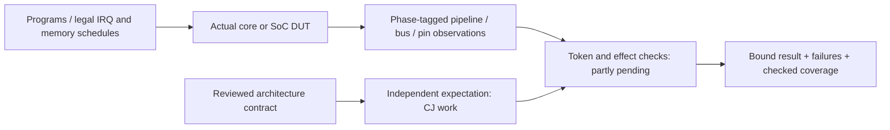
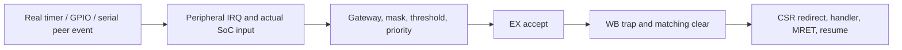

# Verification architecture and qualification

**Current documentation review snapshot · 10 November 2026 · open engineering work, not technical signoff.**

[Review index](index.html) · [Core architecture](01_core_architecture.html) · [HTML summary](02_verification_architecture.html) · [Benchmark/SPI evidence](03_benchmark_spi_evidence.html) · [Gate readiness](04_gate_readiness.html)

Reviewed baseline: `verification_infra/ips_reorganized` at `a91edb7e666d5c374af70809703f52eb5513d96f`. Local `ips/` is an **augmented offline copy**, including local-only skeletons, rather than a Git checkout. Source inspection in this review is distinct from retained execution. Parent collects final file fingerprints. The [document contract](../../../../artifacts/cj_documentation_unification_20261110/DOCUMENT_CONTRACT.md), [current reconciliation and correction banner](../CJ_FINDING_RECONCILIATION_20261110.md), and [remaining-work record](../CJ_REMAINING_WORK_20261110.md) govern this snapshot. Older guides remain preserved and are linked as historical context.

## 1. Requirements and evidence boundaries

The verification problem is to associate each **dynamic instruction and external effect** with an independent expected outcome. A winner is not acceptance; acceptance is not WB trap commit; WB commit is not handler execution or successful return. A valid WB level is not necessarily a unique retirement. The observation path must preserve those distinctions before coverage or completion can be meaningful.

| Responsibility | Exact recorded criterion | Current basis and remaining qualification |
|---|---|---|
| G4 **4.12** | Fetch starts at `RESET_PC`; IRQ taken at a clean boundary; `mtvec` jump and `mepc` save correct | Core-only directed synchronous-trap examples and scoped IRQ unit evidence exist. Current asynchronous clean-entry/reset trace and independent expected restart-PC checks remain required. |
| G5 **5.3** | Minimal machine-mode trap and interrupt tests pass | Engineer reports RISCOF trap/privilege work; newer bundle is not bound to this candidate. Complete applicable machine-mode CSR/trap tests and asynchronous/collision corners. |
| G6 **6.5** | **Every source from real peripheral event to controller input; masking and priority checked** | Unit injected vectors do not prove physical event generation or SoC routing. Implement real event/subevent paths and independent mask/priority checks. **Handler/MRET is additional scope**, useful for 4.12/5.3/6.13, not an extra requirement silently added to 6.5. |
| G6 **6.13** | Interrupts during load/store/branch-dense code; nested interrupt policy exercised if supported | Memory/MDU/redirect development tests provide selected mechanisms. Legal IRQ-under-load schedules, exactly-once effects, context/return and declared nesting policy remain open. |
| Supporting 2.7 / 2.9 / 5.2 | LSU qualification / CSR corner cases / applicable official ISA suite | Need reviewed size/offset/error/latency matrix, independent CSR model, and current-source architectural-test evidence; none is replaced by a skeleton or field sweep. |

Criteria are transcribed in the preserved [G4](../evidence_review_20261102/G4_MISSING_EVIDENCE.md), [G5](../evidence_review_20261102/G5_MISSING_EVIDENCE.md) and [G6](../evidence_review_20261102/G6_MISSING_EVIDENCE.md) reviews. Their broader “missing action” prose must be read with the corrected 6.5 boundary above. VCS is the recorded tool for these checklist items; Slang, Icarus, XSim and Xcelium evidence retains its own scope. No simulator/UVM/controller departure, no-C applicability approval, or waiver is inferred. The official workbook was not read or changed here; the 8 November inventory's status counts are historical.

This is a target checking chain. The tables below identify which links actually exist; the diagram does not claim a completed scoreboard.

## 2. Build/top and evidence map

| Entry point / invocation root | Actual DUT and implementation state | Evidence stage / result / limitation |
|---|---|---|
| [`tb_csr_corner_unit.f`](../../../Verification/filelists/tier1_unit/tb_csr_corner_unit.f), top `tb_csr_corner_unit`; root `rtl/ips` | `csr_regfile`, 32-bit; connected deterministic inputs; reset held low; no-op model/coverage tasks | Static source/port inspection only. **No established compile, elaboration or runtime result.** Source prints `SKELETON/INCOMPLETE; no checks performed` if executed. |
| [`tb_core_csr_trap.f`](../../../Verification/filelists/tier1_unit/tb_core_csr_trap.f), top `tb_core_csr_trap`; root `rtl/ips` | Actual `top.v`, `RESET_PC=0x80000000`; shells, read-only probe and small OOP environment; reset held low | Static inspection only; no established compiler/runtime evidence. Intended result is `SKELETON/INCOMPLETE`, not PASS. |
| [`hazard_unit.f`](../../../Verification/hazard_tb/unit/hazard_unit.f), top `hazard_tb_top`; root its `unit/` directory | Production `hazard_unit.v`; complete adapter, layered driver/monitor and unconfigured user classes | Retained **4 November Slang 12.1.0 semantic compilation**, 0 errors/0 warnings; no simulation. DUT changed since that manifest. |
| [`pipeline.f`](../../../Verification/hazard_tb/pipeline/pipeline.f), top `pipeline_tb`; root its `pipeline/` directory | Actual core with real `rv32m_unit`, passive stage probes and test-only memories; unconfigured user scenario/checker/coverage | Retained **4 November Slang**, 0 errors/3 warnings; no simulation. Current post-port sources are not established compiled by that old result. |
| [`tb_irq_arbiter.f`](../../../Verification/filelists/tier1_unit/tb_irq_arbiter.f), top `tb_irq_restructure`; root `rtl/ips` | Gateway, arbiter, CSR and commit-controller instances, largely driven separately | Retained October simulation and scoped functional/code reports; no CPU program, real peripheral or handler proof. |
| [`core_port_20261109/run_tests.py`](../../../Verification/core_port_20261109/run_tests.py), top `tb_core_port`; script resolves explicit RTL/output roots | Directed core firmware and synchronous IMEM; simple load waits, byte stores, no injected IRQs | Retained post-sync Icarus development runs: 13 configurations; not full architectural suite or IRQ integration. |
| [`PLAN.md`](../irq_event_commit_plan_20261104/PLAN.md), [`TB_FILE_PLAN.md`](../irq_event_commit_plan_20261104/TB_FILE_PLAN.md) | Proposed full-SoC event/commit shell and engineer hooks | **Planned/not built** for the proposed `ips/Verification/irq_tb/` tree (absent at review). No new model, event program or bins delivered by that plan. |

Filelists select real RTL by explicit paths; skeletons are separate tops and do not automatically enter the canonical SoC regression. The CSR core filelist has 39 source entries and the unit list 3; historical static audits recorded connected named ports. Path/port counts are structural observations, not syntax or scheduling verification. Compile templates in the guides have not been run by this review.

The [hazard validation record](../../../Verification/hazard_tb/docs/validation.md), [unit compiler log](../../../../artifacts/hazard_tb_skeleton_20261104/slang_unit_final.log), [pipeline compiler log](../../../../artifacts/hazard_tb_skeleton_20261104/slang_pipeline_final.log), [source manifest](../../../../artifacts/hazard_tb_skeleton_20261104/source_manifest.json) and [Verilator limitation log](../../../../artifacts/hazard_tb_skeleton_20261104/verilator_limitation.log) remain authoritative for that earlier check. The three retained warnings are unconnected production `ALU.Zero`, fetch `imem_stall`, and CSR `csr_valid_o`. Verilator 5.020 stopped on unsupported modport clocking; no executable/runtime result followed. VCS/Verdi were not run.

**Identity check made in this documentation review:** comparing current files against that hazard SHA-256 manifest finds differences in `Control_Unit_Top.v`, `csr_regfile.v`, `decode_cycle.v`, `execute_cycle.v`, `fetch_cycle.v`, `hazard_unit.v`, `rv32m_mul.v`, `rv32m_unit.v` and `top.v`. Do not carry the old Slang result forward as current-candidate compilation. No compilation was launched here.

## 3. CSR/trap skeleton: connected observation, missing expectation

Reuse the preserved [CSR/trap architecture guide](../../../Verification/doc/CSR_TRAP_TESTBENCH_ARCHITECTURE.html), [corner plan](../../../Verification/doc/CSR_TRAP_CORNER_TESTPLAN.md), [skeleton README](../../../Verification/infrastructure/tb/csr_trap/README.md) and [implementation brief](../../../Verification/doc/CSR_TRAP_SKELETON_BRIEF.md). The plan's “proposed tops” description predates the delivered reset-held skeleton; its scenario/coverage sections remain proposals. [CSR_and_Trap_Model.md](../CSR_and_Trap_Model.md) contains historical pre-port claims; current mepc masking, legality and MDU cancellation corrections are governed by the reconciliation, not by that old text.

### Actual chain

1. **DUT:** [`tb_csr_corner_unit.sv`](../../../Verification/infrastructure/tb/tb_csr_corner_unit.sv) directly connects the `csr_regfile` normal-write, trap, MRET, retirement and pending ports. Such future raw-port collisions qualify leaf behavior only; they do not show that the core generates correctly gated requests.
2. **Core stimulus:** [`tb_core_csr_trap.sv`](../../../Verification/infrastructure/tb/tb_core_csr_trap.sv) instantiates actual `top.v`, real core dependencies and public IRQ pins. IRQs are zero, reset never releases, test ID is `UNSELECTED` and expectation version `UNSET`. Three reset-held cycles precede shutdown. Both event-capture blocks are reset-qualified, so the default lifecycle supplies no architectural-event witness.
3. **Memory:** [`core_corner_imem.sv`](../../../Verification/infrastructure/tb/csr_trap/core_corner_imem.sv) exposes all fetch pins but returns an **asynchronous placeholder NOP**. Its configure hook is empty. [`core_corner_dmem.sv`](../../../Verification/infrastructure/tb/csr_trap/core_corner_dmem.sv) ties read data/stall/error to zero; it implements no storage, waits, error schedule or effect ledger. No reviewed `DATA_BASE` is selected. These are shells, not the pipeline bench's memory models.
4. **Observation:** [`core_csr_trap_probe.sv`](../../../Verification/infrastructure/checkers/core_csr_trap_probe.sv) passively maps valid WB, exception packet, trap/MRET commit, gated GPR/CSR writes and memory write observation. [`core_corner_if.sv`](../../../Verification/infrastructure/tb/csr_trap/core_corner_if.sv) samples pipeline/request events pre-rising-edge (`#1step`) and settled `mtvec/mepc/mip/mstatus` before the following falling edge. Phase tags prevent comparing an event and an unrelated CSR sample. Simultaneous event flags remain separate. These taps are observations, not expected values.
5. **Model/checks:** [`csr_trap_env_pkg.sv`](../../../Verification/infrastructure/tb/csr_trap/csr_trap_env_pkg.sv) constructs separate scheduler/scoreboard mailboxes and distinct event objects per recipient. The scoreboard consumes without checking; `model_and_check()` is empty. [`core_csr_trap_assertions.sv`](../../../Verification/infrastructure/checkers/core_csr_trap_assertions.sv) is an assertion-extension shell. A zero failure count with zero attempted checks has no functional meaning.
6. **Coverage/result:** the attempt and checked-result hooks are empty; the checked-result path is not called. `stop()` waits for queue-consumer stop markers, then prints incomplete. Queue shutdown is not architectural drain. No reference model, program, bin or functional result is established.

### CJ-owned engineering work

Preserve `TODO(USER_REF_MODEL)`, `TODO(USER_STIMULUS)` and `TODO(USER_COVERAGE)`. The independent model needs approved CSR reset/masks/WARL/access policy, per-register collision priorities, expected metadata/status/return rules, and a memory-effect ledger. Do not derive expected trap PC/cause from the observed trap packet itself.

The existing plan supplies CT01–CT12 and CU01–CU02, **not completed tests**: establish one checked exception, then younger-effect suppression, exception/IRQ collision, CSR dependencies and older gating writes, waiting memory/redirects, MDU IRQ phases, mepc→MRET, all-source lifecycle, legal/illegal/alignment/error guards, invalid/flushed packets and rearm. Unit work includes status transitions, metadata, per-target write collisions, counter rollover/write priority and reset. Preserve attempted versus fully checked outcomes and bounded no-event windows. Custom CSR `0x7C0` is implemented; unresolved unsupported/read-only policy is not evidence that every custom access is illegal. Direct-only mtvec is not automatically an architectural defect. M-only privilege/WARL and optional software nesting still need a frozen expectation.

## 4. Hazard and pipeline skeletons: useful transport, no functional oracle

Read the preserved [architecture guide](../../../Verification/hazard_tb/docs/architecture.html), [unit extension tutorial](../../../Verification/hazard_tb/unit/README.md) and [pipeline extension tutorial](../../../Verification/hazard_tb/pipeline/README.md). They document source-defined behavior; earlier compilation does not demonstrate runtime behavior on the current core.

### Hazard leaf

[`hazard_tb_top.sv`](../../../Verification/hazard_tb/unit/hazard_tb_top.sv) connects the production hazard DUT's forwarding, load-use/CSR, exception, redirect, MDU and memory-wait inputs and ten outputs (`ForwardAE/BE`, `StallF/D/E/M`, `FlushD/E/M/W`). [`hazard_tb_pkg.sv`](../../../Verification/hazard_tb/unit/hazard_tb_pkg.sv) stamps a nonzero transaction ID, drives via [`hazard_if.sv`](../../../Verification/hazard_tb/unit/hazard_if.sv) on a falling edge and samples settled inputs/outputs `#1step` before the rising edge. Immutable value samples and acknowledgement serialize advancement and suppress repeated publication of one drive ID.

The [active user extensions](../../../Verification/hazard_tb/unit/user/hazard_user_extensions.svh) all return unconfigured. The sequence emits no functional vector; checker returns `checked=0`, `passed=0`; coverage returns `recorded=0`. A future configured run must reject ID/input mismatch, unchecked/failed samples, unrecorded coverage, zero work, sequence errors and unfinished vector-limit exits. `WATCHDOG` bounds infrastructure, not hardware latency. `+PLUMBING_ONLY` uses two benign reset/release bundles and bypasses user hooks; its source-defined `SKELETON_READY` label is not an observed functional pass. No current run was performed.

### Real-core pipeline

[`pipeline_tb.sv`](../../../Verification/hazard_tb/pipeline/pipeline_tb.sv) maps actual fetch/decode/EX/M/W state, forwarded operands, memory pins, real MDU ownership/result signals, hold/flush/redirect and gated WB effects. [`pipeline_probe_adapter.sv`](../../../Verification/hazard_tb/pipeline/pipeline_probe_adapter.sv) copies a `#1step` pre-edge view and a live view 1 ps after the edge/NBA under the same cycle index. [`pipeline_tb_pkg.sv`](../../../Verification/hazard_tb/pipeline/pipeline_tb_pkg.sv) uses immutable samples and zero-time observation callbacks; monitor shutdown precedes finish hooks. Scenarios drive only reset/IRQ/wait/error controls on falling edges through the driver.

| Memory boundary | As-coded test-model behavior | Qualification limit |
|---|---|---|
| [`pipeline_instruction_memory.sv`](../../../Verification/hazard_tb/pipeline/pipeline_instruction_memory.sv) | 4096 words at `0x80000000`; 30-bit **word** address; registered read address, combinational data from that register; explicit `+IMEM_HEX`; unknown/uninitialized consumed words, out-of-range fetch and writes fail | Intended to match one-cycle SRAM timing. No runtime timing proof. No external IMEM ready/error pin exists; do not invent fetch wait/error injection. |
| [`pipeline_data_memory.sv`](../../../Verification/hazard_tb/pipeline/pipeline_data_memory.sv) | 32 KiB at `0x80001000`, zero initialized, optional `+DMEM_HEX`; single response/effect owner; `wait_cfg=N` adds N stalled intervals before completion; stable held fields; byte writes only on successful completion; error gives no store effect | Core model, not real SRAM/AXI/APB integration. Reset cancels pending response while preserving completed memory. Request drop cancels uncompleted work. Runtime behavior remains unestablished. |
| Request/effect identity | Local request IDs and separate offer/accept/response/effect log labels; acceptance and response coincide at modeled `req && !stall` consuming edge | A high request at the next edge after completion is a new modeled transaction, even with identical fields. A duplicated held architectural request can therefore look legal. A **dynamic token/effect checker is still missing**. |

The [pipeline user classes](../../../Verification/hazard_tb/pipeline/user/pipeline_user_extensions.svh) inherit unconfigured/incomplete defaults. No default image exists. Normal execution requires configured scenario/checker/coverage hooks and explicit image selection. Plumbing holds reset for four rising edges; it runs no program. `MAX_CYCLES` covers the complete lifecycle; the two-cycle observation allowance is not proof that instructions/MDU/memory drained.

`instr_retired_candidate = valid_W & ~exc_valid_W` is explicitly a classification, not unique-retirement identity. It may remain asserted during a hold. This matters to [#16](https://github.com/raghul7cj/RISCFORGE_1TOPS/issues/16) and to counter/benchmark checks. The token tracker, instruction association, independent operand model, MDU owner scoreboard, precise memory ledger, checker self-tests and functional bins are **pending**, not supplied by the sample transport.

### Supporting LSU qualification

[`ls_unit.v`](../../../riscv_core/rtl/ls_unit.v) routes byte addresses, request/write, aligned payload/byte enables, formatted LB/LBU/LH/LHU/LW data, stall and error. [`hazard_unit.v`](../../../riscv_core/rtl/hazard_unit.v) combines dependencies with memory/MDU/redirect controls; [`memory_cycle.v`](../../../riscv_core/rtl/memory_cycle.v) is part of the real integration. Static equations are implementation evidence, not an independent oracle. CJ's 2.7/6.13 checks must cover legal byte/half/word offsets, signed/unsigned extension, neighbor preservation, alignment/trap guards, successful/error waits, held-field stability and one-outstanding ownership. Check external acceptance/effects, including younger stores and MMIO reads/writes, rather than only suppressing WB writes. The focused load/MDU cases below do not close this matrix. RS2 source-use qualification was integrated; RS1 false dependencies remain [#18](https://github.com/raghul7cj/RISCFORGE_1TOPS/issues/18).

## 5. IRQ unit evidence and current SoC predictor defects

[`tb_irq_restructure.sv`](../../../Verification/tb_irq_restructure.sv) directly drives gateway raw/clear, arbiter pending/enable/threshold/commit, CSR ports and WB packet controls. It uses list-based expected class/order and committed-ID RR history rather than the old SoC predictor. The arbiter pending input is separately driven; the WB controller has constant MRET/target inputs and the CSR trap input is direct. This is **block-level qualification**, not one connected CPU→handler chain.

The [unit coverage plan](../../../Verification/IRQ_UNIT_COVERAGE_PLAN.md) and source show checks before coverage samples. Cases include 208 singleton source/gate combinations; 24 class-1 and 8 class-0 selection cases; 28 class-2 pairs; 15 RR feedback cases; event/edge/level capture; mintprio/mie behavior; and valid/invalid/synchronous/unsupported commit clears. The exhaustive loop checks **8192 pending vectors × 4 thresholds × 6 RR states = 196608 snapshots**, with all enables/global MIE on. It is not the exhaustive cross of every enable mask and vector.

Retained observations, not rerun here:

- [29 October XSim final simulation log](../../../Verification/artifacts/irq_restructure/irq_coverage_final_sim.log): PASS banner for 196608 snapshots plus the named gateway/CSR/commit checks. The [timestamped functional report](../../../Verification/artifacts/irq_unit_coverage_20261029_233839_967/functional_report/xcrg_func_cov_report.txt) records 14 declared groups at score 100 for that run.
- [30 October Xcelium/IMC functional summary](../../../Verification/artifacts/xcelium_irq_20261030_004317/functional_summary.txt): 471/471 declared covergroup bins. Its [code summary](../../../Verification/artifacts/xcelium_irq_20261030_004317/code_summary.txt) records code average 66.16% and combined covered metric 579/844 (68.60%); these are different report metrics. [Block/expression/toggle details](../../../Verification/artifacts/xcelium_irq_20261030_004317/metrics_summary.txt) retain unhit structures, notably broader CSR/controller behavior. Saved [input snapshots](../../../Verification/artifacts/xcelium_irq_20261030_004317/inputs/) identify that run's population; it is not a new post-sync run or universal CSR/SoC coverage.

### What the real event model must represent

Current [SoC wiring](../../../RTL_SOC/riscforge_soc_subsystem.sv), [gateway](../../../riscv_core/rtl/irq_gateway.v), [arbiter](../../../riscv_core/rtl/irq_arbiter.v) and [core](../../../riscv_core/rtl/top.v) implement 13 routed sources:

| Class / selection | Causes and actual source | Gateway mode |
|---|---|---|
| 2, fixed descending priority | **7,22,24,26,20,21,23,25**: Timer0 C0 compare; T0 C1 compare; T1 C0 compare; T1 C1 compare; T0 C0 overflow; T0 C1 overflow; T1 C0 overflow; T1 C1 overflow | Per-cycle event capture |
| 1, cyclic RR | **19,18,27**: UART; SPI TX/RX threshold aggregate; SPI EOT | UART level; SPI event capture |
| 0, cyclic RR | **17,16**: I2C; GPIO aggregate | I2C level; GPIO rising edge |

Eligibility uses per-source `mie`, global MIE and `class+1 > mintprio`. RR state advances by matching committed cause, not by merely seeing a winner. Event/edge captures win simultaneous clear and can coalesce while pending; levels pass through and are not removed by gateway acknowledgement. GPIO needs an aggregate low interval to rearm. There are more subevents than inputs: GPIO modes/pins, both SPI threshold reasons, UART reasons and timer events require separate legal witnesses. `ext_irq_i` and `sw_irq_i` are tied low in the SoC; leaf CSR MSIP/MEIP visibility is not integrated software/external interrupt delivery. No automatic hardware trap shadow stack is established.

### Current source-confirmed model/TB issues

| Record | Inspected source and mechanism | Consequence / next action |
|---|---|---|
| **#25 TB-IRQPRED** | [`irq_predictor.sv`](../../../Verification/infrastructure/checkers/irq_predictor.sv), instantiated as `u_irq_predictor` in [`soc_tb_top.sv`](../../../Verification/infrastructure/tb/soc_tb_top.sv), models a two-deep shadow stack, incomplete class map, cause 27 as class 2 and generic latched pending. `irq_exp_id` is initialized but no independent winner calculation/comparison exists. Its interface lacks the full current mask/threshold state. | Wrong architecture and missing oracle; a quiet error output cannot qualify the current controller. Review expectations and add targeted wrong-map/winner/mask/stack negative cases before trusting a replacement. [#25](https://github.com/raghul7cj/RISCFORGE_1TOPS/issues/25). |
| **#27 TB-GPIOPRED** | [`register_predictor.sv`](../../../Verification/infrastructure/checkers/register_predictor.sv), instantiated as `u_reg_predictor`, treats 0x000/0x380 as status and 0x004/0x400 as a generic enable. Actual [`gpio_reg_pkg.sv`](../../../gpio-master/gpio_reg_pkg.sv) defines INFO=0x000, CFG=0x004, rise-enable=0x380, fall-enable=0x400, aggregate status=0x580. Only GPIO EN/OUT reads get a nonzero check mask. | Incorrect shadow updates plus skipped mode/IRQ checks; claimed independent register coverage is not established. Qualify map, supported modes, per-pin status/clear and intentionally corrupted readback detection. [#27](https://github.com/raghul7cj/RISCFORGE_1TOPS/issues/27). |
| **#26 TB-DIVIRQ** | [`tb1_interrupts.sv`](../../../Verification/tb1_interrupts.sv), `run_test5_hazard`, loads named IMEM/DMEM hex files, injects timer during busy DIV, waits in an unbounded `while(stallMUL)`, then uses a 30-cycle trap wait without failing explicitly on expiry. Sentinel/quotient success can follow without proving the IRQ. [`test5_hazard.S`](../../../Verification/asm/test5_hazard.S) uses 1000000/7=142857, whereas TB checks 33333 (100000/3). Source-to-loaded-image provenance is unresolved. | Global completion/timeout cannot substitute for missing trap checks. The legacy “never accept during stallMUL” policy also needs reconciliation with current finish/abort/replay intent. Recover image/build identity, agree policy, require bounded DIV/trap/lifecycle checks, retain a missing-IRQ negative case. [#26](https://github.com/raghul7cj/RISCFORGE_1TOPS/issues/26). |

These are current static-source findings corroborating the reconciliation, **not new runtime reproductions**. Existing monitor/scoreboard/reporter instances in `soc_tb_top.sv` are reuse candidates; their presence does not establish effectiveness or independent full-path checking. Historical INFRA B/V records remain triage material under #28, not automatically current reproduced defects.

## 6. Core-port development evidence: what actually ran

The [core-port guide](../../../Verification/core_port_20261109/README.md), [`tb_core_port.sv`](../../../Verification/core_port_20261109/tb_core_port.sv), [`run_tests.py`](../../../Verification/core_port_20261109/run_tests.py), [`tb_legality.sv`](../../../Verification/core_port_20261109/tb_legality.sv) and [`tb_mdu_owner.sv`](../../../Verification/core_port_20261109/tb_mdu_owner.sv) supply concrete checks. The guide's `ips_reorganized/...` shell examples describe the upstream layout; the local augmented tree is `ips/...`. This review provides no new execution command/result.

**Chain:** compiled assembly → public core fetch/LSU boundary → firmware comparisons with explicit constants/labels → reserved data-memory store at `0x80001100` → TB requires value 1, otherwise fatal; watchdog fails after the recorded bound. The responder registers fetch addresses, stalls **loads** for selected 0/1/4-cycle waits, writes enabled byte lanes, ties data error low and all IRQ pins low. Its small data index aliases addresses by `da[11:2]`; it is not a full memory-map/error/peripheral model. It does not insert store-response waits. Firmware independently checks selected arithmetic, preserved load/link values, illegal trap metadata, fetch fault metadata, mepc mask, and ECALL/younger-DIV suppression with return. This does not establish all possible effects or full ISS equivalence.

The [post-sync validation record](../../../../artifacts/verification_infra_sync_20261110/validation/POST_SYNC_VALIDATION.json) retains **13 passing directed configurations**, **131072 field combinations plus exact SYSTEM guards**, **four MDU owner/abort checks**, and **SoC Verilator zero errors/107 warnings** with `-DXSIM -Wno-fatal`. Inspect [post-sync core logs](../../../../artifacts/verification_infra_sync_20261110/validation/core/logs/) and [original before/after validation](../../../Verification/core_port_20261109/validation.json). These are retained development results, not work executed here. Short-image `$readmemh` and multiplier-width warnings remain retained; no waiver is implied.

The legality leaf fixes rs1/rs2/rd to nonzero fields and compares the selected RV32IM subfield policy, then separately guards ECALL/EBREAK/MRET/WFI. It does not sweep every CSR address or architectural state. The owner leaf drives actual execute-stage inputs and checks buffered MUL result/owner PC exactly once, killed MUL, killed DIV and a new DIV after MUL abort. The retained [pre-correction owner failure](../../../Verification/core_port_20261109/evidence/owner_before_multiplier_abort.log) remains negative evidence alongside corrected results; it is not checker fault-injection qualification.

Integrated PR15 mechanisms include MDU valid/hold/owner/cancel through all multiplier valid stages, preservation of older waiting loads and redirect/link state, RS2 qualification, legality guards, mepc low-bit write mask and configurable fetch-region checks wired into the SoC. These directed checks **do not close the original benchmarks or random seeds**, nor G4/G5/G6 as a whole. **#17 missing JALR mask was wrong and withdrawn:** Main_Decoder→ALU_Decoder selects ALU control 0110, and `ALU.v` masks `(A+B)&~1` before alignment checking. Low-bit JALR cases remain runtime coverage work, not an open missing-mask defect. Retirement #16, RS1 #18, predictor/TB #25–#27 remain open; fetch #19 is an investigation, while #20/#21/#22/#23 track contract/qualification work rather than a count of reproduced bugs.

## 7. RISC-DV and RISCOF: useful evidence with distinct oracles

### Saved RISC-DV flow

The preserved [4 November failure audit](../../core/RISCV_DV_FAILURE_AUDIT.md), [raw audit artifacts](../../../../artifacts/riscv_dv_failure_audit_20261104/) and [harness snapshot](../../../../artifacts/riscv_dv_failure_audit_20261104/harness_snapshot/) describe an **offline Spike-versus-Cadence GPR-state-change comparison**, not live lockstep and not a full-SoC random/IRQ proof. Saved inventory: **193 PASSED / 22 FAILED across 215 comparisons**. These are historical comparator outcomes, not 22 independent bugs or a current pass rate. Nineteen failures belong to the illegal family; representative seed 22 was deeply attributed. Misaligned-instruction seeds 21/38 and unaligned-load/store seed 38 show younger DIV/REM effects after an older trap. Preserve the raw failures despite later targeted corrections.

| Chain link | Actual inspected mechanism | Limitation |
|---|---|---|
| DUT/stimulus | Snapshot [`tb_riscv_dv.sv`](../../../../artifacts/riscv_dv_failure_audit_20261104/harness_snapshot/tb_riscv_dv.sv) loads generated images into core-only memories; IRQs low; data stall/error tied low | Not SoC peripherals, arbitrary memory latency, or asynchronous interrupt stimulus. Stale “no trap logic” comments conflict with actual gated-WB probing and cannot define the contract. |
| Instruction observation | Decode-PC associative map; `PCW=PCPlus4W-4`; instruction recovered by PC, with gated GPR write data | No transported dynamic instruction identity/independent retirement event. Consecutive real executions at the same PC can be suppressed by `prev_pcplus4w`; PC change alone cannot distinguish a hold from valid reexecution. |
| Conversion | [`rtl_log_to_trace_csv.py`](../../../../artifacts/riscv_dv_failure_audit_20261104/harness_snapshot/rtl_log_to_trace_csv.py) emits PCW rows; recovers disassembly from objdump or logged decode fallback | Address-based reconstruction does not demonstrate that the word actually committed; logging/association require qualification. |
| Alignment | [`rtl_no_trap_ref_compare.py`](../../../../artifacts/riscv_dv_failure_audit_20261104/harness_snapshot/rtl_no_trap_ref_compare.py) saves `rtl[:len(spike)]` | Tail truncation prevents a full equal-population/terminal-event claim. It must not be used to discard unreviewed extra execution. |
| Effective comparator | [`instr_trace_compare.py`](../../../../artifacts/riscv_dv_failure_audit_20261104/harness_snapshot/instr_trace_compare.py) skips no-GPR and unchanged-value rows, then pairs state-changing GPR updates | Does not independently check full PC/instruction, CSR/trap sequence, stores/MMIO, no-write instructions or full final memory. A single extra GPR change shifts later pairings and cascades mismatches. Final register convergence can hide an earlier fault. |
| Completion | Snapshot tohost detection and timeout | A tohost “PASSED” print is program completion, not comparator success. Timeout text followed by `$finish` is not itself a checked architectural pass. |

**Current-source evidence gap:** the original seed-specific RTL/TB/build hashes and assembly are not preserved with the saved sweep. The inspected remote Makefile named `RTL_5STAGE_UPDATED/tb_riscv_dv.sv` while the located bench was in a backup directory. The Cadence checkout is not shown to contain the merged port. Local post-sync source and historical remote results cannot be equated. Recover source/program/tool/reference/ISA identity, qualify the logger/comparator, rerun saved failures and then record first divergence plus equal terminal populations. Do not weaken expectations, resynchronize past errors or relabel old outcomes.

The [full-SoC RISC-DV feasibility plan](../../../Verification/plans/RISCV_DV_SOC_FEASIBILITY_2026-11-04.md) remains a proposal: start with a deterministic real event stream, dynamic instruction/effect identity and pinned ISS platform; then add explicit IRQ/MMIO capability. Replaying accepted DUT IRQs into an ISS can align CPU execution but cannot independently detect a wrong winner or missing source. Custom causes 16–27 and mintprio require explicit platform support. Proposed models, differential adapters, seeds and coverage are not implemented merely because the roadmap describes them.

### Architectural signature tests / RISCOF

[`verification/riscof/config.ini`](../../../../verification/riscof/config.ini) selects **Sail** as reference; inspected [`riscof_riscforge.py`](../../../../verification/riscof/riscforge/riscof_riscforge.py) compiles with Icarus from legacy `rv32im_zicsr_5stage_exc_nointr`, not current `ips/riscv_core/rtl`. [`run_compliance.bat`](../../../../verification/riscof/run_compliance.bat) offers ISA/M/privilege/Zicsr suites and copies that legacy source. It is a historical entry point, not a recommended current command. The retained [report](../../../../verification/riscof/report.html) displays 46 passed/1 failed; a **newer passing run is engineer-reported**, and its actual plugin/source/reference/signatures/tool/run bundle was not recovered in this review. Preserve both facts.

Signature comparison checks the selected programs' signature obligations against a reference, not every cycle, arbitrary IRQ timing or all precise effects. The plugin contains timeout/fallback signature handling; future qualification must retain execution status and distinguish valid generated signatures from placeholders. For 5.2/5.3 bind the actual candidate, suite revision and applicability denominator, ISA/platform YAML, selected reference/plugin, build command, ELF/image/signature hashes, log and failure behavior. The documented no-C configuration informs applicability but is not an inferred approved N/A. Ordinary CSR semantics remain assigned to RISCOF by the engineer; that ownership does not remove CSR ordering/collision and asynchronous IRQ obligations from the corner benches.

## 8. Peripheral event/commit plan and qualification milestones

The [peripheral event plan](../irq_event_commit_plan_20261104/PLAN.md) and [file/ownership plan](../irq_event_commit_plan_20261104/TB_FILE_PLAN.md) are the detailed future implementation guide. Reuse the existing SoC shell and compatible helpers **after qualification**. Do not copy their incompatible predictor assumptions into the new oracle. The proposed simple module/interface/task shell has a single hierarchy adapter, pre-edge observed snapshots, one report owner, independent readiness flags, empty checker/coverage hooks and per-peripheral user TODO files. Its sources and `irq_tb/` filelist are not built here.

**6.5:** prove the first three boxes using real events and checked masking/priority. **Additional commit/4.12/5.3/6.13 scope:** independently associate the latter boxes with precise restart/context/effects. Internally forced IRQs are useful diagnostic/unit stimuli but cannot fill real-peripheral event bins.

| Milestone | Present state | Next observable deliverable / owner |
|---|---|---|
| K0–K4 skeleton | Proposed/not built | Freeze types/interfaces/taps; wire shell; add passive records and honest incomplete reports; expose engineer TODOs; integrate explicit filelist/build. CJ reviews the source boundary. No bins or hidden event generator in the skeleton. |
| S0 contract / identity | Open | CJ reconciles source map, capture/clear, MDU IRQ policy, CSR ordering, direct trap/nesting and SW/EXT scope; records source/configuration/tool/image identity. |
| S1 one vertical path | Planned | CJ writes `EV-TMR-01` + `CP-01`: raw-MMIO Timer0 C0 compare, event/routing/mask check, then cause/PC/clear/handler/MRET/resume checks. Preserve a targeted negative checker result. S1's full lifecycle intentionally exceeds the exact 6.5 endpoint. |
| S2 all event paths | Planned | CJ supplies all 13 real sources and required subevents, rearm, 208 singleton mask/gating cases and legal simultaneous priority overlaps (78 unordered pairs in the plan). Confirm actual overlap; no forced internal event to fill a bin. Unit exhaustive snapshots remain separate. |
| S3 commit/precision/load | Partly supported by focused core mechanisms; campaign open | CJ adds dynamic instruction/effect ledger, ASM register/stack/context canaries, waits/errors, branches/JAL/JALR, MDU issue/busy/done/abort, older CSR and trap collisions; then declared software nesting if supported. No assumed hardware stack or cross-class fairness. |
| S4 driver use | Planned qualification | Compare the selected official driver with active register layout, then polled pin/bus transaction, then IRQ mode. A driver call/signature is not an independent peripheral oracle. Preserve current BSP/ABI audit needs before handler reuse. |
| S5 closure package | Open | Current candidate + agreed directed/stress scope + effective checks + retained logs/waves/coverage/defect dispositions. Tool/requirement acceptance remains explicit. No new execution is authorized by this document. |

Before a configured “pass” can be trusted, planned **checker negative fixtures** must detect: wrong source map/winner, ignored mask/threshold, early/duplicate clear, wrong trap PC, missing/extra retirement, wrong CSR, stale MDU write, duplicate store/MMIO effect, missing pin transfer and false firmware success. Missing hooks, zero checks/observations, image/configuration failure, unrecorded samples, blocked stimulus and timeout must not become PASS. These are proposed qualification cases, **not results already obtained**, and injected fixtures do not count as real peripheral coverage.

CJ retains the independent expected-state model, programs/pin/BFM schedules, legal latency/error constraints, coverage groups/bins/crosses/exclusions and closure decisions. Attempts and checked successful witnesses stay separate. Preserve negative results and user TODOs; unsupported modes need explicit disposition rather than automatic bin removal. Per-run evidence should connect requirement → test → oracle/check ID → observed witness → result, with commands/tool versions, source/dirty-input hashes, top/defines/parameters, firmware ELF/map/disassembly/image hashes, seed, completion/drain status, logs, focused waves if later authorized and coverage scope. No coverage threshold or approved waiver is invented here.

## 9. Learning checkpoint and unresolved questions

For one delayed older load followed by MUL and an IRQ, annotate the pre-edge request, completion edge, unique instruction token, MDU owner/result, accepted interrupt packet, committed trap PC and any external store effect. Predict which older effect must survive, which younger effects must be suppressed, and which instruction resumes after MRET. Then identify the first missing observation/check in the current skeleton. This checkpoint guides CJ's next distinguishing test; it is not an approval gate for already authorized work.

Remaining questions are concrete: What is the approved busy-MDU IRQ finish/abort/replay rule and service bound? Which CSR write/IRQ boundary determines eligibility? What exact unsupported/read-only CSR and M-only WARL rules apply? Which reset domains cancel outstanding work? Which BSP/context/nesting policy will be tested? Where is the newer passing RISCOF bundle, and which source/filelist actually built the saved RISC-DV runs? Until resolved and evidenced, these are contract/provenance/qualification gaps, not invented passes or additional reproduced RTL bugs.

**Work performed for this page:** source/evidence inspection, historical/current reconciliation and documentation only. No RTL/TB/model/stimulus/bin change, simulation, waveform generation, Git mutation or official status/expectation change. See the [implementation handback](../../../../artifacts/cj_documentation_unification_20261110/verification_handback.md).

## Source-bound structural views

Static connectivity and hierarchy; runtime evidence is scoped below each view.

### Figure V1 — Real-core pipeline harness and sampled observations

**Figure V1 — Real-core pipeline harness and sampled observations.** pipeline_env owns the scenario, control driver and monitor; stimulus travels from scenario to driver to bus to DUT. Memory return paths are explicit.

**Interface key.** DUT outputs IMEM address[29:0] and LSU req/we/address/wdata/BE; responders return instruction data and LSU rdata/stall/error. The passive adapter freezes input #1step before posedge and copies live state +1 ps after the edge; cycle IDs associate the phases.

**Source key.** [Top + hierarchy taps](../../../Verification/hazard_tb/pipeline/pipeline_tb.sv) · [Environment](../../../Verification/hazard_tb/pipeline/pipeline_tb_pkg.sv) · [Sampling adapter](../../../Verification/hazard_tb/pipeline/pipeline_probe_adapter.sv) · [User hooks](../../../Verification/hazard_tb/pipeline/user/pipeline_user_extensions.svh) · [Build filelist](../../../Verification/hazard_tb/pipeline/pipeline.f)

**Accomplishment / evidence limit.** Memory responders, control plumbing and immutable callback delivery are implemented. User scenario/checker/coverage remain unconfigured. 4-Nov Slang compile applies to an older snapshot; current core differs. No pipeline runtime qualification is claimed. [Historical pipeline compile](../../../../artifacts/hazard_tb_skeleton_20261104/slang_pipeline_final.log) · [Snapshot limits](../../../Verification/hazard_tb/docs/validation.md)

### Figure V2 — Separate CSR/trap core harness and incomplete hooks

**Figure V2 — Separate CSR/trap core harness and incomplete hooks.** This independent top is reset-held and uses placeholder responders. Real class/mailbox plumbing does not imply functional checking.

**Interface key.** core_if carries 30-bit IMEM word address, 32-bit instruction/LSU payload and 4-bit byte enables. TB publishes separate event objects into scheduler and scoreboard mailboxes. CSR state is sampled #1step before negedge, separately from pre-posedge event pins.

**Source key.** [CSR top](../../../Verification/infrastructure/tb/tb_core_csr_trap.sv) · [Interface sampling](../../../Verification/infrastructure/tb/csr_trap/core_corner_if.sv) · [Classes + mailboxes](../../../Verification/infrastructure/tb/csr_trap/csr_trap_env_pkg.sv) · [NOP responder](../../../Verification/infrastructure/tb/csr_trap/core_corner_imem.sv) · [Zero responder](../../../Verification/infrastructure/tb/csr_trap/core_corner_dmem.sv)

**Accomplishment / evidence limit.** Passive taps and mailbox fanout are connected. Program setup, independent trap model, stimulus, assertions and coverage are incomplete; checks=0 is source-defined behavior, not a newly observed run. No compile/run evidence is established for this harness. [CSR harness scope](../../../Verification/infrastructure/tb/csr_trap/README.md) · [Corner test plan](../../../Verification/doc/CSR_TRAP_CORNER_TESTPLAN.md)
