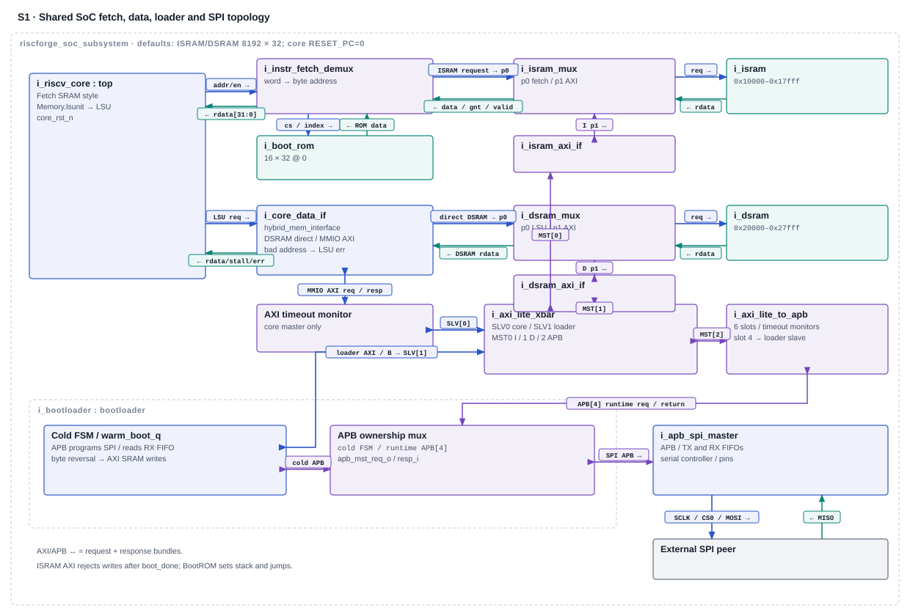

# Benchmark and external-SPI boot evidence

**Current documentation review snapshot · 2026-11-10 · CJ responsibilities G5.7 and G6.10. This is not technical signoff.**

[Review index](index.html) · [Core](01_core_architecture.html) · [Verification](02_verification_architecture.html) · [Benchmark / SPI](03_benchmark_spi_evidence.html) · [Readiness](04_gate_readiness.html)


## 1. Review basis and present conclusion

The reviewed source baseline is `verification_infra/ips_reorganized` commit `a91edb7e666d5c374af70809703f52eb5513d96f`. Local `ips/` is an augmented offline copy, not a Git checkout. Historical run identities remain separate from this source snapshot. This review read source and saved evidence; it did not compile, simulate, generate waveforms, change expectations, or produce a new benchmark score.

| Responsibility | Original criterion, from the historical workbook extraction | Current engineering state | Next action / owner |
| --- | --- | --- | --- |
| **G5.7** | “Dhrystone and/or CoreMark complete with correct results; score recorded”; tool VCS | Infrastructure and historical executions exist. Historical smoke/CoreMark/Dhrystone failed; the counter diagnostic passed within its limited scope. Relevant MDU corrections are integrated, but integrated-source workload completion and measurement qualification remain pending. | CJ: rebind/build inputs, check smoke and full workload correctness, then qualify the measurement and record any defensible metric. |
| **G6.10** | “Boot mode pin = 1: code fetched from the SPI flash model and executed”; tool VCS | Historical unit copy and staged SoC execution evidence exist. Current-source external-flash transfer through actual SRAM execution remains pending. No boot-mode-pin departure or alternative simulator approval is established here. | CJ: resolve exact accepted boot-mode criterion and retain a current cold-boot proof without payload preload into SRAM. |

Criterion provenance: [8 November inventory extraction](../cj_inventory_20261108/inventory.json), entries 5.7 and 6.10; [original G5 review](../evidence_review_20261102/G5_MISSING_EVIDENCE.md), [original G6 review](../evidence_review_20261102/G6_MISSING_EVIDENCE.md). This is not a fresh workbook read and does not modify official statuses. Current interpretation follows the correction banners in [finding reconciliation](../CJ_FINDING_RECONCILIATION_20261110.md) and [remaining work](../CJ_REMAINING_WORK_20261110.md).

**Source identity matters:** the old benchmark [109-file baseline](../../../benchmarks/docs/design_baseline.json) was captured on 4 November. A read-only SHA-256 comparison in this review found **99 matches and 10 differences** in today's local files. The differing files are `Control_Unit_Top.v`, `csr_regfile.v`, `decode_cycle.v`, `execute_cycle.v`, `fetch_cycle.v`, `hazard_unit.v`, `rv32m_mul.v`, `rv32m_unit.v`, `top.v`, and `RTL_SOC/riscforge_soc_subsystem.sv`. Thus the older “109 unchanged” statement is a historical run claim, not a description of the integrated source now inspected. Full comparison hashes are in the [topic handback](../../../../artifacts/cj_documentation_unification_20261110/benchmark_spi_handback.md); the parent collects final package fingerprints.

## 2. G5.7 — what the benchmark environment checks

### Actual implementation and execution path

The dedicated [manifest](../../../benchmarks/filelists/soc_benchmark.f) references [soc_subsystem.f](../../../RTL_SOC/soc_subsystem.f), adds [UART runtime dependencies](../../../benchmarks/filelists/uart_runtime_dependencies.f), and selects [soc_benchmark_tb.sv](../../../benchmarks/tb/soc_benchmark_tb.sv). The TB instantiates the real `riscforge_soc_subsystem`; it does not replace the CPU, memories, fabric, or peripherals with benchmark stubs.

The [runner](../../../benchmarks/tools/run_benchmark.py), [filelist generator](../../../benchmarks/tools/generate_filelists.py), [harness guide](../../../benchmarks/docs/HARNESS.md), and [firmware guide](../../../benchmarks/docs/FIRMWARE.md) identify the consumed inputs. Firmware is RV32IM/Zicsr, ILP32, linked at ISRAM `0x00010000` (32 KiB) with data at DSRAM `0x00020000` (32 KiB). The first 256 DSRAM bytes are reserved for the result ABI; the stack starts at `0x00028000`. Static fit is checked by the builder/linker; it does not prove dynamic stack safety.

```text
Pinned upstream + local firmware/ports + build flags
  → ELF / map / disassembly / imem.hex / dmem.hex / build.json
  → runner provenance and ELF↔preload checks → run-local staged inputs
  → warm-reset selection → direct SRAM preload → core release
  → BootROM trampoline → real ISRAM execution / DSRAM / MMIO paths
  → firmware validation + result ABI → TB guards → host analysis
```

**This benchmark launch is a warm-preload bypass, not an external-SPI proof.** The TB holds soft reset low, releases hard reset, waits for `hard_rst_sync_n` and `i_bootloader.warm_boot_q`, clears and loads both SRAM arrays using `$readmemh`, then releases soft reset. SPI MISO is tied low. Firmware executes on the actual SoC after release, but the external-flash→SPI→SRAM loading path is deliberately skipped. See TB initialization and [boot path record](../../../Verification/components/memory/boot_path.md).

### Contract, independent expectations and decisive observations

| Layer | Source / expected result | What establishes success; what it cannot establish alone |
| --- | --- | --- |
| Input provenance | [source lock](../../../benchmarks/vendor/sources.lock.json), `build.json`, staged ELF/images and source fingerprints | Runner checks completed-build status, required source inventories and hashes, source pins, ELF ABI/address bounds, preload agreement, zero initial result block and staged outputs. Old run directories preserve identities; a mutable build directory is not a candidate identity. |
| Firmware result ABI | [contract.json](../../../benchmarks/contract.json), [runtime.c](../../../benchmarks/firmware/runtime.c) | Magic `0x42454e43`, version 1, ID/iterations, RUNNING then terminal status, zero validation errors and explicit trap evidence. A status word by itself is insufficient. |
| Smoke | [smoke.c](../../../benchmarks/firmware/smoke.c) | Mathematical constants and source-loop expectation, rather than copying DUT intermediate values. Historical expected sum 2980 must remain unchanged. |
| CoreMark | [upstream core_main.c](../../../benchmarks/vendor/upstream/coremark/core_main.c), [port](../../../benchmarks/ports/coremark/core_portme.c), [build adaptations](../../../benchmarks/tools/build_firmware.py) | Upstream known CRCs and error result; report hook copies errors/CRCs into the ABI. Port seeds are `0x3415, 0x3415, 0x66`, one context. The upstream minimum 10-second check is retained. A short CRC-correct exercise would still lack published-score qualification. |
| Dhrystone | [dhrystone_port.c](../../../benchmarks/ports/dhrystone/dhrystone_port.c) | Explicit expected scalars, strings, arrays, pointers and record fields, including iteration-dependent state. A loop exit or formatter output is not this final-state validation. The checker executes on the DUT; it is an expected-value check, not an independent external lockstep model. |
| TB and host | [TB](../../../benchmarks/tb/soc_benchmark_tb.sv), [analyzer](../../../benchmarks/tools/analyze_results.py) | TB requires observed RUNNING, consistent terminal result, no unexpected trap, no sticky bus timeout and bounded completion. Host also requires the pass marker/raw record and consistent log verdict. XSim process exit zero alone is insufficient. |

The [4 November deliverables](../../../benchmarks/docs/DELIVERABLES.md) retain 39 host-test passes and [three expected negative guard outcomes](../../../benchmarks/docs/evidence/tb_guards/guard_20261104T063315Z_d02d3391_summary.json): watchdog, illegal-instruction trap and preloaded terminal result. These support historical infrastructure behavior. They do not qualify every checker, every current source, or a workload score. The [earlier failed attempts](../../../benchmarks/docs/KNOWN_FAILURES.md) remain historical evidence, including a one-NOP watchdog fixture that trapped when it ran into zero-filled memory before the fixture was corrected.

### Retained actual workloads — historical, not rerun now

The four selected runs below used XSim 2022.2, WSL GCC 13.2.0, `-march=rv32im_zicsr -mabi=ilp32`, a modeled 10 ns / 100 MHz clock and a 2,000,000-cycle watchdog. Their metadata rechecks 120 source/generated inputs after compilation. These are 4 November runs against their recorded fingerprints, not current integrated-source workload results.

| Workload / iterations | Observed result in saved raw record and analysis | Evidence |
| --- | --- | --- |
| Smoke / 1 | Firmware FAIL, 3 validation errors; first code `0x1001`; expected sum 2980, observed 1016; no trap. | [raw](../../../benchmarks/runs/smoke_20261104T065353Z_7108f0a2/result.json), [analysis](../../../benchmarks/runs/smoke_20261104T065353Z_7108f0a2/analysis.json), [metadata](../../../benchmarks/runs/smoke_20261104T065353Z_7108f0a2/run_metadata.json), [log](../../../benchmarks/runs/smoke_20261104T065353Z_7108f0a2/simulation.log) |
| Counter probe / 1 | Diagnostic PASS, zero validation errors/no trap. Raw window 38 cycles, 24 unqualified `minstret` increments; body has eight instructions plus measurement overhead. | [raw](../../../benchmarks/runs/counter_probe_20261104T065406Z_9f3abc11/result.json), [analysis](../../../benchmarks/runs/counter_probe_20261104T065406Z_9f3abc11/analysis.json), [metadata](../../../benchmarks/runs/counter_probe_20261104T065406Z_9f3abc11/run_metadata.json), [log](../../../benchmarks/runs/counter_probe_20261104T065406Z_9f3abc11/simulation.log) |
| CoreMark / 1 | Unexpected cause 6, PC `0x00010fa4`, address `0x0002092d`, `sw zero,0(a1)` in `core_list_init`. Mailbox still RUNNING; timing phase 0. No timed completion or CRC validation. | [raw](../../../benchmarks/runs/coremark_20261104T065419Z_d28e58b8/result.json), [analysis](../../../benchmarks/runs/coremark_20261104T065419Z_d28e58b8/analysis.json), [metadata](../../../benchmarks/runs/coremark_20261104T065419Z_d28e58b8/run_metadata.json), [log](../../../benchmarks/runs/coremark_20261104T065419Z_d28e58b8/simulation.log) |
| Dhrystone / 10 | Unexpected cause 5, PC `0x00010088`, address `0x00040231`, `lbu a3,0(a3)` in `emit_unsigned`. Mailbox still RUNNING; timing phase 0. Benchmark loop/final-state validation not established. | [raw](../../../benchmarks/runs/dhrystone_20261104T065432Z_8cffc712/result.json), [analysis](../../../benchmarks/runs/dhrystone_20261104T065432Z_8cffc712/analysis.json), [metadata](../../../benchmarks/runs/dhrystone_20261104T065432Z_8cffc712/run_metadata.json), [log](../../../benchmarks/runs/dhrystone_20261104T065432Z_8cffc712/simulation.log) |

The counter probe establishes diagnostic execution, result transport and live monotonic reads. Its 68 whole-run WB/stall overlap samples are outside the scope of an exact eight-instruction counter oracle. Neither `38/24` nor a raw analyzer CPI field is a qualified CPI. Zero firmware errors while the mailbox is still RUNNING in the trapped workloads is not a validation pass.

### Historical failure isolation versus integrated corrections

The [isolation report](../../../benchmarks/docs/RTL_FAILURE_ISOLATION.md), [machine findings](../../../benchmarks/docs/evidence/isolation/findings.json), and focused [smoke](../../../benchmarks/docs/evidence/isolation/smoke_windows.csv), [CoreMark](../../../benchmarks/docs/evidence/isolation/coremark_windows.csv), [Dhrystone](../../../benchmarks/docs/evidence/isolation/dhrystone_windows.csv) edge tables retain actual trace analysis. CSV samples are immediately before rising edges; the following row reflects that edge's register update. The excerpts in the report are disassembly from full workloads, not independently executed minimal tests.

| Finding | Historical observation | Present source / remaining qualification |
| --- | --- | --- |
| MDU completion loses validity | 10 smoke, 5 CoreMark and 3 Dhrystone completions had correct observed arithmetic for accepted operands but lost WB validity. CoreMark's stale pointer became `0x2092d`; Dhrystone's stale formatter state led to `0x40231`. | [execute_cycle.v](../../../riscv_core/rtl/execute_cycle.v) now implements owner-qualified completion, result hold and `valid_E1`; [rv32m_unit.v](../../../riscv_core/rtl/rv32m_unit.v) propagates abort, and [rv32m_mul.v](../../../riscv_core/rtl/rv32m_mul.v) clears all multiplier valid stages on abort. Integrated mechanisms exist; original workloads still need reruns. |
| Younger MDU starts while older load waits | Two smoke overlaps and one Dhrystone overlap flushed a stalled older MEM packet. None occurred in CoreMark before its trap. | [hazard_unit.v](../../../riscv_core/rtl/hazard_unit.v) qualifies the MDU flush with `~mem_stall_i`; execute's issue guard includes `!StallM`. Current directed evidence covers selected older-load/MDU interactions, not every workload. |
| Held WB repeats retirement — **issue #16 remains open** | Same held packet increments `minstret` on multiple edges; 82/12/183 observed held edges in smoke/CoreMark/Dhrystone. | [memory_cycle.v](../../../riscv_core/rtl/memory_cycle.v) still holds MEM/WB on `core_stall_gated`; [top.v](../../../riscv_core/rtl/top.v) still drives `.instr_retired_i(valid_W & ~exc_valid_W)`; [csr_regfile.v](../../../riscv_core/rtl/csr_regfile.v) increments on each asserted input. Current static mechanism remains; no fresh runtime reproducer was run here. |

The retained [post-sync development validation](../../../../artifacts/verification_infra_sync_20261110/validation/POST_SYNC_VALIDATION.json) records 13 directed configurations, 131,072 legality-field combinations plus SYSTEM guards, four owner/abort checks, and SoC Verilator zero errors / 107 warnings with `-DXSIM -Wno-fatal`. Those focused results do not close the saved benchmark failures. They are not accepted-tool benchmark signoff.

**Measurement remains unqualified.** RV32 high-low-high retries give coherent reads of each 64-bit machine CSR, but the `mcycle` and `minstret` reads occur separately and include reader/wrapper overhead. `timing_phase` is diagnostic, not an exact sample timestamp. A unique-retirement ledger must distinguish held packets, real repeated-PC loop iterations, exceptions and cancelled work. Subtracting the 82/12/183 observations is not a valid correction factor. Issue [#16](https://github.com/raghul7cj/RISCFORGE_1TOPS/issues/16) blocks qualified instruction-count/CPI claims; [#23](https://github.com/raghul7cj/RISCFORGE_1TOPS/issues/23) tracks benchmark qualification. Fetch timing [#19](https://github.com/raghul7cj/RISCFORGE_1TOPS/issues/19) remains an investigation. The missing-JALR-mask allegation #17 was withdrawn; it is not an open benchmark blocker.

CoreMark/Dhrystone correct completion and score qualification are separate from CPI qualification. No new CoreMark/MHz, DMIPS, Dhrystones/s or CPI is claimed here. The analyzer leaves `published_score=null` and `published_compliance=false`; its modeled clock is not achieved silicon Fmax. The retained CoreMark image has one iteration and keeps the upstream minimum-duration error. Do not remove that check to manufacture a pass.

## 3. G6.10 — real external-flash boot path

### As-coded path and ordering

The cold path is autonomous hardware loading followed by ROM handoff; it is not execute-in-place from flash. Source anchors: [SoC subsystem](../../../RTL_SOC/riscforge_soc_subsystem.sv), [bootloader FSM](../../../bootloader/bootloader.sv), [SPI master](../../../spi_master_ip/spi_master/apb_spi_master.sv), [SPI receive FIFO interface](../../../spi_master_ip/spi_master/spi_master_apb_if.sv), [ISRAM bridge](../../../RTL_SOC/axi_lite_sram_if.sv), [SRAM mux](../../../RTL_SOC/sram_mux.sv), [wrapper](../../../RTL_SOC/imem_sram_wrapper.sv), [fetch demux](../../../RTL_SOC/instr_fetch_demux.sv), [BootROM](../../../RTL_SOC/boot_rom.sv), and [ROM image](../../../mem_files/riscforge_bootrom.hex).

```text
Cold reset; core held in reset
  → clear SRAM → flash power-up wait → APB SPI configuration
  → external flash -- READ 0x03 / 24-bit address / serial MISO --> SPI RX FIFO
  → APB accepted RXFIFO read → byte-order conversion → bootloader AXI write
  → crossbar slave[1] → ISRAM bridge / mux port 1 → ISRAM
      (then DSRAM data segment, if configured)
  → clean-slate reset assert/hold/release → boot_done in S_DONE
  → core RESET_PC 0 → BootROM: set sp, jump to 0x00010000
  → fetch demux / mux port 0 → actual SRAM instruction execution
  → independent workload result / observed committed DSRAM write

Warm reset → clean-slate only → release → ROM → retained/preloaded SRAM
             [clear and external SPI transfer skipped]
```

Important implementation boundaries:

- The SoC synchronizes hard reset and filters/synchronizes soft reset. `warm_boot_q` selects the bypass. For a cold proof, do not accidentally assert soft reset into the warm selection before loading.
- Cold boot clears configured ISRAM/DSRAM capacity, waits `FLASH_POWERUP_CYCLES`, configures command `0x03` with an 8-bit command and 24-bit address, then uses chunked serial reads. Bootloader defaults are divider 4 and at most 1024 words per chunk; actual run overrides must be recorded. The SoC defaults to 64 instruction words and zero data words; this is not an automatic firmware-size inference.
- The APB FIFO read completes on a rising edge with access phase and `PREADY`; the bootloader captures `PRDATA` with byte reversal. The RX FIFO supplies backpressure. The loader tracks AW/W acceptance separately and advances its write state on `BVALID`. This source reading is not proof of all bus/error cases.
- `i_bootloader` drives crossbar slave input 1. ISRAM writes traverse crossbar output 0, the privileged-write bridge, mux port 1 and the actual memory wrapper. The destination changes to DSRAM after the configured instruction count. Privileged writes permit boot loading; `boot_done_o` later locks out AXI ISRAM accesses with an error response.
- Clean-slate reset releases the core/peripherals/SPI in `S_CLEAN_RELEASE`; `boot_done_o` is true in `S_DONE`. These are distinct events and should be checked in their actual order rather than assumed simultaneous.
- The core and fetch demux use `RESET_PC=0`. The 16-word BootROM defaults to NOP fill plus the two-word image: `00028137` sets `sp=0x00028000`; `7FD0F06F` jumps from PC 4 to `0x00010000`. The demux routes subsequent ISRAM requests through mux port 0. Its reset response selection follows the reset vector. Observing `boot_done` alone does not prove these instructions or the SRAM payload executed.

### Original bootpin criterion and departure gap

The original G6.10 criterion is specifically **boot mode pin = 1**, flash-model fetch and execution. The inspected `riscforge_soc_subsystem` and bootloader interfaces do not expose a boot-mode selection pin. The SoC's `fetch_enable_i` and `boot_addr_i` are documented legacy stub ports; the reset PC is parameterized and fixed at zero in this integration. Cold/warm reset selection is the as-coded alternative, not evidence that the original strap criterion has been satisfied or approved as inapplicable.

The [verbal-decision record](../evidence_review_20261102/VERBAL_DECISIONS.md) preserves an engineer report of verbal departures but supplies no bootpin-specific approving person, date, scope or accepted alternative. Record that exact disposition, including whether autonomous cold boot replaces bootpin=1, before declaring criterion closure. The same record does not establish XSim acceptance in place of the original VCS requirement. No new waiver, approval or architecture change is inferred here.

## 4. Retained boot evidence and its limits

| Evidence identity | Inspected observations and expectation | Boundary / present state |
| --- | --- | --- |
| **Unit BOOT-01**, 31 October, `tb_bootloader_20261031_183859_f178e58b` | [verdict](../../../Verification/artifacts/runs/tb_bootloader_20261031_183859_f178e58b/verdict.json) says PASSED; [run log](../../../Verification/artifacts/runs/tb_bootloader_20261031_183859_f178e58b/run.log) and [bench log](../../../Verification/artifacts/runs/tb_bootloader_20261031_183859_f178e58b/bootloader_spi_tb.log) show all **1,539 words** matching a golden flash image (375 instruction + 1164 data), repeat-cold determinism, warm retention and runtime APB status read. | Top `bootloader_spi_tb`; [tier-1 manifest](../../../Verification/filelists/tier1_unit/tb_bootloader.f) selects [bootloader_tb_all_testcases.sv](../../../bootloader/bootloader_tb_all_testcases.sv), SPI master/vendor flash and `axi_lite_mem`. There is **no CPU or full SoC fabric**. Unit destination bases are `0x0` / `0x10000`, unlike the integrated map. It does not prove ROM jump or execution. `git_commit=unknown`, dirty state null; manifest SHA retained in verdict. The similarly named 32KB variant is not the run's selected top. |
| **SoC cold boot + warm retention**, 18 October, `20261018_run01` | [log](../../../Verification/artifacts/component_first/20261018_run01/boot/sim.log) reports **36 checks**, eight cold-loaded ISRAM words, reset ordering, SPI activity, warm bypass and SRAM retention after flash poison. [manifest](../../../Verification/artifacts/component_first/20261018_run01/reproducibility.json), [filelist](../../../Verification/artifacts/component_first/20261018_run01/boot/source_filelist.f). | Historical boot/reset evidence; not an independent executed-result proof. Retain its missing-ROM/image warnings. It does not qualify the current source. |
| **SoC Timer0 boot/runtime**, 19 October, `20261019_run02` | [final log](../../../Verification/artifacts/component_first/20261019_run02/timer0_integration/sim_timescale_preserved.log) reports **52/52**: flash payload 11 instruction + 4 data words, vendor flash powered up, READ/MISO/FIFO activity, byte conversion, SRAM integrity, release, first x2 write `0x28000`, ROM→ISRAM PC, Timer0 control readback `9`, counting, program DSRAM[0] result `1`, intact data sentinels and park PC `0x10028`. [exit record](../../../Verification/artifacts/component_first/20261019_run02/timer0_integration/exit_status_timescale_corrected.txt) records xvlog/xelab/xsim zero. | **Historical staged XSim-compatible bench/filelist**, not current checked-in integration-source qualification. [manifest](../../../Verification/artifacts/component_first/20261019_run02/reproducibility.json), [staged bench](../../../Verification/artifacts/component_first/20261019_run02/timer0_integration/tb_xsim_compat.sv), [filelist](../../../Verification/artifacts/component_first/20261019_run02/timer0_integration/xsim_filelist.f), [run explanation](../../../Verification/artifacts/component_first/20261019_run02/README.md). Current staged bench hash matches manifest `1acc545e…e3f43e0`; that verifies this preserved file's identity, not today's full-source equivalence. |
| **Warm preload**, described 24 October and used by benchmarks | [boot_path.md](../../../Verification/components/memory/boot_path.md) records ROM trampoline provision and warm-preload regressions; inspected benchmark TB directly loads SRAM. | This is an intentional SPI bypass. It can support SRAM execution for its run; it cannot establish external image transfer. The boot-path note's Stage 2/3 statement is a retained report, not a new run in this review. |

The historical 52/52 oracle is more specific than “core reached a PC”: the staged TB compares independently listed instruction/data words, latches the **first** x2 write before the payload reuses x2, checks Timer0 readback/counting, and waits separately for the committed DSRAM result. A park PC can precede a pending store; the final log records a three-cycle store wait. The result `1` is expected from the payload's control-register readback branch, not merely from loader completion.

The earlier [time-unit failure](../../../Verification/artifacts/component_first/20261019_run02/timer0_integration/sim_override_timeunit_z_failure.log) is retained: `--override_timeunit` changed the vendor model's 1 ps time unit, making its 300 µs power-up delay 300 seconds; MISO/FIFO/image data stayed Z. The corrected staged run preserved model timescales. The [early-sampling failure](../../../Verification/artifacts/component_first/20261019_run02/timer0_integration/sim_no_override_early_sample.log) is also retained; the bench subsequently waited for DSRAM commit. These are historical setup/check-timing corrections, not silent evidence that a current bench passes. The final log still contains an `imem.hex` warning; preserve it when qualifying exact input consumption.

## 5. Proposed current-candidate rerun plan — not executed

These are proposed engineering steps for CJ. New RTL/TB/checker changes and expectation decisions remain separate authorized work. No simulation, new waveform or source/build mutation was performed for this document.

| Step / dependency | Proposed distinguishing check | Evidence and acceptance boundary |
| --- | --- | --- |
| **A. Freeze identities** | Select the exact candidate, active SoC/TB/filelists, parameters, defines, firmware/ROM/flash hashes, compiler flags and simulator. Resolve bootpin and tool departures explicitly. | Retain source and generated-input hashes plus local/remote identity. Reuse the old manifests as templates; do not identify today's source with an old run name. |
| **B. Rebuild benchmark provenance** | Preserve old build/run directories first. Check vendored pins; build fresh smoke/counter/CoreMark/Dhrystone artifacts against the selected firmware/tools. Inspect generated filelists and preflight. | Completed build metadata, ELF/map/disassembly/images, source/output hashes and actual run commands. A source/preflight mismatch is an input-provenance failure, not a DUT workload result. |
| **C. Correct-result execution** | Run smoke first, then counter diagnostic and full benchmarks in fresh directories. Preserve the historical mathematical/CRC/final-state expectations. | Require RUNNING→terminal result, complete validation, no unexpected trap/timeouts, consistent TB/host verdict. A current failure is retained and localized; focused MDU tests do not substitute for this rerun. |
| **D. Counters/window** | Reproduce #16 using an older held WB packet; establish unique retirement identity/consumption, then test loops, load waits, MDU completion and kill/trap boundaries. Review any correction separately. Identify exact timed work and CSR-read overhead. | Compare a trustworthy unique-retirement ledger and known instruction stream to CSR deltas. No qualified CPI until this is established. Keep the diagnostic PASS separate from accuracy. |
| **E. Score qualification** | Once correct completion is demonstrated, choose an agreed engineering metric campaign or a compliant publication campaign. Retain upstream validation/duration requirements and all port/compiler/string policies. | Record actual iterations, raw cycle snapshots, modeled clock, workload configuration and validation. Short CoreMark and failed workloads yield no compliant score. Never use host wall time as target time. |
| **F. Real SPI cold boot** | Use the actual full SoC with selected flash model/payload, cold reset and no direct payload SRAM preload. Independently verify flash bytes, serial command/address/MISO, accepted FIFO data, AXI writes and SRAM contents. Ensure image lengths and byte order match the firmware. | Keep source/image hashes, parameters, actual commands and complete logs. Check SRAM integrity before the payload can overwrite its result region; a boot_done flag or unit copy signature alone is insufficient. |
| **G. Release, ROM and executed result** | Check reset ordering, ROM first instruction, stack initialization, ROM→ISRAM handoff, actual SRAM fetches and a program-written result derived from an independent expected outcome. Reject prepopulated success and distinguish wrong payload from missing handoff. | Require bounded runtime completion, committed result, relevant data sentinels and no unexpected errors. Warm-retention can be a separate follow-up; it cannot replace the cold-SPI proof. |

### Source-bound command guidance

The existing [PowerShell wrapper](../../../benchmarks/benchmark.ps1) implements `CheckSources`, `Build`, `Run`, `All` and `Test`. `CheckSources` validates vendored source pins; it does **not** bind a current RTL candidate or qualify a score. `Build`/`All` select iterations; `Run` consumes the existing image's recorded iterations. The default wrapper count is one, while the direct Dhrystone builder defaults to ten.

The old README and isolation report contain runnable examples for their historical environment. **Do not assume their old `-Action Run` commands will pass preflight or establish the same outcome after synchronization.** The runner verifies recorded firmware/port/upstream/tool/output hashes against the consumed files and fingerprints live HDL separately. Its preflight is not a comparison against every entry in `design_baseline.json`; therefore the 10-file HDL difference neither proves a firmware preflight failure nor authorizes reuse as current evidence. Inspect/rebuild and record the actual outcome instead of editing hashes to bypass provenance checks.

For the proposed campaign, derive exact arguments from the selected [wrapper](../../../benchmarks/benchmark.ps1), [runner](../../../benchmarks/tools/run_benchmark.py) and [filelist generator](../../../benchmarks/tools/generate_filelists.py). Benchmark paths resolve from the RTL workspace through the generator; tier-1 boot paths resolve from `ips/`; the older SoC filelist names a temporary staging layout. No validated current external-SPI launch command is supplied by this review. First reconcile that source/filelist/model configuration; do not reuse a temporary 19 October command as a current recipe. Preserve vendor model timescales.

## 6. Review checkpoint and remaining unknowns

**Learning checkpoint:** explain why a repeated WB PC can be a valid new loop iteration or the same held packet, and identify the event that distinguishes them. Then trace a single flash word through serial input, FIFO acceptance, byte reversal, SRAM write, ROM handoff and a program effect. Predict which observations disappear in warm-preload mode. This checkpoint supports engineering understanding; it is not a new approval gate.

Remaining unknowns are the current integrated-source workload verdicts, the unique-retirement accuracy proof, accepted score scope/duration, exact current boot image/model/filelist, bootpin departure record and simulator acceptance. CJ retains ownership of stimulus, independent expectations, coverage and closure. This document creates no fixes, coverage hits, waivers or official checklist dispositions. Older sources/reports remain preserved as historical records, including [benchmark README](../../../benchmarks/README.md), [deliverables](../../../benchmarks/docs/DELIVERABLES.md), [known failures](../../../benchmarks/docs/KNOWN_FAILURES.md), [isolation](../../../benchmarks/docs/RTL_FAILURE_ISOLATION.md), [boot path record](../../../Verification/components/memory/boot_path.md), and [older SoC architecture](../SoC_Architecture_Map_Boot.md).

## Source-bound structural views

Static connectivity and hierarchy; runtime evidence is scoped below each view.

<a id="fig-S1"></a>

### Figure S1 — Shared SoC fetch, data, loader and SPI topology



**Figure S1 — Shared SoC fetch, data, loader and SPI topology.** Core fetch uses demux → mux port 0 → ISRAM. Loader writes use distinct crossbar masters → bridges → mux port 1 → SRAM. LSU DSRAM access is direct through the router.

**Interface key.** Separate teal lines are returns; paired AXI/APB arrows carry request/response bundles. The core-only AXI timeout block is i_axi_lite_timeout_monitor. IMEM uses a 30-bit word address; the demux forms the byte address. MISO returns on spi_sdi1_i. BootROM is 16 × 32 at address zero. APB slot 4 and cold FSM converge in the loader-owned APB mux. The loader owns core, peripheral and SPI reset outputs; the figure labels ownership rather than reset-domain timing. SPI clock/CS/MOSI leave the DUT; MISO returns from outside. Unrelated peripheral internals and reset synchronizers are omitted.

**Source key.** [SoC wiring / maps](../../../RTL_SOC/riscforge_soc_subsystem.sv) · [Loader / APB ownership](../../../bootloader/bootloader.sv) · [Fetch demux](../../../RTL_SOC/instr_fetch_demux.sv) · [SRAM mux](../../../RTL_SOC/sram_mux.sv) · [AXI SRAM bridge](../../../RTL_SOC/axi_lite_sram_if.sv) · [Data router](../../../riscv_core/rtl/hybrid_mem_interface.sv)

**Accomplishment / evidence limit.** Source inspection establishes connected hardware. 31-Oct unit 1,539-word comparison has unknown commit; 19-Oct staged SoC 52/52 is a distinct bench/source scope. No qualifying current-candidate cold-SPI execution evidence was identified in inspected records. BootROM is a stack setup and jump, not the serial loader. [Historical boot unit verdict](../../../Verification/artifacts/runs/tb_bootloader_20261031_183859_f178e58b/verdict.json) · [Staged boot record](../../../Verification/components/memory/boot_path.md)

<a id="fig-B1"></a>

### Figure B1 — Warm benchmark host, testbench and DUT boundary



**Figure B1 — Warm benchmark host, testbench and DUT boundary.** Host artifacts and TB backdoors are outside hardware. The TB clears and deposits both instruction and data memories, controls reset and observes real SoC state.

**Interface key.** TB deposits target dut.i_isram.u_imem.mem_array and dut.i_dsram.mem; these are backdoors, not buses. The TB drives hard_rst_ni/soft_rst_ni; the loader owns core_rst_n/boot_done_o. Trap taps are dut.i_riscv_core.trap_commit_*, ABI reads are dut.i_dsram.mem[0:63], and timeout taps are the SoC sticky outputs. Dotted return observations include ABI words, trap metadata, WB hold observations and timeout state. Firmware provides workload validation; host analyzer interprets the saved result.

**Source key.** [Benchmark TB](../../../benchmarks/tb/soc_benchmark_tb.sv) · [Runner](../../../benchmarks/tools/run_benchmark.py) · [Analyzer](../../../benchmarks/tools/analyze_results.py) · [ABI contract](../../../benchmarks/contract.json) · [Build filelist](../../../benchmarks/filelists/soc_benchmark.f)

**Accomplishment / evidence limit.** The warm-preload harness and guards are implemented. Historical workload failures remain retained; no correct-result current-candidate benchmark or defensible score is established here. MISO=0 gives no SPI boot proof; #16 stays open and no counter correction factor is inferred. [Retained workload failures](../../../benchmarks/docs/KNOWN_FAILURES.md) · [Benchmark delivery limits](../../../benchmarks/docs/DELIVERABLES.md)
