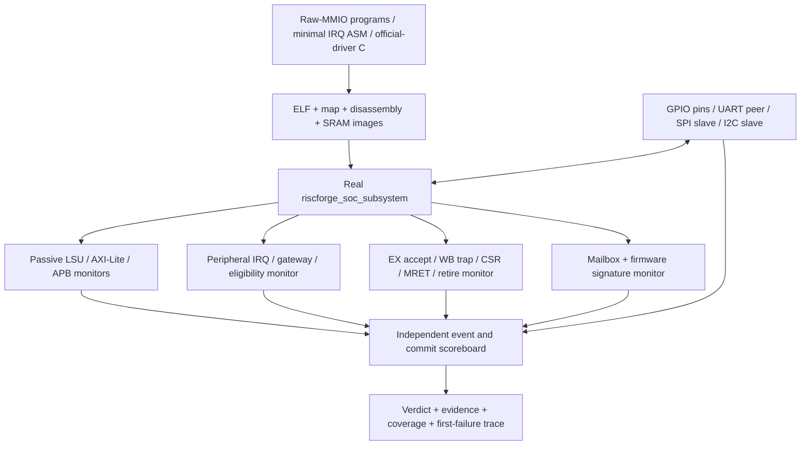
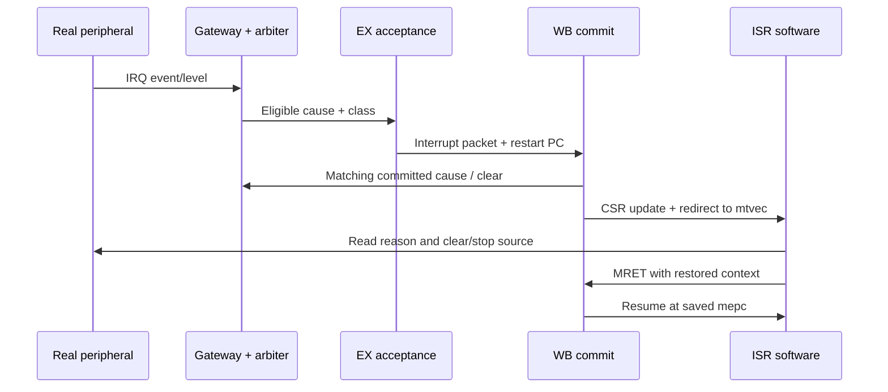

# Peripheral events, interrupt commit, and bare-metal verification plan

Plan ID: IRQ-SOC-20261104 · Revision: proposed v2 · Date: 2026-11-04.

**Status: planning deliverable; implementation, compilation, simulation and closure are not claimed.** This plan specifies a staged implementation for checklist 6.5 and 6.12, with explicitly tagged robustness extensions for 6.13. No DUT, driver, checker, expected-result or workbook changes are authorized by this document alone.

### Engineer ownership and immediate skeleton scope

The engineer owns **test stimuli, peripheral event sequences, firmware test programs, scenario constraints, functional coverage bins/crosses and final coverage expectations**. The immediate proposed delegation is a readable, commented TB skeleton: wiring, passive observation, trace/report plumbing and explicit extension points. It does not implement the test cases or coverage described in sections 5–9. Those remain the engineer's implementation guide.

Each user-owned hook must carry a stable TODO ID, exact plan case reference and the observations the engineer should check. Put timing/mode/constraint decisions in the plan and user notes; do not embed random constraints, event sequences, automatic traffic or covergroups in the skeleton. Clock generation, approved baseline boot/reset/loading and safe pin idle values are environment infrastructure; reset stress, rearm, fault injection, serial responses and peripheral programming are engineer-owned stimulus.

Read [TB_FILE_PLAN.md](TB_FILE_PLAN.md) for the proposed files, ownership and APIs, and [DELEGATION_BRIEFS.md](DELEGATION_BRIEFS.md) for ready-to-send GPT-6 Luna xhigh briefs. These supersede any suggestion below that skeleton agents should implement stimulus, coverage or a complete functional oracle. The existing full verification roadmap remains intact for later engineer-led work. No subagents have been started.

## 1. Recommendation and checklist boundaries

Build one reusable full-SoC verification shell, then prove one Timer0 path through it before expanding. First run short raw-MMIO C/assembly programs and real pin BFMs to expose hardware behavior. Next prove interrupt commit, handler entry and MRET on that same path. Then qualify the drivers stored with each peripheral and use them for the final bare-metal suite. Reuse monitors, external models, test IDs and result records across these stages.

Drivers are useful for programming hardware; they cannot independently prove that the hardware generated an event, routed it correctly, committed the right trap or preserved state. Keep an independent SystemVerilog scoreboard. A firmware PASS is necessary for firmware tests, but is insufficient without observed hardware activity and passing checkers.

| Tag | Required endpoint | Evidence to collect | Boundary |
| --- | --- | --- | --- |
| `[6.5-EVENT]` | Real peripheral event → peripheral IRQ → actual SoC wiring → gateway/controller input | Source and subevent identity, mask behavior, pending state, correct eligible winner and priority | ISR execution is not a prerequisite for the event-path criterion |
| `[COMMIT]` | Eligible request → EX acceptance → WB interrupt commit → CSR/redirect → handler → MRET → resumed work | Precise instruction boundary, cause, PC, side effects, matching clear and handler outcome | Shared infrastructure supporting 6.12 and 6.13 |
| `[6.12-C]` | Bare-metal memory tests, timer/SW/external interrupts, UART/SPI/GPIO loopbacks | Driver/MMIO transactions, external pin results, firmware signature and independent checks | SW/external delivery is currently an architecture gap |
| `[6.13-CORNER]` | Interrupts around load/store/branch/MUL/DIV, and nesting if supported | Ordering, bounded progress, context and resume correctness | Do not require hardware shadow nesting that the current RTL lacks |

The official checklist names VCS for 6.5 and 6.12. Local XSim or Xcelium runs can support development; accepted signoff evidence needs the named tool or an explicit tool disposition. The broader 6.1 UVM/coreless requirement remains a separate obligation: this full-SoC plan does not waive it or claim that C stimulus satisfies it. If that phase requires a no-core integration top, reuse these BFMs, event records and scoreboard through a reviewed bus-master adapter; direct per-IP APB tests alone do not establish integrated routing.

## 2. Baseline facts and unresolved decisions

### 2.1 Source map inspected in the current checkout

The integrated controller is the in-core `irq_gateway` plus `irq_arbiter`; no integrated PLIC or CLINT was established. Gateway index 0 is cause 7; indices 1–12 are causes 16–27. Per-source `mie` and global `mstatus.MIE` qualify requests; `mintprio` filters eligible classes. Class 2 outranks class 1, which outranks class 0. Class 2 fixed order is **7, 22, 24, 26, 20, 21, 23, 25**. Class 1 cyclic order is **19, 18, 27**; class 0 cyclic order is **17, 16**. Round-robin history advances from matching WB commit feedback, not mere observation of a winner.

| Source/test stem | Cause | Class | Gateway input contract | Real stimulus |
| --- | ---: | ---: | --- | --- |
| `T0C0-CMP` | 7 | 2 fixed | Event capture | Timer0 channel 0 reaches nonzero compare |
| `GPIO` | 16 | 0 RR | Rising edge of aggregate IRQ | External GPIO pin event under configured interrupt mode |
| `I2C` | 17 | 0 RR | Level | Real serial command completion/error with interrupt enabled |
| `SPI-THR` | 18 | 1 RR | Event capture | TX FIFO ≤ threshold or RX FIFO ≥ threshold |
| `UART` | 19 | 1 RR | Level | RX data/timeout/error or TX-empty; modem events only if reachable |
| `T0C0-OVF` | 20 | 2 fixed | Event capture | Timer0 channel 0 wraps |
| `T0C1-OVF` | 21 | 2 fixed | Event capture | Timer0 channel 1 wraps |
| `T0C1-CMP` | 22 | 2 fixed | Event capture | Timer0 channel 1 compare |
| `T1C0-OVF` | 23 | 2 fixed | Event capture | Timer1 channel 0 wraps |
| `T1C0-CMP` | 24 | 2 fixed | Event capture | Timer1 channel 0 compare |
| `T1C1-OVF` | 25 | 2 fixed | Event capture | Timer1 channel 1 wraps |
| `T1C1-CMP` | 26 | 2 fixed | Event capture | Timer1 channel 1 compare |
| `SPI-EOT` | 27 | 1 RR | Event capture | Actual SPI transaction completes |

There are 13 controller inputs but more than 13 peripheral subevents. UART error/data/TX reasons and SPI TX/RX threshold reasons must be distinguished even though they share a controller input. GPIO per-pin and event-mode coverage also extends beyond its single aggregate cause.

### 2.2 Decisions that must precede implementation closure

| ID | Decision/evidence needed | Consequence |
| --- | --- | --- |
| `DEC-01` | Pin RTL commit, dirty-source hashes, authoritative filelist, timer copy, UART chain, parameters and compiled modules | A source file existing does not establish the compiled design; UART filelist comments and source structure need reconciliation |
| `DEC-02` | Confirm the source map, class order, gateway modes, threshold semantics and accepted G1 trap specification | Scoreboard expected values come from the approved contract, checked against RTL |
| `DEC-03` | Decide how 6.12 machine software/external interrupts will be delivered | Current SoC ties `sw_irq_i` and `ext_irq_i` low; arbiter services only cause 7 and 16–27. A driver cannot fix this. Add approved architecture or obtain exact item disposition; keep SW/EXT tests BLOCKED |
| `DEC-04` | Confirm GPIO aggregate pulse/level mode against the rising-edge gateway | Two peripheral events without an aggregate low interval can merge; do not expect a new core IRQ for every pin edge |
| `DEC-05` | Audit official drivers against active registers, access widths, reset/clear semantics and available pins | Multiple driver families exist inside individual peripheral folders; select by compatibility, not filename alone |
| `DEC-06` | Approve memory regions, reserved firmware areas, timeout budgets and stress seeds | Destructive March tests cannot overwrite the active stack/mailbox/data or executing code |
| `DEC-07` | Confirm M-only direct trap mode, software nesting policy and precise resume boundary | No assumed shadow stack or always-available vectored mode |

These are review decisions, not new design requirements or permission to silently revise the RTL. Resolve a mismatch as a defect or explicit specification change; never change the checker simply to pass.

## 3. Official-driver integration strategy

User-designated source locations:

| IP | Driver candidates under the IP folder | Qualification focus |
| --- | --- | --- |
| Timer | `ips/apb_timer-master/firmware/{timer.c,timer.h,apb_timer_drv.h}` | Both instances/channels, channel stride, prescaler bit positions, zero compare and count writes |
| GPIO | `ips/gpio-master/firmware/{gpio.c,gpio.h,dif_gpio.c,dif_gpio.h,gpio_hal.h,apb_gpio_drv.h}` | Legacy `gpio.h` uses a different register layout from the parametric GPIO. Audit `dif_gpio` and local APB header too; neither is accepted without a register comparison |
| UART | `ips/apb_uart-main/firmware/{uart.c,uart.h,apb_uart_drv.h}` | Byte versus word MMIO, DLAB aliases, FIFO size from active configuration, IIR/LSR clear rules |
| SPI | `ips/spi_master_ip/firmware/{spi.c,spi.h,apb_spi_drv.h}` | FIFO/length units, thresholds, CS wiring, completion and INTSTA read semantics |
| I2C | `ips/apb_i2c-master/firmware/{i2c.c,i2c.h,apb_i2c_drv.h}` | PRE/control layout, command IACK, RXACK/IF/TIP/AL, open-drain pins |

Original libraries reference `pulpino.h`, base-address macros and sometimes pad-control APIs absent from this SoC. Propose a small project-owned `soc_driver_platform.h` / compatibility header plus thin adapters for instance selection and missing IRQ controls. Preserve upstream files and record any required patch separately. Do not invent pad registers. Driver calls not covering an IRQ mode may use a documented narrow MMIO helper; report that test as helper-based, not full driver API coverage.

Run one polled transaction per driver before IRQ-driven use. Compare observed APB addresses/data and pin behavior with the raw-MMIO baseline. Every polling path has a firmware deadline or at minimum an independent bench watchdog; a hung library call is a FAIL. Candidate legacy GPIO addresses already differ visibly from the active parametric GPIO layout, so simple base relocation is insufficient for that family.

## 4. Testbench architecture

### 4.1 One full-SoC shell, three stimulus modes

Reuse `ips/Verification/infrastructure/tb/soc_tb_top.sv` as the inspected starting point. Audit it before reuse: its IRQ predictor assumes an old hardware shadow stack and assigns cause 27 to class 2; current arbiter puts cause 27 in class 1. Its existing monitors and PASS logic are candidates, not qualified infrastructure for this plan.



| Component | Responsibility | Prohibited shortcut for closure |
| --- | --- | --- |
| Test coordinator | Select manifest/test/seed, reset, peer schedule, deadlines and completion barriers | Ending successfully because a fixed simulation time elapsed |
| ELF loader + reset manager | Bound images to memory, warm preload correctly, check startup; independent cold-boot smoke | Cold-reset clearing a preloaded image without detecting it |
| Minimal firmware | Configure IP by legal MMIO/CSR writes, emit ARM/GO/DONE phases, park or run short code | Directly writing DUT internal peripheral/controller state |
| Official-driver firmware | Polled and IRQ-driven transactions using qualified IP-folder drivers | Treating a software ISR counter alone as delivery proof |
| Pin BFMs | Drive GPIO, UART frames, SPI responses, open-drain I2C ACK/data/stretch; record actual transfers | Forcing peripheral IRQ/controller pending lines for an event-path PASS |
| Read-only bind adapter | Normalize current hierarchy into typed records for peripheral outputs, raw inputs, pending, masks, winner, acceptance, commit and return | Using a DUT winner as the expected winner |
| Event scoreboard | Derive events from peer transactions and separately modeled configuration/counters; compare every path checkpoint | Counting only a raw IRQ toggle as a verified protocol event |
| Commit scoreboard | Check architectural ordering and exactly the permitted clear/CSR/redirect effects | Assuming EX acceptance means the interrupt committed |
| Coverage/reporting | Sample after a check succeeds; emit source/subevent, masks and lifecycle results | Sampling a stimulus as successful coverage before its expected behavior is observed |

Three modes share this shell: `EVENT` uses short raw-MMIO programs and bounded observation windows; `COMMIT` adds minimal handlers and instruction markers; `DRIVER` uses the official C adapters, loopbacks and memory suites. For event isolation, configure before asserting the test stimulus and hold global MIE off while observing raw/pending routing. Enable MIE in a separate observed phase for eligibility/priority. Use single-shot/long-period timer events to avoid unintended repeated commits.

### 4.2 Records and checker ownership

Use a typed event record with `{run_id,test_id,event_id,source,cause,subevent,cycle,phase,observed_configuration,payload}`. Add records for APB completion, peripheral IRQ assertion/deassertion, gateway pending, arbitration winner, EX acceptance, WB commit, gateway clear, CSR snapshot, first ISR instruction, ISR status read, peripheral clear, MRET and resumed program marker. Internal hierarchy access is confined to the read-only adapter so the scoreboard survives renaming.

Build two independent state models: peripheral/event state from observed MMIO and peer traffic; controller state from the approved mapping, capture mode, enable/threshold state and matching committed cause. Use an instruction/retire boundary model for commit ordering. Firmware markers synchronize external stimulus but are not the oracle for an event, winner or trap PC. Account for setup and synchronizer latency; compare signals in defined sampling regions to avoid testbench races.

No one-to-one event→commit assumption: event gateways coalesce while pending; GPIO aggregate edges can merge; level IRQs remain asserted until the peripheral condition clears and may legitimately retrigger. Track event count, pending episodes, accepted packets, committed packets and serviced reasons separately. Require equality only in isolated single-shot cases with a defined clear/rearm sequence. A new event coincident with commit-clear wins in the current event gateway and must remain pending.

### 4.3 Reset, bus and mailbox contracts

- Default development boot: `hard_rst_ni=1`, preload bounded ISRAM/DSRAM images, then a warm soft-reset pulse as supported by the current loader. Verify release and first instruction; use a fresh simulation for independent tests unless reset semantics are specifically under test.
- Keep a cold boot smoke with the real SPI flash model separate from runtime SPI tests. Give runtime SPI slave/flash models explicit CS ownership and switch only after boot relinquishes the controller. No two responders drive the same wire.
- Observe real LSU → AXI-Lite → APB transactions. Link driver setup, enable and clear accesses to completed bus transfers, including wait states. Never invent wait-state behavior for a slave without checking its actual interface.
- Propose a versioned mailbox with magic, test ID, phase, expected activity, error code, signature and DONE sequence; place counters/ISR log in a linker-reserved region. Bench checks ID/version, nonzero expected activity, correct image identity, hardware progress and no scoreboard/assertion errors before accepting DONE.
- Each test has setup, event, trap and total watchdogs appropriate to its protocol. Event deadline comes from programmed timer/baud/SPI/I2C timing plus bounded synchronization/handshake overhead. Trap deadline is conditional on eligibility and specified bounded execution; blocked/stuck level traffic is not assigned an invented universal latency guarantee. Freeze recent bus/IRQ/retire records on first failure.

## 5. Peripheral normal and corner-case test catalog

IDs below are stable proposed test families. Parameter expansion creates individual case IDs in the run manifest. `N` denotes normal behavior; `C` denotes a corner or negative case. All event families run first as `[6.5-EVENT]`; their single-source commit variants add `[COMMIT]`, and qualified driver variants add `[6.12-C]` where applicable. I2C delivery supports 6.5; its driver transaction is supporting scope beyond the explicit UART/SPI/GPIO loopbacks in 6.12.

### 5.1 Timer0 and Timer1 — eight controller inputs

Expand each applicable row across `{T0C0,T0C1,T1C0,T1C1}` and compare/overflow separately.

| ID | Type | Trigger/setup | Independent expected observations |
| --- | --- | --- | --- |
| `EV-TMR-01` | N | Stop; configure nonzero compare; zero count; enable; allow real ticks | Correct channel compare pulse, mapped raw bit, gateway pending, no unrelated bit |
| `EV-TMR-02` | N | With timer stopped, legally write count near `0xffffffff`; choose compare to avoid an earlier match; enable | Real wrap/overflow pulse and correct cause; no backdoor counter deposit |
| `EV-TMR-03` | N | Program two instances/channels concurrently with distinct periods | Correct identity and independent counting; no swapped compare/overflow wiring |
| `EV-TMR-04` | C | Timer disabled with count equal to compare or `0xffffffff` | No IRQ; no unintended counter clear. Exercise the qualified ENABLE behavior in the active timer source |
| `EV-TMR-05` | C | Compare=0; compare=1; count=compare−1/equal/+1 | Zero compare suppresses compare IRQ as coded; equality/tick timing matches approved counter model |
| `EV-TMR-06` | C | Prescaler 0, 1 and 7; enable/stop/write near a matching tick | Boundary timing and APB-write priority follow modeled RTL; count only observed completed writes |
| `EV-TMR-07` | C | Compare=`0xffffffff` and matching count | Simultaneous compare+overflow behavior recorded; both inputs captured if both assert; fixed priority selects compare before corresponding overflow |
| `EV-TMR-08` | C | Single pulse while `mie`/MIE/threshold blocks; then unmask | Pending captured independently of core enable; later eligibility matches source and class |
| `EV-TMR-09` | C | Second event while pending and event coincident with commit clear | Coalescing and capture-wins-clear match gateway model; no invented per-event queue |
| `EV-TMR-10` | C | Reset with pending event; stop/restart after service | Reset removes stale state; restart yields a new correctly mapped event |

For first commit tests, stop the timer in the ISR or use a sufficiently long period, drain any modeled pending event and prove rearm. A running periodic timer may legitimately create another interrupt while the ISR runs.

### 5.2 GPIO — cause 16, aggregated edge gateway

| ID | Type | Trigger/setup | Expected observations |
| --- | --- | --- | --- |
| `EV-GPIO-01` | N | Configure one enabled input for rising edge; BFM drives low→high | Synchronizer/pin event → aggregate IRQ → gateway bit 1/cause 16 |
| `EV-GPIO-02` | N | Falling-edge configuration; BFM high→low | Correct pin status and aggregate transition; no rising-mode false event |
| `EV-GPIO-03` | N | External wiring connects selected output to a distinct input; software toggles output | Actual output transition and input readback; input event/IRQ with correct masks |
| `EV-GPIO-04` | C | Sweep all integrated pins and supported rising/falling/level configurations | Pin identity and enable/mode semantics covered; distinguish supported aggregate mode from gateway contract |
| `EV-GPIO-05` | C | Disabled pin, opposite edge, output/input-enable combinations | No unexpected qualifying event; expected status behavior remains checked |
| `EV-GPIO-06` | C | Two pins transition together; event on pin B while aggregate remains high from A | Model peripheral pending and aggregate edge coalescing; expose a lost/rearm requirement instead of assuming two commits |
| `EV-GPIO-07` | C | Clear W1C/status near a new event; drive low and generate a new edge | Clear-versus-capture rule and rearm; one isolated event yields one service |
| `EV-GPIO-08` | C | Sustained high/low, brief pulse relative to synchronizer, reset while asserted | No false multiple edges; only pulses satisfying specified sampling guarantees must be captured; unsupported widths explicitly scoped |

Qualification must resolve the driver's CFG/pin-mode setup and actual status offsets before using any clear sequence. Do not use the older GPIO register map with this parametric IP.

### 5.3 I2C — cause 17, level gateway

| ID | Type | Trigger/setup | Expected observations |
| --- | --- | --- | --- |
| `EV-I2C-01` | N | Enable controller+IEN; transmit START/address/data to an ACKing slave BFM | Serial command completion/IF → peripheral IRQ level → cause 17 |
| `EV-I2C-02` | N | Slave supplies known read data; issue final NACK/STOP as protocol requires | Correct received byte, IF and interrupt; no fabricated EEPROM echo |
| `EV-I2C-03` | C | IEN=0 with successful command, then enable while IF remains pending | Peripheral output mask and later assertion follow actual IF/IEN semantics |
| `EV-I2C-04` | C | Command IACK clear; retain level through core commit before clearing | Commit clear alone does not clear a peripheral level; no retrigger after real IACK removes condition |
| `EV-I2C-05` | C | Slave NACK; clock stretching; controller disable/reset mid-command | Status/IF/IRQ follow the documented completion/error contract; deadlines account for permitted stretching |
| `EV-I2C-06` | C | Competing open-drain master creates arbitration loss, if interface supports it | AL/status/IRQ checked against documented behavior; otherwise report unsupported subcase |

Validate open-drain output-enable polarity from RTL. The inspected common shell's line assignments are only a starting point; do not trust comments about polarity without checking the IP port contract.

### 5.4 SPI — causes 18 and 27

| ID | Type | Trigger/setup | Expected observations |
| --- | --- | --- | --- |
| `EV-SPI-01` | N | Program TX threshold; fill/drain TX through a real transaction | TX threshold subevent → `events_o[0]` → cause 18; BFM checks actual shifted bytes |
| `EV-SPI-02` | N | Program RX threshold; SPI slave returns known data until FIFO crosses it | RX threshold subevent → same cause 18; FIFO payload matches pin data |
| `EV-SPI-03` | N | Start a legal command/address/data transaction; observe final clock/CS | EOT → `events_o[1]` → cause 27; no premature completion |
| `EV-SPI-04` | N | Driver transmits known stream; external responder returns defined echo/transform | Full duplex/selected transfer mode loopback checks both wire data and C buffer independently |
| `EV-SPI-05` | C | Threshold−1/equal/+1; TX/RX enables independently disabled; both threshold reasons together | Comparator/rearm behavior and shared-output aggregation correct; EOT masking checked only if an actual EOT gate exists |
| `EV-SPI-06` | C | FIFO empty/full, partial final word, length 1 and boundary sizes supported by hardware | No missing/extra bytes; underflow/overflow has defined verdict and no false success |
| `EV-SPI-07` | C | Threshold and EOT overlap; INTSTA read before/after EOT | Both mapped inputs and side-effect ordering checked; reading status cannot erase unobserved evidence |
| `EV-SPI-08` | C | Back-to-back transactions; reset/abort during transfer; repeated threshold without rearm | Correct event count under the peripheral FSM contract and gateway coalescing; bounded recovery |

Only exercise wired chip selects and supported data lines in SoC closure. Wider/QPI or unwired CS cases belong to component scope unless the actual SoC interface supports them.

### 5.5 UART — cause 19, several internal interrupt reasons

| ID | Type | Trigger/setup | Expected observations |
| --- | --- | --- | --- |
| `EV-UART-01` | N | Enable RX-data IRQ; peer transmits known frame(s) | Pin decode, RX FIFO/data-ready, IIR reason, IRQ level and cause 19 agree |
| `EV-UART-02` | N | Queue TX bytes; enable TX-empty IRQ; peer decodes output | Correct bytes/format and TX-empty interrupt/clear behavior |
| `EV-UART-03` | N | FIFO mode, sub-threshold RX data, then prescribed idle interval | Character timeout reason asserted only after configured timeout; clears through defined reads |
| `EV-UART-04` | N | Driver TX→external peer→RX loopback | C TX/RX buffers and independent pin payloads match; IRQ-driven and polled variants |
| `EV-UART-05` | C | IER reasons individually disabled; FIFO threshold−1/equal/+1 | Per-reason masks and cause 19 eligibility correct; no assumption of one IRQ per byte |
| `EV-UART-06` | C | Peer injects parity error, bad stop/framing, break, RX overrun separately | Supported line-status bits, highest internal IIR reason and clear action checked |
| `EV-UART-07` | C | RX, TX-empty and error reasons overlap | UART internal priority checked separately from global controller priority; service next reason after clearing winner |
| `EV-UART-08` | C | DLAB accesses, FIFO reset during pending IRQ, reset mid-frame, back-to-back frames | No alias-induced unintended IER writes; defined clearing/recovery and bounded behavior |
| `EV-UART-09` | C | Modem status transitions | Run only for pins/modes reachable in the selected SoC; tied modem inputs require explicit exclusion or supported loopback mode |

Derive FIFO capacity and internal interrupt priority from the selected UART implementation, not the legacy driver's FIFO-depth constant. Check actual IIR and read/write side effects before fixing expected clear behavior.

## 6. Common masking, priority and lifecycle catalog

| ID | Tag | Normal/corner scenario | Required result |
| --- | --- | --- | --- |
| `IRQ-MASK-01` | 6.5 | Each source singleton with `mie` 0/1, MIE 0/1 and threshold 0..3 | Full 13×2×2×4=208 qualification combinations; raw/pending remain distinct from eligibility |
| `IRQ-MASK-02` | 6.5 | Change each mask/threshold around a real pending event | Eligibility follows architecturally visible mask state; exact CSR-write/accept collision handled in commit tests |
| `IRQ-PRI-01` | 6.5 | All 78 unordered source pairs, with simultaneous controller pending in the observation cycle | Correct class and within-class winner; record actual overlap rather than relying on launch time |
| `IRQ-PRI-02` | 6.5 | All eight class-2 sources pending | Fixed order 7,22,24,26,20,21,23,25; cause map not sorted numerically |
| `IRQ-PRI-03` | 6.5/COMMIT | All class-1 and class-0 contenders; skipped members and repeated commits | Correct cyclic history; no pointer advance on no-commit or unrelated-class commit |
| `IRQ-PRI-04` | 6.13 | Sustained high class plus low class, then remove high | Document strict-priority starvation; lower class progresses once higher class is absent; no invented fairness across classes |
| `IRQ-LIFE-01` | COMMIT | One isolated real source event, source removed/disabled after service | Correct accept, one committed packet, matching clear, handler and MRET; no unintended duplicate |
| `IRQ-LIFE-02` | COMMIT | Masked pending event later unmasked; event during ISR with MIE cleared | No ineligible trap; legitimate pending survives to permitted service |
| `IRQ-LIFE-03` | COMMIT | Level stays high through commit; event pulse coincides with clear | Level remains eligible until peripheral clear; event capture wins clear as modeled |
| `IRQ-LIFE-04` | COMMIT | Reset between event, acceptance, commit, handler and return | State resets at the documented reset domain; no stale trap packet or mailbox success |

Exhaustive 8,192-vector × threshold × RR-state unit regression remains useful. It is separate from the proposed real-peripheral 78-pair integration suite. For sources sharing a timer comparator/overflow condition, schedule legal compare=`0xffffffff` or phase-aligned counts as appropriate; verify the two real pending inputs overlapped. Do not force a pair internally to fill integration coverage. Unreachable combinations need review with a reason, not silent bin deletion.

## 7. Commit pipeline and ISR plan

Current inspected behavior accepts an interrupt in EX, replaces that instruction with an exception packet and commits the trap in WB. The intended restart point is the interrupted instruction, not an unconditional PC+4. Confirm this against G1 and model older retirement explicitly.



| ID | Type/tag | Stimulus | Checks |
| --- | --- | --- | --- |
| `CP-01` | N / COMMIT | One Timer0 event during a labeled instruction sequence | Cause/class/PC transported unchanged; `valid_W && exc_valid_W` qualifies trap; IRQ bit sets mcause[31] |
| `CP-02` | N / COMMIT | Expand singleton commit across 13 sources and required subevents | Correct matching gateway clear, CSR bundle, direct mtvec redirect, observable ISR and MRET |
| `CP-03` | N / 6.12 | Assembly register canaries around C ISR | All interrupted GPR values, SP, memory canaries and return PC preserved; x0 zero; handler frame obeys ABI alignment before C calls |
| `CP-04` | C / 6.13 | Interrupt near ALU dependency, taken branch/JAL/JALR and synchronous exception | Older instruction effects retained; correct exception/IRQ ordering and restart; no wrong-path register/CSR or MMIO effect |
| `CP-05` | C / 6.13 | Event before/during/after delayed load and store | Transaction completes or cancels per approved ordering; no duplicated store/MMIO read side effect on return; response not orphaned |
| `CP-06` | C / 6.13 | Event at MUL/DIV issue, middle and completion; divide-by-zero/overflow | Determine actual acceptance window; no stale MDU write after abort, correct replay/result and bounded completion |
| `CP-07` | C / 6.13 | Older exception/CSR mask write with younger IRQ; new event at MRET | Priority uses specified state/boundary, no younger side effect; correct MIE/MPIE updates |
| `CP-08` | C / 6.13 | ISR drains multiple reasons; optional software-managed nesting | Save/restore mepc/mstatus/mcause and threshold where required; only supported nesting policy tested; no assumed hardware stack |
| `CP-09` | C / COMMIT | Invalid/killed WB packet and unrelated IRQ commit | No false clear, redirect or pointer advance; negative lifecycle checks have nonzero opportunities |

Bench checks `mepc`, `mcause`, `mtval`, applicable mstatus fields, redirect PC, clearing and resumed sequence. GPR/CSR writes for killed instructions are forbidden; older completed effects remain. Detect bus side effects at request/acceptance, not only at WB: a younger MMIO store issuing before an older trap can violate precision even if later register writes are suppressed.

The inspected `tests/bsp/trap_handler.s` allocates a 72-byte frame before a C call. Its stack alignment must be reviewed against the selected ABI before reuse. This is a planning finding; no handler correction was made. Preempted code needs its full live caller-saved context preserved, with callee-saved registers preserved through the ABI. Optional nesting needs additional CSR/context storage and an approved policy.

## 8. Bare-metal 6.12 suite, including memory and loopbacks

| ID | Type | Normal test | Corner/negative extension |
| --- | --- | --- | --- |
| `C-MEM-01` | Memory | March C− on linker-reserved DSRAM scratch region | First/last word, ascending/descending traversal, byte-lane sentinels, verify no neighbor corruption |
| `C-MEM-02` | Memory | Data walking-one and walking-zero patterns across scratch words | All 32 data bits, 0/all-ones and alternating patterns |
| `C-MEM-03` | Memory | Address walking-one/power-of-two alias test plus address-derived patterns | Base/limit and adjacent region guards; exact range and algorithm logged |
| `C-MEM-04` | Memory | Partitioned broader DSRAM campaign after safe relocation | Active code/data/stack/mailbox exclusions enumerated; full-array claim blocked until excluded words are independently covered |
| `C-IRQ-TMR` | IRQ | Official timer driver starts/stops both channels on both instances; ISR records cause | Compare/overflow, disabled/masked/pending/rearm; all eight sources |
| `C-IRQ-SW` | IRQ / BLOCKED | Deliver machine software interrupt via approved software-visible mechanism | Pending set/clear and masking; no current full-SoC claim from a forced core input |
| `C-IRQ-EXT` | IRQ / BLOCKED | Deliver machine external interrupt through approved integrated source/controller | Mask/priority/claim/clear as applicable; keep cause 11 distinct from custom fast causes |
| `C-UART-LB` | Loopback | Official UART driver sends known stream; external peer returns it; C verifies RX | 00/ff/55/aa, burst lengths around actual FIFO boundaries, supported baud/format sweep, malformed frame timeout |
| `C-SPI-LB` | Loopback | Official SPI driver transfers deterministic stream to responder and receives defined response | Length/FIFO boundaries, configured modes supported by IP, EOT/threshold IRQ service, no boot/runtime contention |
| `C-GPIO-LB` | Loopback | Driver writes output pins physically wired by BFM to input pins; reads/checks input | All selected pins, walking bits, simultaneous changes, direction and IRQ masks; avoid driving DUT outputs externally |
| `C-I2C-RW` | Supporting | Official I2C driver writes/reads slave model memory | ACK/NACK, repeated START, bounded stretch and IRQ clear; supports 6.5 and per-IP evidence |

March C− sequence: `⇕(w0); ↑(r0,w1); ↑(r1,w0); ↓(r0,w1); ↓(r1,w0); ⇕(r0)`. Declare element width and exact tested address range. Use volatile accesses and inspect generated code so the compiler cannot remove memory operations. Broad memory claims require explicit address coverage and preserved sentinels, not one final signature alone.

Run memory tests without interrupts first, then an interrupt-enabled scratch test once context preservation passes. Active C stack, data and mailbox cannot be March-tested destructively in place. ISRAM is not established as CPU data-readable through the current LSU map; firmware execution is not a memory March. Define separate loader/readback or relocation coverage for ISRAM if the agreed 6.12 memory scope requires it. Clearly report scratch-region coverage and full-memory gaps.

## 9. Coverage plan and closure rules

Functional targets below are proposed plan acceptance goals, subject to engineer review. No achieved percentage is claimed. Coverage records are retained per stage and source identity; different tools/revisions are not silently merged.

| Coverage model | Required bins / crosses | Sampling / evidence |
| --- | --- | --- |
| `CG_EVENT_PATH` | 13 sources × event/raw/pending/winner checkpoints; source-specific legal subevents | Sample verified checkpoint transitions; include actual observed event ID and mapping |
| `CG_GPIO` | Each integrated pin × supported event mode × enable/disable; aggregate clear/rearm/merge | Check expected pin status and aggregate waveform before sampling |
| `CG_TIMER` | 4 channels × compare/overflow × enabled/disabled; prescaler 0/1/7; compare/count boundaries | Counter oracle and real programmed MMIO; compare=0 exception explicitly represented |
| `CG_SPI` | TX/RX threshold reasons separately; EOT; threshold boundary, FIFO boundary, clear/rearm/overlap | Peer payload plus observed status; source 18 is not a sufficient substitute for both subevents |
| `CG_UART` | RX-data/TX-empty/timeout/error subreasons × enable; supported FIFO/format/clear cases | Decode actual IIR/status and wire frames; unreachable modem bins reviewed |
| `CG_I2C` | Read/write × ACK/NACK; IEN; IACK; supported stretch/AL/reset cases | Monitor command/status plus real SCL/SDA completion |
| `CG_MASK` | 208 source × `mie` × MIE × threshold singleton cases | Correct presence/absence of eligibility observed over bounded window, with expected raw event proven |
| `CG_PRIORITY` | 78 source pairs; 28 class-2 pairs; RR pointer states × subsets × matching/no/other commit | Real integration overlaps separated from exhaustive unit injected-vector bins |
| `CG_COMMIT` | 13 sources × accept/commit/handler/MRET/resume; class; eligible/ineligible; valid/killed packet | Successful independent lifecycle checks only; count coalesced events separately |
| `CG_PIPE_CORNER` | Event timing before/during/after load, store, branch, MUL and DIV; CSR/exception collisions | Boundary trace and side-effect scoreboard; actual accepted phase logged |
| `CG_C_SUITE` | Memory algorithms/ranges/bit positions; driver APIs; loopback payloads and lengths; IRQ types | Firmware signatures + pin/bus evidence + bounds; SW/EXT remain blocked until implemented/dispositioned |

Target 100% of approved mandatory functional bins and all directed case instances, with zero unexpected checker/assertion failures. Exclusions require a reason and review; unsupported functionality remains visible. Plan a deterministic baseline and a proposed 20-seed mixed-event development campaign per enabled stress scenario, recording exact seeds; final stress duration/seed count is an explicit agreement, not a checklist fact. Directed corners precede random stress. Stress alone does not close unhit directed bins.

Collect VCS code coverage for relevant RTL and review unhit lines/branches/toggles; 6.16's SoC code-coverage target is tracked separately. Functional closure for 6.5 or 6.12 is not implied by a global code percentage. Reuse the 13-source unit oracle concepts, but implement integration expected behavior from reviewed specifications rather than copying RTL equations.

Checker qualification is part of the implementation plan: inject a wrong source map, ignored mask, wrong priority, early/duplicate clear, wrong commit PC, stale MDU write, missing pin transaction and false firmware PASS into controlled monitor/scoreboard test fixtures. Each must fail for the intended reason. Such injected failures qualify checkers; they do not count as real peripheral event coverage.

## 10. Stage-by-stage implementation and review deliverables

**Immediate prerequisite:** deliver and review the skeleton milestones K0–K4 in [TB_FILE_PLAN.md](TB_FILE_PLAN.md). The S0–S5 table below describes the subsequent verification campaign; its stimulus/coverage work belongs to the engineer. In particular, Timer0 S1 is the first recommended engineer-written test after the skeleton, not an instruction for skeleton agents to generate that test.

| Stage | Implementation scope | Deliverables | Exit evidence |
| --- | --- | --- | --- |
| `S0 · Contract` | Pin manifest/source identity, select compatible official drivers, freeze IRQ/clear policy, decide SW/EXT and memory scope | `baseline_manifest.json`, `driver_compatibility.md`, `irq_sources.json`, decision list | Source maps and mandatory tests reviewed; blocked items clearly assigned |
| `S1 · One vertical path` | Timer0 C0 compare via raw MMIO; real event monitor; masked routing; minimal ISR; WB and MRET checks | Common shell adapter, Timer0 trigger, lifecycle record/scoreboard, first result bundle | One event traced through all checkpoints, masking negative case, correct cause/PC/clear/resume; checker negative fixture fails |
| `S2 · All event paths` | Expand eight timer, GPIO, I2C, UART and both SPI causes and their legal subevents | `event_*` test families, pin BFMs, event coverage/report and source map | Each real event reaches correct input; mask/priority suite and rearm cases checked; accepted 6.5 tool evidence |
| `S3 · Commit and precision` | All-source lifecycle, context, waits, collisions, MDU and supported nesting policy | Commit/retire scoreboard, ASM canary harness, `commit_*` and corner tests | No false clear/commit/side effect; exact failure traces; robustness gaps retained |
| `S4 · Official-driver C` | Qualify each IP-folder driver, polled transaction then IRQ/loopback, memory tests | Compatibility adapters, bounded test wrappers, ELF/map/disassembly/images, memory and loopback programs | Driver API + bus + pins + signatures agree; requested 6.12 SW/EXT either truly pass or remain explicitly open |
| `S5 · Closure bundle` | Run pinned candidate, directed suite then agreed stress, review coverage and defects | Per-case verdicts, coverage, defect dispositions, reproducibility manifest and concise reviewer report | Mandatory cases/coverage pass on accepted tool; no fabricated gate approval |

S2 and initial S4 driver qualification can proceed per peripheral after S1; final IRQ-driver closure depends on S3. Deliver in small reviews: Timer0 first, then GPIO, UART, SPI, I2C and remaining timer cases. This order gives fast pin and ISR feedback before longer serial scenarios. Coreless component/unit work may proceed in parallel as engineering work, but no delegated agents or functional implementation are started by this plan.

Proposed code locations (future implementation, subject to review):

```text
ips/Verification/
  plans/irq_event_commit/          # approved catalogs and source contract
  infrastructure/irq/             # bind adapter, typed records, event/commit scoreboard, coverage
  infrastructure/vip/             # reviewed extensions to existing pin BFMs
  tests/platform/                 # driver compatibility headers/adapters
  tests/suites/irq_events/         # raw-MMIO singleton and pair programs
  tests/suites/irq_commit/         # minimal handlers + assembly context/collision tests
  tests/suites/baremetal_6_12/     # qualified-driver IRQ/loopback + memory programs
  filelists/                      # separate pinned VCS tops/manifests
  artifacts/irq_event_commit/<run_id>/
```

Reuse existing firmware startup, linker, trap and BFM sources only after their S0/S1 checks. Do not introduce a third unreviewed BSP/driver copy. The existing runner's command line must be inspected before publishing executable run instructions; the paths above specify deliverables, not commands claimed to work today.

## 11. Per-run evidence and failure diagnosis

Retain `manifest.json`, `verdict.json`, `case_results.csv`, `event_trace.jsonl`, `commit_trace.jsonl`, firmware ELF/map/disassembly/image hashes, tool/version and exact commands, stdout/stderr and exit status, protocol/assertion logs, functional/code coverage, focused waveforms and defect links. Record parent RTL commit plus dirty-file hashes; lack of a known baseline prevents current-candidate closure claims. Preserve failed runs and seed identities.

Verdicts: `PASS`, `FAIL`, `BLOCKED`, `NOT_RUN`, `APPROVED_NA` with reason/reference. A compile failure is not a simulation failure; a simulation exit without checked events is not PASS. No result is produced from this planning activity.

Diagnose by first missing checkpoint: no legal programming transfer → firmware/driver/bus; no protocol/timer event → configuration or peer; event without peripheral output → IP/mask; output without correct gateway input → integration; pending without expected winner → enable/priority; winner without acceptance → pipeline/interrupt eligibility; acceptance without commit → packet transport/ordering; commit without correct handler/return → CSR/redirect/ABI/software; correct lifecycle with wrong payload → peripheral/driver data path. Preserve uncertainty until a distinguishing trace resolves it.

## 12. Review presentation and source references

Delivered now: this detailed plan, `TB_FILE_PLAN.md`, `DELEGATION_BRIEFS.md` and `reviewer.html`. These are planning documents only. The immediate proposed implementation is the K0–K4 TB skeleton; the engineer then develops S0/S1 and the subsequent stimulus/coverage campaign.

Relevant inspected sources, relative to this folder:

- [6.5 and 6.12 exact criteria and recorded gaps](../evidence_review_20261102/G6_MISSING_EVIDENCE.md).
- [Actual SoC IRQ mapping](../../../RTL_SOC/riscforge_soc_subsystem.sv), near `fast_irq_i`/`timer_irq_i`.
- [Gateway](../../../riscv_core/rtl/irq_gateway.v), [arbiter](../../../riscv_core/rtl/irq_arbiter.v), [commit controller](../../../riscv_core/rtl/wb_trap_mret_commit_controller.v), [EX stage](../../../riscv_core/rtl/execute_cycle.v).
- [Current shell](../../../Verification/infrastructure/tb/soc_tb_top.sv) and [old integration predictor requiring reconciliation](../../../Verification/infrastructure/checkers/irq_predictor.sv).
- [Retained unit coverage scope](../../../Verification/IRQ_UNIT_COVERAGE_PLAN.md), [verification evidence matrix](../../../Verification/verification_matrix.csv).
- [Official Timer driver folder](../../../apb_timer-master/firmware/), [GPIO](../../../gpio-master/firmware/), [UART](../../../apb_uart-main/firmware/), [SPI](../../../spi_master_ip/firmware/), [I2C](../../../apb_i2c-master/firmware/).
- [Current linker](../../../Verification/tests/bsp/link.ld), [trap entry requiring ABI audit](../../../Verification/tests/bsp/trap_handler.s), [CSR/trap observations](../CSR_and_Trap_Model.md).

No external source or standards-compliance claim is needed for this proposed verification plan. Current behavior statements above come from local source inspection; algorithm, coverage and staged deliverables are proposals for review.
